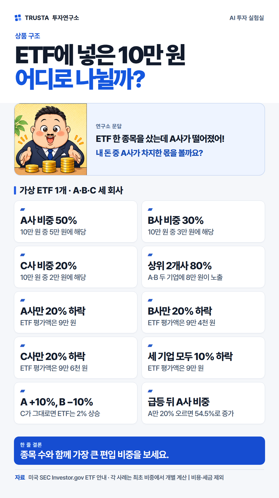
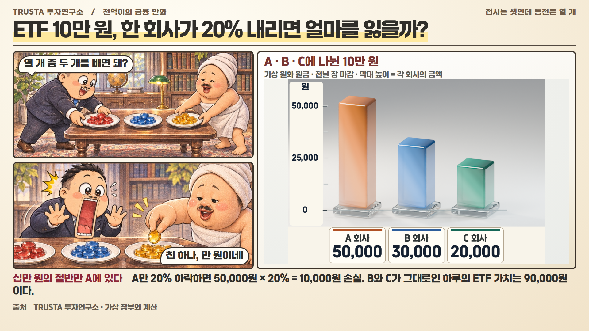
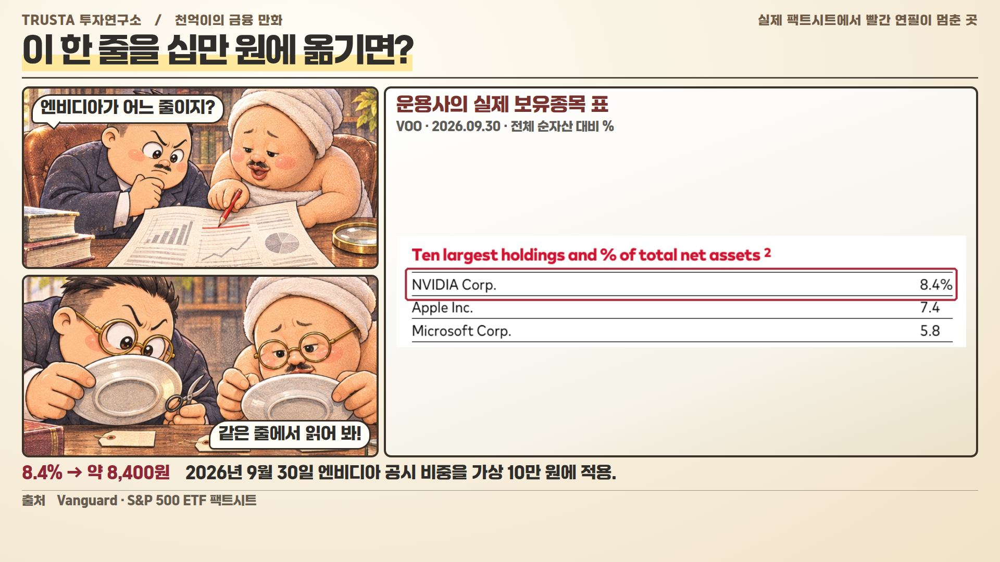

# ETF에 넣은 10만 원 중 한 회사에 걸린 돈은 얼마일까?

## 접시는 셋인데 동전은 열 개

십만 원짜리 바구니에서 가장 큰 회사 주가가 하루에 이십 퍼센트 떨어졌어요. 수건 친구가 제 계산기에서 이만 원을 지웁니다. 제가 만 원을 다시 올려놓지요. “천억아, 너 지금 손실을 깎아 주는 거야?” 깎아 줄 수 있으면 좋겠죠. 그런데 오늘 벌어진 일은 할인하고는 상관이 없습니다. 친구가 곱셈을 시작한 자리가 딱 한 칸 옆이었거든요.

여기서부터는 천억이와 수건 친구가 등장하는 가상 실험입니다. 식탁에 접시 세 개를 놓고 만 원짜리 놀이 칩 열 개를 꺼냈어요. 친구가 세 접시를 제 쪽으로 밀어 줍니다. “딱 세 군데니까 세 개씩 놓으면 되지?” 세 개씩 놓고 나니 칩이 하나 남습니다. 이 친구는 마지막 칩을 어느 접시에 놓을지 고민하는데, 저는 더 앞에서 실수했어요. 애초에 똑같이 나누라는 말이 어디에도 없었거든요.

장부를 펼칩니다. 출발 금액은 원화 십만 원. 전날 장을 마칠 때 가 회사에 오만 원, 나 회사에 삼만 원, 다 회사에 이만 원이 들어 있습니다. 현금과 빚은 없고 이 세 회사 주식만 담습니다. 주식을 사고팔지 않고 분배도 없다고 놓을게요. 세금과 거래비용, 보수는 영 원이고 환율 변화도 없습니다. 이 실험에서는 ETF 한 주의 거래 가격도 안에 든 자산 가치와 같다고 놓습니다. 그래야 딱 한 가지, 가 회사 주가를 움직였을 때 벌어지는 일만 볼 수 있으니까요.

첫 접시엔 칩 다섯 개, 둘째엔 세 개, 셋째엔 두 개를 놓습니다. “잠깐, 가 회사 주식이 다섯 주라는 뜻이야?” 칩 하나를 뒤집어 보입니다. 뒤에 적힌 건 만 원이에요. 한 주 가격이 다른 주식을 같은 자로 재려고 돈으로 바꾼 겁니다. 보유 수량까지 알아야 할 때도 있지만, 가 회사의 몫이 지금 내 돈의 절반이라는 답은 이 식탁만 봐도 나옵니다.

친구가 증권 앱을 연 척 손가락을 한 번 톡 두드립니다. 주문 내역에는 세 회사 이름이 따로 뜰까요? 이 실험에서 산 건 ETF 한 주라서 주문 내역은 한 줄입니다. 그 한 줄 안쪽에 세 접시가 있지요. 식탁 앞에서 친구와 제가 역할을 나눠 봅니다. 저는 펀드가 가진 것을 세고 친구는 자기가 가진 것을 셉니다. 제 장부에는 주식 세 종류가 보이고, 친구 장부에는 펀드 지분이 보입니다. 같은 십만 원을 두 번 더하면 이십만 원이라는 이상한 답이 나옵니다. 장부 두 권이 같은 돈을 서로 다른 자리에서 보고 있기 때문입니다.

제가 접시 위에 가, 나, 다 이름표를 세우자 친구가 달려가 사진을 찍습니다. 그런데 칩은 싹 가려 놓고 이름표만 찍었네요. 그 사진만 건네받은 사람은 무엇까지 알 수 있을까요? 기업이 세 곳이라는 것은 압니다. 첫 회사가 반을 차지하는지는 모릅니다. 친구가 몸을 옆으로 옮겨 칩 높이까지 한 장에 담습니다. 이제야 제목을 붙일 만해졌어요. ‘세 곳에 나뉜 십만 원, 단 다섯 칩이 한 곳에 있다.’

*가상 원금 10만 원. 같은 하루에 한 회사만 20% 내리는 세 가지 경우를 비교한다.*

*가상 원금 10만 원. A만 하루 20% 내리고 B와 C가 그대로일 때의 손실은 1만 원이다.*

## 한 칸을 치우니 비중도 움직였다

수건 친구가 가 회사 접시에만 오늘 이십 퍼센트 하락 쪽지를 얹습니다. 저는 열 개 중 두 개를 치우려다 멈춰요. 쪽지가 붙은 곳은 칩 다섯 개짜리 접시잖아요. 다섯 개의 오 분의 일, 딱 하나만 걷어 냅니다. 가 회사 사만 원, 나 회사 삼만 원, 다 회사 이만 원. 합이 구만 원입니다. 가 회사 때문에 줄어든 만 원은 출발 원금 십만 원의 십 퍼센트예요. 종목의 등락률과 내 돈 전체의 등락률이 식탁에서 서로 다른 자리에 놓입니다.

여기서 친구가 빈 칩 자리를 보고 묻습니다. “그럼 내일도 전체 돈의 절반이 가 회사야?” 계산기 없이 접시부터 세어 봐요. 남은 칩은 아홉, 가 회사 접시에는 넷. 오늘 장이 끝난 뒤 이 회사의 비중은 사를 구로 나눈 약 사십사 점 사사 퍼센트예요. 주식을 한 주도 바꾸지 않았는데 몫이 작아졌습니다. ‘절반’이라는 답에는 반드시 어제 장 마감이라는 시점이 붙어야 했어요.

다음 날 가 회사가 이십 퍼센트 오른다고 해 볼까요? 이제 이십 퍼센트를 곱할 돈은 오늘 접시에 남아 있는 사만 원입니다. 팔천 원이 불어나 총액은 구만 팔천 원. 처음 십만 원으로 돌아가려면 아직 이천 원이 모자랍니다. 반대로 첫날 하락을 그대로 지우려면 사만 원이 다시 오만 원이 되어야 하니 가 회사가 이십오 퍼센트 올라야 해요. 친구가 두 쪽지를 나란히 붙입니다. 왼쪽은 얼마가 움직였지, 오른쪽은 어느 금액에서 시작했지.

방금 일을 거꾸로 해 보겠습니다. 접시를 처음처럼 다섯, 셋, 둘로 되돌리고 이번에는 가 회사 가격이 첫날 이십 퍼센트 오른다고 놓아요. 다른 두 곳은 그대로입니다. 오만 원이 육만 원, 총액은 십일만 원이지요. 그날 저녁 가 회사의 비중은 육만 원을 십일만 원으로 나눈 약 오십사 점 오오 퍼센트입니다. 친구가 오십 퍼센트라고 적어 둔 어제 사진과 오늘 숫자가 달라요. 같은 개수의 주식을 들고 있는 것과 같은 비중으로 들고 있는 것은 이렇게 갈라집니다.

친구가 달력 한 칸을 접더니 이런 수수께끼를 냅니다. “오늘 아침에 오십 퍼센트였고 저녁에는 더 커졌다면, 운용사가 몰래 이 회사를 더 산 걸까?” 오늘은 거래가 아예 없다는 조건을 우리가 붙였잖아요. 그것만으로 판별이 끝납니다. 가격이 달라져서 생긴 결과지요. 반대로 모든 종목 가격이 같은 비율로 움직이면 각 접시의 금액은 달라져도 전체 안에서 차지하는 비율은 유지됩니다. 비중 두 장을 비교해서 거래 내용을 복원하려면 가격 변화와 수량 변화도 함께 알아야 한다는 뜻입니다.

이제 계산기 화면의 숫자가 두 개 남았어요. 아침의 오만 원과 저녁의 사만 원. 과거 하루의 손익을 설명하려면 아침 숫자를 써야 하고, 다음 거래일에 같은 충격이 오면 얼마가 움직일지 물으려면 저녁 숫자에서 시작해야 합니다. 친구가 처음 찍은 사진 파일 이름 뒤에 ‘전날 마감’을 덧붙입니다. 같은 사진이 과거를 설명하는 자료가 될 수도 있고 앞으로의 계산을 틀리게 하는 자료가 될 수도 있으니까요.

| 첫날 움직인 회사 | 출발 노출 | 주가 −20%에 따른 손실 | ETF 기말 가치 |
|---|---:|---:|---:|
| A | 50,000원 | 10,000원 | 90,000원 |
| B | 30,000원 | 6,000원 | 94,000원 |
| C | 20,000원 | 4,000원 | 96,000원 |

## 접시 밑에 숨겨 둔 주식 수

우리가 지금까지 한 가지를 일부러 감춰 놨습니다. 접시 밑에 주식 수와 한 주 가격이 적힌 종이가 있어요. 이제 뒤집어 봅니다. 이 실험 속 작은 펀드가 가 회사 오만 원짜리 한 주, 나 회사 만 원짜리 세 주, 다 회사 이천 원짜리 열 주를 들고 있다고 합시다. 곱하면 다시 오만, 삼만, 이만 원. 총 열네 주가 됩니다. 그런데 주식 수만 보고 가장 많이 담은 회사를 고르면 다 회사가 돼요. 가장 많은 돈이 걸린 곳을 고르면 가 회사입니다. 같은 장부에서 질문의 동사 하나가 바뀌자 두 사람이 다른 접시를 가리킵니다.

제가 가 회사 종이 한 장을 반으로 잘라 두 장으로 만듭니다. 두 장으로 쪼갠 직후의 모형에서 한 장의 값은 이만 오천 원, 두 장이니 합계는 역시 오만 원입니다. 다른 변화가 전혀 없다는 가정 아래 한 주를 둘로 나누는 상황을 흉내 낸 겁니다. 갑자기 주식 수가 하나에서 둘로 늘었는데 전체 십만 원의 절반이라는 답은 그대로지요. 종이 장수만으로 비중을 구하려 하면 아무 돈도 추가하지 않은 이 순간에 투자 비중이 뛰었다고 결론 냅니다. 친구가 가위 대신 저울을 가져오는 이유예요.

이번에는 표의 오른쪽 절반을 가립니다. 회사 이름과 세 회사의 주식 수만 보이고 한 주 가격이 안 보이는 장부예요. 이걸로 원화 기준 편입 비중을 계산해 달라고 하면 어떤 답을 해야 할까요? 주식 수가 가장 많다는 답까지는 낼 수 있습니다. 얼마어치인지는 가격이 한 줄 더 필요합니다. 반쪽 종이를 열고, 수량에 같은 시점의 가격을 곱해서 각 줄을 금액으로 바꾼 다음, 세 줄을 더합니다. 우리가 칩으로 열 개를 만들었던 과정이 종이 위에서는 이렇게 생겼습니다.

친구가 여기서 자기 계좌 화면을 보여 줍니다. “나는 ETF 한 주만 샀는데 그럼 내가 저 회사 한 주를 직접 가진 셈이야?” 이번에는 접시 크기를 바꿔 보지요. 같은 구성의 가상 펀드 전체가 백만 원짜리이고 나눠진 펀드 지분이 열 개라면 한 지분의 가치는 십만 원입니다. 펀드가 보유한 가 회사 주식 총액은 오십만 원이고, 친구 지분 한 개에 해당하는 경제적 노출은 그 십 분의 일인 오만 원이에요. 친구의 주식 주문창에서 가 회사 한 주를 따로 꺼내 매도하는 모습과는 다릅니다. 그가 실제로 거래하는 줄은 여전히 ETF입니다.

친구가 다음 질문을 던집니다. “그럼 내 십만 원이 왜 꼭 이 펀드 안의 오만 원, 삼만 원, 이만 원과 정확히 맞아?” 여기까지는 체결 가격과 지분당 순자산가치가 같다고 정하고 놀았기 때문입니다. 미국 증권거래위원회의 ETF 투자자 안내를 보면 펀드 지분은 장중 시장 가격으로 거래되고 그 가격은 지분당 순자산가치보다 높거나 낮을 수 있습니다. 일상에서는 보유종목 구성에 따른 대략적인 노출을 먼저 구하고, 체결 손익까지 묻는 순간 매수가와 매도가를 따로 펴는 게 순서입니다.

그 차이를 작게 만들어 봅니다. 펀드 한 지분 안의 순자산가치가 십만 원일 때 누군가 시장에서 그 한 지분을 십만 천 원에 샀다고 가정해요. 보유 자산은 그대로고 수수료와 세금도 없어요. 산 직후 펀드 내부의 가 회사 몫은 여전히 한 지분당 오만 원입니다. 지불한 십만 천 원의 절반인 오만 오백 원은 이 뜻과 정확히 일치하지 않지요. 매수할 때 순자산가치보다 천 원 더 지불한 사정까지 펀드 속 주식 수가 따라 바뀌지는 않기 때문입니다. 이 사례에서 그 천 원은 운용사가 가 회사 주식을 더 산 돈으로 적을 수 없습니다.

“그럼 어느 계산기를 써?” 친구가 묻습니다. 펀드 안에서 가 회사의 비중은 얼마인가, 한 지분의 순자산에서 그 회사가 차지하는 금액은 얼마인가, 내가 실제로 사고판 뒤 얼마가 남았는가는 서로 다른 계산이에요. 질문이 첫째면 보유종목 표를, 둘째면 지분당 순자산가치도, 셋째면 체결 내역과 비용까지 펼칩니다. 식탁 위 접시는 세 개였지만 답을 찾는 서랍도 세 개였던 셈이죠. 처음 질문은 첫 번째와 두 번째 서랍만 열면 풀립니다.

미 SEC가 설명하는 장중 시장 가격과 순자산가치의 차이를 확인할 수 있다. [SEC 투자자 안내](https://www.investor.gov/introduction-investing/investing-basics/investment-products/mutual-funds-and-exchange-traded-2)

## 세 회사가 동시에 미끄러지는 날

이번에는 가 회사만 붙잡고 있던 손을 놓습니다. 식탁 아래 한쪽 다리에 얇은 책을 받쳐 뒀다가 그 책을 슬쩍 빼요. 접시 세 장이 같은 방향으로 기웁니다. 칩을 다시 십만 원어치로 맞추고 세 회사가 같은 하루에 모두 십 퍼센트씩 내렸다고 가정합니다. 가 회사에서 오천 원, 나 회사에서 삼천 원, 다 회사에서 이천 원이 줄어요. 모두 합치면 만 원 손실. 아까 가 회사 혼자 이십 퍼센트 떨어졌을 때와 같은 구만 원이 됐습니다.

친구한테 마감 잔액 구만 원이라는 문자 한 줄만 보내 놓고 이유를 맞혀 보라고 합니다. “제일 큰 회사가 사고 쳤지?” 그럴 수도 있지요. 그런데 방금은 세 회사가 나란히 내렸습니다. 마지막 숫자 하나에는 그 경로가 남아 있지 않습니다. 어떤 회사가 하루 손실에 얼마나 기여했는지 알고 싶으면 전날의 비중과 각 회사의 그날 수익률이 필요해요. 공통 원인이 실제로 있었는지까지 말하려면 가격표 말고 다른 증거가 또 필요합니다. 이 이야기에선 식탁을 기울였다는 사건을 우리가 직접 연출했지만, 실제 시장의 가격 세 줄이 같은 방향이라는 사실만으로 원인까지 확정할 수는 없지요.

친구가 이번에는 접시 사이에 종이 칸막이를 세웁니다. “이름을 세 개로 나눴으니 이제는 각자 움직이겠지?” 세 회사가 서로 다른 일을 한다고 놓을 수도 있고, 같은 공장에서 납품받는다고 놓을 수도 있어요. 세 회사가 한 고객의 주문에 의존한다고 상상하면 그 고객이 발주를 미루는 날 세 곳의 사정이 한꺼번에 달라질 수 있습니다. 오직 한 회사에서만 재고가 상한 날은 이야기가 다릅니다. 칸막이는 회사 이름의 경계를 보여 주지만, 어떤 사건이 여러 회사에 같이 닿는지는 보여 주지 못합니다.

이런 이유로 분산을 살필 때 미국 금융산업규제기구의 투자자 안내는 여러 자산에 나누는 것과 자산 종류 안에서 나누는 것을 함께 다룹니다. 접시가 셋일 때도 업종이나 투자 대상, 같이 영향을 받는 조건을 읽어야 한다는 이야기예요. 업종이 다른 두 회사도 어떤 날은 같이 내릴 수 있고, 같은 업종의 두 회사도 실적에 따라 다르게 움직일 수 있습니다. 접시 개수는 첫 질문에 쓸 수 있는 정보이지, 내일 식탁이 얼마나 흔들릴지에 대한 측정값까지는 아닙니다.

그럼 “분산해도 다 같이 떨어질 수 있다” 한 줄만 들고 집에 가면 될까요? 그 결론도 조금 이릅니다. 출발점으로 돌아가서 각 회사가 홀로 이십 퍼센트 하락하는 세 경우를 나란히 놓아요. 가 회사만 내리면 만 원 손실. 나 회사만 내리면 육천 원 손실. 다 회사만 내리면 사천 원 손실입니다. 처음 십만 원에서 남는 금액은 각각 구만 원, 구만 사천 원, 구만 육천 원. 같은 하락률이어도 어떤 접시를 건드렸는지에 따라 내 돈이 움직인 폭은 다릅니다. 세 상황은 서로 다른 실험이니 세 손실을 차례로 더하면 안 돼요.

이번에는 가 회사가 십 퍼센트 오르고, 나 회사가 십 퍼센트 내리고, 다 회사가 그대로라고 합시다. 가 회사가 보탠 돈은 오천 원. 나 회사가 가져간 돈은 삼천 원. 끝내 남은 변화는 플러스 이천 원입니다. 친구가 퍼센트 두 개를 보고 “더하면 영인데?”라고 말해요. 오른 십 퍼센트와 내린 십 퍼센트를 서로 다른 크기의 접시에 적용했잖아요. 두 접시를 같은 크기로 채웠다는 추가 조건이 있어야 원화로도 상쇄됩니다. 수익률 앞에 있는 부호만 보던 친구가 이번에는 분모를 손으로 짚습니다.

제가 친구에게 식탁을 원상 복구해 달라고 했더니 칩 총액만 십만 원으로 맞춰 두고 갑니다. 첫 접시에 여섯, 나머지에 둘씩이에요. 이 상태에서 아까처럼 가 회사가 이십 퍼센트 내리면 만 이천 원이 줄어듭니다. 총액은 같아도 출발 비중이 달라서 다른 실험이 됐어요. 친구가 사진을 다시 찾아 첫 접시의 칩 하나를 둘째 접시로 옮깁니다. 같은 질문에 같은 답을 얻으려면 날짜와 총액에 이어 출발 구성도 맞춰야 합니다.

[FINRA 분산투자 안내](https://www.finra.org/investors/investing/investing-basics/asset-allocation-diversification)

## 취급 주의, 같은 오십 퍼센트라도

수건 친구가 견출지에 커다랗게 오십 퍼센트라고 적어 붙입니다. 어디에 붙였을까요? 가 회사 접시 밑이면 편입 비중입니다. 가 회사 주가의 등락 내역 옆이면 그 회사의 수익률이에요. 전체 ETF 평가액의 변화를 적는 칸에 붙이면 내 펀드 수익률입니다. 숫자와 기호는 똑같고, 읽는 문장은 전부 다릅니다. 오늘 손실 예시에서 가장 큰 접시의 출발 비중 오십 퍼센트에 그 회사의 하루 수익률 마이너스 이십 퍼센트를 곱하면, 펀드의 하루 수익률에 미친 기여는 마이너스 십 퍼센트포인트예요. 다른 두 회사의 기여가 영이므로 펀드의 하루 수익률도 마이너스 십 퍼센트입니다.

기여라는 말이 딱딱하게 들리면 영수증에 줄을 긋는다고 생각해 보세요. 펀드 전체 십만 원을 분모로 통일하고, 각 접시에서 더 생긴 돈이나 줄어든 돈을 한 줄씩 적습니다. 오천 원을 번 줄은 플러스 오 퍼센트포인트, 삼천 원을 잃은 줄은 마이너스 삼 퍼센트포인트. 두 줄을 합쳐 펀드 수익률 플러스 이 퍼센트를 얻습니다. 가 회사의 자체 수익률 십 퍼센트에서 나 회사의 자체 수익률 십 퍼센트를 곧장 빼는 것과 계산 순서가 다르죠. 같은 돈을 분모에 써야 줄별 숫자를 더할 수 있어요.

그런데 친구가 제 공책을 들여다보고 웃습니다. “여기에는 가 회사 위험이 절반이라고 써 놨네?” 처음에는 저도 그렇게 적었어요. 자산가치 절반이 가 회사라는 말은 장부로 확인했지만, 펀드의 모든 위험 중 정확히 절반을 차지한다는 말은 이 장부로 계산하지 않았습니다. 가 회사가 거의 움직이지 않고 작은 두 회사가 크게 오르내리는 경우도 만들 수 있거든요. 어느 시간 동안의 어떤 위험을 잴지, 각 회사의 가격 움직임과 함께 움직인 정도를 무엇으로 추정할지도 정해야 해요. 종이에서 ‘위험’을 지우고 ‘원화 평가액’이라고 고쳐 적습니다.

수건 친구는 반대 방향의 실수를 합니다. “가 회사 위험이 절반은 아닐 수 있으니, 오만 원이라는 숫자도 쓸모없어?” 그건 아닙니다. ‘나머지가 그대로인 하루에 가 회사만 이십 퍼센트 내린다면?’처럼 충격을 분명하게 정해 주면, 이 오만 원이 바로 계산을 시작할 금액이에요. 노출 금액은 정해진 충격의 결과를 계산하는 데 유용하고, 충격이 실제 일어날 확률까지 알려 주지는 않습니다. 그래서 화면에 적을 때에도 ‘이십 퍼센트 내리면’이라고 조건을 붙이고 ‘내일 이십 퍼센트 내린다’고 읽지는 않습니다.

친구가 유성펜으로 ‘상위 두 회사 팔십 퍼센트’에 동그라미를 칩니다. “이제 나머지 이십 퍼센트는 버리고 봐도 돼?” 남은 접시에 든 돈은 이만 원이지요. 다 회사만 절반이 되면 잃는 돈은 만 원입니다. 가 회사가 이십 퍼센트 내릴 때와 같은 금액이에요. 작은 비중은 같은 폭의 충격이라면 영향을 줄이지만, 실제로 어떤 폭의 충격이 오는지까지 작게 정해 주지는 않습니다. 친구는 동그라미 밖에 남은 칩 두 개를 서랍에 넣으려다가 다시 식탁 위에 놓습니다.

여기서 편집부가 만든 질문 하나를 받아 볼게요. “우리 집에서는 가 회사 주식을 이미 따로 갖고 있는데, ETF 장부만 보면 될까요?” ETF에 십만 원, 가 회사 주식에 별도로 이만 원이 있고 출발 가격과 다른 조건은 그대로라고 가정합니다. ETF를 통한 오만 원과 직접 보유한 이만 원을 합쳐 칠만 원이 가 회사 가격에 연결됩니다. 계좌 전체 십이만 원 중 약 오십팔 점 삼삼 퍼센트입니다. 펀드 자체의 편입 비중 오십 퍼센트는 그대로인데 내 계좌의 비중은 커졌어요.

현금 이만 원으로 조건 하나만 바꿔 볼까요? 계좌 총액은 똑같이 십이만 원이지만 가 회사에 연결되는 돈은 오만 원뿐입니다. 내 계좌 전체에서 약 사십일 점 육칠 퍼센트. 펀드 이름도, 펀드를 산 금액도, 계좌 총액도 똑같습니다. 옆 서랍에 넣어 둔 것이 같은 회사 주식인지 현금인지에 따라 답이 달라졌습니다. 친구가 이제 장부 겉장에 ‘펀드 안’과 ‘내 계좌 전체’를 따로 씁니다. 다섯 칩을 보면서 서로 다른 답을 낼 때, 누가 틀렸는지 따지기 전에 어디까지 더했는지부터 물어볼 수 있게 됐어요.

## 실제 팩트시트에서 빨간 연필이 멈춘 곳

이제 가상의 식탁을 치울 시간인데 수건 친구가 칩 하나를 몰래 소매 속에 넣어 둡니다. “진짜 자료를 펼치면 어디에 놓을지 보자.” 이번에는 뱅가드가 공시한 미국 상장 ETF, 브이 오 오의 팩트시트를 폅니다. 그날 실제 비중과 지금부터 우리가 덧붙여 볼 가상 투자금은 구분해서 읽겠습니다. 자료에 인쇄된 기준일은 이천이십육 년 구월 삼십일입니다. 다른 날짜의 순위를 맞히는 자료로 쓰지 않고, 그날 장부를 읽는 연습으로 씁니다.

친구가 첫 페이지에서 먼저 발견한 숫자는 펀드 이름에 들어간 오백입니다. “십만 원을 오백으로 나누면 하나에 이백 원?” 출발은 좋습니다. 그 계산이 맞으려면 오백 곳에 같은 금액이 들어 있다는 조건이 하나 더 필요해요. 이 펀드는 에스앤피 오백 지수의 성과를 따라가려 합니다. 같은 돈을 배분하는지 궁금하면 이름의 숫자로 추측하지 말고 실제 보유 비중이 있는 표를 봐야 합니다. 제 빨간 연필은 두 번째 페이지로 넘어갑니다.

작은 영어 글씨를 따라가 볼게요. 텐 라지스트 홀딩스. 규모가 큰 보유 항목 열 개입니다. 그 옆의 퍼센트 오브 토털 넷 애셋츠는 펀드 순자산 전체에서 차지하는 비율이에요. 두 덩어리를 한꺼번에 읽어야 합니다. 열 개를 소개했다는 말은 행 수를 설명하고, 전체 순자산이라는 말은 각 퍼센트의 분모를 설명해요. 상위 열 줄만 보인다고 그 열 줄끼리 합해서 백이 되도록 나눈 숫자는 아닙니다. 친구가 열 줄 아래 작은 합계 칸을 찾아서 연필 끝으로 톡 두드립니다. 그 칸에는 백보다 작은 숫자가 찍혀 있지요.

엔비디아 줄에는 팔 점 사 퍼센트가 인쇄돼 있습니다. 이 비율이 측정값입니다. 이제 우리가 덧붙이는 실험은 그날 펀드 순자산과 같은 구성으로 원화 십만 원을 나눈다는 가정입니다. 원화로 평가한 기준 금액을 십만 원으로 놓고 환율, 세금, 매매비용, 분배와 시장 가격의 차이를 모두 고정할게요. 그 십만 원 가운데 엔비디아에 해당하는 근삿값은 팔천사백 원입니다. 미국에서 그 주식을 팔천사백 원에 한 주 살 수 있다는 뜻일까요? 한 주 가격을 계산한 적이 없습니다. 십만 원짜리 모형 안에서 그 기업 줄에 이름을 붙인 금액이에요.

자료 아래쪽에는 상위 열 곳 합계가 사십 점 육 퍼센트라고 적혀 있습니다. 같은 가상 원금이라면 사만 육백 원 정도입니다. 친구가 자를 대고 맨 위 줄부터 아래로 훑습니다. “엔비디아 팔천사백 원에 이 사만 육백 원을 또 더하면 되나?” 첫째 줄이 이미 열 줄 합계 안에 있잖아요. 다시 더하면 엔비디아를 두 번 세게 됩니다. 상위 열 곳 가운데 첫째 줄을 빼고 나머지 아홉 곳의 대략적인 몫을 보고 싶다면, 공표한 두 비율의 차이를 구해야 해요. 사십 점 육에서 팔 점 사를 뺀 삼십이 점 이 퍼센트, 우리 모형에서 약 삼만 이천이백 원입니다. 반올림해 표시된 숫자들의 차이라는 점도 그대로 따라갑니다.

친구는 그 열 줄을 진짜로 더해 봅니다. 우리가 펼친 표에 보이는 한 자리 소수 열 개를 더하면 사십 점 오 퍼센트가 됩니다. 그런데 운용사가 따로 표시한 합계는 사십 점 육이에요. 누가 더하기를 틀린 걸까요? 소수 한 자리까지 표시된 개별 값에는 더 작은 자릿수가 보이지 않습니다. 각각 표시된 숫자의 합과 별도로 공시된 합계 사이에는 이런 차이가 날 수 있어요. 그 숨은 자릿수는 이 종이에서 우리가 확인할 수 없어요. 그래서 이 글에서 열 곳의 몫을 읽을 때는 공시된 합계를 사용하고, 소수 둘째 자리 이하의 정확한 구성은 추정해서 채우지 않습니다.

실제 숫자를 가져왔으니 아주 작은 가상 충격도 시험해 볼 수 있습니다. 엔비디아만 하루 십 퍼센트 내리고 다른 자산과 환율이 그대로라면 십만 원 모형에서 그 줄은 약 팔백사십 원 줄어듭니다. 펀드 전체 기준 약 영 점 팔사 퍼센트예요. 이건 구월 삼십일 이후에 팔백사십 원을 잃었다는 실측 결과가 아닙니다. 공시에서 확인한 것은 출발 비율이고, 십 퍼센트 하락은 우리가 가정한 사건이에요. 화면에는 날짜를 비중 옆에, ‘가상 하루’를 손실 옆에 따로 씁니다. 같은 계산기에 넣더라도 두 숫자의 출신이 다르니까요.

그제야 친구가 소매 속 칩을 꺼냅니다. 만 원짜리 칩 하나로는 팔천사백 원을 정확히 표시할 수가 없네요. “그럼 반올림해서 첫 접시에 만 원 놓을까?” 저는 대신 작은 종이에 팔천사백 원이라고 적어 칩 밑에 둡니다. 장난감의 눈금 때문에 자료를 더 거칠게 바꿀 필요는 없어요. 유리 막대에는 같은 기준선을 쓰고, 꼭대기 옆에는 원래 표의 팔 점 사라는 글씨를 그대로 남깁니다. 잘 만든 그림은 가까이 들여다볼 때 어느 값으로 돌아가야 할지도 알려 줍니다.

**공시와 계산**　2026년 9월 30일 VOO의 엔비디아 비중은 8.4%, 상위 10개 합계는 40.6%다. 원화 100,000원 × 0.084 = 약 8,400원. 단위를 맞춘 설명용 환산이며 기준일 이후의 수익률은 가정하지 않았다. [Vanguard VOO 팩트시트 2쪽](https://institutional.vanguard.com/iippdf/pdfs/FS0968R.pdf)

*2026년 9월 30일 VOO의 엔비디아 비중은 8.4%. 가상 원금과 실제 관측 비중을 따로 읽는다.*

## 어제 사진을 오늘 식탁에 대 봤더니

친구가 공시 날짜에 빨간 동그라미를 친 채 사진을 휴대전화 배경으로 설정합니다. “좋아, 이제 오늘도 팔 점 사네.” 바로 그때 처음 접시 얘기가 돌아옵니다. 우리는 거래를 하나도 안 했는데도 가 회사가 오십 퍼센트에서 사십사 점 사사 퍼센트로 바뀌는 걸 봤지요. 구월 말 자료를 나중에 열었다는 사실은 그 자료가 오늘의 장부로 변했다는 증거가 아닙니다. 자료를 확인한 날, 자료가 관측한 날, 내가 계산을 적용하려는 날을 일치시킬 수 있는지 먼저 살펴야 해요.

날짜 하나가 실제로 계산을 얼마나 바꿀 수 있는지, 가상 접시로 돌아가서 보겠습니다. 첫날 가 회사만 이십 퍼센트 내려 저녁 총액 구만 원이 된 데서 이야기를 잇습니다. 둘째 날 가 회사가 다시 십 퍼센트 내리고 나와 다는 그대로라면, 출발점은 가 회사 사만 원입니다. 사천 원이 줄어 총액은 팔만 육천 원이 돼요. 둘째 날 ETF 수익률은 사천 원을 전날의 구만 원으로 나눈 약 마이너스 사 점 사사 퍼센트입니다. 첫날 사진에서 오십 퍼센트를 그대로 가져와 둘째 날 하락률 십 퍼센트에 곱하면 마이너스 오 퍼센트라고 잘못 적게 되죠.

그런데 첫날 저녁에 누군가 접시를 원래 목표대로 다시 맞췄다면 어떻게 될까요? 같은 구만 원, 같은 세 회사, 다음 날의 주가 변화도 방금과 같습니다. 달라지는 조건은 오직 저녁의 재조정 한 번뿐이에요. 거래비용과 세금은 여전히 영 원이고 소수 단위로도 매매할 수 있다고 놓습니다. 목표가 오십, 삼십, 이십 퍼센트라면 구만 원을 사만 오천 원, 이만 칠천 원, 만 팔천 원으로 다시 나눕니다. 가 회사는 오천 원을 더 사고, 나 회사에서 삼천 원, 다 회사에서 이천 원을 덜어 오죠. 누군가 새 돈을 넣었다고 적을 필요는 없습니다. 판 안에서 자리를 바꾼 겁니다.

이후 가 회사가 십 퍼센트 더 내리면 사만 오천 원의 십 퍼센트, 사천오백 원이 줄어 총액은 팔만 오천오백 원입니다. 아까와 오백 원 차이가 나지요. 반대로 둘째 날 가 회사가 십 퍼센트 오른다면 재조정한 식탁에는 구만 사천오백 원, 그대로 둔 식탁에는 구만 사천 원이 남습니다. 어느 장부가 더 컸는지는 둘째 날 방향에 따라 뒤집힙니다. 이 비교에서 재조정을 하면 수익이 더 크다는 규칙을 꺼낼 수는 없어요. 하나의 목표 비중을 유지하는 일과 가만히 보유한 결과로 비중이 떠다니는 일을 구분하려는 실험입니다.

친구가 오백 원짜리 동전 하나를 두 장부 사이에 세워 둡니다. “나중에 팔만 오천오백 원이 찍혔다면 무조건 재조정한 거네?” 우리가 방금 다른 변수를 모두 묶어 둔 두 실험 안에서는 그렇습니다. 현실 계좌에는 보수, 체결 가격, 현금 유출입, 분배금 지급, 환율 같은 다른 변화도 들어올 수 있어요. 나중의 잔액 하나만 받았다면 그중 무엇이 원인이었는지 재현할 정보가 충분한지부터 따져야 합니다. 처음에 구만 원만 보고 가 회사 하나의 사고라고 단정한 실수와 같은 종류예요.

친구가 봉투를 하나 더 꺼냅니다. “분배금을 내 통장으로 받으면 접시에 있어야 할 돈이 어디론가 사라진 거야?” 여기서는 별도 가정으로, 지분 가치가 만 원이고 다른 시장 변화나 세금·비용 없이 오백 원을 현금으로 지급해 그만큼 지분 가치가 조정된 경우를 만들게요. 지급 뒤 지분 가치 구천오백 원과 받은 현금 오백 원을 합하면 만 원입니다. 그 현금을 다시 투자하지 않으면 다음 날의 가격 변화가 미치는 지분 금액은 구천오백 원이고, 받은 현금은 현금 서랍에 있어요. 우리 첫 실험이 분배 없음이라고 시작한 이유입니다. 지급을 포함하는 자료에서 지분 가격만 떼어 보면 돈을 어느 서랍에 넣었는지 놓치기 쉽습니다.

계좌에 돈을 더 넣은 경우도 잠깐 갈라 둡시다. 총액 구만 원인 날 친구가 새 현금 만 원을 넣으면 계좌가 다시 십만 원이 됩니다. 처음과 끝의 금액이 같다는 이유로 원금이 저절로 회복됐다고 하면 친구 주머니에서 나온 만 원을 빼먹는 셈이에요. 추가 현금을 가 회사에 넣는 경우와 서랍에 그대로 두는 경우는 다음 날의 가 회사 노출도 다릅니다. 주식 비중을 추적할 때 입출금 내역을 찾는 일이 고리타분해 보여도, 무슨 돈을 분모에 넣었는지 설명해 주는 영수증이 바로 이 내역입니다.

## 빈 접시 하나를 들고 집에 간 이유

식탁에 어느새 접시 네 개가 놓였습니다. 넷째는 비어 있어요. 처음 봤다면 ‘네 회사에 분산했구나’ 하고 찍었겠지요. 이제 친구는 빈 접시를 들고 뒤집어 봅니다. “여기에는 기준일을 적어 두려고.” 원고를 읽던 분이 작은 ETF 한 줄을 가족에게 설명해 달라고 부탁했다고 해 볼게요. 내가 산 금액, 어느 회사의 비중인지, 그 비중을 측정한 시점. 이 세 말을 같은 문장 안에 넣을 수 있으면 우리가 오늘 한 일을 집에서도 다시 할 수 있습니다.

저라면 검색창에 갖고 있는 ETF의 정확한 종목 기호나 이름을 넣고 운용사 상품 페이지에서 보유종목 또는 구성 종목 항목을 찾겠습니다. 영어 화면에서는 홀딩스라는 말이 나올 수 있지요. 파일을 열면 맨 먼저 그 안의 기준일을 읽어요. 파일 이름에 붙은 다운로드 날짜와 안쪽의 기준일이 다르면 안쪽의 기준일을 적습니다. 헤더에 쓰인 수치가 주식 수인지, 자산 대비 비중인지도 따로 확인합니다. 수량을 나열한 열만 보인다면 퍼센트가 적힌 열을 찾거나 어떤 가격으로 금액을 환산해야 하는지 살펴봅니다.

오늘 우리가 실제로 펼친 팩트시트에서 한 줄만 가져와 볼게요. 이천이십육 년 구월 말, 이 자료가 표시한 엔비디아 비중은 팔 점 사 퍼센트. 그날의 펀드 순자산 구성을 원화 십만 원에 적용한다는 가정 아래 엔비디아 몫은 약 팔천사백 원. 재투자나 매도 뒤 실제 수익을 묻는 문장이 아니라, 그날 기준 어느 기업에 얼마가 연결됐는지 묻는 문장입니다. 이것을 이웃에게 글로 건넬 때는 실측 비중과 가상 투자금 옆에 각각 꼬리표를 붙입니다. 종목명만 남기고 기준일을 자른 사진보다는 조금 길지만, 나중에 같은 표를 찾아갈 길이 남습니다.

공시를 읽다 보면 어느 회사가 표에 보이지 않을 때도 있어요. 친구는 셋째 접시를 치우려다가 한번 더 묻습니다. “이게 모든 보유종목을 담은 표야, 아니면 상위 몇 곳만 뽑은 표야?” 오늘 본 페이지는 규모가 큰 열 곳을 보여 줬습니다. 거기 없다는 사실로 펀드가 그 기업을 전혀 보유하지 않는다고 결론 내릴 수는 없어요. 전체 종목을 확인하려면 같은 기준일의 더 상세한 보유 내역을 찾아야 합니다. 상세 내역을 확보하지 못했다면 빈칸에 ‘상위 열 곳에서는 확인되지 않음’이라고 쓰면 됩니다. 빈칸을 영으로 채우면 후속 계산은 쉬워지지만 답은 바뀌어 버려요.

마지막으로 친구가 작은 시험을 냅니다. 종이에는 ‘가 회사 십 퍼센트 하락’만 적혀 있어요. “그래서 우리 집에서는 얼마가 줄어?” 저는 계산기를 열지 않습니다. 어제 십만 원짜리 펀드 안의 오만 원만 있던 집인지, 가 회사 주식 이만 원을 따로 들고 있던 집인지부터 물어봐야 하니까요. 첫 집에서 가 회사만 십 퍼센트 내리면 오천 원 손실. 둘째 집에서는 가 회사 몫이 칠만 원이라 칠천 원 손실입니다. 여기에 다른 두 회사나 환율까지 움직였다고 하면 그 변화는 별도의 줄에 적습니다. 가장 빠른 계산은 곱셈 버튼을 먼저 누르는 것이 아니라 곱할 자리를 정확히 찾아 두는 일이었어요.

“그럼 우리 처음 문제, 답이 뭐였지?” 수건 친구가 일부러 이만 원짜리 쪽지를 흔듭니다. 저는 빈 접시를 원래 자리에 놓고 다섯 칩 가운데 하나만 집어 듭니다. 원금 십만 원 가운데 가 회사에 연결된 오만 원. 그 회사만 하루 이십 퍼센트 하락하고 다른 조건은 그대로. 이 두 문장이 있을 때 줄어드는 돈은 만 원입니다. 첫 접시가 삼만 원이었다면 같은 하락률에도 육천 원입니다. 숫자 한 줄만 외운 사람과 접시를 한 번 움직여 본 사람이 다음 사례에서 다르게 답하는 순간이지요.

오늘 해 볼 일은 하나입니다. 실제로 궁금한 ETF 한 개의 운용사 자료를 열어, 보유 비중 한 줄을 기준일과 함께 적고 가상 십만 원에 곱해 보세요. 맨 아래에는 ‘펀드 안에서 이 기업에 해당하는 금액’이라고 쓰면 됩니다. 종이 한 장, 식탁 한 모퉁이면 충분해요. 나중에 다른 ETF까지 겹쳐 들었는지 알아보고 싶어질 때, 그 종이가 두 번째 장부의 첫 줄이 됩니다. 수건 친구가 치우려던 빈 접시를 하나 남겨 둡니다. 다음 숫자가 어느 날의 어떤 돈인지 먼저 적어 놓을 자리예요.

**원문**　[미 SEC의 ETF 구조 안내](https://www.investor.gov/introduction-investing/investing-basics/investment-products/mutual-funds-and-exchange-traded-2) · [미 SEC의 펀드 거래방식 비교](https://www.investor.gov/introduction-investing/general-resources/news-alerts/alerts-bulletins/characteristics-mutual-funds-exchange-traded-funds) · [FINRA 분산투자 안내](https://www.finra.org/investors/investing/investing-basics/asset-allocation-diversification) · [Vanguard VOO 팩트시트](https://institutional.vanguard.com/iippdf/pdfs/FS0968R.pdf)

**이어 읽기**　[한 상품의 두 분류](EP002.md) · [두 ETF에서 같은 회사가 겹칠 때](FAQ01.md) · [전자책 목차](목차.md)
