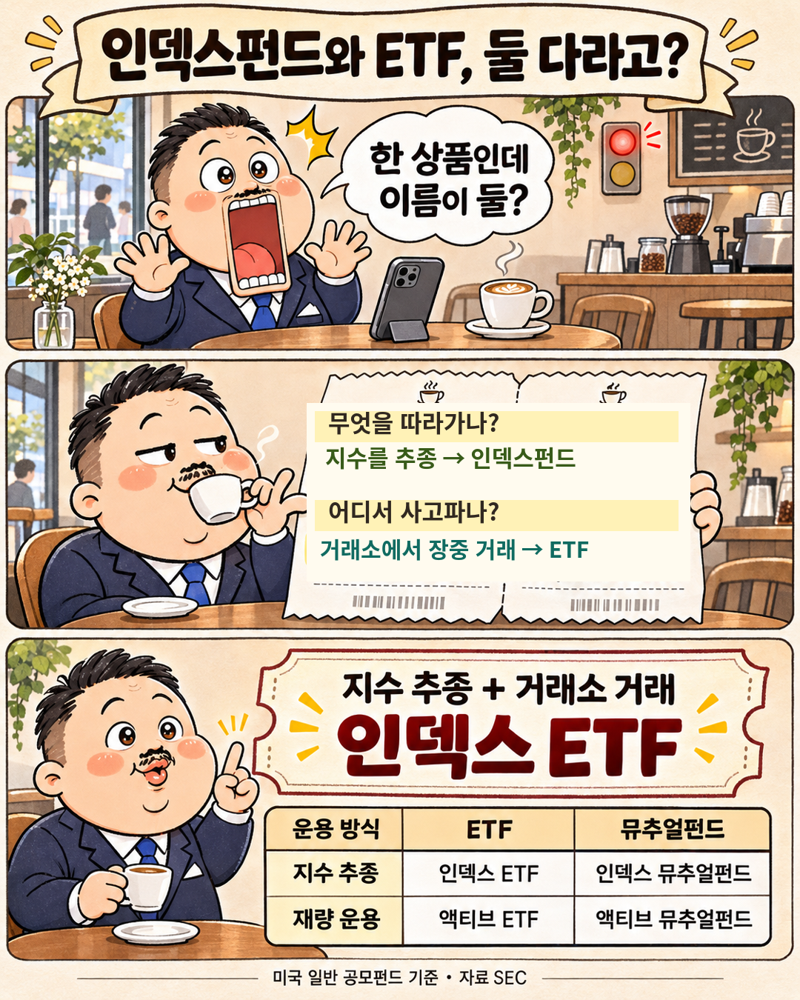
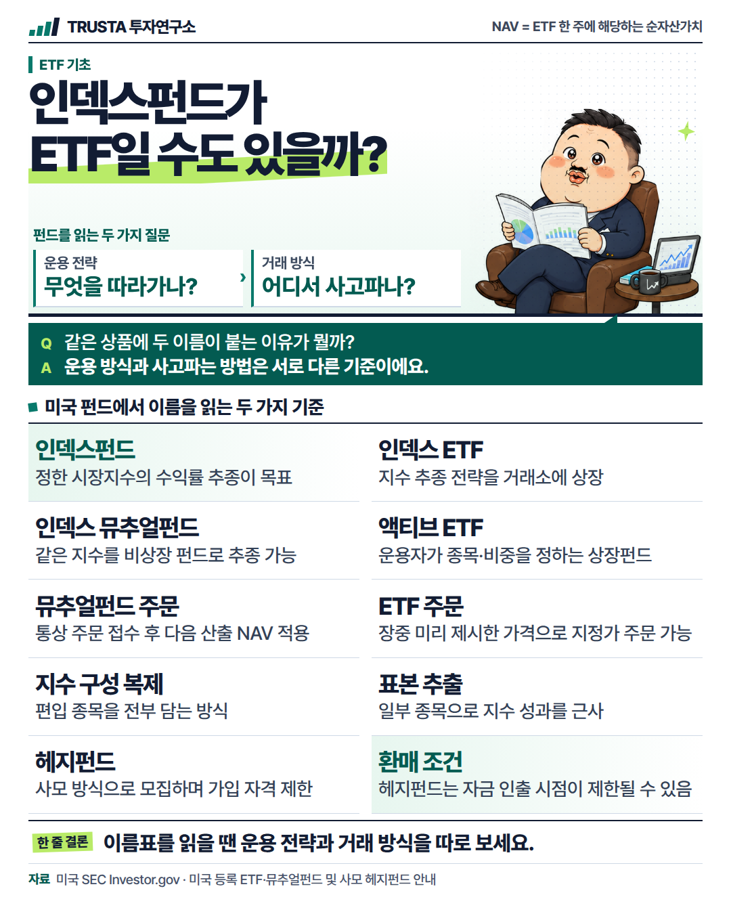

# 인덱스펀드와 ETF, 한 상품에 이름이 둘인 이유

*천억이와 지우는 가상의 인물입니다. 대화와 Q&A는 편집부가 만든 질문입니다.*

천억이가 카페에서 영수증 한 장을 뒤집습니다. 친구 지우가 그 위에 인덱스펀드와 ETF를 나란히 쓰더니, 둘 중 하나에 동그라미를 쳐 달래요. 그런데 휴대폰 속 상품에는 두 이름이 다 붙어 있습니다. 지우가 묻죠. 나 지금 펀드를 두 개 사는 거야?

천억이가 커피잔을 내려놓고 영수증을 세로로 접습니다. 왼쪽엔 무엇을 따라가나, 오른쪽엔 어디서 어떻게 사나. 이제 상품 하나를 양쪽에서 읽어 보자는 거예요.

**그림 Q&A · 편집부가 만든 질문**　표에서 거래소 거래는 그대로 두고 운용자에게 종목 선택을 맡기면 어느 칸일까요? ETF 열을 따라 한 칸 내려간 ‘액티브 ETF’입니다.

## 영수증을 반으로 접은 이유

먼저 왼쪽입니다. 지수는 정해진 규칙대로 여러 종목의 움직임을 하나의 숫자로 나타낼 수 있어요. 인덱스펀드는 선택한 지수의 성과를 따라가도록 운용합니다. 지수에 든 종목을 전부 담기도 하고, 대표 표본을 골라 비슷하게 따라가기도 해요. 비용도 있어서 실제 수익률은 지수와 조금 벌어질 수 있습니다.

이번엔 오른쪽입니다. ETF의 영어 이름을 풀면 거래소에서 거래되는 펀드예요. 개인 투자자는 주식처럼 장중에 주문을 내고, 주문이 맞으면 시장가격에 지분을 삽니다. 이 이름으로는 펀드 안에 무슨 종목을 담을지까지 알 수 없어요.

지우가 영수증의 두 칸을 채웁니다. 왼쪽에는 지수를 따라간다. 오른쪽에는 거래소에서 산다. 두 칸을 다 만족하는 게 바로 인덱스 ETF예요. 커피 한 잔에 아이스와 테이크아웃을 함께 표시할 수 있는 것처럼요.

그럼 모든 ETF가 인덱스펀드일까요? 천억이는 액티브 ETF라는 메모를 같은 종이 위에 놓습니다. 거래소에서 사는 건 그대로지만, 운용자가 정해진 전략 안에서 종목이나 비중을 선택합니다. 성과를 비교할 지수가 적혀 있어도 그 지수를 그대로 따라가는 게 목표인지는 투자목표를 읽어 봐야 해요.

반대쪽 조합도 가능합니다. 미국의 일반적인 개방형 뮤추얼펀드도 지수를 따라갈 수 있어요. 다만 주문을 유효하게 접수한 다음 계산하는 한 주당 순자산가치로 거래합니다. 쉽게 말해 펀드의 자산에서 빚을 빼고 전체 지분 수로 나눈 값이죠. 앱으로 주문했다는 사실만으로 거래소에서 샀다고 판단하면 안 됩니다.

## 오전 100달러, 마감 98달러

지우가 말합니다. 그럼 아침에 가격을 보고 사는 쪽이 더 싸겠네. 이번에는 하루만 계산해 볼게요. 미국 달러 천 달러씩을 아침에 한 번 넣습니다. 추가 납입과 인출은 없고, 세금과 비용은 영, 분배금도 없어 재투자할 돈도 없어요. 연율을 쓰지 않는 하루짜리 가정입니다.

같은 주식 바구니를 담은 두 상품이 있다고 해 보죠. 아침에 ETF를 백 달러에 열 주 샀습니다. 저녁에 시장가격과 한 주당 순자산가치가 모두 98달러가 되면, 열 주의 평가액은 980달러예요. 처음 돈보다 이십 달러 줄었죠.

같은 날 아침에 뮤추얼펀드로 천 달러 금액 주문을 냈다면 어떨까요. 마감 전에 유효하게 접수됐고 다음 기준가격이 98달러라면, 소수 지분을 허용할 때 약 10.2041지분을 받습니다. 이 사람은 98달러에서 출발해요. 아침부터 보유했던 사람과 투자 시간이 달랐던 겁니다.

결말을 뒤집어 보죠. 저녁 가격이 102달러로 올랐다면 아침에 산 열 주는 1,020달러예요. 뮤추얼펀드 주문자는 천 달러를 102달러로 나눈 약 9.8039지분부터 시작합니다. 장중 주문은 거래할 때를 선택할 수 있게 해 줍니다. 어느 쪽이 더 싸게 살지는 그날의 가격을 미리 알아야 답할 수 있어요.

## 가격표를 한 번 더 읽을 때

지우가 거래 화면을 다시 보니 가격이 두 줄입니다. 사려는 사람이 낸 최고 가격이 구십구 달러 구십 센트, 팔려는 사람이 부른 최저 가격이 백 달러 십 센트예요. 호가와 물량이 그대로일 때 한 주를 즉시 사고 바로 팔면 이십 센트가 줄죠. 수수료가 영이어도 생길 수 있는 차이입니다.

그렇다면 헤지펀드는 어느 칸에 쓸까요? 천억이는 새 메모지를 꺼냅니다. 미국의 사모 헤지펀드를 볼 때는 누가 가입할 수 있는지, 언제 환매할 수 있는지, 성과보수 약정이 있는지를 따로 살펴야 합니다. 이름에 헤지가 들어가도 손실을 막아 준다는 보장은 없어요.

## 앱 메뉴와 투자설명서가 다른 이유

지우는 가방을 들었다가 다시 앉습니다. 이름 두 개가 한 상품을 가리킬 수 있다는 건 알겠어. 그런데 내가 쓰는 앱에서는 인덱스펀드하고 이티에프를 아예 다른 메뉴에 넣어 놨던데? 천억이가 카페 메뉴판을 돌아봅니다. 포장 주문을 누르면 뜨거운 커피가 사라질까요? 주문을 받는 쪽에서 편하게 갈라 놓은 메뉴와 손에 쥐는 물건의 성질은 서로 다를 수 있어요. 앱에서 어느 단추를 눌렀는지는 출발점입니다. 마지막 확인은 상품 설명서에 있는 투자목표와 거래 안내에서 해야 합니다.

지우는 휴대폰 메모에 자기 말로 두 줄을 씁니다. 첫째 줄에는 운용자가 어떤 약속을 했는지, 둘째 줄에는 내가 누구와 어떤 가격으로 거래하는지. 이 두 줄은 무엇을 찾을지 모를 때 특히 쓸모가 있어요. 예를 들어 첫 장에서 미국 대형주라는 단어만 찾았다면 아직 두 줄 중 하나도 완성하지 못한 겁니다. 미국 대형주를 투자 대상으로 삼는다는 말만으로 정해진 지수를 그대로 따를지, 그 안에서 좋은 기업을 골라낼지는 알 수 없거든요. 마찬가지로 해외 주식이라는 설명도 내 주문을 장중에 체결해 준다는 약속과는 별개입니다.

천억이가 가게 냅킨에 가상의 상품 소개 문장 두 개를 씁니다. 첫 상품에는 이런 뜻의 문장이 들어 있습니다. 비용을 빼기 전, 우리 동네 세 회사로 구성된 지수의 성과를 따라가려 한다. 둘째 상품에는 이렇게 쓰여 있어요. 우리 동네 세 회사 가운데 오래 성장할 것 같은 기업에 투자하며 그 지수와 성과를 비교한다. 이 문장들은 실제 투자설명서의 인용문이 아닙니다. 두 설명에서 지수의 이름을 지우면 무엇이 남을까요? 첫 문장에는 따라간다는 약속이 남고, 둘째 문장에는 선택해서 투자한다는 약속이 남습니다. 지우는 명사를 찾던 손가락으로 이번에는 동사를 짚습니다.

## 빵집 주가가 움직인 날

세 회사를 빵집, 우유 가게, 잼 가게라고 해 보죠. 셋 다 상장돼 있다고 가정하는 작은 시장입니다. 첫날 지수가 정한 비중은 빵집 절반, 우유 가게 삼십 퍼센트, 잼 가게 이십 퍼센트입니다. 미국 돈 천 달러를 넣는 하루짜리 이야기로 해 볼게요. 뒤에 따로 말하지 않는 한 추가 납입이나 인출은 없고, 세금과 비용은 영입니다. 분배금을 지급하지 않아서 재투자도 없고 환율은 계산에 들어오지 않습니다. 세 회사의 비중대로 돈을 나누면 오백 달러, 삼백 달러, 이백 달러죠.

그날 빵집만 십 퍼센트 올랐습니다. 나머지 두 곳은 그대로예요. 빵집에 들어 있던 오백 달러가 오백오십 달러가 되고 나머지 오백 달러는 손대지 않았습니다. 바구니 전체는 천오십 달러입니다. 지우가 여기서 질문 하나를 잘합니다. 오늘 아침에 천 달러를 전부 넣어 놓은 사람 얘기죠? 맞습니다. 장이 끝나고 처음 들어온 사람에게도 오늘의 오십 달러가 따라붙는 건 아니에요. 투자 방식이 똑같더라도 언제부터 보유했는지를 따로 적어야 하는 이유가 다시 나타납니다.

다른 운용자가 같은 세 가게를 보면서 빵집을 이십 퍼센트만 담았다고 해 봅시다. 남은 팔십 퍼센트는 가격이 그대로인 우유와 잼 가게에 나눠 넣습니다. 같은 날 천 달러는 천이십 달러가 됩니다. 둘 다 동네 세 회사에 투자했고 둘 다 지수와 성과를 비교했는데도 첫날 결과가 삼십 달러 벌어졌습니다. 빵집을 얼마만큼 들고 있었는지가 달랐으니까요. 이때 삼십 달러 뒤처졌다는 이유만으로 둘째 운용자가 자기 약속을 어겼다고 말할 수 있을까요? 자유롭게 비중을 정하는 전략이었다면 성적을 평가할 수는 있어도 지수를 복제한다는 약속을 어겼다고 할 수는 없습니다.

지우는 이번엔 반대로 빵집이 십 퍼센트 떨어지는 날을 생각합니다. 같은 출발점에서 절반을 담은 바구니는 오십 달러, 이십 퍼센트를 담은 바구니는 이십 달러 줄어요. 한 번의 하락을 덜 겪었다고 앞으로도 덜 떨어질지는 모릅니다. 여기서 알고 싶은 건 누가 더 영리한가가 아니었죠. 같은 시장을 가리키는 두 상품이 어떻게 다른 결과를 낼 수 있느냐는 것이었습니다. 첫 질문에 답하고 나면 비로소 내가 선택할 때 무엇을 비교해야 할지가 드러납니다. 지수를 따라가겠다고 한 상품끼리라면 어느 지수를 얼마나 가깝게 따라갔는지가 한 기준이 되겠죠.

천억이는 영수증 위의 빵집 이름을 일부러 가립니다. 세 가게가 든 상품 두 개가 있고, 둘 다 지수형이라고 해 볼게요. 하나는 아까처럼 절반, 삼십 퍼센트, 이십 퍼센트라는 지수 규칙을 따릅니다. 다른 하나는 세 가게의 비중을 똑같이 맞추는 지수를 따르고요. 빵집만 십 퍼센트 오르면 첫 바구니의 하루 상승률은 오 퍼센트, 둘째는 약 삼 점 삼삼 퍼센트예요. 둘째가 첫째보다 덜 올랐다고 추종에 실패한 게 아닙니다. 각자 따라간 기준이 달랐으니까요. 상품 이름에서 인덱스라는 한 단어를 확인한 뒤에도 추종 지수의 정확한 이름을 읽어야 합니다.

그럼 지수형 운용자는 아무 일도 안 할까요? 지우는 처음에 따라가기만 하면 된다고 생각했어요. 그런데 가게가 세 곳이 아니라 천 곳이라면 어떨까요. 운용사는 모든 종목을 정해진 비중에 가깝게 담을 수도 있고, 비슷한 특징을 가진 일부를 골라 전체 움직임을 따라가려 할 수도 있습니다. 골랐다는 말만 보고 무조건 액티브라고 분류하면 여기서 길을 잃어요. 일부를 고르는 목적이 지수와 가까운 움직임을 만들려는 데 있는지, 운용자의 전망을 반영해서 지수와 다른 결과를 내려는 데 있는지를 읽어야 합니다. 같은 행동도 운용 목표에 따라 의미가 달라지죠.

지우가 예로 든 건 빵집 주식을 살 수 없는 하루였습니다. 다른 두 가게가 빵집과 늘 같이 움직인다면 일부만 담아도 비슷한 결과가 날 수 있겠죠. 하지만 빵집에만 좋은 소식이 온 날에는 빠뜨린 빵집 몫만큼 차이가 생길 수 있습니다. 이건 표본 운용이 무조건 비효율적이라는 예언이 아닙니다. 대표 종목만 담는 방식을 선택하면 실제 결과가 지수에서 벌어질 여지가 있다는 설명이에요. 그 차이는 과거의 같은 날짜, 같은 통화, 같은 분배금 처리 방식으로 놓고 봐야 합니다. 기준이 다르면 따르는 솜씨를 재는 줄자가 처음부터 휘어져요.

## 가격 차트에서 빠진 동전

이번에는 분배금 때문에 줄자가 휘는 장면을 보겠습니다. 한 주를 백 달러에 들고 하루를 시작합니다. 낮 동안 펀드가 받을 권리가 있던 소득 이 달러를 투자자에게 현금으로 나눠 주고, 다른 시장 움직임 없이 하루 끝에 한 주 값이 구십팔 달러가 됐다고 가정해요. 지우가 화면에 보이는 구십팔 달러에만 동그라미를 칩니다. 이 퍼센트 잃었네. 천억이가 찻잔 밑에서 동전 두 개를 꺼냅니다. 계좌에 들어온 분배금 이 달러는 어디에 적었어? 현금으로 받은 돈을 보태면 다시 백 달러예요. 한 주 가격만 본 사람과 지급된 현금까지 합친 사람의 성적표는 다르게 생깁니다.

두 달, 세 달이 지나 분배가 여러 번 있었다면 단순히 마지막 가격 한 번을 비교하는 일은 더 어려워져요. 한쪽 자료는 분배금을 바로 재투자한 총수익으로 보여 주고, 다른 쪽 자료는 그날그날 가격만 이은 그림일 수 있습니다. 지우는 비교 전에 같은 기간을 골라 놓고, 화면 아래 작은 글씨에서 분배를 어떻게 처리했는지 확인하기로 합니다. 이 선택은 이티에프냐 뮤추얼펀드냐를 떠나 두 상품 모두에 적용됩니다. 차트 두 개가 비슷하게 생겼다고 각각 무엇을 더하고 뺐는지까지 같지는 않거든요.

영수증 오른쪽으로 돌아갈 차례입니다. 지우가 묻습니다. 거래소에서 거래하는 한 주의 값은 누가 정해요? 가게에서 아메리카노 한 잔은 메뉴판 가격이 딱 하나지만, 거래소에서 마주 보는 사람들은 자기가 원하는 가격을 내놓습니다. 지금 바로 살 수 있는 가격과 지금 바로 팔 수 있는 가격이 따로 보이는 이유예요. 그 순간의 가격으로 거래해도 펀드가 가진 자산을 한 주 몫으로 나눈 값과 정확히 같다는 보장은 없습니다. 무엇을 담았는가와 얼마에 샀는가를 한 줄에 묶어 버리면 내 계좌 수익을 설명하지 못하는 날이 옵니다.

## 한 주 값과 실제 주문 가격

하루가 끝난 같은 시각, 한 주당 순자산가치가 정확히 백 달러라고 놓겠습니다. 시장에서는 그보다 오십 센트 비싼 백 달러 오십 센트에 한 주를 샀어요. 그 차이는 기준이 되는 백 달러의 영 점 오 퍼센트입니다. 다음 날 펀드가 가진 자산에 아무 변화가 없다고 가정하고, 거래소 가격만 백 달러로 돌아오면 어떻게 될까요. 한 주에서 오십 센트가 줄어듭니다. 지수는 움직이지 않았는데 내 손익에는 변화가 생겼어요. 반대로 처음에 구십구 달러 오십 센트에 사고 다음 날 백 달러에 팔았다면 오십 센트가 늘었겠죠. 할인된 것처럼 보였다는 사실만으로 다음 날 가격이 맞춰질 기한까지 정해지는 건 아닙니다.

지우가 묻습니다. 그러면 그냥 백 달러에만 사겠다고 써 두면 안전하겠네? 매수 지정가를 백 달러로 냈는데 하루 종일 팔려는 쪽의 최저 가격이 백 달러 십 센트였다고 해 보죠. 그 조건에서는 주문이 한 주도 체결되지 않을 수 있습니다. 천 달러는 현금으로 남고 바구니 안의 주식이 올라도 내 계좌는 그 상승을 얻지 못해요. 가격을 제한하면서 떠안은 건 주문을 못 채울 가능성입니다. 이 사건 역시 인덱스펀드라서 생겼을까요, 이티에프라서 생겼을까요? 거래소에 지정가 주문을 냈기 때문이라고 설명해야 가장 정확합니다.

지우는 어제 보았던 상품 페이지를 다시 펼칩니다. 매일 거래되는 양이 많다고 써 있더래요. 거래가 많았던 날이 있었다는 것과 지금 내 주문 전량을 같은 가격에 받아 줄 상대방이 있다는 것도 다른 얘기입니다. 백 달러에 두 주만 팔겠다는 주문이 있고 다음 가격이 백한 달러라고 해 보죠. 다섯 주를 즉시 산다면 두 주에 이백 달러, 세 주에 삼백삼 달러로 모두 오백삼 달러를 냅니다. 한 주를 평균 백 달러 육십 센트에 산 셈입니다. 첫 화면에 보인 백 달러에 다섯을 곱한 것보다 삼 달러가 더 들죠. 거래 형태의 차이가 구체적으로 와닿는 순간입니다.

그렇다면 지우처럼 월급날 정해진 돈을 넣는 사람은 무엇을 더 확인해야 할까요. 한 달에 딱 오십 달러만 쓰려 하고 한 주의 시장가격은 구십 달러라고 가정해요. 거래를 정수 단위로만 받는 곳에서는 오늘 한 주를 살 수 없습니다. 현금 오십 달러가 그대로 남습니다. 소수 단위 거래를 지원한다면 금액 주문이 가능할 수 있죠. 뮤추얼펀드도 금액으로 살 수 있는 경우가 있지만 첫 가입에 필요한 최소 금액이 내 예산보다 크다면 역시 출발하지 못합니다. 두 상품의 재료가 같더라도 내 계좌와 주문 서비스에서 가능한 단위를 알아야 실제로 비교할 수 있어요.

## 월급날 50달러로 살 수 있는 지분

둘째 달에 다시 오십 달러가 생기고 가격이 구십 달러 그대로라면 정수 주문만 되는 곳에서도 한 주를 사고 십 달러를 남길 수 있습니다. 그런데 가격이 백십 달러가 됐다면 두 달치 백 달러를 모아도 한 주를 못 사요. 이 과정에서 투자 결과가 갈린다면 이유는 운용자가 지수를 얼마나 잘 따라갔느냐가 아닐 수도 있습니다. 생활비에서 떼어 놓은 돈 중 일부가 시장에 들어가지 못하고 기다렸기 때문입니다. 같은 지수를 골랐다는 사실과 같은 날 같은 돈이 투자됐다는 사실은 서로 따로 확인해야 합니다.

지우가 원래 앱을 열었던 이유는 사실 매달 오십 달러를 자동으로 넣고 싶어서였어요. 거래소에서 살 수 있다는 상품 설명만 보고 자기 계좌에서 자동 매수까지 가능할 거라고 생각했죠. 하지만 자동 주문은 거래를 중개하는 회사의 서비스 조건도 봐야 합니다. 어느 날 주문을 내는지, 시장이 쉬는 날은 언제로 넘기는지, 잔고가 모자라면 건너뛰는지, 수수료는 어떻게 붙는지를 알아야 해요. 오늘 장중 가격을 세밀하게 고를 수 있다는 장점도 한 달에 한 번 자동으로 돈을 넣는 사람에게는 매일 쓰는 기능과 다르게 다가옵니다.

비용 이야기가 나오자 천억이는 커피값을 결제한 카드 영수증을 한 장 더 꺼냅니다. 비교할 비용에는 돈을 넣고 빼는 순간 생기는 것과 갖고 있는 시간에 따라 부담하는 것이 있습니다. 처음에만 영 점 이 퍼센트가 드는 상품과 해마다 영 점 이 퍼센트가 드는 상품은 같은 숫자를 내걸어도 같은 조건이 아니죠. 간단히 투자 규모가 일 년 내내 천 달러로 고정된다고 두고 연 영 점 이 퍼센트의 비용을 단순 계산하면 한 해 약 이 달러입니다. 거래 때 한 번만 드는 이 달러는 두 해를 갖고 있어도 같은 거래를 반복하지 않는다면 또 생기지 않아요. 실제 보수는 펀드 자산에 반영될 수 있어서 통장에서 딱 이 달러가 별도로 빠진다고 해석할 일은 아닙니다.

지우에게 천 달러를 꼭 열 번에 나누어 사야 하는 이유가 있다고 해 봅시다. 한 번 주문할 때마다 정액 일 달러를 낸다고 가정하면 열 번 사는 동안 열 달러가 들죠. 한 번에 사는 사람은 일 달러를 냅니다. 그런데 비용이 정액이 아니라 거래 금액의 영 점 일 퍼센트이고 최소 비용도 없다고 조건을 바꾸면, 천 달러를 한 번 사든 백 달러씩 열 번 사든 총비용은 일 달러입니다. 잦은 거래가 무조건 얼마 더 비싸다는 답을 외워서는 이 두 장면을 동시에 설명할 수 없어요. 해당 계좌의 요금이 건별 정액인지 비율인지, 최소 금액이 붙는지 알아야 합니다.

해외 상품 화면을 열면 또 하나의 단어가 사람을 헷갈리게 합니다. 달러라고 쓰여 있으면 지수도 달러를 따라간다는 뜻일까요? 주문 대금을 달러로 낸다는 사실과 펀드 안의 주식이 어느 나라의 사업에 노출됐는지는 서로 다른 질문이에요. 단순한 예로 미국 돈 백 달러를 투자하고 하루가 지나 같은 백 달러를 돌려받는다고 해 보죠. 매입할 때 달러당 천삼백 원, 환전해 나올 때 천이백 원을 적용하면 원화로는 십삼만 원을 넣고 십이만 원을 받습니다. 환전비용과 세금이 전혀 없어도 통화를 바꿔 셈한 결과가 달라요. 이 차이를 보자마자 운용자가 지수를 못 따라갔다고 판단하면 엉뚱한 사람에게 이유를 묻게 됩니다.

## 통화와 집중도를 확인하는 법

지우는 자기 영수증 두 칸 밑에 작은 여백을 남깁니다. 원화 성과와 달러 성과를 혼용한 건 아닌지, 시작일이 같은지, 지수에도 분배금이 들어 있는지, 비용을 반영한 수익률인지. 긴 상품 이름 하나에서 다 알아내려 했던 답입니다. 기준 통화와 날짜를 맞춰 놓으면 비로소 운용 방식을 비교할 차례가 돼요. 환율에 따라 손해가 날 수 있다는 사실이 모든 사람에게 같은 실제 손해가 이미 났다는 뜻은 아닙니다. 자기 장부의 시작점과 끝점을 따로 찾아야 하죠.

그때 옆자리 손님이 동네 회사 세 곳을 다 사면 분산투자에 성공한 거냐고 묻는 장면을 떠올려 봅시다. 편집부가 만든 질문입니다. 한 회사에 넣던 돈을 세 곳에 나눴으니 한 가게만 문을 닫을 때의 충격은 줄어들 수 있어요. 그런데 세 가게 모두 같은 건물에 있다면 어떨까요. 그 건물이 공사에 들어가 문을 못 여는 동안에는 세 곳이 동시에 타격을 받겠죠. 주식에서도 같은 산업이나 같은 재료 가격에 영향을 받는 기업들이 한 바구니에 몰릴 수 있습니다. 지수를 따라간다는 사실만으로 투자 대상이 얼마나 넓게 흩어져 있는지까지 정해지지 않아요.

영수증의 첫 줄에 적은 세 회사가 국내 대형주 백 곳으로 바뀌면 한 기업에 대한 위험은 또 달라지겠죠. 그렇다고 백 곳이라는 개수 하나로 끝낼 수도 없습니다. 가장 큰 한 회사 비중이 절반이고 나머지 아흔아홉 곳이 나머지 절반을 나눈다면, 큰 회사 주가만 이십 퍼센트 내려도 바구니 전체는 약 십 퍼센트 줄어요. 다른 종목은 움직이지 않는 하루라는 조건입니다. 지우는 종목 수 밑에 가장 큰 종목 비중을 한 칸 더 씁니다. 이티에프라는 오른쪽 답을 확인하고도 왼쪽의 지수 이름과 구성 내역을 펼쳐야 했던 이유가 여기 있습니다.

천억이는 이제 지우에게 설명을 맡깁니다. 오늘 영수증을 못 본 친구가 연락해서, 이 펀드에 비교 지수가 있다는데 그럼 인덱스 상품 맞지, 하고 물었다고 해 보자. 지우는 바로 예나 아니오로 답하지 않습니다. 설명서에서 어떤 동사를 썼는지 한 문장만 보내 달라고 해요. 그 문장이 지수 추종을 목표로 한다면 왼쪽 칸에 인덱스라고 적습니다. 지수를 초과하는 성과를 추구한다고 적혔다면 비교의 잣대와 추종의 대상을 구별해 둡니다. 어느 쪽 문장도 찾지 못하면 왼쪽 칸은 비워 둬요. 자료가 없는 자리에 익숙한 상품 이름을 넣지 않는 것도 판단입니다.

두 번째 친구는 거래소에서 주문을 냈고 오전에 정확히 한 주가 체결됐다고 합니다. 이건 오른쪽 칸을 채워 주는 단서예요. 다만 거래소에서는 보통 주식도 사고 상장된 채무증권도 살 수 있습니다. 거래소에서 샀다는 사실 하나로 모두 펀드라는 결론까지 나가면 안 돼요. 실제로 집합투자상품의 지분인지 상품 문서를 먼저 보고, 그다음 거래소에서 지분을 사고파는 구조인지 확인해야 합니다. 같은 창에서 사는 상품이라도 내가 가진 권리가 달라질 수 있거든요. 첫 친구의 답과 둘째 친구의 답을 가져와 하나의 문서에서 둘 다 확인한 뒤에야 영수증 양쪽이 찹니다.

지우가 처음 질문에 직접 답합니다. 내가 고르려던 건 이름 둘 중 하나가 아니었네. 한 상품의 운용 방식과 거래 방식을 따로 확인하면 됐어. 영수증을 펴니 접힌 자국 양옆으로 답이 하나씩 남았습니다. 여러분도 관심 상품 하나의 투자설명서를 열어 보세요. 지수를 어떻게 다룬다는 문장과 내 주문 가격을 언제 정한다는 문장을 한 줄씩 찾아보면 됩니다.

*운용 전략과 거래 형태의 두 축을 비교한다.*

**편집부가 만든 질문 · 장중 사고팔 수 있으면 늘 비용도 낮을까?**

매수·매도 호가 차이와 수수료가 크면 짧게 보유할 때 유리함이 사라진다. 반대로 펀드의 판매 보수나 환매 조건도 읽어야 한다.

**직접 확인하기**　관심 상품을 ‘운용 목표 / 거래 방식 / 환매 조건’ 세 칸에 한 번씩만 적어 보자.

**자료 기준**　미국 SEC의 일반 공모펀드 안내(2025년 4월 29일 발행)와 인덱스펀드 용어 정의를 2026년 11월 27일 확인했습니다. 계산은 특정 상품 시세와 무관한 하루 가정입니다.

[미 SEC 인덱스펀드 정의](https://www.investor.gov/introduction-investing/investing-basics/glossary/index-fund)

**원문**　[미 SEC의 펀드 거래방식 비교](https://www.investor.gov/introduction-investing/general-resources/news-alerts/alerts-bulletins/characteristics-mutual-funds-exchange-traded-funds) · [미 SEC 헤지펀드 안내](https://www.investor.gov/introduction-investing/investing-basics/investment-products/private-investment-funds/hedge-funds) · [미 SEC의 ETF 구조 안내](https://www.investor.gov/introduction-investing/investing-basics/investment-products/mutual-funds-and-exchange-traded-2) · [FINRA 분산투자 안내](https://www.finra.org/investors/investing/investing-basics/asset-allocation-diversification)

**이어 읽기**　[주식·ETF·ETN, 증권사가 어려워지면 내 권리는 어떻게 달라질까?](EP003.md) · [두 ETF의 겹침과 분산](FAQ01.md) · [전자책 목차](목차.md)
