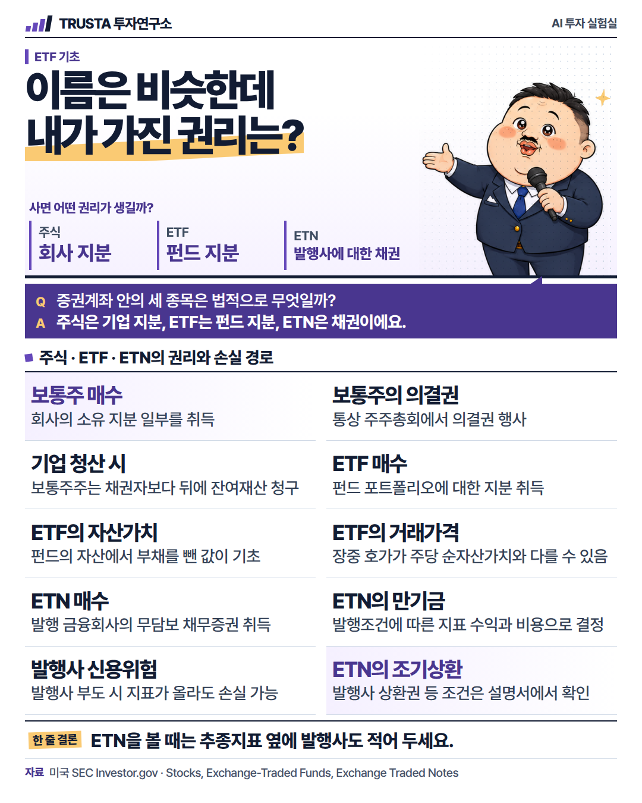

# ETF인 줄 알았는데 ETN이었다. 같은 지수를 따라가도 무엇이 다를까?

## 1. 은퇴 통장에 담기 전, 끝 글자 하나가 눈에 들어왔다

가상의 은퇴자 천억이는 앞으로 쓸 돈의 일부로 같은 원유 지수를 내세우는 상품 두 개를 찾았습니다. 거의 같은 이름인데 마지막에 ETF와 ETN이 나뉩니다. “지수가 그대로 움직이면, 돈을 돌려받는 방식도 똑같겠지?” 수건 친구는 수익률 표를 잠시 덮습니다. 그리고 상품을 소개하는 첫 페이지에서 누가 어떤 권리를 주는지부터 찾습니다.

## 2. 주식을 산 사람과 펀드 지분을 산 사람이 보는 문서

일반 주식을 사면 그 주식을 발행한 회사의 지분을 갖습니다. 그 회사의 주주가 되는 것이며, 회사에 제공한 대출의 원금 상환을 약속받은 상황과 다릅니다. 실적, 전망, 배당 여부, 주식의 거래가격이 투자 결과에 영향을 줍니다. 천억이가 고른 것이 ETF라면 펀드의 지분을 사는 것입니다. 운용사는 상품의 목적과 방법에 따라 자산을 담거나 계약을 사용합니다. 투자자에게 ETF를 거래할 계좌를 제공하는 증권사와 실제 ETF를 운용하는 기관은 다를 수 있습니다.

ETF에 들어 있는 기업의 주식을 투자자 본인이 직접 하나씩 소유하는 것과도 구분합니다. 어떤 자산이나 계약에 간접적으로 노출되는지는 펀드 설명서를 읽어야 알 수 있습니다. 합성 구조에 거래상대방 위험이 있다면 그 계약과 담보 등 공시 조건을 따로 봅니다. ETF 가격도 기초자산에 따라 떨어지고, 거래소 매도가격과 주당 순자산가치가 다를 수 있습니다.

## 3. ETN에서 발행 회사 이름을 찾는 이유

한국거래소는 국내 ETN의 투자위험 안내에서 ETN 발행회사의 채무불이행 위험을 설명합니다. 지표에 따라 지급액을 계산하기로 한 채무증권이어서 기초지수의 움직임 외에 발행사의 신용이 중요합니다. 국내의 공개 설명서에 무보증·무담보 증권이라고 기재된 사례도 확인할 수 있습니다. 지수를 정하는 기관, 상품을 발행해 지급할 주체, 계좌를 통해 주문을 받는 금융회사가 누구인지 각각 찾아봅니다. 내 주문을 받은 증권사가 ETN 발행사와 같은지 다른지도 읽습니다.

천억이는 ‘발행회사’라는 항목을 형광펜으로 긋습니다. 그 회사 사정이 어려워졌다는 소식을 보면, 자기 투자와 어떤 관계가 있는지 먼저 확인할 수 있습니다. 발행회사의 채무 지급 문제와 단순히 개인 앱에서 주문을 받는 회사의 문제가 각각 어떤 절차로 이어지는지는 계좌·거래·상품 조건에 따라 다릅니다. 상품의 권리 구조를 아는 것이 모든 형태의 금융회사 문제를 같은 방식으로 해결해 주지는 않습니다.

## 4. 지표는 5% 올랐는데 실제 다시 쓸 수 있는 돈은 다르다

가상의 원화 원금 100만 원을 1년간 ETN에 넣고 지표가 5% 올랐다고 가정합니다. 이 실습에서는 지표 상승이 비용 없이 계약상 지표가치에 그대로 반영됩니다. 세금, 이자, 분배 및 재투자는 없습니다. 발행사가 지급 약정을 지키고 설명용 기준일에 지표가치 그대로 받는 경우에는 105만 원입니다. 실제 상품의 상환 방식이나 미래 회수액을 뜻하지 않습니다.

| 같은 가상 지표가치 | 받을 수 있다고 가정한 조건 | 원화 결과 |
|---|---|---:|
| 105만 원 | 약정대로 지표가치 그대로 지급 | 1,050,000원 |
| 105만 원 | 만기 전에 지표가치의 97%에 매도 | 1,018,500원 |
| 105만 원 | 만기 전에 지표가치의 94%에 매도 | 987,000원 |

지표가 올라 있어도 두 번째는 3만 1,500원, 세 번째는 6만 3,000원만큼 지표가치보다 낮은 가격에 팔게 됩니다. 세 번째는 비교 시작 원금 100만 원보다 1만 3,000원 적습니다. 이 차이는 시장 매도 조건을 바꾼 가상 계산입니다. 발행사 부도가 났을 때도 지표가치에 97%나 94%를 곱해 회수액을 계산할 수 있다는 뜻은 아닙니다. 실제 권리 순위·해당 약관·절차를 확인해야 합니다.

*기업의 지분, 펀드의 지분, 발행사 채무를 나란히 본다.*

## 5. 방향이 반대인 두 가지 예외를 나눠 본다

첫 번째 반례에서는 지표가 10% 하락하지만 발행사가 지급할 의무를 이행합니다. 위의 단순 조건이면 90만 원입니다. 발행사가 정상적으로 지급했다는 사실과 투자 손실이 없다는 판단이 다르다는 것을 보여 줍니다. 두 번째 반례에서는 지표가 5% 올랐지만 발행사가 약정 지급을 이행하지 못합니다. 105만 원의 지표가치는 계산에 남더라도 실제 받는 돈은 이 단순 비율 모형으로 결정되지 않습니다. 천억이는 두 상황을 한 줄에 더하거나 둘의 값을 대신하지 않습니다. 가격이 하락한 경우와 지급 자체에 문제가 생긴 경우를 구분합니다.

## 6. 만기 날짜와 내가 돈을 써야 할 날짜를 대조한다

만기·조기상환 조건은 상품 설명서나 공시에서 확인합니다. 장내 매도는 시장에서 다른 상대에게 파는 거래이고, 만기 지급은 약정에 따라 받는 일입니다. 지급일이 다르면 두 가지를 같은 현금 계획에 넣을 수 없습니다. 천억이가 생활비를 자산에 맞춰 늦춰도 되는지 생각하려면, 먼저 일정 자체가 고정인지부터 적어야 합니다. 표시된 지표가치도 실제 그 가격에 바로 체결된다는 약속으로 읽지 않습니다.

## 7. 같은 지수를 보던 두 사람의 메모가 달라졌다

수건 친구는 펀드라면 운용 방식, 주당 순자산가치와 시장가격, 거래상대방을 확인할 칸을 놓습니다. ETN이면 발행인, 지표가치와 실제 호가, 상환 규칙을 적습니다. 둘에서 똑같이 보이는 이름은 지수일 수 있지만, 실제 생활비를 꺼낼 날에는 각각 다른 문서를 엽니다. 거래소의 상장 심사는 발행인이나 상품의 조건을 확인하는 절차입니다. 발행사의 지급 불능 가능성이나 내 매도가격의 위험이 사라진다고 보면 곤란합니다.

### 내 주문 증권사와 약속한 증권사는 다른 이름일 수 있다

수건 친구는 가상의 주문내역을 책상에 놓습니다. 천억이가 쓰는 창구에는 A증권이라고 적혀 있습니다. 그런데 상품 설명의 발행인은 B증권입니다. 이 상황에서 ETN의 지급 의무를 확인하려면 상품을 발행한 B의 이름을 읽습니다. 주문이 제대로 접수됐는지 확인할 상대는 A일 수 있습니다. 두 이름을 한 칸에 쓰면 뉴스를 보고 어느 문제를 확인할지 혼동됩니다. 두 회사가 실제로 같은 곳인 상품도 있을 수 있으므로, 거래 화면의 이름에서 추정하지 않고 공시의 항목을 봅니다.

ETF를 거래할 때도 창구 증권사와 운용 회사의 이름이 달라질 수 있습니다. 두 상품에서 같은 증권사 앱을 쓸 수 있다는 사실은 권리와 자산 구조가 같다는 근거가 되지 않습니다. 자산 보관이나 별도 관리와 관련된 권리도 계좌 종류와 관할, 상품의 법적 구조에 따라 확인할 일입니다. 천억이는 노트의 제목을 ‘A증권에서 산 상품’에서 ‘매수 창구와 발행 또는 운용 주체’로 나눠 씁니다.

### 지표가치가 같을 때 매수 가격부터 달라지면

앞에서 지표가치보다 낮은 가격에 팔 경우를 계산했습니다. 이번에는 거래를 시작할 때 실제 가격과 지표가치가 다르다고 둡니다. 가상 원화 1주 ETN의 표시 지표가치는 1만 원인데, 시장에서 1만 500원에 한 주를 샀습니다. 매수 비용과 세금, 이자·분배는 우선 없습니다. 나중에 발행사가 약정을 모두 지켜 주당 1만 300원을 지급한다고 가정합니다. 지표가치 1만 원에서 보면 3% 늘어난 수치입니다. 하지만 내가 쓴 1만 500원에서 계산하면 200원을 잃었습니다. 손익률은 약 마이너스 1.90%입니다.

같은 가상의 약정에서 최초 매수가격이 9,800원이라면 1만 300원을 받은 사람은 500원의 차익이 생깁니다. 시작한 지표가치와 받은 돈은 같고 내가 거래한 가격만 바뀌었습니다. 실제 수익률을 건너뛰고 지표가 얼마나 올랐는지부터 외우면 두 거래를 똑같다고 기록하게 됩니다. 수건 친구는 주문 전에 적어 둔 체결 예정 가격과 종료 때 받을 금액을 같은 줄의 양쪽에 놓습니다. 아직 확정되지 않은 체결가라면 가정으로 표시합니다.

### 읽은 수치가 실시간인지 장 마감값인지 본다

천억이는 거래소에서 실시간 종목 화면과 날짜별 지표 자료를 각각 엽니다. 한국거래소는 국내 ETN 지표가치와 실시간 지표가치의 제공 방식을 설명합니다. 장 마감 후의 기준값을 장중 호가와 비교할 때는 관측 시각이 같지 않을 수 있다는 점을 먼저 봅니다. 해외 시장을 기초로 하는 경우 거래시간의 차이로 인해 화면의 지표와 시장가격이 다르게 보일 수도 있습니다. 왜 차이가 났는지 하나로 단정하기 전에 공시된 조건을 확인합니다.

금액과 시각을 확인했으면 다음은 권리가 언제 현실의 현금이 되는지입니다. 천억이의 종이에는 장중 호가, 장 마감 지표, 계약 지급일이 각각 적혀 있습니다. 세 줄이 가까이 모여 있어도 질문은 다릅니다. 오늘 거래가 가능한가, 기준값이 얼마인가, 약정이 이행될 때 언제 무엇을 받는가입니다. 더 큰 수익률을 가리키던 손을 멈추고 자기 계획에 필요한 한 줄을 고를 수 있게 됩니다.

## 8. 오늘 상품 설명 첫 장에서 누구의 이름인지 읽는다

**내가 이미 들고 있는 상품 하나를 선택해 첫 장의 ‘발행인’ 또는 ‘집합투자업자’를 표시하세요.** ETF이면 실제 자산과 운용 방식을, ETN이면 지표가치와 만기 지급을 책임지는 주체와 조건을 바로 옆에 적습니다. 천억이는 처음 주문 창에서 놓쳤던 글자 하나를 다시 읽습니다. 상품을 고를 때 지수가 어디로 갈지에 앞서, 손에 들고 있는 권리가 뭔지부터 물을 수 있게 됐습니다.

### 편집부 Q&A

**ETN 지표가치가 나오면 지금 받을 금액이 확정인가요?**  
지표가치와 시장 매도가격은 별개입니다. 약정 지급일에 받을 돈을 확인하려면 상품별 공시의 지급 조건이 필요합니다.

**ETF면 발행 상대의 위험을 볼 필요가 없나요?**  
운용 구조에 따라 확인할 상대가 달라집니다. 합성 구조라면 거래상대방과 계약 조건을 설명서에서 확인하고, 실제 매도가와 순자산가치도 구분합니다.

**원문**　[FINRA ETN 신용위험](https://www.finra.org/investors/insights/exchange-traded-notes-avoid-unpleasant-surprises) · [미 SEC의 펀드 거래방식 비교](https://www.investor.gov/introduction-investing/general-resources/news-alerts/alerts-bulletins/characteristics-mutual-funds-exchange-traded-funds) · [미 SEC의 ETF 구조 안내](https://www.investor.gov/introduction-investing/investing-basics/investment-products/mutual-funds-and-exchange-traded-2) · [한국거래소 · ETN 투자위험](https://open.krx.co.kr/contents/OPN/01/01030303/OPN01030303.jsp) · [한국거래소 KIND · ETN 공시 사례](https://kind.krx.co.kr/disclosure/etnisudetail.do?method=searchEtnIsuSummary&strIsuSrtCd=Q520026) · [한국거래소 · ETN 지표가치 안내](https://open.krx.co.kr/contents/OPN/01/01030301/OPN01030301T5.jsp)

**이어 읽기**　[ETF 이름 읽는 순서, 원화로 사는 미국 지수 ETF에 왜 (H)가 붙을까?](EP004.md) · [전자책 목차](목차.md)
