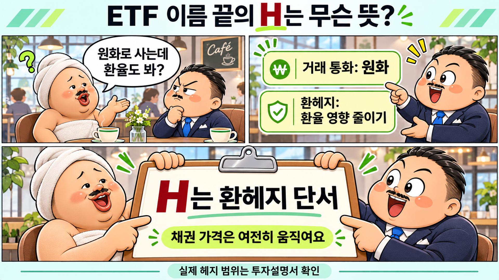

# ETF 이름 읽는 순서, 원화로 사는 미국 지수 ETF에 왜 (H)가 붙을까?

*민호의 대화와 문답은 편집부가 만든 질문입니다. 운용사 분배 공지의 수치를 제외한 금액은 가정입니다.*

민호가 동전 하나를 자판기에 넣습니다. 버튼에는 달러가 아니라 원이라고 쓰여 있어요. 그때 천억이에게 휴대폰을 내밉니다. 이 펀드도 원화로 사는데 이름 끝에 에이치가 붙었어. 환율을 신경 쓸 필요가 없다는 뜻이라면, 다음 달에 쓸 백만 원을 잠깐 맡겨도 될까? 천억이는 그 백만 원을 언제 쓸지부터 묻습니다. 다음 달 첫날에 새 냉장고 잔금을 치러야 한대요. 민호가 알고 싶은 건 이름의 뜻을 넘어서 그날 얼마를 꺼낼 수 있느냐였습니다.

천억이가 자판기 상품 이름을 가리킵니다. 같은 원화 동전을 넣어도 나오는 물건은 탄산수일 수도 있고 우유일 수도 있죠. 원화는 결제할 때 건네는 돈입니다. 투자 자산이 달러로 가격이 붙고 환율 변화가 원화 가치에 반영되는지는 상품 안쪽에서 확인해야 합니다. 민호는 휴대폰 메모를 열어 거래 통화와 기초자산을 다른 줄에 씁니다. 처음엔 두 줄에 다 원화라고 적으려 했지만 둘째 줄은 설명서를 보기 전까지 비워 둡니다.

**그림 Q&A · 편집부가 만든 질문**　H가 붙으면 채권 가격도 고정될까요? 환헤지는 환율 영향을 줄이려는 설계입니다. 채권 가격은 금리 등에 따라 여전히 움직입니다.

## 이름을 끊어 읽는 순서

상품 이름을 앞에서부터 끊습니다. 브랜드는 운용사를 찾는 단서입니다. 미국이라는 말은 투자 시장을 좁혀 주고, 국채라는 말은 기업 주식 대신 정부 채무에 관련된 자산을 떠올리게 합니다. 삼십 년이라는 말만 보고 모든 보유 채권의 잔존 만기가 오늘 정확히 삼십 년이라고 적을 수는 없어요. 어떤 만기 범위의 채권인지, 지수를 쓰는지, 그 지수가 어떤 방식으로 종목을 교체하는지 문서에서 확인해야 합니다. 이름을 읽는 데서 얻는 것은 답안지보다 찾아갈 항목입니다.

## 환율만 바꾼 한 달

민호가 가장 궁금한 에이치부터 계산해 보죠. 원화 백만 원을 첫날 한 번 넣고 한 달 뒤 전액 출금한다고 가정합니다. 추가 납입은 없고 분배금도 없어 재투자하지 않습니다. 거래 비용과 세금은 영 원입니다. 연율을 쓰지 않고 한 달의 변화만 볼게요. 처음에는 달러 자산 가격이 그대로고 달러 한 단위를 사는 데 필요한 원화만 오 퍼센트 오른다고 놓습니다. 환헤지가 없는 가상 상품의 원화 가치는 기말 백오만 원입니다. 같은 환율 영향을 완전히 상쇄하고 비용도 영으로 둔 가상 상품이라면 백만 원입니다.

민호는 차라리 환헤지가 없는 쪽이 더 낫겠다며 처음 결론을 바꿉니다. 그런데 달러가 오 퍼센트 내렸다면 어떻게 될까요. 다른 조건은 그대로라면 헤지 없는 경우 구십오만 원, 완전 헤지 모형에서는 여전히 백만 원입니다. 오를 때 얻는 몫도 줄고 내릴 때 잃는 몫도 줄어드는 계산이죠. 실제 상품에서 상쇄되는 크기는 목표 비율과 계약 조건, 실제 자산 움직임에 따라 달라질 수 있어요. 두 가상 결과는 에이치가 붙은 상품의 보장 금액이 아니라 환율 변수 하나를 떼어 본 결과입니다.

이번엔 채권 가격을 같이 움직여 봅니다. 달러로 본 채권 가치가 한 달 동안 팔 퍼센트 하락하고 달러당 원화 가격은 오 퍼센트 올랐습니다. 환헤지가 없는 가상 상품이라면 백만 원 곱하기 영 점 구이 곱하기 일 점 영오, 구십육만 육천 원입니다. 환율 효과를 완전히 없애고 비용을 영으로 두면 구십이만 원입니다. 두 상황 모두 채권 자체 하락을 겪어요. 민호가 에이치면 백만 원을 고정해 준다고 생각했던 답이 이 지점에서 깨집니다. 상쇄하려는 움직임이 무엇인지 알아야 글자 하나에 너무 많은 약속을 싣지 않습니다.

금리가 오를 때 이미 발행된 고정금리 채권 가격이 왜 내려가는지도 한 장면으로 볼 수 있습니다. 같은 신용 조건에서 새 채권이 더 높은 이자를 줍니다. 예전에 낮은 이자를 약속한 채권을 그대로 같은 가격에 사려는 사람은 줄겠죠. 가격이 낮아지면 그 낮아진 가격을 기준으로 기존 이자를 받는 매력이 올라갑니다. 다른 조건이 비슷한 채권에서는 먼 미래의 지급액이 더 많이 남을수록 금리 변화에 민감할 수 있습니다. 민호가 종목명에서 국채를 읽었을 때 묻고 싶었던 안전이 신용에 관한 말인지, 내일 시장가격에 관한 말인지부터 구분해야 합니다.

냉장고 잔금을 내는 날에 채권 하나가 정확히 만기를 맞는 상황과, 장기채를 계속 사서 담는 펀드를 그날 시장에서 파는 상황도 따로 생각해 봅시다. 전자는 해당 채권의 계약상 지급을 확인하는 질문이고, 후자는 펀드 지분에 어떤 매수 주문이 들어와 있는지를 확인하는 질문입니다. 상품 이름에 적힌 만기로 내 ETF를 언제 사 준다고 약속하지는 않아요. 만기를 목표로 설계한 별도 형태도 있으므로 상품의 종료 조항을 읽으면 무엇을 기대할 수 있는지 더 분명해집니다.

## 커버드콜을 붙이면 달라지는 손익

다음으로 이름 속 커버드콜입니다. 아주 간단한 모형으로 시작합니다. 자산 한 단위를 백 달러에 보유한 사람이 한 달 뒤 백오 달러를 넘는 상승분에 대해 상대방에게 권리를 주고 대가로 이 달러를 받습니다. 한 달 한 번의 유럽형 콜 매도 모형이며 추가 입출금이나 분배, 재투자, 거래 비용과 세금은 없다고 둡니다. 만기 가격이 백십오 달러라면 자산만 보유한 경우 백십오 달러가 됩니다. 콜을 모두 덮어 씌운 모형에서는 백오 달러 위의 십 달러를 내주고 대가 이 달러를 남겨 백칠 달러가 됩니다.

만기 가격이 구십 달러로 떨어지면 상대방은 이 모형에서 백오 달러에 살 권리를 행사할 이유가 없어요. 자산 구십 달러에 받은 이 달러를 보태 구십이 달러입니다. 받은 대가가 손실 중 이 달러를 덜어 줬지만 여전히 처음 백 달러보다 팔 달러 적습니다. 만기 가격이 백 달러로 같으면 이 사례에서는 백이 달러가 돼요. 같은 전략을 두고 사람들이 서로 다른 말을 하는 이유가 보입니다. 옆으로 움직이는 시장, 크게 오르는 시장, 많이 내리는 시장에서 결말이 다릅니다.

실제 이름의 타겟이라는 말이 대가를 언제나 같은 금액으로 받는다는 뜻일까요? 어느 기간의 어떤 지표를 목표로 삼는지, 매도하는 옵션이 자산 전체를 덮는지 일부를 덮는지에 따라 결과가 달라집니다. 예를 들어 앞의 모형에서 자산 두 단위 중 하나에만 같은 옵션을 걸었다면 나머지 하나의 상승분은 그 옵션에 묶이지 않습니다. 백십오 달러로 끝날 때 두 단위 중 하나는 백칠 달러, 다른 하나는 백십오 달러예요. 둘을 합해 이백이십이 달러입니다. 두 단위를 모두 덮었을 때의 이백십사 달러와 차이가 납니다. 옵션 하나의 조건도 모른 채 커버드콜이라는 단어만으로 상한을 확정할 수는 없어요.

## 합성과 계약으로 얻는 노출

합성이라는 표시는 또 다른 문을 엽니다. 펀드가 투자 대상의 움직임을 계약으로 얻도록 설계할 수 있다는 뜻입니다. 무엇을 담보로 보유하는지와 계약으로 무엇의 성과를 받는지가 다를 수 있어요. 민호가 보유 목록에서 예상한 채권 이름을 못 찾았다고 해서 곧바로 채권 가격의 영향을 받지 않는다고 결론 내릴 수 없습니다. 반대로 계약이 있다는 한마디로 위험을 정확히 매길 수도 없어요. 계약의 상대방, 담보, 비용, 계약을 지속하거나 교체하는 조건을 설명서에서 따로 찾습니다. 가상의 이름을 하나씩 분해한 이 장면에서는 그 계약 조건을 알지 못하니 숫자를 채우지 않습니다.

천억이는 민호에게 상품 이름을 베끼는 대신 문장 하나를 써 보자고 합니다. 원화로 주문하고, 미국 장기 국채 관련 움직임을 가져오며, 옵션을 통해 손익이 달라지고, 환율 영향은 줄이려 한다. 문장이 네 동작으로 길어졌지만 무엇이 바뀌면 자기 돈이 달라질지는 오히려 더 잘 보입니다. 그리고 모르는 부분 옆에 물음표를 달아요. 무슨 지수인지, 옵션을 얼마나 매도하는지, 어느 통화를 얼마나 헤지하는지. 각각을 찾아야 할 문서의 위치가 다르니 물음표도 하나로 모으지 않습니다.

## 운용사 분배 공지 읽기

실제 공지의 한 줄로 연습해 보죠. 삼성자산운용이 이천이십육 년 시월 십삼일에 발표한 분배 공지에서 종목 코드 사팔일공육공의 좌당 분배금은 칠십일 원으로 표기됐습니다. 표에 적힌 일 퍼센트는 시월 십이일 종가를 기준으로 계산한 분배율이에요. 두 날짜 중 하나는 가격을 계산에 넣은 기준일이고 다른 하나는 공지가 나온 날입니다. 날짜가 하나만 있어도 숫자는 읽을 수 있지만 그 숫자가 어느 가격으로 나뉘었는지 설명하기는 어려워요. 이름에 쓰인 미국이나 삼십 년만으로 이 칠십일 원을 추정한 게 아니라 운용사 공지에서 읽은 값입니다.

이 공지에서 받을 자격을 갖춘 지분을 십 좌 보유한 가상 독자라면 칠십일 원에 열을 곱해 세전 칠백십 원이라고 읽습니다. 계좌에서 실제로 확인할 세후 원화는 과세와 계좌 조건이 있어야 알아요. 그리고 그 돈을 다음 달에도 똑같이 받는다는 계산은 할 수 없습니다. 한 번의 공지가 알려 주는 건 그 공지의 지급 조건이에요. 월 지급 주기로 운용되는 상품이라고 해도 한 좌당 금액은 달마다 달라질 수 있습니다. 민호가 달력에 써야 할 것은 공지와 실제 입금 확인이며, 냉장고 잔금 전부를 이미 받은 돈처럼 적으면 안 됩니다.

편집부가 만든 질문입니다. 이름 뒤에 붙은 액티브는 에이치와 같은 뜻일까요? 액티브는 투자 목적과 전략 안에서 운용자가 어떤 재량을 갖는지 살펴볼 단서입니다. 에이치는 환율 영향과 관련된 설계를 찾게 하는 단서예요. 둘이 한 이름에 같이 붙어도 두 질문에 동시에 답할 수 있습니다. 마찬가지로 일일 두 배라는 문구가 있다면 거기서 중요한 것은 목표가 잡힌 기간과 배율입니다. 액티브가 붙었다는 이유만으로 두 배가 되지도 않고, 환헤지가 붙었다는 이유만으로 가격 변동이 끝나지도 않습니다.

민호도 반례를 하나 만들어 냅니다. 이름이 아주 짧은 상품 둘을 골랐다고 해요. 둘 다 미국 국채라고 쓰여 있지만 하나는 짧은 만기의 자산에 주로 노출되고 다른 하나는 긴 만기에 집중합니다. 원화로 주문하는 방식이 같고 둘 다 환율 영향을 줄이도록 설계됐다고 해도 금리에 대한 반응은 다를 수 있어요. 쉽게 이름을 읽을 수 있다는 것과 상품 구조가 같다는 것은 별개입니다. 긴 설명을 헷갈려 했다면 이름을 억지로 외우기보다 자산 종류와 만기부터 한 줄씩 채우는 편이 계산을 시작하기 쉽습니다.

## 환율을 일부만 상쇄한다면

천억이는 민호의 이름표 아래에 이번에는 숫자 세 개를 씁니다. 기초자산 수익률, 달러 값의 변화, 헤지에서 실제로 정산된 금액입니다. 앞에서는 환율이 완전히 상쇄되는 모형과 그대로 남는 모형만 다뤘죠. 이번에는 그 가운데를 만들어 봅시다. 백만 원 규모의 달러 자산을 한 달 갖고, 자산의 달러 가격은 그대로입니다. 달러 매도를 약속한 계약은 출발 시점 자산의 팔십 퍼센트만큼 있다고 합시다. 약속 환율은 출발 환율과 같고 한 달 뒤 만기에 모두 정산한다고 놓을게요. 분배와 세금, 별도 수수료는 없고 추가 매수나 재투자도 없습니다.

달러당 원화 가격이 오 퍼센트 오른다면 자산에서 원화 오만 원이 늘어납니다. 하지만 처음에 달러를 팔기로 약속했던 팔십만 원 규모에서는 달러가 오른 만큼, 원화 사만 원을 포기하는 효과가 납니다. 이 실험에서는 두 금액을 합쳐 만 원이 남습니다. 만일 달러 가격이 반대로 오 퍼센트 내리면 자산에서 오만 원이 줄고 약속에서 사만 원을 보전해 합계 만 원 손실입니다. 환율 오 퍼센트를 그대로 맞는 모형과 환율 변화가 하나도 남지 않는 모형 사이에 답이 나왔어요. 여기서 팔십 퍼센트는 설명을 위해 고른 숫자입니다. 실제 이름의 에이치만 보고 그 수치를 넣을 수는 없습니다.

같은 출발점에서 자산이 한 달 사이 두 배가 되는 아주 큰 변화를 가정해 봅시다. 환율을 그대로 두고 보면 달러 자산의 원화 가치는 이백만 원이 되었지만, 처음 약속한 달러 매도 계약 규모는 저절로 두 배가 되지 않아요. 처음 팔십만 원 규모였다면 새 자산 규모에 대한 비율은 사십 퍼센트로 낮아졌습니다. 반대로 자산 가격이 내려가면 같은 계약 규모가 남은 자산에 비해 더 커질 수 있죠. 계약을 언제 다시 맞추는지 알아야 하는 까닭입니다. 민호는 목표 헤지 비율과 오늘 실제로 상쇄되는 비율을 서로 다른 칸에 적습니다.

그 계약이 출발 환율과 다른 가격을 제시하는 경우도 살펴봅시다. 달러 천 달러를 한 달 뒤에 원화로 바꿀 계획입니다. 출발 때 바로 바꾸는 가격은 달러당 천삼백 원이고, 미래에 바꾸기로 약속할 때의 가격은 천이백구십 원이라고 가정해요. 만기에 실제 시장 환율이 천사백 원으로 올라도 계약대로 바꾸면 백이십구만 원입니다. 시장 환율이 천이백 원으로 가도 계약 상대가 약속을 지킨다는 조건에서는 같은 금액입니다. 당시 현물 환율로 환산한 백삼십만 원과의 만 원 차이는 이 약속 가격에 이미 들어 있습니다. 별도의 청구 비용이 없다는 사실만으로 두 가격을 같은 것으로 놓을 수는 없어요.

민호는 이제 상품 화면의 원화 가격과 설명서 속 투자 지표를 나란히 둡니다. 어느 자료에는 지수 변화가 달러 기준으로 있고 어느 자료에는 투자자가 원화로 받은 성과가 있습니다. 기간도 달라요. 첫 번째 표는 달 초부터 달 말까지이고, 두 번째는 민호가 산 오후부터 그 다음 달 초까지입니다. 똑같이 국채라는 말이 화면에 떠 있어도 두 수익률의 차이를 전부 헤지 성과에 할당하면 틀릴 수 있어요. 같은 시간 구간을 잘라 놓고 통화와 분배 처리 기준을 맞추고, 무엇을 기준 수익률로 삼았는지 읽어야 어떤 차이가 남는지 알 수 있습니다.

여기에 ETF 지분의 시장가격이 한 번 더 들어갑니다. 원화로 나타낸 펀드 지분당 순자산이 만 원으로 그대로였다고 해 볼게요. 첫날 거래소에서 민호는 만 백 원에 한 주를 샀고 다음 달 만 원에 팔았습니다. 이 사례의 시작 자금은 만 백 원이며 입출금은 처음 매수와 마지막 매도뿐입니다. 비용과 세금과 분배는 없습니다. 자산 자체가 변하지 않아도 민호는 백 원 손실입니다. 처음에 자산 가치보다 비싸게 거래한 차이가 끝에 사라졌기 때문이죠. 계좌 손익을 보고 환헤지에 실패했다고 바로 결론 내리기 전에, 자기 매수와 매도 가격이 그날의 순자산가치에서 얼마나 떨어져 있었는지 확인합니다.

반대의 경우도 배치해 볼게요. 펀드의 한 주당 순자산이 만 원에서 구천구백 원으로 내려갑니다. 민호는 시작에 자산가치보다 낮은 구천팔백 원을 주고 샀고 끝에 순자산가치와 같은 구천구백 원에 팔았어요. 자산 가치가 떨어졌는데 개인의 거래 손익은 백 원 이익입니다. 어떤 경우에 더 싸게 살 수 있다거나 가격이 반드시 제자리로 돌아온다는 예언이 아니죠. 이름에 달린 표시는 운용 방식을 알려 주고 내 주문 내역은 그 기간에 내가 거래한 가격을 알려 줍니다. 둘을 붙여야 개인 손익이 되는 만큼 한쪽 이름만으로 다른 쪽 숫자를 대신 쓰기는 어렵습니다.

친구가 국채라는 말을 읽다가 이번에는 채권 하나를 직접 사는 장면을 종이 위에서 실험합니다. 일 년 뒤에 원금과 이자를 합해 백오 달러를 한 번 받는 가상 채권입니다. 신용 위험 없이 지급하고 환율을 고정하며 중간 현금은 없다고 정해요. 오늘 시장이 같은 조건의 일 년 돈에 오 퍼센트를 요구한다면 백오 달러를 일 점 영오로 나눈 백 달러가 됩니다. 시장이 십 퍼센트를 요구하면 백오 달러를 일 점 일로 나눈 약 구십오 점 사오 달러예요. 약속된 만기 지급액이 그대로인데도 오늘의 가격이 움직입니다. 냉장고 잔금을 만기 전에 치러야 한다면 오늘 팔 때 받을 가격을 먼저 물어야 하는 이유입니다.

그 채권을 아주 오래 보유할 수 있다고 답한 사람도 있습니다. 하지만 장기채를 계속 갈아 담는 펀드의 지분을 가지고 있다는 사실로 그 국채 한 장을 가진 것과 같은 만기 지급 약속을 얻지는 않습니다. 지수가 오래 남은 채권 위주로 구성되도록 설계되면 시간이 지날 때 일부 채권이 빠지고 다른 채권이 들어갈 수 있어요. 상품의 이름에서 삼십 년을 보고 본인이 삼십 년을 보유하면 특정 원화를 돌려받는다고 적으면 장부의 대상이 바뀐 겁니다. 채권 자체의 지급 일정과 ETF 지분의 가격과 상품의 종료 조건은 각자 다른 항목에서 확인합니다.

민호가 옵션 계산으로 돌아와 이번엔 두 장의 달력을 놓습니다. 콜 옵션이 만료되는 날과 분배를 받을 권리를 확인하는 날입니다. 만일 일정한 날에 분배하는 구조라 해도, 그 날짜와 옵션 계약의 만기가 일치하는지 이름으로는 알 수 없죠. 콜 매도 때 받은 대가는 거래의 한쪽 현금 흐름이며 만기에 넘겨야 할 돈도 생길 수 있습니다. 옵션을 팔며 이 달러를 받았다는 사실만으로 그날 투자자가 이 달러를 분배받는다고 장부에 올리면 두 주체의 돈을 섞는 셈이에요. 투자자가 받은 돈은 운용사 분배 공지와 계좌를 봐야 알 수 있습니다.

그래서 이번엔 옵션 대가를 한 번 더 계산합니다. 자산 백 달러에 행사가 백오 달러의 콜을 팔지만 대가가 이 달러에서 오십 센트로 줄었다고 합시다. 만기 자산 가격이 구십 달러라면 계좌는 구십 달러 오십 센트입니다. 아까의 구십이 달러와 다릅니다. 만기 가격이 백십오 달러라면 백오 달러 오십 센트가 됩니다. 자산의 마지막 가격이 같고 옵션을 덮은 수량도 같은데 받는 대가를 바꾸니 양쪽 결과가 모두 바뀌었죠. 상품 이름에서 타겟을 발견했을 때 바로 고정된 현금을 떠올리기보다 무엇을 목표로 삼고 실제 계약 조건이 어떻게 달라질 수 있는지를 묻습니다.

다른 친구가 이 이름이면 원화 가격의 주간 성적을 알아볼 수 있냐고 문자합니다. 민호는 세 가지 자료를 받아 달라고 합니다. 설명서의 투자 목적, 비교 지표의 통화와 산식, 그리고 실제 기간의 지분 가격입니다. 손에 쥔 이름으로 어떤 자료를 요청할지는 고를 수 있지만 다 받아 놓기 전에는 실측 결과를 숫자로 채우지 않습니다. 운용사가 목표를 바꾼 경우에는 과거 설명서와 새 설명서가 적용되는 날도 따로 봐야 해요. 오늘의 문서를 열었다고 그 문구가 과거 몇 달에도 그대로 적용됐다는 사실이 자동으로 확인되지는 않습니다.

마지막으로 냉장고 잔금표에 작은 선을 긋습니다. 가상의 금액 백만 원으로 한 달 기다린 뒤 구십이만 원밖에 없다면 팔만 원을 다른 곳에서 가져와야 합니다. 환율을 완전히 없앤 모형에서조차 방금 채권 가격이 팔 퍼센트 빠졌을 때 그렇죠. 냉장고가 꼭 그날 와야 하는지, 빠진 반대편 돈을 어디서 마련할지에 따라 민호의 선택이 달라집니다. 대금이 언제 인출 가능한지도 실제 거래 계좌에서 따로 확인합니다. 모형이 계산하는 것은 특정 시점의 가치입니다. 출금 가능한 시각도 그 값과 같다고 가정하면 지급 계획에 또 하나의 근거 없는 약속이 생깁니다.

자판기로 돌아옵니다. 민호는 동전을 넣으면 무슨 음료가 나오는지 확인하듯, 종목 코드로 공식 문서를 열고 오늘 읽은 말을 한 줄에 남깁니다. 이번에는 에이치 하나만 골라 환헤지의 목표와 한계가 적힌 곳을 찾습니다. 다음 달 잔금을 치를 돈은 자판기 동전처럼 넣고 같은 값으로 되돌릴 수 있는지부터 물어야 했어요. 한 달 뒤 금리, 옵션, 시장가격을 아직 모른다는 사실을 달력에 그대로 씁니다. 그리고 그 옆에 적습니다. 원화로 사는 것과 원화 금액을 지키는 약속은 각각 어떤 문서에 있지? 처음 던진 질문이 이제 자기가 확인할 수 있는 문장으로 바뀌었습니다.

**자료 시점**　운용사 공지 2026년 10월 13일, 분배율 산식의 종가 기준일 10월 12일, 자료 확인일 11월 27일. 상품의 미래 분배와 실제 환헤지 효과는 미확정입니다.

**원문**　[미 SEC의 ETF 구조 안내](https://www.investor.gov/introduction-investing/investing-basics/investment-products/mutual-funds-and-exchange-traded-2) · [삼성자산운용 2026년 10월 13일 분배 공지](https://www.samsungfund.com/etf/lounge/notice-view.do?no=80195) · [미 SEC 레버리지·인버스 ETF 안내](https://www.investor.gov/introduction-investing/general-resources/news-alerts/alerts-bulletins/investor-alerts/sec)

**이어 읽기**　[ETF 시장가격과 NAV, 2% 비싸게 샀다는 말의 기준은?](EP005.md) · [전자책 목차](목차.md) · [분배락 뒤 당일 손실과 실제 입금](FAQ03.md)
