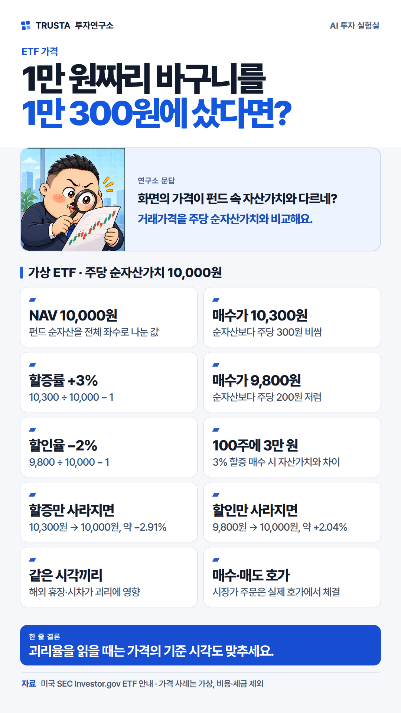
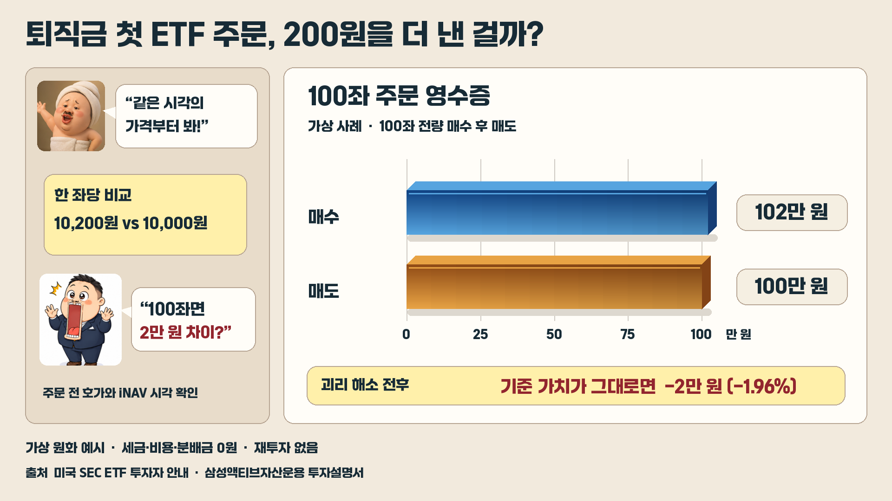

# 퇴직금으로 ETF 담기 전, 1만 원짜리에 200원 더 내고 있는지 보는 법

## 1. 익숙한 하루 · 첫 주문의 가격표

퇴직하고 받은 돈은 통장에 그대로 두자니 아깝고, 한꺼번에 옮기자니 마음이 불편합니다. 가상 인물 천억이는 공부해 둔 ETF를 소액부터 담으려고 주문창을 엽니다. 매도호가는 10,200원. 그 옆에 적힌 순자산가치는 1만 원입니다. ‘시장이 오른 것도 아닌데, 내가 200원을 더 내는 건가?’

## 2. 필요한 것 · 내 돈이 나갈 가격

**호가와 NAV는 서로 다른 질문에 답합니다.** 매도호가는 누군가 팔겠다고 내놓은 가격이고, 체결가는 거래가 실제 성사된 가격입니다. NAV는 펀드의 자산에서 부채를 빼고 발행 좌수로 나눈 한 좌당 가치입니다. 주문 수량이 맨 앞 호가에 나온 수량보다 크면 일부가 다음 가격에서 체결될 수 있습니다.

## 3. 낯선 화면 · 가격표에도 시계가 있다

장 마감 기준으로 산출하는 NAV와 장중 추정치인 iNAV는 표시 시점과 계산 기준이 다를 수 있습니다. 해외 자산을 담은 국내 상장 ETF라면 국내 거래시간과 기초자산 현지 거래시간이 어긋날 수 있습니다. 현지 시장이 쉬는 날에는 화면에 보이는 가격과 추정 가치가 각각 어떤 정보까지 반영했는지 상품 설명서에서 확인합니다. 오늘 호가와 전일 NAV만 보고 오늘 같은 시각의 할증을 단정하기 어렵습니다.

## 4. 계산 · 2% 비싸게 샀는데 왜 손실은 1.96%일까?

가상의 원화 ETF입니다. 매수 시점에 비교 가능한 기준 가치가 한 좌당 10,000원이고 100좌가 모두 10,200원에 체결됐다고 가정합니다. 원금은 102만 원입니다. 이후 한 시점에 모두 청산하는 기간 손익을 비교합니다. 세금, 거래 비용, 분배금은 0으로 두며 재투자와 추가 납입은 없습니다.

매수 가격이 기준 가치보다 높은 비율은 `10,200 ÷ 10,000 − 1 = 2%`입니다. 이후 기준 가치가 1만 원 그대로이고 100좌를 모두 1만 원에 팔 수 있다면 회수액은 100만 원, 손실은 2만 원입니다. 내 손익률은 실제 투입한 102만 원으로 나눈 **−1.96%**입니다. 두 비율의 분모가 달라 숫자도 달라집니다.

*카드는 NAV 1만 원에서 10,300원에 산 별도 사례다. 할증은 3%, 가격이 NAV로 돌아올 때 매수가 대비 손실은 2.91%다. 본문의 매수가는 10,200원이다.*

*가상 원화 100좌의 실제 투입액과 회수액 비교. 세금·비용·분배금 0원, 재투자 없음.*

## 5. 발견 · 화면의 ‘0%’가 가리키는 것

괴리가 사라지는 길은 여러 가지입니다. 위 사례처럼 시장가격이 내려올 수도 있지만, 기준 가치가 10,200원으로 올라 체결가와 만날 수도 있습니다. 두 번째 조건에서 10,200원에 판다면 가정상 손익은 0원입니다. 같은 ‘괴리율 0%’라도 계좌 결과가 다른 이유입니다.

## 6. 대가 · 가격이 싸 보이는 순간에도

기준 가치가 1만 원일 때 9,800원에 샀다고 합시다. 매수 시점에는 2% 할인입니다. 이후 기준 가치와 팔 수 있는 가격이 모두 9,500원이 되면 100좌에서 3만 원을 잃습니다. 할인은 특정 시점의 비교 결과이며 이후 가치까지 붙들어 두지는 못합니다.

## 7. 돌아오기 · 같은 화면에서 볼 두 줄

매수호가가 9,990원, 매도호가가 10,010원이면 스프레드는 20원입니다. iNAV가 1만 원일 때 매도호가가 그보다 10원 높은 것과는 별개입니다. 설정·환매와 차익 거래는 가격차를 줄이는 방향으로 작동할 수 있지만, 원하는 가격에 즉시 사고팔 수 있다는 뜻은 아닙니다. 지정가 주문도 제시한 조건보다 불리한 가격을 피하는 대신 체결되지 않을 수 있습니다.

## 8. 달라진 선택 · 주문 버튼 앞에서 할 한 가지

천억이는 돈을 옮기기 전에 종목 상세 화면을 캡처합니다. 캡처에서 **매도호가와 수량**, **iNAV와 표시 시각**에 각각 동그라미를 칩니다. 같은 시점에 비교할 수 있는지부터 확인하면, 다음에 비슷한 숫자가 떠도 200원이 무엇과 무엇의 차이인지 스스로 설명할 수 있습니다.

**편집부 Q&A · 그럼 괴리율이 작으면 왕복 거래 비용도 작은가요?**  
매수·매도 호가 차이와 필요한 수량의 체결 가격을 따로 확인하세요. 화면에 표시된 괴리가 작아도 호가 간격은 별도로 벌어질 수 있습니다.

**원문**　[미 SEC ETF 투자자 안내](https://www.investor.gov/introduction-investing/general-resources/news-alerts/alerts-bulletins/investor-bulletins-24) · [삼성액티브자산운용 투자설명서의 평가 시차와 괴리 위험](https://www.samsungactive.co.kr/upload/invest/2ETFR2-A.pdf) · [미 SEC 주문 유형 안내](https://www.investor.gov/introduction-investing/investing-basics/how-stock-markets-work/types-orders)

**이어 읽기**　[ETF 다섯 개 속 같은 기업, 실제 투자금은 얼마나 겹칠까?](EP006.md) · [전자책 목차](목차.md)
