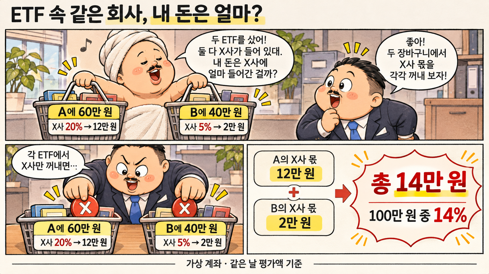
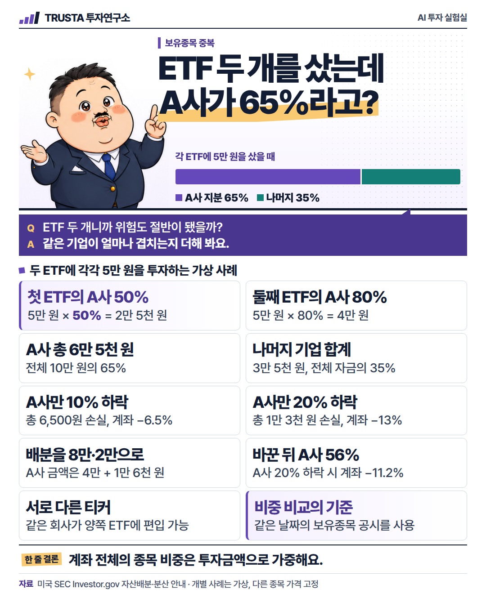

# ETF 다섯 개 속 같은 기업, 실제 투자금은 얼마나 겹칠까?

*민호와 천억이의 대화는 편집부가 만든 질문입니다.*

수건을 두른 민호가 찜질방 매점에서 달걀 다섯 개를 고릅니다. 하나는 동생 것, 하나는 조카 것. 봉투에 이름을 따로 써 달라고 부탁하던 참에 휴대폰이 울려요. 자기가 담아 놓은 상장지수펀드 다섯 개 가격이 나란히 내려갔다는 알림입니다. 방금 본 뉴스에는 반도체 회사 하나만 나왔는데, 내 계좌에서 그 회사에 걸린 돈은 대체 얼마지? 달걀 봉투는 이름만 보면 주인을 알 수 있는데, 펀드 이름 다섯 개는 속을 봐야 알 수 있습니다.

천억이가 매점 영수증 긴 것을 한 장 얻어 옵니다. 다섯 개를 사면 한 종목에 걸리는 몫도 다섯 조각으로 저절로 나뉜다고 생각했어? 민호가 고개를 끄덕입니다. 같은 회사 이름이 여러 줄에 나올 때 그 줄들을 지워야 하는지, 전부 더해야 하는지도 헷갈려요. 천억이는 계좌 화면부터 잠시 닫습니다. 먼저 가방 두 개만 열어 보자. 무엇을 더할 수 있고 무엇을 바로 더하면 안 되는지 한 번만 알면 가방이 다섯 개가 되어도 손이 안 꼬여.

## 계좌 백만 원에서 같은 회사 몫 꺼내기

오늘 이야기 속 계좌와 회사는 편집부가 만든 가정입니다. 원화 백만 원을 첫날 한 번 넣고 빚이나 파생상품 없이 보통주를 담은 펀드에 투자했다고 놓겠습니다. 값을 비교하는 동안 추가 납입과 인출은 없어요. 하루 동안 환율과 다른 자산 가격은 고정하고 보수, 거래 비용, 세금은 영 원입니다. 분배금도 없어 재투자하지 않습니다. 하락률을 말할 때는 하루 변화만 다루고 연간 수익률로 환산하지 않아요. 먼저 같은 날의 펀드별 평가액과 같은 날의 구성 비중을 알고 있다고 정합니다.

백만 원 가운데 육십만 원짜리 펀드 에이와 사십만 원짜리 펀드 비가 있습니다. 에이 속에 엑스 회사가 이십 퍼센트, 비 속에는 오 퍼센트예요. 민호는 습관처럼 이십 더하기 오, 이십오 퍼센트에 동그라미를 칩니다. 천억이는 그 답을 지우는 대신 바로 옆에 원 단위의 빈칸을 두 개 그려요. 첫 번째 이십 퍼센트에 해당하는 돈은 어느 돈의 이십 퍼센트일까요? 에이 안에 넣은 육십만 원의 이십 퍼센트입니다. 십이만 원이죠. 두 번째 오 퍼센트의 기준은 사십만 원입니다. 이번에는 이만 원이에요.

이제 더할 수 있습니다. 첫 가방에서 꺼낸 십이만 원과 두 번째 가방에서 꺼낸 이만 원은 같은 날, 같은 통화, 같은 회사 몫입니다. 합치면 십사만 원. 전체 백만 원으로 나누면 십사 퍼센트예요. 민호가 처음 말한 이십오 퍼센트는 두 가방의 크기를 잊고 숫자만 붙인 결과였습니다. 이십 퍼센트와 오 퍼센트 사이에서 답이 나온다는 사실도 검산에 쓸 수 있어요. 두 펀드에만 양수로 투자했고 빌린 돈도 없으니 섞은 뒤의 비중이 더 큰 쪽의 이십 퍼센트를 넘어간다면 계산을 다시 봐야 합니다.

**그림 Q&A · 편집부가 만든 질문**　두 바구니의 20%와 5%를 바로 더하면 왜 틀릴까요? 기준 금액이 각각 60만 원과 40만 원입니다. 원화로 바꿔 더한 14만 원을 전체 100만 원으로 나누면 14%입니다.

그날 엑스 회사 주가만 십 퍼센트 떨어진다고 해 보죠. 계좌 전체 백만 원에 십 퍼센트를 곱해서 십만 원을 빼면 될까요? 엑스 회사 몫 십사만 원에만 십 퍼센트를 곱합니다. 손실은 만 사천 원이에요. 첫 펀드에서 만 이천 원, 둘째에서 이천 원이 줄어든다고 나눠 계산해도 같은 답입니다. 계좌 전체 하루 손실률은 일 점 사 퍼센트예요. 실제 뉴스 한 건으로 어느 날 손실이 정확히 이만큼 났다고 말한 것은 아닙니다. 한 회사만 움직였을 때의 영향을 떼어 본 종이 위 실험입니다.

민호는 여기서 궁금해집니다. 그럼 가격이 떨어진 다음 날에도 나는 십사 퍼센트를 들고 있는 거야? 하락 직전에는 그랬죠. 하락 뒤 엑스 몫은 십사만 원에서 만 사천 원이 빠진 십이만 육천 원입니다. 전체 평가액도 구십팔만 육천 원으로 줄었습니다. 새 비중은 십이만 육천을 구십팔만 육천으로 나눈 약 십이 점 칠팔 퍼센트예요. 아무것도 사거나 팔지 않아도 비중은 달라집니다. 원래 비중을 알고 있다는 사실과 오늘 비중을 안다는 사실 사이에는 가격 변화라는 하루가 끼어 있어요.

## 다섯 ETF를 펼치면

이제 민호가 처음 물었던 다섯 봉투를 전부 펼칠 차례입니다. 이번 계좌는 앞의 두 펀드 계좌와 다른 가정이에요. 합계는 똑같이 백만 원입니다. 첫 봉투 사십만 원, 둘째 이십오만 원, 셋째 이십만 원, 넷째 십만 원, 마지막 오만 원입니다. 각각 광역 주식, 기술주, 반도체, 배당주, 단기채권을 담은 가상 상품이라고 부르죠. 이름은 표를 찾아가기 위한 꼬리표일 뿐, 실제 상장 상품을 본뜬 숫자는 아닙니다. 여기서 먼저 더할 것은 다섯 평가액입니다. 백만 원이 되면 통장에 있는 돈과 처음으로 맞아떨어집니다.

첫 봉투에서 엑스 회사가 십 퍼센트를 차지합니다. 사십만 원 중 사만 원이에요. 둘째에는 이십사 퍼센트가 들어 있으니 이십오만 원 곱하기 영 점 이사, 육만 원입니다. 셋째에는 무려 사십 퍼센트가 들어 있지만 투자한 돈은 이십만 원이에요. 엑스 몫은 팔만 원입니다. 넷째 배당주 봉투에서는 오 퍼센트, 십만 원의 오 퍼센트라 오천 원입니다. 마지막 채권 봉투에는 그 회사 주식이 없다고 놓죠. 이 다섯 값을 한 줄로 이어 더하면 십팔만 오천 원입니다. 엑스 주식에 대한 계좌 노출은 십팔 점 오 퍼센트예요.

민호는 종목 수가 아닌 기여 금액으로 순서를 다시 적습니다. 가장 큰 투자금은 첫 펀드인데, 엑스 한 회사에 가장 많이 걸린 돈은 셋째 펀드 안에 있었어요. 둘째와 셋째 두 봉투만 합쳐도 십사만 원입니다. 둘은 전체 투자금 중 사십오만 원을 차지하지만 엑스 몫 가운데서는 십팔만 오천 원 중 십사만 원을 만들어 냅니다. 같은 사십오만 원이라도 무엇을 묻느냐에 따라 분모가 달라져요. 계좌 전체에서 두 상품이 차지하는 비중을 물으면 사십오 퍼센트, 그 회사 노출을 어디서 가져왔는지 물으면 약 칠십오 점 칠 퍼센트입니다.

앞의 두 펀드 계좌보다 봉투는 세 개 늘었습니다. 그런데 엑스 회사 몫은 십사만 원에서 십팔만 오천 원으로 오히려 커졌죠. 그렇다고 펀드를 세 개 추가하면 언제나 집중도가 올라간다는 뜻일까요? 두 계좌는 같은 원금을 다르게 배치한 별개의 예입니다. 처음 계좌에 무엇을 얼마나 보탰느냐를 빼고 단순히 개수만 비교할 수는 없어요. 알아낸 것은 더 분명합니다. 다섯 개라는 개수만으로 한 회사의 계좌 비중이 작아졌는지 판단할 수 없다는 점이에요. 손으로 만질 수 있는 원화 금액으로 내려와야 보입니다.

천억이는 다섯 봉투가 든 계좌에서 엑스 회사만 하룻밤에 십 퍼센트 하락하는 경우를 다시 제시합니다. 손실 만 팔천오백 원, 계좌 전체의 일 점 팔오 퍼센트입니다. 그런데 휴대폰에서는 첫 펀드와 둘째와 셋째가 각기 다른 폭으로 내릴 수 있죠. 첫 펀드에서 엑스 비중이 십 퍼센트라 펀드 자체에 미치는 단순 영향은 마이너스 일 퍼센트입니다. 둘째는 마이너스 이 점 사 퍼센트, 셋째는 마이너스 사 퍼센트, 넷째는 마이너스 영 점 오 퍼센트가 됩니다. 다섯째는 이 모형에서 영향이 영입니다. 이 퍼센트들을 합하는 대신 각 금액 손실을 합쳐야 계좌 손실로 돌아옵니다.

## 옮긴 돈의 도착지까지 계산하기

수건 친구가 제일 먼저 떠올린 방법은 엑스 회사가 들어 있는 펀드 하나를 정리하는 거였어요. 금액을 움직이기 전에 종이 위에서 조건만 바꿔 봅시다. 십만 원을 셋째 펀드에서 빼서 다섯째 펀드로 옮기고 가격과 비중은 그대로라고 놓습니다. 셋째의 엑스 비중은 사십 퍼센트였으니 회사 몫 사만 원이 줄어요. 다섯째에 새로 십만 원이 들어가도 엑스 주식이 없다는 가정이라 이쪽에서 보태는 금액은 영입니다. 엑스 몫은 십팔만 오천 원에서 십사만 오천 원으로, 전체 비중은 십사 점 오 퍼센트로 내려갑니다. 계좌 원금은 여전히 백만 원입니다.

같은 십만 원을 셋째에서 빼서 둘째로 옮기면 어떨까요? 빠지는 회사 몫 사만 원은 아까와 같지만, 둘째에서 새로 들어오는 엑스 몫은 십만 원의 이십사 퍼센트인 이만 사천 원입니다. 둘을 함께 반영하면 줄어든 금액은 만 육천 원뿐입니다. 새 회사 몫은 십육만 구천 원, 비중은 십육 점 구 퍼센트예요. 민호는 옮긴 금액이 같아도 도착지를 적지 않으면 답을 못 낸다는 걸 알아냅니다. 어느 펀드를 덜 사느냐와 그 돈으로 무엇을 더 사느냐가 한 쌍입니다. 이 계산은 상품을 바꾸라는 지시가 아니라 변수를 하나씩 바꿔 본 실험이에요.

천억이는 이번에 현금 오십만 원이 별도 통장에 있었다는 설정을 더합니다. 민호가 묻는 건 이제 펀드 계좌가 아니라 자기 금융자산 전체 중 엑스 주식이 얼마나 되는지예요. 다섯 펀드는 처음 배치로 돌려놓습니다. 회사 몫은 그대로 십팔만 오천 원이고, 분모가 백만 원에서 백오십만 원으로 바뀝니다. 나눠 보면 약 십이 점 삼삼 퍼센트예요. 비율이 낮아졌는데 엑스가 오늘 십 퍼센트 내릴 때 원화 손실도 줄었을까요? 여전히 만 팔천오백 원입니다. 바꾼 것은 돈을 세는 범위이고, 주식을 실제로 줄인 게 아니니까요.

민호는 반대로 엑스 주식을 증권계좌에서 직접 산 돈도 생각해 냅니다. 펀드 백만 원과 별도로 십만 원어치를 직접 들고 있고 다른 자산은 없다고 가정해 볼게요. 엑스 관련 금액은 십팔만 오천 원과 십만 원을 더한 이십팔만 오천 원입니다. 분모는 백십만 원이에요. 약 이십오 점 구일 퍼센트입니다. 직접 산 주식 십만 원을 분자에 더하고 분모는 펀드 백만 원으로 그대로 두면 이십팔 점 오 퍼센트가 나오는데, 그건 서로 다른 범위를 섞은 계산이에요. 합칠 대상을 바꾸면 전체 금액도 같은 범위로 다시 세어야 합니다.

그런데 앱에 보이는 숫자 중 어떤 것을 펀드에 곱해야 할까요. 민호는 오래전에 넣었던 매입원금이 더 익숙합니다. 가령 에이를 육십만 원 주고 샀지만 오늘은 칠십이만 원, 비는 사십만 원에 샀지만 오늘 평가액은 삼십육만 원이라고 해 봅시다. 지금 공시된 엑스 비중은 에이 이십 퍼센트, 비 오 퍼센트예요. 오늘의 노출을 묻는다면 칠십이만 원의 이십 퍼센트인 십사만 사천 원과 삼십육만 원의 오 퍼센트인 만 팔천 원을 더합니다. 합계 십육만 이천 원, 오늘 계좌 백팔만 원의 십오 퍼센트입니다. 옛 매입원금을 쓰면 십사 퍼센트라고 답하겠죠. 과거와 현재 중 어느 질문의 답인지 먼저 써야 합니다.

## 자료의 날짜와 빠진 종목

지금의 비중으로 과거 손실 이유를 밝히려 할 때도 비슷한 일이 생깁니다. 한 달 전 엑스 비중이 이십 퍼센트였고 오늘은 십 퍼센트라면, 지난달 내내 어느 쪽이었는지는 끝점 두 개만 봐서는 알 수 없어요. 중간에 지수가 구성 종목을 바꿨을 수도 있고, 자산 가격 차이로 자연스럽게 비중이 변했을 수도 있습니다. 오늘 값을 들고 과거 한 달 내내 같은 노출이 있었다고 주장하려면 추가 근거가 필요합니다. 과거 성과를 설명하고 싶은 날에는 변화가 일어나기 전의 보유 내역과 기간 중 거래 자료를 따로 찾아야 합니다.

천억이가 한 손에 찐 달걀을 들고 다른 손으로 달력을 보여 줍니다. 파일 이름은 오늘 날짜인데 표 머리에 있는 보유 기준일은 지난 금요일이에요. 다른 운용사 파일은 목요일 기준이라고 해 봅시다. 비교하려는 두 펀드가 있으니 금요일에 둘 다 내려받으면 날짜를 맞춘 걸까요? 내려받은 날짜만 같아진 겁니다. 같은 기준일이 필요하면 양쪽에 모두 있는 날짜를 찾아서 그날의 표끼리 묶어야 합니다. 오늘 확인한 최신 자료 중 하나가 며칠 전 것이라면 며칠 차이가 난다는 사실을 밝혀야 해요. 없는 날짜의 상세 비중을 추측해서 메우면 나중에 계산을 재현할 수 없습니다.

실제 상품 페이지에서는 어디에 손을 대야 할까요. 반도체라는 말이 들어가는 아이셰어즈의 에스오엑스엑스와 반에크의 에스엠에이치가 있습니다. 두 운용사 원문은 각자 상품의 투자 대상과 보유 내역을 확인하는 출발점이에요. 여기서는 현재 어느 회사가 몇 위인지 경쟁시키지 않습니다. 민호가 연습할 일은 상품 이름을 정확히 맞춘 뒤, 보유 내역 표의 기준일과 항목 정의를 찾는 겁니다. 페이지 위에 크게 보이는 펀드 전체 순자산과 한 회사가 펀드 안에서 차지하는 비중은 단위부터 달라요. 운용사 전체가 가진 돈 대신 내가 그 펀드에 실제 넣어 둔 평가액을 곱해야 합니다.

민호가 처음 내려받은 건 상위 열 종목 그림이었습니다. 열 줄에서 엑스 이름을 못 찾으니 영 원이라고 쓰려고 해요. 그때 천억이가 봉투 입구를 접어 절반만 보여 줍니다. 윗부분에 안 보이는 달걀이 아래쪽에는 없다고 말할 수 있을까? 만약 공개된 열 종목 합계가 팔십 퍼센트라면 나머지 이십 퍼센트의 상세는 그 그림만으로 모릅니다. 엑스가 공개된 목록에 없다면 그 나머지에 들어 있을 가능성을 배제하지 못해요. 펀드에 이십만 원을 넣었다면 전체 미확인 부분이 사만 원이라는 넓은 상한은 잡을 수 있지만, 그 사만 원이 전부 엑스라는 뜻은 아닙니다.

조건을 조금 더 주면 범위가 좁아집니다. 목록이 정말 비중 순으로 정렬한 상위 열 종목 전부이고 열 번째의 비중이 이 퍼센트라고 해 볼게요. 엑스가 단일 증권 한 줄이고 표에서 빠졌다면 그 한 줄의 비중은 이 퍼센트보다 크기 어렵습니다. 동률 때문에 경계가 같을 수는 있어요. 이십만 원에 이 퍼센트를 곱한 사천 원은 방금의 사만 원보다 훨씬 좁은 상한입니다. 하지만 같은 회사의 다른 종류주 두 줄이 따로 있다면 단일 증권에 적용한 그 상한을 회사 전체에 그대로 가져갈 수 없어요. 정렬 기준도 확인하지 않고 상한을 단정하면 계산에 없는 전제를 보탠 겁니다.

## 같은 회사를 어떤 단위로 묶을까

이번에는 표 마지막에 합계가 구십구 점 구 퍼센트라고 적혀 있습니다. 민호가 남은 영 점 일 퍼센트를 현금이라고 채웁니다. 꼭 그럴까요? 소수 한 자리로 반올림한 값들을 합쳐서 생긴 차이일 수도 있어요. 예를 들어 세 종목을 똑같은 비중으로 든 가상 펀드를 소수 첫째 자리까지만 쓰면 삼십삼 점 삼 퍼센트가 세 번 나옵니다. 합계 구십구 점 구 퍼센트죠. 실제로 현금 영 점 일 퍼센트를 떼어 놓았던 것은 아닙니다. 현금이라고 분류한 행이 있는지, 일부 항목을 제외한 표인지, 표시 자릿수가 몇 자리인지를 먼저 봐야 합니다.

수건 친구는 표에 적힌 회사 이름이 조금씩 다른 문제와도 만납니다. 한 파일에는 한글 이름, 다른 파일에는 영문 약칭, 또 다른 파일에는 거래소에서 쓰는 기호가 적혀 있어요. 이름 첫 글자가 같다고 합치면 다른 기업이 섞일 수 있고, 철자가 다르다고 나누면 같은 기업이 두 번 남을 수 있죠. 그래서 원문에 있는 증권 식별자와 거래소, 종류주 정보를 같이 살펴봅니다. 같은 기업에 대한 사업 위험을 알고 싶다면 기업 단위로 묶고, 실제로 같은 증권을 두 번 담았는지 알고 싶다면 증권 단위로 남깁니다. 두 표 모두 유효하지만 대답하는 질문이 다릅니다.

가령 한 펀드에는 어떤 회사의 보통주가 십만 원, 다른 펀드에는 그 회사의 예탁증서가 오만 원어치 들어 있다고 해 보죠. 회사의 주식 관련 노출이라는 넓은 범위에서는 둘을 합친 십오만 원이 유용할 수 있어요. 그러나 거래 가능한 동일 증권이 십오만 원어치라고 쓰면 예탁증서와 현지 주식의 권리 구조나 통화, 거래 시장 차이가 사라집니다. 예탁증서 한 개가 현지 주식 몇 주에 해당하는지도 상품에 따라 확인해야 하고요. 이미 같은 통화의 시장가치로 환산한 뒤라면 그 비율로 금액을 한번 더 늘리는 것도 이중 계산입니다.

민호가 아끼는 달걀 봉투 중 하나를 열었더니 그 안에 더 작은 봉투가 들어 있습니다. 이번에는 다른 펀드에 투자하는 펀드를 생각해 봅시다. 내가 십만 원 넣은 바깥 펀드에서 절반을 안쪽 펀드에 투자했고, 안쪽 펀드의 엑스 주식 비중이 삼십 퍼센트라고 해요. 경로를 따라가면 십만 원 곱하기 절반은 오만 원, 그 오만 원 중 삼십 퍼센트는 만 오천 원입니다. 그 밖에 바깥 펀드가 엑스 주식을 직접 일만 원어치 들고 있다면 두 경로를 더해 이만 오천 원입니다. 안쪽 펀드 지분 오만 원을 그대로 엑스 몫으로 넣고 또 그 속 주식을 보태면 부풀어 올라요.

여기서 장부를 맞춰 보는 습관이 도움이 됩니다. 방금 바깥 펀드의 십만 원을 안쪽 펀드 오만 원과 직접 보유한 자산 오만 원으로 먼저 나눴습니다. 안쪽 오만 원을 다시 만 오천 원과 나머지 삼만 오천 원으로 나누면 합계는 여전히 오만 원이어야 하죠. 여러 겹을 열수록 원래의 포장지와 내용물을 동시에 합계에 넣기 쉽습니다. 마지막 줄에 종목과 현금과 아직 분해하지 못한 부분을 더했을 때 출발한 십만 원이 되는지를 보세요. 평가 시점과 통화가 같고 빚 없는 단순 보유라면 이 검산에서 큰 실수가 드러납니다.

그런데 선물이나 스왑이라는 말이 나오면 방금 방식만으로 답을 낼 수 있을까요? 민호는 펀드 장부에 현금이 많으면 주식 위험이 작을 거라고 생각합니다. 현물 주식만 담은 가상 계좌라면 어느 정도 맞는 직관이에요. 하지만 파생계약으로 가격 움직임을 가져오는 구조에서는 담보로 잡힌 금액과 실제 가격 변동에 노출된 규모가 다를 수 있습니다. 이때는 단순한 보유자산 시장가치와 계약이 만들어 내는 경제적 노출을 나누어 봐야 해요. 계약 방향과 명목 금액, 기초 자산을 확인하지 못했다면 현금이 많다는 이유로 엑스 노출이 작다고 결론 내리지 않습니다.

## 상품끼리 닮은 정도와 내 계좌의 노출

예를 들어 현금 담보 이십만 원이라는 한 줄만 읽었다고 합시다. 그 한 줄은 이십만 원이 어디에 있는지 알려 주지만 계약 규모가 이십만 원인지, 오십만 원인지, 상승에 이익을 보는지 하락에 이익을 보는지는 말해 주지 않아요. 천억이는 이 칸에 숫자 영을 적지 않고 미확인이라고 적습니다. 영과 미확인은 계산에서 전혀 다르게 취급해야 하죠. 영은 확인한 결과 대상이 없다는 뜻이고 미확인은 계산할 자료가 부족하다는 뜻입니다. 미확인을 영으로 합산하면 빈칸이 늘어날수록 위험이 작아 보이는 이상한 장부가 됩니다.

친구가 다른 질문을 보냅니다. 두 펀드가 얼마나 닮았는지 알고 싶은 건데 내 계좌 잔액을 꼭 알려 줘야 해? 꼭 그렇지는 않습니다. 두 펀드 자체의 구성 유사도를 물을 때는 투자자의 계좌 배분을 몰라도 계산할 수 있는 지표가 있어요. 양쪽에 공통으로 있는 증권마다 작은 쪽 비중만 취해서 더하는 방식입니다. 단순한 현물 펀드 두 개를 같은 기준일, 같은 종목 식별 단위로 놓고 전체 상세 비중을 알고 있다는 조건에서 볼게요. 이 지표는 내 돈이 엑스에 얼마나 들어갔는지 묻던 처음 질문과 다른 것을 셉니다.

첫 펀드에는 엑스가 이십 퍼센트, 와이가 삼십 퍼센트, 나머지 다른 종목이 오십 퍼센트입니다. 둘째에는 엑스가 오 퍼센트, 와이가 사십 퍼센트, 첫 펀드에는 없는 다른 종목이 오십오 퍼센트예요. 엑스에서 공통으로 잡을 수 있는 몫은 작은 쪽 오 퍼센트입니다. 와이에서 작은 쪽은 삼십 퍼센트죠. 나머지에는 같은 종목이 전혀 없다고 정했으니 두 펀드의 공통비중은 삼십오 퍼센트입니다. 두 펀드를 각각 한 바구니씩 표준 크기로 놓았을 때 서로 포개지는 영역을 구한 셈이에요.

그런데 민호가 실제 첫 펀드에 육십만 원, 둘째에 사십만 원을 넣었다면 엑스에 걸린 돈은 아까와 똑같이 십사만 원입니다. 와이는 육십만 원의 삼십 퍼센트인 십팔만 원과 사십만 원의 사십 퍼센트인 십육만 원을 더한 삼십사만 원이에요. 두 공통 회사에 배분된 돈을 묻는다면 십사만 원 더하기 삼십사만 원, 사십팔만 원입니다. 방금 공통비중 지표인 삼십오 퍼센트를 백만 원에 곱한 삼십오만 원과 다르죠. 한쪽은 작은 쪽만 남긴 두 상품의 유사도, 다른 쪽은 실제 보유한 두 회사의 금액 합계입니다.

## 계좌 손실과 한 회사의 영향

천억이는 봉투 하나를 아예 비웠을 때를 떠올려 보라고 합니다. 첫 펀드에만 백만 원 넣고 둘째에는 한 푼도 없더라도 두 상품의 공통비중 삼십오 퍼센트 자체는 바뀌지 않습니다. 상품의 구성에 관한 숫자니까요. 반면 민호의 계좌에서 엑스에 들어간 돈은 이십만 원으로 달라집니다. 이 간단한 반례를 통과하면 질문이 어느 쪽인지 다시는 헷갈리지 않아요. 내 계좌를 비웠는데도 같은 숫자가 남는다면 그건 상품끼리 비교하는 값입니다. 내가 넣은 돈을 바꿨을 때 결과가 변한다면 투자자가 실제로 가진 몫을 재는 값일 가능성이 큽니다.

이번엔 엑스가 흔들리던 날에 다섯 펀드가 전부 빨갛게 보였다는 원래 사건으로 돌아가죠. 다섯째 펀드에는 엑스 주식이 없다고 했는데 왜 같이 움직였을까요? 설명은 여러 개가 가능합니다. 금리나 환율 같은 다른 요인이 겹쳤을 수 있고, 같은 업종의 다른 기업이 함께 움직였을 수도 있어요. 펀드 시장가격이 자산가치와 조금 다른 폭으로 움직였을 수도 있습니다. 색깔이 같았다는 관찰 하나로 엑스가 유일한 원인이라고 증명할 수는 없어요. 엑스 주식에 직접 걸린 금액은 보유 내역에서 구하고, 그날 손익의 원인을 밝히려면 나머지 자산과 시장 요인도 추가로 살펴야 합니다.

*카드는 가상 5만 원씩에 A사 비중 50%와 80%를 대입해 계좌 65%를 얻는다. 본문은 비대칭 배분에서 14%를 얻는 다른 사례다.*

**편집부가 만든 질문 · 상위 열 종목에 겹침이 없으면 중복률이 0일까?**

전체 보유 파일의 나머지 종목이 겹칠 수 있다. 상위 열 개만 본 값은 확인한 범위의 하한으로 기록한다.

민호는 실제로 계좌가 삼만 원 줄었다는 가정을 하나 보탭니다. 엑스가 십 퍼센트 떨어지고 다른 것은 고정했을 때의 계산이 만 팔천오백 원이었으니 나머지 만 천오백 원은 어디서 나왔을까요? 차액 자체는 구할 수 있습니다. 하지만 그것이 전부 환차손인지, 다른 종목의 하락인지, 거래비용인지는 이 숫자만으로 구분하지 못합니다. 차액은 설명된 부분과 전체 사이에 남은 문제예요. 충분한 자료 없이 가장 눈에 띄는 뉴스 하나로 그 빈칸을 메우면 같은 돈을 두 원인에 동시에 배분할 수도 있습니다.

천억이는 마지막 연습으로 아주 작은 통장을 꺼냅니다. 오만 원씩 두 펀드에 똑같이 들어 있어요. 첫 펀드 안 같은 회사 비중이 절반, 둘째는 팔십 퍼센트입니다. 첫 펀드에서 이만 오천 원, 둘째에서 사만 원을 가져오면 합계 육만 오천 원. 전체 십만 원으로 나눠 육십오 퍼센트입니다. 두 비중의 단순 평균인 육십오 퍼센트와 이번엔 우연히 답이 같아요. 왜 이번에는 평균을 내도 됐을까요? 두 펀드에 들어간 돈이 정확히 같았기 때문이에요. 처음의 육십만 원과 사십만 원 사례에는 같은 지름길을 쓸 수 없습니다.

이제 민호는 달걀 봉투 다섯 개를 다시 줄 세웁니다. 이름을 적은 봉투마다 내가 넣은 금액을 쓰고, 그 아래에는 같은 회사가 차지하는 몫을 적어요. 맨 오른쪽 칸에는 원으로 환산한 값만 놓습니다. 보유 날짜가 다른 자료는 옆으로 빼고, 파생계약처럼 아직 금액을 구할 수 없는 것도 빈칸으로 남겨 둡니다. 모든 상품을 오늘 다 조사해야 시작할 수 있는 건 아니에요. 자료가 확인된 두 펀드로 작은 계산부터 해 보고, 지금 답이 계좌 전체인지 확인된 일부인지 표시하면 됩니다. 나머지 세 펀드가 남았다면 두 펀드 결과를 전체라고 제목 붙이지 않는 게 중요합니다.

매점 직원이 민호에게 묻습니다. 봉투 다섯 개로 나눠 드렸는데 어떤 게 조카 거였죠? 민호는 이번에는 봉투 이름과 그 안의 몫을 함께 확인하고 건넵니다. 오늘 집에 가서도 똑같이 해 볼 일이 하나 있어요. 계좌에서 평가액이 큰 두 펀드를 골라 같은 날짜의 보유 내역을 열고, 둘 다 가진 기업 딱 한 곳만 찾습니다. 각 펀드에 들어간 내 돈에 그 회사의 비중을 곱해서 원 단위로 한 줄씩 쓰고 두 줄을 더해 보세요. 다섯 개를 샀으니 나뉘었겠지 하던 질문이, 이 회사에 지금 얼마가 걸려 있구나 하는 자기 장부의 답으로 바뀝니다.

**자료 기준**　원문 확인일 2026년 11월 27일. 계산은 원화 가상 계좌의 같은 날 평가액 기준입니다. SOXX·SMH는 보유 내역을 찾는 원문 사례이며 두 상품의 실측 중복률은 미확정입니다.

**원문**　[미 SEC의 ETF 구조 안내](https://www.investor.gov/introduction-investing/investing-basics/investment-products/mutual-funds-and-exchange-traded-2) · [FINRA 분산투자 안내](https://www.finra.org/investors/investing/investing-basics/asset-allocation-diversification) · [iShares SOXX](https://www.ishares.com/us/products/239705/ishares-phlx-semiconductor-etf) · [VanEck SMH](https://www.vaneck.com/us/en/investments/semiconductor-etf-smh/)

**이어 읽기**　[ETF 총비용 계산, 연 보수 0.1%보다 호가 한 번이 더 클 때](EP007.md) · [두 ETF의 겹침이 50%라면 내 계좌 절반이 같은 기업일까?](FAQ01.md) · [전자책 목차](목차.md)
