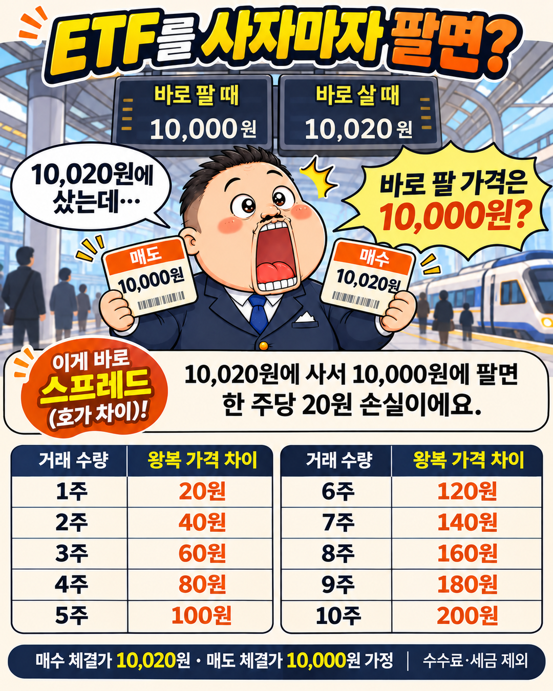
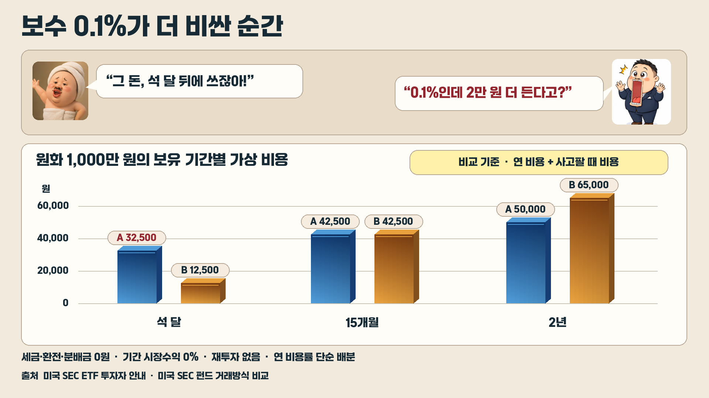

# 은퇴 후 1,000만 원, 석 달만 ETF에 둔다면? 보수 0.1%의 함정

## 1. 첫 연금까지 석 달

가상 인물 천억이는 첫 연금 입금일과 치과 예약일을 같은 달력에 적습니다. 그사이 1,000만 원을 어떻게 둘지 고민하다 연 보수 0.1%인 ETF를 발견합니다. “이게 더 싸지?” 수건 친구가 치과 예약일을 짚습니다. “그 돈, 언제 다시 써야 하는데?”

## 2. 날짜가 먼저인 돈

생활비나 치료비는 지출 날짜가 정해져 있습니다. ETF 가격이 내려간 상태에서 날짜에 맞춰 팔면 손실이 확정될 수 있습니다. 꼭 써야 하는 금액을 먼저 적어 두고, 손실을 감당할 수 있는 금액과 구분합니다. 아래 계산은 가격 변동을 고정한 비용 비교입니다.

## 3. 주문창에서 보이는 비용

연간 운영비는 펀드 자산에서 차감됩니다. 투자자가 거래할 때는 증권사 수수료와 호가 차이가 별도로 영향을 줍니다. 10,020원에 사서 다른 조건 변화 없이 바로 10,000원에 팔면 한 좌당 20원이 줄어듭니다. 주문량이 앞 호가 물량보다 많다면 다음 가격에서도 체결될 수 있습니다.

*보수와 별도로 주당 20원의 왕복 가격 차이가 생기는 만화 속 가정이다.*

## 4. 석 달 영수증의 반전

가상으로 원화 1,000만 원을 석 달 보유하고 한 번에 청산합니다. 기간 시장수익 0%, 세금·환전·분배금 0원, 재투자 없음입니다. 연 비용률은 개월 수에 비례해 단순 배분합니다. 왕복 비용률은 사고팔 때 드는 호가·수수료를 초기 원금 대비로 환산합니다.

A의 연 비용률은 0.1%, 왕복은 0.3%입니다. 석 달 비용 2,500원에 거래 비용 30,000원을 더하면 **32,500원**입니다. B는 연 0.3%, 왕복 0.05%로 석 달 비용 7,500원과 거래 비용 5,000원, 합계 **12,500원**입니다. 연 비용률이 낮은 A에서 2만 원이 더 나갑니다.

## 5. 15개월이 되면 순서가 바뀐다

왕복에서는 A가 25,000원 더 들고, 매년 쌓이는 비용에서는 B가 20,000원 더 듭니다. 25,000원을 20,000원으로 나눈 1.25년, 즉 15개월에 두 비용은 42,500원으로 같습니다. 2년을 놓고 보면 A 50,000원, B 65,000원입니다.

*초기 원금 1,000만 원의 가상 비용. 투자 기간에 따라 비용이 적은 상품이 달라진다.*

## 6. 같은 석 달이어도 호가가 달라지면

A의 왕복 비용만 0.05%로 떨어지면 A의 석 달 비용은 7,500원입니다. B의 12,500원보다 내려갑니다. 호가 간격과 수량은 바뀔 수 있으므로 비교 당시 예상 비용을 체결 금액처럼 적지 않습니다.

## 7. 이미 빠진 비용은 한 번만

상품 설명서에서 연간 운영비에 어떤 항목이 포함되는지 확인합니다. 해당 비용이 이미 반영된 NAV 수익률을 사용한다면 같은 항목을 또 빼면 중복입니다. 외화 상품을 비교할 때는 실제 부담하는 환전 비용과 환율로 달라진 원화 가치도 구분합니다.

## 8. 내 달력에 숫자 두 줄 적기

천억이는 필요한 돈이 언제 나가는지 먼저 적습니다. 각 ETF 옆에 그때까지 쌓일 비용과 매매를 한 번 왕복할 비용을 원 단위로 따로 적으면, 어느 가격에서 내 판단이 바뀌는지 비교할 수 있습니다.

**편집부 Q&A · 증권사 수수료 무료면 왕복 비용도 0원인가요?**  
증권사 수수료 조건과 사고팔 때 만나는 두 호가를 따로 확인합니다.

**원문**　[미 SEC ETF 투자자 안내](https://www.investor.gov/introduction-investing/general-resources/news-alerts/alerts-bulletins/investor-bulletins-24) · [미 SEC 펀드 거래방식 비교](https://www.investor.gov/introduction-investing/general-resources/news-alerts/alerts-bulletins/characteristics-mutual-funds-exchange-traded-funds)

**이어 읽기**　[ETF 거래시간, 미국 휴일에 한국 상장 미국 ETF를 주문해도 될까?](EP008.md) · [전자책 목차](목차.md)
