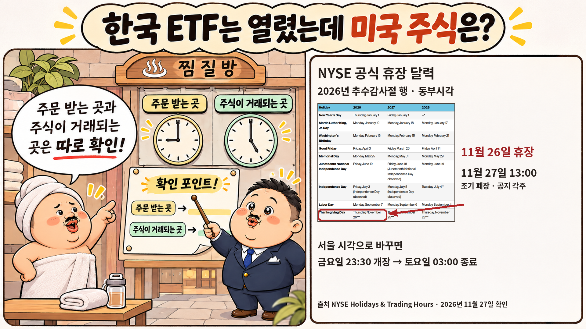
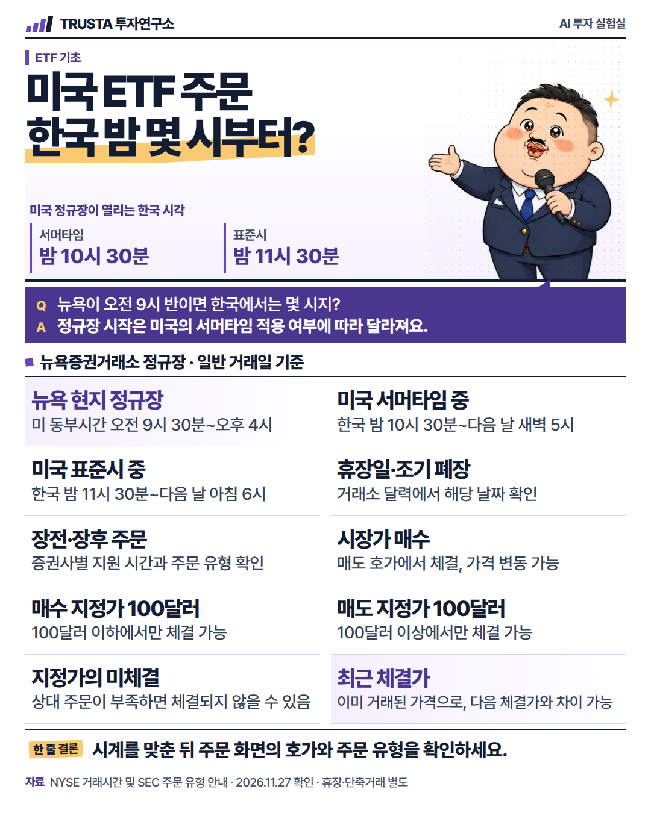

# ETF 거래시간, 미국 휴일에 한국 상장 미국 ETF를 주문해도 될까?

*민호와 천억이의 대화와 문답은 편집부가 만든 질문입니다.*

민호가 찜질방 매점에서 야간 이용권을 두 장 꺼냅니다. 입구는 열려 있는데 찜질방 안쪽 매점은 셔터가 내려가 있어요. 그 앞에서 천억이에게 휴대폰을 보여 줍니다. 국내에 상장된 미국 주식 펀드는 지금 살 수 있다는데, 미국이 추수감사절이면 그 안에 든 주식도 지금 거래되는 걸까? 둘 다 열린 줄 알고 눌렀다가 가격을 잘못 읽으면 어쩌지? 천억이는 두 장의 이용권을 나란히 놓습니다. 하나는 지금 주문을 받는 곳, 다른 하나는 펀드가 들고 있는 주식이 정규장에서 거래되는 곳입니다.

## 추수감사절 달력에서 같은 날짜 찾기

실제로 뉴욕증권거래소의 이천이십육 년 달력을 봅니다. 미국 동부시각 십일월 이십육일 목요일은 추수감사절이라 쉽니다. 이튿날인 이십칠일 금요일에는 조기 폐장으로 주식 정규장이 오후 한 시에 끝납니다. 이 날짜는 미국 동부 달력에 적힌 날짜예요. 늦가을 서울과 뉴욕은 열네 시간 차이가 납니다. 금요일 오전 아홉 시 반에 시작하는 정규장은 서울 금요일 밤 열한 시 반에 열리고, 금요일 오후 한 시의 조기 폐장은 서울 토요일 새벽 세 시가 됩니다.

**그림 Q&A · 편집부가 만든 질문**　뉴욕 금요일 오후 1시에 끝나는 조기 폐장은 서울에서 언제인가요? 토요일 오전 3시입니다. 동부 표준시와 서울의 시차는 14시간입니다.

민호는 서울 금요일이라고 적힌 날짜 하나에 휴장과 조기 폐장 중 하나만 적으려 했어요. 그런데 서울 금요일 새벽은 뉴욕 목요일이고, 서울 금요일 밤은 뉴욕 금요일 아침입니다. 같은 서울 날짜 안에서도 연결되는 뉴욕 날짜가 바뀌죠. 달력에서 날짜뿐 아니라 내가 주문을 생각하는 시각에 맞춰야 합니다. 이달 말의 금요일 오전에 주문하는 사람과 같은 날 밤 자정 무렵에 정보를 보는 사람은 다른 미국 시간을 보고 있다는 얘기예요.

평소 뉴욕 정규장은 동부시각 오전 아홉 시 반에서 오후 네 시입니다. 서울에서는 미국 표준시 적용 기간 밤 열한 시 반부터 다음 날 오전 여섯 시, 미국 일광절약시간 적용 기간 밤 열 시 반부터 다음 날 오전 다섯 시예요. 민호가 작년 여름에 저장한 화면을 꺼내 내일도 항상 밤 열 시 반이라고 적었다면 겨울에는 한 시간 틀어집니다. 조기 폐장을 확인해야 하는 날이라면 여기에 정규장 종료 시간도 다시 맞춰야 해요.

*뉴욕 정규장의 동부시각과 한국의 여름·겨울 시차를 대조한다. 휴장 및 단축장에는 별도 일정을 본다.*

## 국내 주문 버튼과 기초주식의 거래 상태

그럼 국내 주문 버튼을 누를 수 있다는 사실은 뭘 알려 줄까요? 그 화면이 국내 상장 상품을 받는 주문 창이라는 점입니다. 주문이 지금 체결되는지, 예약 접수만 되는지, 거래가 정지됐는지는 상태 표시로 따로 확인해야 해요. 기초 주식이 미국 정규장에서 당장 거래되고 있느냐는 질문에는 미국 쪽 정규장 시간표가 필요합니다. 두 창을 열고 한쪽의 버튼이 켜졌다는 사실을 다른 쪽의 개장 증거로 옮겨 적지 않습니다.

실제로 어느 기초 주식이 거래되는지까지 보려면 구성 종목이 어느 거래소에서 거래되는지도 살펴야 합니다. 뉴욕증권거래소의 달력은 뉴욕증권거래소가 공지한 시장 일정입니다. 국내 상품이 여러 시장의 증권을 담았다면 해당 시장의 일정도 찾아봐야 해요. 또 정규장 표에 없는 시간이라고 해서 관련 자산의 모든 거래가 전 세계에서 멈췄다는 뜻은 아닙니다. 해외 선물이나 시간외 시장을 근거로 쓰려면 그 거래소가 그날 공지한 개장 시간과 실제 가격 관측 시각을 별도로 확인합니다.

천억이는 민호에게 회색 숫자와 빨간 숫자가 나란히 보이는 종이 화면을 건넵니다. 회색은 어제 자산 평가에서 남은 값, 빨간색은 지금 팔겠다는 사람이 부른 가상 가격이에요. 숫자 옆의 시각이 몇 시간 차이 나는데도 두 값을 곧장 빼면 정확한 할인인지 알 수 있을까요? 차이 자체는 계산할 수 있지만 무엇이 그 차이를 만든 것인지는 더 살펴야 합니다. 기초주가가 마지막으로 관측된 시간, 원화로 바꾼 데 쓴 환율의 시간, 국내 호가를 읽은 시간이 모두 다를 수 있기 때문입니다.

예를 들어 펀드 안의 달러 자산은 한 주 몫으로 십 달러이고 마지막 가격이 그대로라고 둡니다. 달러당 천삼백 원에서는 만 삼천 원입니다. 새 기초주식 거래가 없는 동안 원화 환율만 천삼백이십육 원이 됐다면 같은 십 달러의 원화 환산액은 만 삼천이백육십 원이에요. 단순 환산은 이 퍼센트 움직였습니다. 실제 상품의 환헤지, 보유 현금이나 별도 비용은 반영하지 않은 모형입니다. 휴장이라고 국내 가격의 모든 입력값까지 정지한다고 생각했던 민호는 환율을 따로 적기 시작합니다.

민호가 다시 묻습니다. 그럼 휴장 중 국내 가격이 올랐으니 미국 장이 재개되면 꼭 올라요? 국내 호가에 다음 장의 기대가 반영될 수 있지만, 그 기대가 나중 시세와 같을지는 아직 모릅니다. 반대로 국내 가격이 어제의 순자산 표시보다 높더라도 단순히 비싸다고 부르려면 같은 기준 시각과 통화의 자산가치를 확인해야 하죠. 오늘 밤 실제로 호가와 체결가가 어디에 만들어질지는 지금 볼 수 없습니다. 전망을 입찰가와 실측을 섞어 말하면 다음 날 왜 숫자가 달라졌는지 설명하기도 어렵습니다.

## 열 주를 사는 두 주문의 차이

천억이는 숫자 옆에 호가와 체결이라는 글자를 붙입니다. 마지막에 거래된 가격은 이미 끝난 주문에서 나온 값입니다. 지금 살 수 있는지 알려면 지금 팔겠다는 사람이 어떤 값을 부르고 몇 주를 내놓았는지 봐야 해요. 그러고 보니 민호가 아까 캡처한 화면은 오전 열 시였고 실제로 버튼을 누르려는 건 오후 한 시입니다. 사진 속 호가가 오전에 사실이었다고 해서 오후에 같은 사람이 같은 수량을 내놓고 있다는 증거는 아닙니다. 캡처는 관찰한 시간을 보관하는 도구이지, 사진에 찍힌 거래 조건을 예약해 두는 도구가 아닙니다.

원화 하루짜리 모의 주문을 놓아 보겠습니다. 처음에 십일만 원을 현금으로 넣고 추가 입출금은 없어요. 분배금과 재투자, 수수료와 세금은 영 원이며 연율을 사용하지 않습니다. 국내 펀드 열 주를 사려 합니다. 지금 매도하는 사람이 만 원에 세 주, 다음 가격 만 오십 원에 일곱 주를 내놓았어요. 두 줄의 주문이 그대로 있고 그 외 제약 없이 열 주가 즉시 체결된다는 조건입니다. 세 주 값 삼만 원에 일곱 주 값 칠만 삼백오십 원을 더하면 십만 삼백오십 원, 한 주 평균 만 삼십오 원입니다. 남은 현금은 구천육백오십 원이에요.

이번엔 만 원에만 사겠다고 지정합니다. 같은 창에서 처음 세 주가 체결됐다고 놓으면 삼만 원을 썼고 나머지 일곱 주 주문은 기다립니다. 앞으로 팔겠다는 사람이 만 원까지 내려오거나 새로 그 가격에 주문을 내면 더 체결될 수 있어요. 계속 그보다 비싸게만 팔려고 하면 그날 끝까지 세 주일 수도 있죠. 시장가와 지정가를 비교할 때 십만 삼백오십 원과 삼만 원만 놓고 둘째가 싸다고 결론 내리면 안 됩니다. 앞은 열 주를 샀고 뒤는 세 주를 샀습니다. 민호에게 필요한 건 한 주 가격의 상한과 실제로 확보해야 하는 수량 중 어느 쪽을 먼저 정할지예요.

조건을 한 줄만 바꿔 볼게요. 민호가 주문하는 사이에 만 원짜리 세 주가 먼저 거래됐습니다. 이제 만 오십 원짜리 일곱 주와 만 백 원짜리 세 주가 남아 있다고 합시다. 앞의 숫자 그대로 열 주를 즉시 샀다면 일곱 주에 칠만 삼백오십 원, 나머지에 삼만 삼백 원입니다. 합계 십만 육백오십 원이죠. 오전과 똑같이 열 주를 골랐는데 삼백 원 더 들어갔습니다. 시장가 주문에 보인 첫 가격을 적고 손을 놓았다면 주문 다음 화면의 평균 단가가 왜 달라졌는지 설명하기 어렵습니다.

다른 경우도 있습니다. 만 원에 열 주를 살 의향이 있어서 지정가를 내려고 했는데 지금 팔겠다는 쪽이 구천구백구십 원에 열 주를 내놨어요. 가격과 수량이 유지되고 체결 조건이 맞으면 지정한 값보다 낮은 가격에 체결될 수 있습니다. 매수 지정가는 꼭 그 가격을 지불하겠다는 뜻이 아니라 그 위로는 지불하지 않겠다는 조건입니다. 다만 앞에 기다리는 주문, 거래 제한, 바뀌는 잔량 때문에 민호가 본 화면과 실제 체결은 다를 수 있습니다. 이 예가 보여 주는 건 주문의 가격 제한이 어느 방향으로 작동하는지예요.

오후에 민호의 앱에는 삼 주 체결이라고 뜹니다. 민호는 나머지 수량을 산 줄 알고 새로 열 주를 다시 주문할 뻔합니다. 아직 기다리는 일곱 주가 살아 있는 상태에서 또 열 주 주문이 들어가면 계좌 조건에 따라 원했던 열 주를 넘길 수 있죠. 주문 접수 알림과 체결 수량, 남은 수량, 이미 취소된 수량을 따로 보는 이유입니다. 휴장 여부를 맞게 확인하고도 자기 주문 상태를 잘못 읽으면 원하지 않는 수량이 생길 수 있어요. 화면 튜토리얼에서 어느 칸에 화살표를 붙일지 정할 때에도 주문과 체결을 같은 말로 묶으면 놓치는 지점입니다.

천억이는 이번에 사는 쪽과 파는 쪽을 양쪽에 적게 합니다. 가상의 국내 화면에서 지금 즉시 살 때 만 오십 원, 즉시 팔 때 구천구백오십 원이라고 해 볼까요. 한 주를 사고 곧 되팔면 백 원 차이입니다. 장이 활발한 다른 날에 매수가 만 십 원, 매도가 구천구백구십 원이라면 이십 원 차이예요. 예시의 가격은 실측이 아니며 모든 미국 휴장일에 이 차이가 넓어진다는 주장도 아닙니다. 사는 쪽과 파는 쪽을 같은 시각에 보고 그 차이가 내 주문 수량과 예산에서 어떤 금액이 되는지 확인하는 연습입니다.

## 호가를 비교하기 전에 기준 시각 맞추기

이럴 때 싸 보인다며 반대편 정보를 묻지 않고 주문하는 것이 왜 문제인지 한 번 더 보죠. 어제의 가상 자산가치가 만 원입니다. 오늘 국내 호가는 구천구백 원이라 민호는 백 원 싸다고 말해요. 그런데 그 사이 환율과 시장이 보는 해외 가격 정보가 바뀌어, 같은 시각의 가상 자산가치가 구천팔백 원이었다고 가정해 보면 오늘 호가는 오히려 백 원 높습니다. 국내 호가는 구천구백 원 그대로예요. 비교 상대를 교체했을 뿐인데 낮고 높음의 방향이 뒤집혔습니다. 실제로 구천팔백 원이라고 추정하려면 자료가 필요합니다. 예시에서는 답을 주기 위해 가정했을 뿐입니다.

반대로 표시된 기초 자산의 마지막 평가가 오래됐다는 이유만으로 지금 거래가격이 모든 정보를 정확하게 담고 있다고 봐도 안 됩니다. 지금 주문을 낸 사람도 다음에 어떤 일이 일어날지 모르고, 급하게 사고파는 이유가 예상 수익과 무관할 수 있어요. 화면을 읽는 사람에게 필요한 것은 확실한 가치 하나를 임의로 정하는 일이 아닙니다. 비교하는 값의 시간과 정의를 적고 각각 얼마를 근거로 하고 있는지 확인하는 일입니다. 값이 만나지 않으면 잠시 기다려 다시 비교할 수도 있고, 자기 가격과 수량을 정해 두고 체결 여부를 볼 수도 있습니다. 어느 쪽이 나을지는 주문의 목적이 달라지면 달라집니다.

민호가 달러로 주문하는 계좌도 꺼내 보입니다. 이 계좌에서는 미국에 상장된 ETF를 직접 사고요. 다른 계좌에서는 국내 거래소에 상장된 미국 주식 ETF를 원화로 주문합니다. 투자 지역이 비슷하다고 거래 장소와 시간까지 같다고 생각하기 쉽습니다. 첫 계좌에서 정규장 체결을 기대한다면 그 미국 상품이 거래되는 시장과 휴장일을 찾아야 합니다. 둘째는 국내 상장 상품의 거래 상태를 먼저 봅니다. 두 상품이 실제로 동일한 기초자산을 같은 방법으로 따라가는지는 별도로 확인해요. 오늘 이야기에서 비교하는 건 지수 수익률의 우열이 아니라 주문을 받는 장소의 차이입니다.

서울이라는 날짜 표시만 보고 정규장 다음 날을 착각할 수 있는 다른 예도 들어 볼게요. 미국 동부의 금요일 장이 서울 토요일 새벽까지 이어질 수 있습니다. 휴대폰에 토요일이라고 나타나는 것만 보고 뉴욕도 토요일이니 거래 중일 리 없다고 쓰면 엇갈려요. 반대로 서울 월요일 낮이 됐다고 뉴욕 월요일 정규장이 이미 열렸다고 볼 수도 없습니다. 두 시계의 시작과 끝을 같은 줄에서 환산해 보세요. 다가오는 장을 기다리는 사람에게는 정확한 날짜 하나와 시작 시각 하나를 바르게 쓰는 것이 장이 열렸냐는 말보다 더 도움이 됩니다.

민호는 지도를 펼치고 거래소 달력 오른쪽 아래에 작게 확인일을 써 둡니다. 열었다는 뉴스가 아니라 그 시장의 공식 페이지에서 그 시장 이름을 확인하자는 뜻이죠. 휴장 표에서 같은 이름의 공휴일을 찾아도 연도가 다르면 날짜가 밀릴 수 있어요. 올해 추수감사절 행을 보고도 바로 아래 주석에서 이튿날 조기 폐장이 어떤 시장에 적용되는지 살펴야 합니다. 미국 동부시각으로 오후 한 시라고 쓰여 있으면 그때가 서울 새벽 몇 시인지 따로 메모합니다. 화면에 동그라미를 두 개 그린다면 한 개는 휴장일, 나머지는 주석의 조기 폐장 시각에 그리는 편이 알아보기 쉽습니다.

## 출금과 체결의 날짜

누군가 이 자료를 몇 달 뒤에 볼 수도 있습니다. 애초에 공지된 일정과 실제 그날 갑자기 발표된 변경을 같은 것으로 처리하지 않습니다. 영상에 이천이십육 년 날짜를 쓰면 시청자가 다른 해에도 같은 숫자를 복사해서 쓰는 실수를 줄일 수 있죠. 소스 화면을 찍은 날도 함께 놓으면 당시 확인한 표를 다시 찾을 수 있습니다. 자산의 실제 거래가격을 캡처한 자료라면 시간대와 상품 식별 정보도 필요해요. 이번 이야기에서 사용한 열 주 호가는 어디까지나 가상입니다. 실제 거래소 캡처 위에 그 모의 수치가 원래 있었던 것처럼 겹쳐 쓰면 출처를 잘못 읽게 됩니다.

친구가 자기가 궁금한 건 내일 아침 장보기 돈이라고 말합니다. 오늘 ETF를 팔면 내일 바로 장볼 돈이 생길까요? 거래가 체결되는 시각과 결제된 돈을 꺼낼 수 있는 시각을 따로 확인해야 합니다. 달력의 영업일에 따라 달라지는 경우도 있고, 중개사의 화면에 재주문에 쓸 수 있는 금액과 출금할 수 있는 금액이 따로 보일 수도 있어요. 어떤 국내 상품의 실제 출금일을 계산하려면 거래일과 국내 결제 일정, 계좌 조건이 필요합니다. 미국 기초시장이 오늘 휴장했다는 한 가지 사실로 자기가 가진 국내 계좌의 출금 가능 시각을 계산할 수는 없습니다.

## 뉴욕이 열리고 서울이 닫힌 날

편집부가 만든 질문입니다. 미국 장이 닫히면 국내 ETF를 주문해도 되는지 물었는데 왜 천억이는 세 번이나 달력을 확인했을까요? 첫 번째는 국내 주문이 언제 어떤 상태로 들어가는지 알기 위해서입니다. 두 번째는 미국 주식의 마지막 정규장 관측값이 얼마나 오래됐는지 보려는 것이고요. 세 번째는 실제 돈이 필요한 날짜가 언제인지 적기 위해서입니다. 각각 화면이 달라요. 첫 답을 알았다고 둘째와 셋째가 채워지지 않습니다. 민호가 새 호가에 체결됐다고 해서 오래된 수치를 현재 해외 주가로 읽거나, 체결 대금을 지금 당장 출금할 수 있다고 적지 않는 것만으로도 세 장의 달력이 제 일을 합니다.

마지막으로 민호는 하루 시간표를 반대로 읽어 봅니다. 미국 시장이 정규장 안에서 거래되는 날이라고 해도, 그 시간에 국내 ETF의 정규 거래가 함께 열리는 것은 아닙니다. 미국 주식 가격이 밤 사이 크게 움직였는데 국내 ETF 앱에서 보이는 마지막 체결가는 오후에 남은 숫자일 수 있죠. 밤에 본 국내 마지막 값으로 다음 아침 주문이 같은 가격에 체결될 것이라고 계산하면 날짜 경계를 빼먹은 겁니다. 장이 다시 열릴 때 사람들이 새 정보를 넣어 주문 가격을 다시 매길 수 있거든요.

구체적으로 전날 국내에서 한 주 만 원에 끝났다고 가정합니다. 밤에는 달러 기준 기초자산이 사 퍼센트 올랐고, 원화 환산에 쓰는 달러값은 이 퍼센트 내렸습니다. 완전히 노출된 단순 모형에서 비용과 분배가 없을 때 두 움직임을 곱하면 일 점 영사 곱하기 영 점 구팔, 일 점 영일구이입니다. 처음 만 원이 동일 시점 자산 가치였다고 놓으면 다음 원화 환산값은 만 백구십이 원입니다. 사와 이를 빼서 만 이백 원이라고 적으면 간단한 근사는 되지만 일치하지는 않아요. 이 계산 결과는 모형 속 자산 가치이고 국내 개장 때 상대방이 실제로 부를 가격은 아직 모릅니다.

다음 아침 모의 시장에서 가장 낮은 매도호가가 만 이백십 원이라고 해 볼게요. 전날 만 원이라는 숫자만 알고 제출한 만 원 지정가는 가격을 넘기지는 않지만 그 조건에서 거래가 없을 수 있습니다. 만 이백십 원을 보았으니 오늘부터 그 가격이 적정하겠다고 확정하기도 어렵죠. 호가 뒤의 수량이 내 수량과 같다는 보장이 없고, 해외 시장의 마지막 관측 이후 관련 정보가 더 바뀌었을 수 있습니다. 민호는 전날 국내 종가와 밤새 본 기초자산의 변화와 주문 직전의 호가를 종이에 연달아 적습니다. 이제 세 숫자가 왜 각자 위치에 있는지 설명할 수 있어요.

천억이는 미국 주식 다섯 개가 담긴 작은 바구니를 그려 줍니다. 같은 나라 이름 아래 있어도 구성형 상품에는 현금이 있거나, 일부는 다른 시장에서 거래되거나, 환헤지 계약이 들어갈 수 있습니다. 모든 주식이 동시에 같은 가격으로 바뀌었다는 정보가 없으면 주가지수 한 줄로 펀드 가치가 정확히 얼마 움직였다고 정할 수 없어요. 구성과 환율, 가격의 시각을 모두 맞추기 어려운 때에는 오늘 확인된 관측과 자료가 나올 때까지 남은 질문을 적어 둡니다. 숫자가 여러 개라는 사실보다 각 숫자가 서로 어떤 시각을 가리키는지가 더 중요해졌죠.

민호가 친구에게 영상을 보낸다면 무엇을 보여 줄까요? 첫 장면에서는 자기가 국내 상품을 찾은 화면의 종목명과 시장을 짚습니다. 다음 컷에서는 뉴욕증권거래소 공식 달력의 가로줄을 따라 휴장일을 찾고, 바로 아래의 조기 폐장 주석을 읽어요. 이어서 두 시점을 서울 시각으로 바꿔 적습니다. 마지막에 모의 호가 두 줄을 보여 줄 때에는 실제 시세가 아니라는 설명을 화면에 놓습니다. 그렇게 하면 친구는 앞부분의 공식 일정과 뒷부분의 가격 예시를 자기 메모에서 섞지 않습니다.

반대로 실제로 사지 않고 호가창을 두 번 기록해 보는 방법도 있어요. 민호는 오전과 오후에 종목 코드를 한 번씩 읽고, 가격 옆에 공개된 잔량과 관측 시각을 기록해 보기로 합니다. 체결가가 한동안 같아도 호가 잔량이 움직였는지, 괴리율 표시의 시각은 바뀌었는지 살펴볼 수 있습니다. 다만 관측을 두 번 했다고 그 사이 모든 변동을 알 수 있는 것은 아닙니다. 오전과 오후가 달랐다면 그 두 시각이 달랐다고만 적어요. 내일 다시 같은 조건을 찾을 때도 같은 상품, 같은 시장, 같은 화면 항목을 비교하면 오늘 메모의 의미가 남습니다.

매점 불이 켜졌습니다. 민호는 애초에 가지고 온 이용권 한 장에 매점 개장 시각을 적으려다가, 결국 두 장을 따로 씁니다. 오늘 자기 주문에 관한 시각과 기초시장에 관한 시각입니다. 마지막에는 모의 주문의 세 주와 열 주를 구별해 실제 체결 수량을 확인할 빈칸도 남깁니다. 여러분이 다음 주문을 준비할 때는 종목 이름 아래에 거래소 두 곳과 각자 확인한 현지 날짜를 한 줄씩 써 보세요. 그리고 주문할 때 본 호가에는 확인 시각과 수량을 적습니다. 셔터를 한 번 더 볼 때처럼 작은 행동이지만, 어디에서 지금 가격을 만들고 있는지 직접 확인할 수 있습니다.

**자료 기준**　거래소 공식 일정은 2026년 미국 동부시각 11월 26~27일, 원문 확인일은 2026년 11월 27일입니다. 호가와 환산 금액은 가정입니다.

**원문**　[뉴욕증권거래소 거래 일정](https://www.nyse.com/trade/hours-calendars) · [미 SEC 주문 유형](https://www.investor.gov/introduction-investing/investing-basics/how-stock-markets-work/types-orders) · [미 SEC의 ETF 구조 안내](https://www.investor.gov/introduction-investing/investing-basics/investment-products/mutual-funds-and-exchange-traded-2)

**이어 읽기**　[액티브 ETF와 패시브 ETF, 지수를 이겼다는 한 줄 읽는 법](EP009.md) · [전자책 목차](목차.md) · [두 ETF의 종목 겹침](FAQ01.md)
