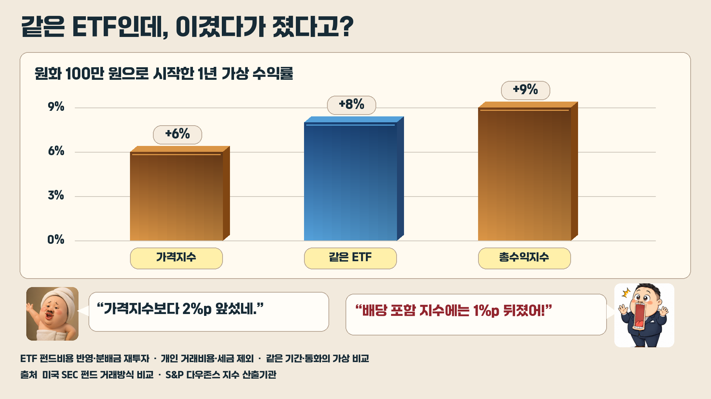
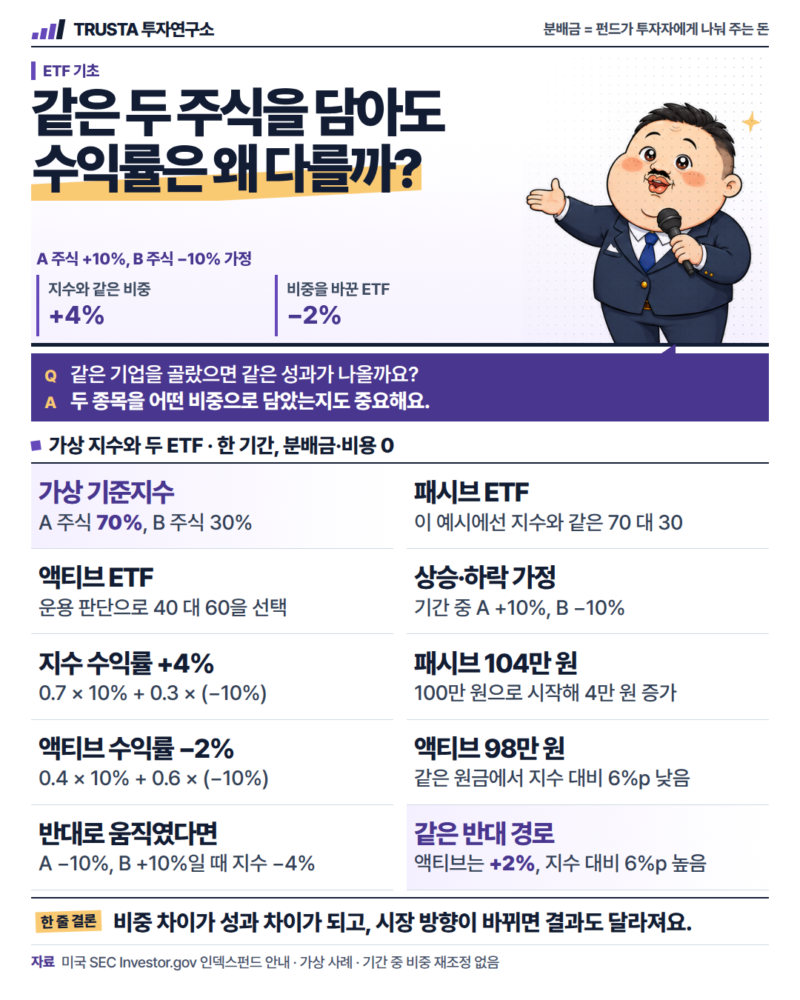

# 은퇴 자금 맡길 ETF, ‘지수보다 2%포인트 더 벌었다’는 말 믿어도 될까?

## 1. 식탁 위 두 성적표

퇴직하고 나니 오래 들고 갈 돈이 더 신경 쓰입니다. 가상 인물 천억이는 식탁에서 ETF 보고서 두 장을 펼칩니다. 한 장에는 ‘지수 대비 +2%포인트’라고 적혀 있습니다. 수건 친구가 그 옆에 지수 이름을 적습니다. “예금 금리는 이자까지 따져 봤잖아. 여기서는 뭘 어디까지 더한 거지?”

## 2. 같은 질문을 두 운용사에 하기

패시브 ETF는 정해진 지수의 성과를 가깝게 따라가는 것을 목표로 합니다. 구성 종목 전부를 같은 비중으로 담는 방식과 일부를 골라 비슷하게 움직이도록 설계하는 방식이 있습니다. 액티브 ETF는 운용 전략에 따라 종목과 비중을 선택합니다. 목표가 무엇인지 보고서 첫 문장에서 찾습니다. ‘액티브’라는 이름만으로 목표가 항상 지수 초과라고 단정하기 어렵습니다.

## 3. 낯선 계산기 · 배당이 어디로 갔나

가격지수는 주식의 가격 움직임을 기록합니다. 총수익지수는 산출기관이 정한 기준에 따라 배당 재투자 효과를 반영합니다. 총수익지수에도 배당에 적용하는 세금 가정에 따라 종류가 다를 수 있습니다. 펀드 성과에 분배금 재투자가 들어갔다면, 비교 지수의 배당 처리부터 확인해야 두 성적표를 같은 방식으로 읽을 수 있습니다.

## 4. 100만 원을 세 줄에 적기

가상 원화 원금 100만 원으로 같은 날 시작해 1년 뒤 같은 날 끝냅니다. 중간 납입과 인출은 없습니다. ETF의 기간 수익은 펀드 비용 반영 및 분배금 재투자 후이며, 개인 거래비용과 세금은 제외합니다. 가격지수와 총수익지수는 원금이 지수대로 움직였다고 환산한 가상 비교값입니다.

ETF는 108만 원, 가격지수 환산은 106만 원, 총수익지수 환산은 109만 원입니다. 같은 ETF의 8%를 두고 가격지수 6%와 비교하면 **+2%포인트**, 총수익지수 9%와 비교하면 **−1%포인트**입니다. 계좌 결과를 그대로 둬도 비교 기준을 바꾸면 초과수익의 부호가 바뀝니다.

*원화 100만 원의 가상 1년 비교. 비교 지수가 달라지면 같은 ETF의 초과수익이 +2%포인트에서 −1%포인트로 바뀐다.*

## 5. 발견 · 비중만 달라도 다른 길을 간다

같은 시장 이름을 가진 두 상품이라도 업종 비중과 실제 환노출이 다르면 결과가 갈립니다. 기술주 비중을 더 많이 둔 ETF가 기술주 강세장에서 앞섰다면, 어느 업종에 얼마를 담았는지 먼저 봅니다. 특정 기업을 잘 골라서 앞섰는지는 추가 자료가 필요합니다. 보조 카드의 두 종목 실험은 이 비중 효과를 보여줍니다.

*카드의 가상 두 종목 실험은 보유 비중의 차이, 본문 실험은 비교지수의 차이를 보여 준다.*

## 6. 대가 · 눈에 띄는 숫자만 보면 놓치는 날

같은 1년이라도 펀드와 지수의 출발·종료일이 다르면 가격의 급등락을 포함하는 구간부터 달라집니다. 원화 펀드 성과를 달러 지수와 그대로 비교해도 환율 효과가 섞입니다. 비교 조건을 맞춘 뒤에도 예컨대 펀드가 112만 원, 총수익지수가 109만 원이면 +3%포인트입니다. 그 차이가 실제로 보여도 다음 1년에 반복된다는 결론까지는 얻을 수 없습니다.

## 7. 돌아온 성적표에 네 칸 그리기

천억이는 운용 목표, 비교 지수의 정식 명칭, 같은 시작·종료일과 통화, 분배 재투자 여부를 두 성적표 위에 적습니다. 여유가 있다면 같은 구간에 얼마나 크게 흔들렸는지도 확인합니다. 은퇴 뒤 생활비를 꺼낼 예정이라면 종료일의 수익률이 같아도 중간에 필요한 돈을 얼마나 확보할 수 있었는지가 달라질 수 있습니다.

## 8. 달라진 한 문장

보고서에 직접 해 볼 일은 한 가지입니다. 운용 목표 문장과 성과 그래프 각주를 함께 열어, 펀드 수익률과 벤치마크 옆에 **‘배당 포함?’**이라고 표시해 보세요. 표시가 끝나면 ‘지수를 이겼다’ 앞에 어느 지수와 어느 기간인지 붙여 말할 수 있습니다.

**편집부 Q&A · 패시브 ETF가 어떤 해에 지수를 앞서면 액티브인가요?**  
운용 유형은 보고서의 운용 목표와 방법으로 확인합니다. 표본 구성과 현금 흐름 등으로 목표 지수와 일시적인 성과 차이가 생길 수 있습니다.

**원문**　[미 SEC의 ETF 구조 안내](https://www.investor.gov/introduction-investing/investing-basics/investment-products/mutual-funds-and-exchange-traded-2) · [미 SEC의 펀드 거래방식 비교](https://www.investor.gov/introduction-investing/general-resources/news-alerts/alerts-bulletins/characteristics-mutual-funds-exchange-traded-funds) · [S&P 다우존스 지수 산출기관](https://www.spglobal.com/spdji/en/indices/equity/sp-500/)

**이어 읽기**　[첫 ETF 주문 전, 상품 화면에서 답을 찾아야 할 일곱 질문](EP010.md) · [전자책 목차](목차.md)
