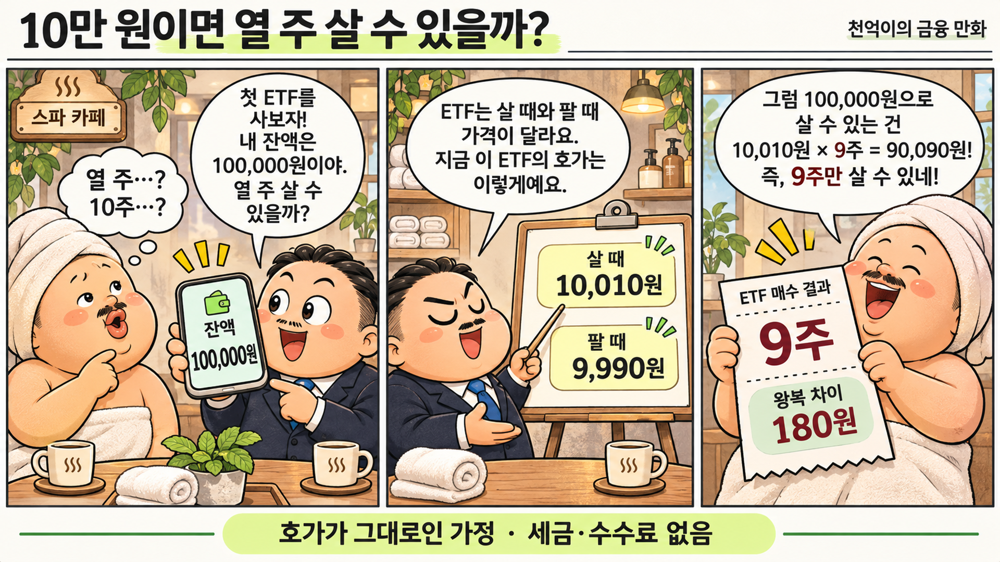

# 첫 ETF 주문 전, 상품 화면에서 답을 찾아야 할 일곱 질문

*등장인물과 문답은 편집부가 만든 질문과 가상 장면입니다. 가격·잔량·수리비는 원화 가정이며 실제 상품 시세는 미사용입니다.*

수건을 머리에 두른 민호가 찜질방 신발장 열쇠를 천억이 앞에 내려놓습니다. 번호가 딱 백 번이에요. 마침 통장에도 십만 원이 있고 친구가 보내 준 펀드 화면에는 만 원이라고 떠 있습니다. 열 주 사고 내일 다시 팔면 십만 원을 그대로 찾을 수 있겠지? 천억이는 열쇠를 돌려주면서 뜻밖의 질문을 합니다. 내일 몇 시에 그 돈을 써야 하는데?

민호는 내일 아침 아홉 시에 자전거 수리점을 예약해 놨어요. 출퇴근길에 바퀴가 자꾸 헛돌아서 오늘 맡겼고, 수리비로 팔만 원을 준비해 오라는 연락을 받았습니다. 오늘 투자할 수 있는 금액을 물으면 십만 원이라고 답했고, 내일 꼭 남겨야 하는 돈을 물으면 팔만 원이라고 답했습니다. 둘 다 사실인데 두 대답을 한 줄에 적으니 문제가 보이죠. 십만 원이 전부 투자에 쓸 여윳돈은 아니었던 겁니다. 천억이는 실제 주문 버튼을 누르기 전에 종이 위에서만 오늘 하루를 살아 보자고 합니다.

## 마지막 체결가로 열 주를 살 수 있을까

가상의 펀드 한 종목을 만들겠습니다. 출발 자금은 원화 십만 원이고 오늘 아침에 한 번 넣어요. 빚을 내지 않고 추가 입금이나 중간 인출도 없습니다. 정수 단위로만 사고팝니다. 하루 안에 사고 되팔아 보는 실험이라 분배금과 재투자는 없어요. 세금과 별도 수수료도 우선 영 원으로 놓습니다. 수익률을 연간으로 환산하지 않습니다. 지금부터 등장하는 가격이나 주문 수량은 교육용으로 정한 숫자입니다. 실제 거래소에서 관측한 시세는 아니에요.

민호가 본 만 원은 방금 전 마지막으로 거래가 이뤄졌던 가격이라고 해 보죠. 왼쪽에 지금 팔고 싶다는 사람들이 적은 금액을 놓습니다. 가장 싸게 팔겠다는 사람이 한 주에 만 십 원을 불렀어요. 반대편에서 지금 사겠다는 사람이 부른 가장 높은 가격은 구천구백구십 원입니다. 두 가격의 가운데가 만 원입니다. 마지막 가격도 만 원이고 가운데도 만 원이니 지금 만 원에 살 수 있다고 생각하기 쉽습니다. 그런데 민호에게 지금 당장 팔겠다고 기다리는 사람의 가격은 만 십 원이에요.

열 주면 십만 백 원이 필요합니다. 백 원이 모자라요. 처음엔 오차처럼 보였던 십 원이 열 번째 한 주를 빼 버린 거죠. 아홉 주를 사는 데 드는 돈은 구만 구십 원. 십만 원에서 빼면 구천구백십 원이 현금으로 남습니다. 열 주를 살 수 있겠냐는 첫 질문에는 벌써 답이 나왔습니다. 단, 정수 주문만 되고 가격이 그대로이며 첫 호가에 아홉 주 이상이 남아 있다는 조건이 붙습니다. 천억이는 종이에 수량 아홉 옆에 작게 조건도 함께 씁니다.

**그림 Q&A · 편집부가 만든 질문**　가격표가 움직이지 않아도 180원이 줄어드는 이유는? 한 주의 매입가 10,010원과 매도가 9,990원의 차이 20원에 9주를 곱한 값입니다.

*하루 가정 · 각 최우선 호가에 9주 이상 · 원화 정수 주문 · 세금·별도 수수료 0원.*

친구가 묻습니다. 아직 그래프가 꼼짝도 안 했으니 지금 되팔면 산 돈 그대로 아니야? 당장 사 주겠다는 사람의 가격은 여전히 구천구백구십 원이에요. 아홉 주를 곱하면 팔만 구천구백십 원을 돌려받습니다. 남겨 둔 현금 구천구백십 원까지 보태면 구만 구천팔백이십 원입니다. 매수 전의 십만 원과 비교하면 백팔십 원이 줄었어요. 시장 전체가 내려가서도 아니고 증권사가 별도 수수료를 떼서도 아닙니다. 한 주를 사고 되판 가격 사이의 이십 원이 아홉 번 겹쳤기 때문이에요.

민호가 종이를 가져가서 직접 거꾸로도 계산합니다. 원래 십만 원에서 백팔십 원을 빼니 구만 구천팔백이십 원. 두 경로로 같은 답이 나오죠. 여기서 백팔십 원을 한번 더 비용 칸에 적어 빼면 안 됩니다. 이미 체결 가격 안에 들어 있는 차이니까요. 이 간단한 왕복 계산을 처음에 해 보는 이유가 있습니다. 수익을 얼마나 낼지 모르더라도 지금 눈앞의 조건으로 거래하면 출발선이 얼마나 달라지는지는 따져 볼 수 있거든요.

## 투자목표에서 하루를 읽는 법

천억이는 민호가 받아 온 문자를 펼쳐 봅니다. 거기에는 종목 코드와 반도체라는 말 한 줄뿐입니다. 이 상품이 무엇을 하는지 친구에게 한 문장으로 설명할 수 있어? 민호는 반도체 회사 주식을 모아 놓은 거래소 펀드라고 대답합니다. 그럴 수도 있어요. 하지만 코드가 가리키는 공식 상품명과 투자목표를 실제로 대조하기 전에는 어떤 나라의 어떤 기업이 들어 있는지, 하루의 움직임을 몇 배로 따라가려 하는지 알 수 없습니다. 문자에 붙은 별명은 검색을 시작하는 실마리로 쓰고, 문서의 첫 장에서 이름과 운용 주체를 맞춰 봐야 합니다.

이번엔 편집부가 만든 두 장의 모의 설명서를 놓습니다. 첫 장에는 어떤 반도체 지수 성과를 추종한다고 써 있어요. 둘째 장에는 같은 지수의 하루 수익률 두 배를 목표로 한다고 써 있습니다. 반도체라는 명사는 같습니다. 판단을 바꾸는 건 하루라는 단어와 몇 배라는 숫자죠. 실제 상품의 보수나 추적 차이는 빼고 두 설명이 수학적으로 얼마나 다른지 하루씩 계산해 볼까요. 두 상품과 지수를 모두 백에서 시작하고 지수가 첫날 십 퍼센트 올랐다고 정합니다. 첫 상품은 백십, 둘째는 백이십이 됩니다.

그다음 날 지수가 십 퍼센트 내립니다. 백십의 십 퍼센트는 십일이니까 지수는 구십구입니다. 첫 상품도 여기서는 정확히 추종한다고 가정했으므로 구십구예요. 두 배 상품은 둘째 날 이십 퍼센트 내려요. 백이십의 이십 퍼센트는 이십사니까 구십육입니다. 이틀간 지수 손익은 마이너스 일 퍼센트, 두 배 상품은 마이너스 사 퍼센트입니다. 이틀 전체 손실을 단순히 두 배로 해서 마이너스 이 퍼센트라고 써 놓으면 틀립니다. 둘째 날 곱셈을 시작하는 금액이 이미 바뀌었거든요.

민호는 솔직히 고백합니다. 하루만 투자할 거라서 설명서에 하루라고 쓰였으면 오히려 안심하려 했다고요. 그런데 둘이 조심해서 봐야 하는 하루의 뜻도 두 가지입니다. 상품이 목표를 계산하는 한 번의 기준 기간과 민호가 오후에 사서 다음 날 오전에 파는 보유 시간이 정확히 같다는 보장은 없습니다. 거래한 날짜가 하루 차이라는 사실만으로 목표 배율이 내 개인 체결가 사이에서 실현된다고 약속할 수 없어요. 그래서 오늘은 상품 구조를 한 문장으로 설명하지 못한 상태에서 주문을 미루는 것도 가능한 선택으로 종이에 남겨 둡니다.

## 스무 회사가 같은 무게일까

다음 질문은 바구니 안쪽을 향합니다. 반도체 회사가 스무 곳이나 들어 있다면 한 회사에 들어가는 돈은 이십 분의 일씩일까요? 모두 같은 비중이라고 명시했다면 출발 시점에는 그렇게 계산할 수 있죠. 하지만 첫 회사가 사십 퍼센트, 나머지 열아홉 회사가 육십 퍼센트를 나눠 갖는 구성이라면 결과가 크게 달라집니다. 십만 원을 고스란히 그 바구니에 넣었다고 단순화하면 첫 회사에 해당하는 금액은 사만 원입니다. 회사가 스무 곳이라는 사실만 세면 오천 원이라고 적기 쉬워요. 두 답은 삼만 오천 원 차이입니다.

첫 회사 주가만 하루에 이십 퍼센트 내려간다고 해 보죠. 다른 자산의 가격과 환율은 그대로이고, 바구니가 실제로 그 비중으로만 움직인다고 가정합니다. 첫 회사에 해당하는 사만 원의 이십 퍼센트는 팔천 원이에요. 십만 원 전체를 기준으로 하면 팔 퍼센트 하락입니다. 반대로 전부 같은 비중이라 첫 회사 몫이 오천 원이면 같은 하락에서 천 원만 줄어요. 같은 회사 수, 같은 뉴스 한 줄, 같은 투자 원금인데 차이가 이렇게 납니다. 민호는 어떤 회사가 가장 많이 들었는지와 그 회사가 얼마를 차지하는지를 한 묶음으로 적습니다.

한 걸음 더 가 볼게요. 상위 기업 세 곳의 비중이 사십, 이십, 십 퍼센트라고 치면 세 곳에만 칠십 퍼센트가 들어 있습니다. 민호는 그 수치를 보고 나머지가 전부 상관없는 회사라고 생각합니다. 그런데 세 회사가 모두 같은 고객의 주문에 의존하고 나머지 기업도 그 고객에게 부품을 납품한다면 어떨까요? 종목 이름을 여러 개 모아 놓아도 주문 감소라는 같은 사건에 동시에 흔들릴 수 있죠. 그 관계까지 단번에 수익률로 환산할 수는 없습니다. 이때 확인할 것은 업종별 묶음과 실제 사업의 노출입니다. 모르는 민감도를 정밀한 퍼센트로 꾸며 적을 필요는 없어요.

보유 내역을 보여 주는 문서에 날짜가 두 개 있습니다. 내려받은 날은 오늘인데, 표 맨 위의 기준일은 지난달 마지막 영업일입니다. 어느 날짜의 사십 퍼센트일까요? 지난달 표에서 관측한 사십 퍼센트예요. 오늘 열어 봤다는 이유로 오늘 아침에 측정한 값으로 바뀌지는 않습니다. 그 사이에 가격이 움직였거나 편입 비중을 바꿨다면 내 주문 때의 노출은 달라져요. 민호는 휴대폰 사진 밑에 확인한 날을 적고 표의 기준일은 따로 동그라미를 칩니다. 둘 중 하나만 남기면 나중에 똑같은 계산을 되짚기가 어렵거든요.

## 보수와 호가 차이는 언제 드는 돈인가

수건 친구가 손가락으로 화면의 작은 글씨를 가리킵니다. 연 보수가 영 점 이 퍼센트래. 아까 계산한 백팔십 원 대신 이걸 넣어야 하나? 천억이는 시간부터 맞춰 보자고 합니다. 연간 내내 평균 투자액이 십만 원으로 고정된다고 단순화하면 영 점 이 퍼센트는 일 년에 약 이백 원입니다. 실제 펀드 비용은 자산에 반영될 수 있고 투자 금액도 날마다 달라집니다. 이백 원이 주문 한 번 할 때마다 현금으로 청구된다는 뜻은 아니에요. 한쪽은 갖고 있는 기간에 걸친 비용이고 아까의 백팔십 원은 양쪽 호가를 한 번씩 건넜을 때의 차이입니다.

비교 상대를 하나 더 놓으면 왜 기간을 따져야 하는지 분명해집니다. 계산하기 쉽게 두 상품에 각각 백만 원을 일 년간 유지하는 가정이에요. 첫 상품의 연간 보수는 영 점 일 퍼센트, 둘째는 영 점 삼 퍼센트라고 합시다. 평균 잔액이 변하지 않는 단순 근사에서 연간 차이는 이천 원이에요. 그런데 첫 상품을 사고파는 왕복 비용이 둘째보다 삼천 원 더 크다면 어떨까요. 한 해만 보유하고 나올 경우에는 보수로 아낀 이천 원보다 거래 때 더 든 삼천 원이 큽니다. 이 조건 아래에서는 전체 차이가 천 원만큼 첫 상품에 불리하게 남습니다.

똑같은 거래를 처음과 끝에만 한 번씩 하고 이 년을 보유한다면, 연간 절약액 이천 원을 두 번 합쳐 사천 원입니다. 처음 가정한 왕복 차이 삼천 원을 메우고도 천 원이 남죠. 계산상의 손익분기 기간은 일 년 반입니다. 단, 보수 차이와 평균 잔액이 내내 일정하고 나갈 때 예상한 비용도 그대로여야 해요. 상품을 실제로 어느 날 팔지, 그때 호가가 얼마나 벌어질지는 오늘 확정되지 않습니다. 그러니 일 년 반은 어떤 펀드의 권장 보유 기간이 아니라 두 가지 가정을 나누어 계산한 결과로만 읽어야 합니다.

주문 횟수를 바꿔 보는 것도 좋습니다. 천억이는 민호에게 한 달에 이만 원씩 다섯 번 사는 사람과 십만 원을 한 번 사는 사람을 비교해 보라고 합니다. 매 주문 정액 오백 원을 내야 하는 가상 계좌라면 다섯 번 사는 데 이천오백 원, 한 번 사는 데 오백 원이 들어요. 차이는 이천 원입니다. 이번에는 수수료가 거래액의 영 점 일 퍼센트이고 최소 부과액도 없다고 바꿉시다. 이만 원씩 다섯 번이면 이십 원씩 다섯 번, 합계 백 원이에요. 십만 원 한 번에도 백 원입니다. 몇 번 나누느냐는 질문보다 먼저 그 계좌가 어느 방식으로 비용을 계산하는지 알아야죠.

## 내 예산과 호가별 잔량

이번엔 민호의 차례입니다. 내일 수리비로 팔만 원이 필요하니까 투자에 쓸 수 있는 돈은 이만 원이잖아. 만 십 원짜리 두 주를 사면 거의 맞지 않아? 천억이가 열쇠를 톡 두드립니다. 두 주에 이만 이십 원입니다. 이십 원이라도 넘으면 따로 놓은 팔만 원에서 꺼내야 해요. 한 주만 사면 구천구백구십 원이 투자 봉투에 남습니다. 이때 전체 계좌에는 팔만 원을 합쳐 팔만 구천구백구십 원이 현금으로 남고요. 투자할 수 있는 돈과 계좌 안의 총 현금을 구별하면 같은 거래 화면에서도 주문 가능한 수량을 다르게 판단하게 됩니다.

그런데 만 십 원에 살 수 있는 물량이 얼마나 남아 있을까요? 처음 계산에서는 아홉 주가 전부 첫 가격에 체결된다고 가정했습니다. 이번에는 그 가격에 세 주만 있고 다음 가격 만 삼십 원에 여섯 주가 있다고 해 보죠. 같은 시각 다른 주문이 들어오거나 취소되지 않는 조건에서 아홉 주를 즉시 사면 처음 세 주에 삼만 삼십 원, 다음 여섯 주에 육만 백팔십 원을 냅니다. 합계 구만 이백십 원입니다. 원래 예상한 구만 구십 원보다 백이십 원 더 듭니다. 첫 호가와 첫 호가에 실제로 쌓인 수량을 함께 적어야 하는 이유예요.

이 아홉 주를 전부 구천구백구십 원에 되팔 수 있다면 매도로 받는 금액은 여전히 팔만 구천구백십 원입니다. 지금은 매수가에만 조건을 바꿨으니 왕복 차이는 삼백 원으로 늘어요. 장중 거래할 수 있는 상품이라고 해서 화면 첫 줄 가격에 내 수량 전부를 사고팔 수 있는 것은 아닙니다. 더구나 화면을 보고 주문이 도착하기까지 사이에 다른 사람이 주문을 낼 수도 있어요. 방금 계산은 그 사이에 아무것도 바뀌지 않은 모의 호가창에서만 딱 떨어지는 숫자입니다. 실제 결과는 주문 뒤 체결 내역으로 확인해야 합니다.

민호가 하루 거래량이 엄청 많았다는 친구의 말을 떠올립니다. 하루 거래량은 그날 이미 손바뀜이 일어난 수량을 모은 겁니다. 장 초반에 만 주가 잠깐 거래됐고 지금 내 가격에는 한 주만 남을 수도 있어요. 반대로 오늘 아직 거래된 적이 적더라도 지금 정해진 가격에 상대방 주문이 있을 수도 있습니다. 과거 체결 합계와 지금 대기 중인 주문은 서로 바꿔 쓸 수 있는 숫자가 아니에요. 둘 다 유용하지만 민호가 지금 아홉 주를 특정 가격 안에서 살 수 있는지 묻는다면 우선 봐야 할 숫자는 지금 호가별 잔량입니다.

여기서 지정가를 넣으면 마음이 편해질까요? 만 십 원보다 비싸게는 사지 않겠다고 정해 봅시다. 방금 예에서 만 십 원에 세 주가 남았고 그보다 비싼 가격에만 나머지 물량이 있다면, 다른 조건이 맞을 때 세 주는 체결되고 여섯 주는 기다릴 수 있습니다. 주문을 넣었다는 알림이 왔다고 아홉 주를 샀다는 뜻은 아닙니다. 매수한 수량, 아직 기다리는 수량, 취소가 이미 처리된 수량은 서로 다른 칸이에요. 민호가 수량을 채우려 두 번째 주문을 내기 전에 첫 주문이 얼마나 남았는지 확인하는 까닭입니다.

예컨대 처음 넣은 아홉 주 중 세 주만 체결됐는데, 민호가 여섯 주가 취소된 줄 알고 여섯 주를 다시 넣었다고 해 보죠. 먼저 낸 주문도 살아 있고 나중 주문도 살아 있다면 예산과 계좌의 주문 가능 금액이 허용하는 범위에서 원래 의도보다 많이 체결될 수 있어요. 반대로 중개사가 현금을 묶어 두어 새 주문을 받지 않을 수도 있고요. 실제 서비스마다 화면에 표시되는 주문 가능 금액과 처리 순서를 확인해야 합니다. 같은 상품의 위험을 읽는 것과 내가 넣은 주문의 상태를 읽는 것은 별개예요.

## 달러 자산을 원화로 계산할 때

이쯤에서 천억이가 편집부가 만든 질문 하나를 꺼냅니다. 꼭 오늘 사야 한다면 지정가를 올리는 게 정답인가요? 오늘 안에 사는 것이 우선인지, 정한 금액을 넘기지 않는 것이 우선인지에 따라 답이 달라집니다. 매수 지정가는 얼마보다 비싸게 사지 않겠다는 한도를 정할 수 있지만 다 살 수 있다는 보장은 없어요. 시장가 주문은 보통 즉시 체결을 추구하지만 가격이 보장되지 않습니다. 급변하는 시장이나 얕은 호가에서는 마지막으로 본 가격과 달라질 수 있죠. 어떤 불확실성을 감수할 수 있는지를 먼저 정하는 선택입니다.

민호는 원화로 주문하고 결제하면 환율에 신경 쓸 게 없다고 생각했습니다. 천억이는 달러로 가격이 붙은 가상의 자산을 원화로 표시하는 실험을 합니다. 환율 변동을 막는 장치는 없고 한 단위가 십 달러라고 두죠. 달러당 천삼백 원이면 만 삼천 원입니다. 하루 뒤에도 자산 자체는 십 달러로 그대로인데 환율만 천이백 원이 되면 원화 가치는 만 이천 원이 됩니다. 원화 주문 버튼으로 샀어도 계산에 들어가는 기초자산과 환율이 달라질 수 있다는 뜻입니다. 환전 수수료를 실제로 냈느냐는 또 다른 질문이에요.

이번엔 달러 자산 가격이 십 퍼센트 올라 십일 달러가 되고 원화 환율은 천삼백 원에서 천백칠십 원으로 십 퍼센트 내렸다고 할게요. 처음 만 삼천 원이었던 한 단위는 십일 곱하기 천백칠십, 만 이천팔백칠십 원입니다. 둘의 변화율을 더하면 영처럼 보이지만 실제로는 백삼십 원이 줄었어요. 처음 금액의 일 퍼센트입니다. 원화로 본 수익은 두 변화의 배율을 곱해서 계산하기 때문이에요. 환노출을 설명할 때 오른 퍼센트와 내린 퍼센트를 그냥 더해 버리면 작은 차이라고 생각했던 부분에서 방향까지 뒤집힙니다.

## 내일 아홉 시에 남겨야 하는 돈

그럼 이름에 환헤지라는 글자만 있으면 방금 계산을 지워도 될까요? 이름을 단서로 삼되 실제 설명서에서 어느 통화 노출을 어느 정도 줄이려 하는지 봐야 합니다. 환율의 영향을 줄이려는 목표와 모든 시점의 환영향이 완전히 사라진다는 약속은 다릅니다. 헤지 비용과 실제 운용 결과도 있을 수 있어요. 반대로 원화로 가격이 표시된다고 모두 환위험을 가진다는 말도 성립하지 않습니다. 자산의 통화와 헤지 정책을 보기 전까지는 민호의 종이에 환율 칸을 미확인으로 남겨 두는 편이 정확합니다.

천억이가 계산기를 끄자 민호가 자기 달력을 엽니다. 내일 아홉 시의 수리비 팔만 원. 지금 당장 이 돈이 빠져도 되는지 확인할 시간입니다. 오늘 아홉 주를 구만 구십 원에 사서 구천구백십 원을 남겼다고 돌아가 봅시다. 내일 어디까지 떨어지면 수리비를 못 맞출까요? 팔만 원에서 남은 현금을 빼면 칠만 구십 원입니다. 아홉 주를 팔아 이만큼을 받아야 해요. 한 주 평균으로 나누면 칠천칠백팔십칠 원과 몇십 전 정도입니다. 거래 단위를 무시한 수학적 경계이고, 실제 호가 단위와 비용은 따로 봐야 합니다.

알아듣기 쉬운 두 가격으로 확인해 보죠. 한 주 칠천팔백 원이면 아홉 주 매도액은 칠만 이백 원입니다. 남겨 둔 현금 구천구백십 원을 더하면 팔만 백십 원, 수리비를 빼면 백십 원이 남습니다. 한 주 칠천칠백 원으로 바꾸면 매도액 육만 구천삼백 원에 현금을 더해 칠만 구천이백십 원입니다. 이제 칠백구십 원이 모자라요. 이 계산은 어디까지 떨어질지 예측한 게 아닙니다. 피할 수 없는 지출이 있을 때 어느 가격이면 계획이 깨지는지를 거꾸로 찾은 겁니다.

민호는 안도의 한숨을 쉽니다. 그 정도로만 안 떨어지면 되겠네. 천억이는 신발장 열쇠를 가리킵니다. 그 돈을 내일 아홉 시에 이체할 수 있다는 건 어디서 확인했어? 계산 속에서는 주식을 팔자마자 수리점으로 전액 보냈습니다. 실제로는 매도 주문이 체결되는 때와 매도 대금을 계좌 밖으로 인출할 수 있는 때가 다를 수 있어요. 거래 시장의 영업일과 결제 절차, 중개사의 출금 가능 시각을 확인해야 합니다. 지금 이야기에서는 실제 계좌를 고르지 않았으므로 특정 결제일을 정답으로 써 넣을 수 없습니다.

수리점에서 카드로 결제하면 하루쯤 미뤄도 되지 않을까 싶지만, 그것도 원래 약속을 바꾸는 일입니다. 결제 수단이 되는지, 청구 시점은 언제인지 모르는 상태에서 투자 계획에 넣을 수는 없죠. 민호는 결국 수리비 팔만 원을 따로 두고, 남은 이만 원으로만 가상 주문을 기록합니다. 한 주를 만 십 원에 사고 판다는 조건에서 첫 호가 차이 이십 원이 자기 한 주에 어떻게 나타나는지 배웠어요. 실물을 열 주 사지 않고도 내일 필요한 돈을 해치지 않으면서 주문 과정을 이해할 수 있었던 겁니다.

친구가 보낸 종목 코드를 지우지는 않습니다. 메모의 쓰임을 바꿔요. 오늘 바로 따라 살 목록에서 공식 설명서와 주문 조건을 확인할 목록으로 옮깁니다. 그 밑에 자기가 확인한 값과 아직 모르는 값을 나눠 씁니다. 예산과 수리 날짜는 자기 통장과 예약 문자에서 확인할 수 있어요. 상품의 투자목표와 자산 구성은 발행사 자료를 열어야 합니다. 가격과 잔량은 같은 시각의 호가를 봐야 하고, 출금 시점은 실제 계좌에서 확인해야 합니다. 한 화면에서 답이 다 안 나오는 건 당연합니다. 질문마다 찾아갈 문이 다르니까요.

마지막으로 민호는 친구에게 답장을 써 봅니다. 네가 보내 준 코드 봤어. 이 상품이 무슨 지수를 어떤 기간 기준으로 따라가는지, 상위 한 종목이 차지하는 몫이 얼마인지 먼저 찾아볼게. 나는 내일 아침 자전거를 찾아야 해서 십만 원 전부를 쓸 수는 없어. 답장을 다 쓰고 보니 정작 물어야 했던 것은 내일 오를지 내릴지가 아니었습니다. 상품 설명서 한 줄이 내 돈의 어떤 조건과 만나는가였어요. 같은 코드를 두 사람이 받아도 각자의 지출 달력과 주문 크기가 다르면 답은 달라질 수 있습니다.

찜질방을 나가려는데 백 번 신발장 문이 잘 안 열립니다. 민호가 다른 줄의 백 번 앞에 서 있었어요. 번호는 맞는데 줄이 달랐던 거죠. 천억이가 웃으며 열쇠에 찍힌 구역을 가리킵니다. 오늘 본 만 원이라는 숫자도 그랬습니다. 마지막 체결가인지, 지금 살 수 있는 가격인지, 펀드 안의 자산 가치인지, 어느 칸에서 읽었는지를 알아야 자기 돈에 맞는 문이 열립니다. 여러분도 종목 하나를 고른 뒤 첫 주문 전에 메모 한 줄을 남겨 보세요. 언제 쓸 돈 중 얼마를 빼 두고, 어느 시각의 어떤 가격에 몇 주까지 주문할 수 있는지요.

**자료 확인일**　2026년 11월 27일. 미국 SEC의 투자자 교육 자료에서 주문 유형과 ETF 거래가격의 원리를 확인했습니다. 실제 계좌의 출금 가능 시점과 적용 비용은 미확정입니다.

**원문**　[미 SEC의 ETF 구조 안내](https://www.investor.gov/introduction-investing/investing-basics/investment-products/mutual-funds-and-exchange-traded-2) · [미 SEC의 펀드 거래방식 비교](https://www.investor.gov/introduction-investing/general-resources/news-alerts/alerts-bulletins/characteristics-mutual-funds-exchange-traded-funds) · [미 SEC 주문 유형](https://www.investor.gov/introduction-investing/investing-basics/how-stock-markets-work/types-orders)

**이어 읽기**　[액티브 ETF와 패시브 ETF, 지수를 이겼다는 한 줄 읽는 법](EP009.md) · [전자책 목차](목차.md) · [두 ETF의 종목 겹침을 읽는 법](FAQ01.md)
