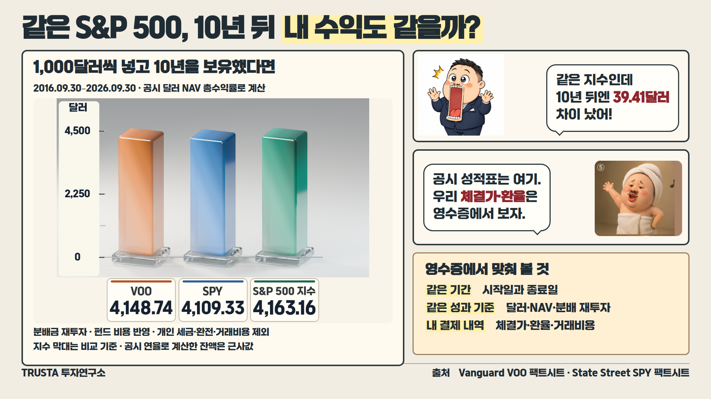
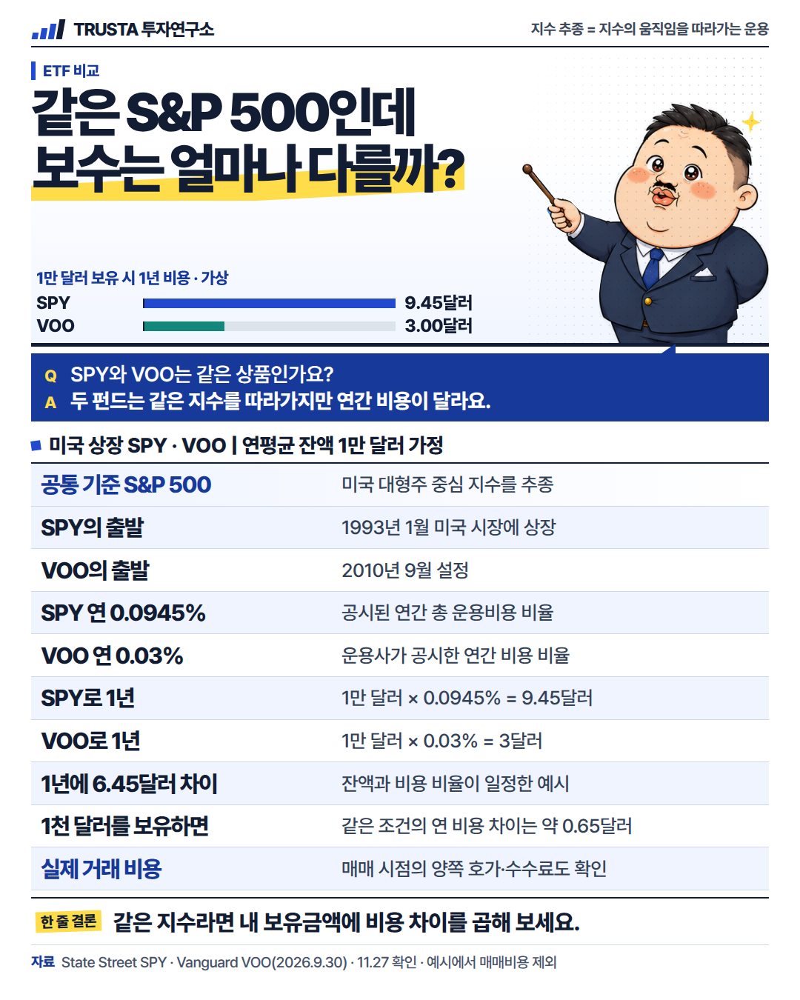

# VOO와 SPY, 둘 다 S&P 500인데 내 수익률은 왜 다를까?

## 같은 지수인데 영수증이 두 장이다

천억이가 식탁에 미국 주식 거래 영수증 두 장을 놓습니다. 두 상품 모두 에스앤피 오백을 따라간다고 들었는데, 수건 친구와 비교하니 수익률이 다릅니다. 천억이는 곧장 “그럼 네가 산 게 지수를 더 잘 쫓았네”라고 말합니다. 수건 친구는 두 영수증의 상품명 위를 가리고 거래 날짜부터 확인합니다. 다음 날 산 영수증끼리 비교하고 있었거든요. 두 인물과 거래는 설명을 위해 만든 사례입니다.

*2016년 9월 30일~2026년 9월 30일 공시 연율을 적용한 달러 잔액. 분배금 재투자 및 펀드 운용비용을 반영하고 개인 세금과 매매·환전 비용을 뺐다.*

오늘의 질문은 두 가지입니다. 같은 기간에 두 펀드가 공식적으로 얼마를 벌었느냐와, 실제로 두 사람이 그 결과를 자기 계좌에서 얻었느냐입니다. 앞의 질문에는 운용사가 내놓은 달러 기준 총수익률을 씁니다. 뒤의 질문에는 언제 어떤 가격과 환율로 샀고, 현금으로 나온 분배금을 어떻게 처리했는지가 들어갑니다. 두 답이 서로 다르면 거래 내역에서 설명할 수 있는 차이가 있는지부터 봅니다.

수건 친구는 미국 거래일의 시작과 끝, 통화, 분배금 처리 방식이 같은지를 한 줄에 써 놓습니다. 천억이는 마침 달러로 남겨 둔 잔액을 보고 있었습니다. 친구는 원화 환산 손익 화면을 보고 있었고요. 둘 다 성적표를 보고 있었다고 말했지만 같은 자를 들고 있지 않았습니다. 천억이는 달러로 표시한 한 기간부터 비교하기로 합니다.

## 같은 출발선에서 천 달러씩 넣었다면

운용사 두 곳의 팩트시트에서 이천이십육 년 구월 삼십일에 끝나는 일 년을 맞춥니다. 연도 중간부터의 수익률이나 최근 한 달 성과를 섞지 않습니다. 순자산가치의 총수익률은 브이오오가 십오 점 칠 퍼센트, 에스피와이가 십오 점 육 퍼센트였습니다. 비교 기준인 에스앤피 오백 총수익지수는 십오 점 칠사 퍼센트였습니다. 이 기간의 달러 기준 공시 수익률은 분배금을 재투자하는 계산이며 펀드의 운용비용이 반영되어 있습니다. 개인 세금과 환전 및 매매비용은 들어가지 않습니다. [Vanguard VOO 팩트시트](https://workplace.vanguard.com/assets/corp/fund_communications/pdf_publish/us-products/fact-sheet/F0968.pdf) · [State Street SPY 팩트시트](https://www.ssga.com/library-content/products/factsheets/etfs/us/factsheet-us-en-spy.pdf)

각각 천 달러로 출발했다면 천백오십칠 달러와 천백오십육 달러입니다. 실측 자료의 공시 수익률을 가상 원금에 적용해 비교한 결과예요. 두 장부의 차이는 일 달러입니다. 이 숫자는 실제 주식 수를 계산하거나, 천 달러어치를 당시 앱에서 정해진 가격으로 체결하는 실험에서 나온 값이 아닙니다. 고정한 시작일과 종료일의 표를 같은 단위의 돈으로 읽은 것입니다.

천억이가 이제 시장가격 성과가 있는 줄에 자를 옮깁니다. 같은 기간 시장가격 기준 총수익률은 각각 십오 점 칠팔과 십오 점 육육 퍼센트입니다. 한쪽을 순자산가치로 읽고 다른 쪽을 시장가격으로 읽으면 비교 기준부터 어긋납니다. 그래서 두 파일에서 같은 행을 고른 뒤에야, 실제 영수증으로 돌아갑니다.

*1만 달러를 보유할 때의 연 보수 가정과 실제 1년 NAV 성과 차이는 다른 값이다. 카드의 보수 예시는 매매비용을 제외한다.*

## 1년 뒤 1달러 차이는 10년이면 얼마였을까?

수건 친구가 영수증 두 장 옆에 같은 종료일의 5년 칸과 10년 칸을 붙입니다. 2026년 9월 30일까지 5년 동안 달러 기준 NAV 총수익률은 VOO 연 13.75%, SPY 연 13.65%였습니다. 이 숫자를 각각 1,000달러에 적용해 5년간 복리로 계산하면 약 1,904.39달러와 1,896.04달러입니다. 차이는 약 8.36달러입니다. 공시 수익률의 소수점 둘째 자리까지 사용했으므로 금액도 근삿값입니다. [Vanguard VOO 팩트시트](https://workplace.vanguard.com/assets/corp/fund_communications/pdf_publish/us-products/fact-sheet/F0968.pdf) · [State Street SPY 팩트시트](https://www.ssga.com/library-content/products/factsheets/etfs/us/factsheet-us-en-spy.pdf)

종료일을 그대로 두고 2016년 9월 30일부터 10년간 비교하면 연율은 각각 15.29%와 15.18%입니다. 같은 1,000달러를 넣어 계산하면 약 4,148.74달러와 4,109.33달러로, 약 39.41달러 차이입니다. 시작일과 종료일을 공유하는 공시 성과를 원금에 적용한 예시입니다. 중간 추가 납입이나 인출은 없고 펀드 비용 반영 후 성과에 분배 재투자를 포함합니다. 기말에 개인이 부담할 세금이나 매매·환전 비용은 제외합니다.

천억이는 10년간 두 계좌 모두 네 배가 넘었다는 숫자에 놀랍니다. 수건 친구는 열 해 동안 매년 똑같이 15%씩 오른 장부인지 묻습니다. 공시 연율은 시작과 끝의 누적 성과가 동일해지도록 바꾼 일정한 연율입니다. 중간에 한 번도 손해를 본 적 없다는 기록으로 읽을 수 없습니다. 이 두 팩트시트의 한 줄만으로 보유 중 최대낙폭을 계산할 수 없으므로, 이 비교에서는 손실 폭 순위를 붙이지 않습니다.

### 같은 5년이라도 출발 연도를 바꾸면

천억이는 10년 장부를 반으로 접어서 앞쪽 5년만 보고 싶어 합니다. 종료일이 같은 10년 성장배수를 뒤쪽 5년 성장배수로 나누면 앞쪽 5년의 배수를 근사할 수 있습니다. 뒤쪽 5년을 ‘빼는’ 자리에 수익률의 퍼센트 숫자만 적으면 복리를 놓치게 됩니다. 먼저 공시에 적힌 연율에 1을 더하고 각각 10제곱과 5제곱을 한 뒤, 앞에서 얻은 큰 배수를 작은 배수로 나눕니다.

2016년 9월 30일부터 2021년 9월 30일까지 각각 1,000달러를 넣었다고 놓으면 VOO 약 2,178.51달러, SPY 약 2,167.32달러가 됩니다. 뒤의 5년인 2021년 9월 30일부터 2026년 9월 30일까지는 앞서 계산한 1,904.39달러와 1,896.04달러였습니다. 앞과 뒤 모두 달러 기준으로 펀드 비용 반영 후 공시 총수익률을 적용하고 분배금은 재투자합니다. 개인 세금·매매 및 환전 비용은 제외합니다.

두 구간에 같은 금액을 넣었지만 이번엔 어느 5년을 골랐는지가 두 상품 사이의 차이보다 큰 영향을 주었습니다. 앞 구간은 공시의 두 반올림 연율을 이용한 역산이므로 당시 독립 공시값과 끝자리가 달라질 수 있습니다. 실제 매일의 움직임까지 알려면 해당 구간의 일별 분배 재투자 계열이 필요합니다. 수건 친구는 5년이라고 쓴 자리 옆에 두 장부의 시작 연도도 적어 둡니다. [Vanguard VOO 팩트시트](https://workplace.vanguard.com/assets/corp/fund_communications/pdf_publish/us-products/fact-sheet/F0968.pdf) · [State Street SPY 팩트시트](https://www.ssga.com/library-content/products/factsheets/etfs/us/factsheet-us-en-spy.pdf)

## 같은 날 샀는데도 순서가 뒤집혔다

두 사람은 이제 운용사 파일을 내려놓고 가상 영수증으로 돌아갑니다. 시작일에 같은 지분을 각각 달러 NAV 1,000달러로 평가하고, 1년 뒤 그 지분의 NAV가 각각 1,080달러와 1,079달러라고 놓습니다. 분배금, 비용, 세금, 환전은 없습니다. 펀드 성과만 보면 각각 8%와 7.9%입니다.

첫 펀드를 살 때 NAV보다 0.2% 비싸게 체결돼 같은 지분에 1,002달러를 지불했다고 합시다. 두 번째 펀드는 1,000달러를 내고 샀고, 종료일에는 둘 다 NAV에 판다고 놓습니다. 첫 거래의 수익률은 1,080달러를 1,002달러로 나눈 뒤 1을 빼므로 약 7.78%입니다. 두 번째 거래의 7.9%가 더 높습니다. 펀드의 0.1%포인트 차이보다 첫 체결가격의 영향이 컸던 예입니다.

반대로 첫 펀드를 NAV보다 0.2% 싸게 샀고 매도 조건이 같다면, 첫 거래의 수익률은 약 8.22%로 올라갑니다. 두 결과는 특정 티커가 언제나 더 싸게 체결된다는 뜻이 아닙니다. 시장가격은 거래 과정에서 달라질 수 있으니, 과거 성과 표와 주문 화면을 비교할 때는 내가 실제로 낸 금액을 한 줄에 적어야 이 차이를 볼 수 있습니다.

### 같은 지수 이름 뒤에 가격과 총수익이 붙는다

수건 친구는 휴대폰 검색에서 에스앤피 오백이라고 쓰고 첫 화면에 나온 숫자를 가져옵니다. 천억이는 비교하던 팩트시트의 벤치마크 행에도 같은 이름이 있다고 말합니다. 여기서 확인할 것은 검색 결과의 지수가 주가 움직임만 반영하는 가격지수인지, 배당의 재투자도 반영하는 총수익지수인지입니다. 배당을 포함해 계산한 펀드 총수익률을 앞에 두고 가격지수만 옆에 놓으면, 배당으로 생긴 차이까지 운용 성과처럼 읽게 됩니다. [S&P 다우존스 지수 · S&P 500](https://www.spglobal.com/spdji/en/indices/equity/sp-500/)

책상 위에 가상 숫자로 표시한 지분 하나를 놓아 봅시다. 시작가 백 달러, 일 년 뒤 가격 백오 달러, 그날 지급받은 현금 이 달러입니다. 현금의 지급을 포함하고 세금과 비용을 빼며 지급 직후 평가하면 총 가치는 백칠 달러입니다. 가격 상승은 오 퍼센트, 지급액까지 포함한 기간 수익은 칠 퍼센트입니다. 종료 시점에 지급된다는 가정이라 그 돈은 평가일까지 추가로 움직이지 않습니다. 실제 지수의 배당 재투자 세칙 대신 어떤 항목을 더하는지 보여 주기 위한 가상 모형입니다.

천억이는 공식 일 년 비교표에서 총수익 기준 지수의 십오 점 칠사 퍼센트를 다시 확인합니다. 같은 기간 브이오오의 NAV 성과와의 차이는 마이너스 영 점 영사 퍼센트포인트, 에스피와이는 마이너스 영 점 일사 퍼센트포인트였습니다. 이 값은 해당 일 년의 성과 차이입니다. 하루하루 지수를 따라간 편차가 얼마나 흔들렸는지는 여러 시점의 데이터로 따로 계산합니다. 두 사람은 이 칸에 ‘일 년 운용 결과’라고 써 두고, 호가가 얼마나 벌어졌는지 알아보는 영수증으로 돌아갑니다.

## 달러 계좌에서 번 돈, 원화 계좌에도 그대로 찍힐까

천억이는 달러로 천백오십칠 달러가 된 경로를 원화 영수증으로 바꿔 봅니다. 처음에 달러당 천삼백 원으로 천 달러를 바꿨다고 놓으면 투자 원금은 백삼십만 원입니다. 끝날 때 달러당 천이백오십 원으로 평가하면 원화 잔액은 백사십사만 육천이백오십 원입니다. 원금에서 늘어난 돈은 십사만 육천이백오십 원으로 약 십일 점 이오 퍼센트입니다. 끝날 때 환율이 천사백 원이었다면 잔액은 백육십일만 구천팔백 원, 증가액은 삼십일만 구천팔백 원입니다. 약 이십사 점 육 퍼센트입니다.

펀드의 달러 성과는 앞에서 확인한 수치를 적용했고 두 환율은 설명을 위한 가정입니다. 두 경로는 시작일과 종료일이 같은 일 년이며, 분배금을 재투자하고 펀드 비용이 반영된 달러 총수익률을 사용합니다. 개인 세금, 환전 수수료와 매매비용은 빼고 같은 시점에 원화로 평가합니다. 실시간 원화 표시액은 증권사가 적용하는 환율과 실제 환전 금액이 다를 수 있으니, 원화로 써야 할 돈을 계산할 때는 환전 내역까지 펼쳐 봅니다.

같은 시작일과 종료일의 동일 환율을 브이오오와 에스피와이 모두에 적용하면, 양의 환율은 두 달러 잔액에 같은 비율로 곱해집니다. 같은 환율을 썼다는 이유만으로 두 상품 순서가 뒤집히지는 않습니다. 한 사람이 다른 날짜에 매수했거나 분배금을 중간에 원화로 바꿨다면, 현금 흐름마다 다른 환율이 쓰입니다. 천억이는 원화 성과 차이가 왜 났는지를 물을 때 거래일 전체와 현금이 바뀐 날짜를 먼저 표시합니다.

## 운용 성과 차이보다 내 거래 비용이 클 때

수건 친구가 원래의 달러 비교로 돌아갑니다. 같은 천 달러 원금에 공시 성과를 적용하면 한 해 차이는 일 달러였습니다. 어떤 가상 비교에서 더 높은 수익률을 기록한 쪽만 종료일에 추가 거래 비용 삼 달러를 냈다고 합시다. 다른 세금과 비용 없이 둘을 같은 날에 매도했다고 놓으면, 천백오십칠 달러 쪽은 천백오십사 달러가 되고 다른 쪽은 천백오십육 달러가 남습니다. 이 계산에서 두 경로의 순서가 바뀌는 지점은 추가 비용 일 달러입니다. 실제 수수료 조건을 뜻하지는 않습니다.

이번에는 양쪽 모두 종가의 호가 가운데 값으로 거래했다는 가정을 지웁니다. 매수할 때 매도 호가 가까이 사고, 팔 때 매수 호가 가까이 거래하면 그 간격의 영향을 받을 수 있습니다. 실제 거래에서 차이가 얼마였는지는 당시 호가와 체결가격이 있어야 계산할 수 있습니다. 주문 전에 확인할 수 있는 호가 간격과, 주문 후 영수증에 찍히는 실제 가격을 천억이는 다른 줄에 옮깁니다. [미 SEC 투자자 안내 · ETF](https://www.investor.gov/introduction-investing/investing-basics/investment-products/mutual-funds-and-exchange-traded-2)

또 한 장에는 펀드 비용이 이미 반영된 NAV 수익률이라고 표시합니다. 이 행에서 운용보수를 한 번 더 빼면 같은 비용을 다시 셉니다. 공시 수익률에서 보이지 않는 내 거래 비용은 영수증으로 따로 확인합니다. 두 장을 놓고 보는 이유는 보수가 낮은지 묻는 질문과, 내가 실제로 얼마를 남겼는지 묻는 질문이 서로 다른 계산을 요구하기 때문입니다.

### 이미 보유 중이라면 교체 비용은 몇 년치일까

수건 친구는 새로 살 때와 이미 보유한 상품을 바꿀 때를 구분합니다. 두 공시의 해당 기준일에 VOO 연 보수는 0.03%, SPY는 0.0945%였습니다. 가상으로 연평균 잔액을 1만 달러로 고정하면 보수 차이는 한 해 약 6.45달러입니다. 두 펀드의 다른 성과 차이를 무시하고 보수만 비교하는 계산입니다. 두 수치는 화면을 다시 볼 때 운용사 공시에서 실제 적용 조건을 확인합니다. [Vanguard VOO 팩트시트](https://workplace.vanguard.com/assets/corp/fund_communications/pdf_publish/us-products/fact-sheet/F0968.pdf) · [State Street SPY 팩트시트](https://www.ssga.com/library-content/products/factsheets/etfs/us/factsheet-us-en-spy.pdf)

예를 들어 매도와 매수 과정에서 즉시 20달러의 비용이 들고 이후 평균 잔액과 보수율이 그대로라면, 단순 계산으로 20을 6.45로 나눈 약 3.10년이 필요합니다. 1년만 더 보유할 계획이라면 예상 보수 차이 6.45달러보다 교체 비용 20달러가 큽니다. 이 예시는 세금과 환율 효과를 제외했고 추가 납입·인출이 없으며 시간에 따른 비용의 현재가치 차이도 무시했습니다. 분배금은 비교하는 두 경로에서 같은 방식으로 재투자한다고 놓습니다.

천억이는 교체하려는 이유가 지수 자체를 바꾸기 위해서인지, 같은 지수에서 비용을 줄이려는지 다시 씁니다. 지금 매도하면 세금이 실제로 발생하는지는 거주지와 계좌, 실현손익 상태를 확인해야 합니다. 매입 금액과 지금 남은 잔액이 같다고 놓을 수도 없습니다. 교체를 검토할 때는 증권사의 실제 매도·매수 예상비용을 한 줄에 써 보고, 그 줄을 현재 잔액에서 예상한 연 보수 차이와 같은 달러 단위로 맞춥니다.

## 분배금을 같은 날 다시 넣었다는 가정

수건 친구가 거래내역을 한 번 더 펼칩니다. 한쪽 계좌에는 분배금이 들어왔고, 그 돈이 현금으로 남아 있습니다. 펀드 성과를 낸 표의 재투자 가정과는 여기서부터 달라집니다. 가상으로 분배금 20달러가 들어온 날 그 돈 전부를 펀드에 다시 넣을 수 있고, 추가로 산 지분이 종료일까지 10% 올랐다고 놓으면 이 돈에서 2달러가 더 늘어납니다. 비교 기간은 분배금 입금일부터 같은 종료일까지이고, 나머지 지분은 두 경로 모두 그대로 보유합니다. 달러, 세금과 비용 제외, 현금 이자 0이라는 조건입니다.

그 뒤에 지분 가격이 10% 내렸다면 재투자 몫은 18달러가 됩니다. 현금으로 그대로 보관한 계좌에는 20달러가 남고요. 이 경우 2달러 차이의 방향은 반대입니다. 실제 계좌에서 분배금에 세금이 원천징수되거나 소수점 매수가 어렵다면, 재투자 가능한 금액과 날짜부터 달라집니다. 앱에 찍힌 개인 손익을 공시 자료에 대조할 때 천억이는 지분과 현금을 한 통씩 따로 셉니다.

두 사람이 계산기에 넣은 조건은 이제 열 줄이 넘었습니다. 비교 기간, 통화, 벤치마크, NAV와 시장가격, 분배금, 재투자, 편입 시점, 결제 금액, 환율, 운용 비용과 개인 거래 비용입니다. 그러나 실제 확인은 작은 순서로 할 수 있습니다. 먼저 두 팩트시트의 같은 기준일과 NAV 행을 찾고, 다음에 개인 거래 화면에서 같은 기간에 나간 돈과 들어온 돈을 찾습니다.

## 영수증 옆에 남긴 한 줄

편집부 질문입니다. 원화 계좌에서 더 많이 오른 펀드가 지수를 더 잘 따라간 걸까요? 두 펀드가 지수를 얼마나 따라갔는지를 보려면 같은 기간의 달러 NAV 총수익률에서 같은 총수익지수의 수익률을 빼 봅니다. 내 원화 성적은 내가 낸 원화, 매도나 평가 때의 원화, 중간에 들어와 재투자되거나 남은 돈을 같은 기간에 맞춰 봅니다. 보유 중 추가로 돈을 넣거나 뺀 기록이 많다면, 처음과 끝의 잔액만 나눠서 기간 전체 수익률이라고 부르기 어렵습니다.

천억이는 저녁에 영수증을 두 장의 파일에 하나씩 붙입니다. ‘운용사 팩트시트’라고 적힌 쪽에 펀드 성과를, ‘내 영수증’ 쪽에 원화로 낸 금액과 날짜를 적습니다. 10년 공시 숫자를 다시 보니 비교 기간을 늘릴수록 금액 차이가 커졌습니다. 오늘의 거래에서는 호가를 잘못 읽거나 분배금이 현금으로 남는 일만으로도 다른 결과가 나올 수 있습니다. 두 값이 어디서 달라졌는지 이제 자기 장부에서 찾을 수 있습니다.

오늘 한 번만 확인한다면 두 운용사 자료에서 같은 종료월의 **NAV 총수익률** 행을 나란히 적으세요. 그 옆에 내가 같은 날 같은 가격과 같은 환율을 썼는지 볼 수 있도록 실제 체결 내역을 붙이면 됩니다. 두 상품의 이름이 닮았을 때도 어느 숫자를 비교했는지 다음 달의 나에게 설명할 수 있습니다.

**원문**　[Vanguard VOO 운용 팩트시트](https://institutional.vanguard.com/assets/corp/fund_communications/pdf_publish/us-products/fact-sheet/F0968.pdf) · [State Street SPY](https://www.ssga.com/us/en/intermediary/etfs/state-street-spdr-sp-500-etf-trust-spy) · [S&P 다우존스 지수 산출기관](https://www.spglobal.com/spdji/en/indices/equity/sp-500/) · [미 SEC의 ETF 구조 안내](https://www.investor.gov/introduction-investing/investing-basics/investment-products/mutual-funds-and-exchange-traded-2) · [Vanguard VOO 운용 자료](https://institutional.vanguard.com/iippdf/pdfs/FS0968R.pdf) · [State Street SPY 팩트시트](https://www.ssga.com/library-content/products/factsheets/etfs/us/factsheet-us-en-spy.pdf)

**이어 읽기**　[QQQ와 QQQM, 주당 가격보다 보유기간이 중요한 이유](EP012.md) · [두 ETF의 겹침이 50%라면 내 계좌 절반이 같은 기업일까?](FAQ01.md) · [전자책 목차](목차.md)
