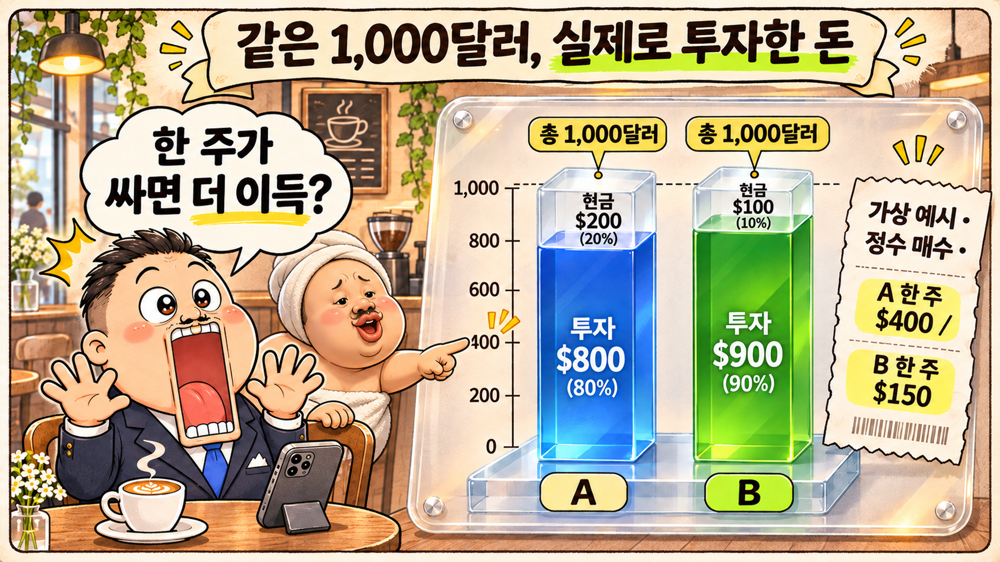
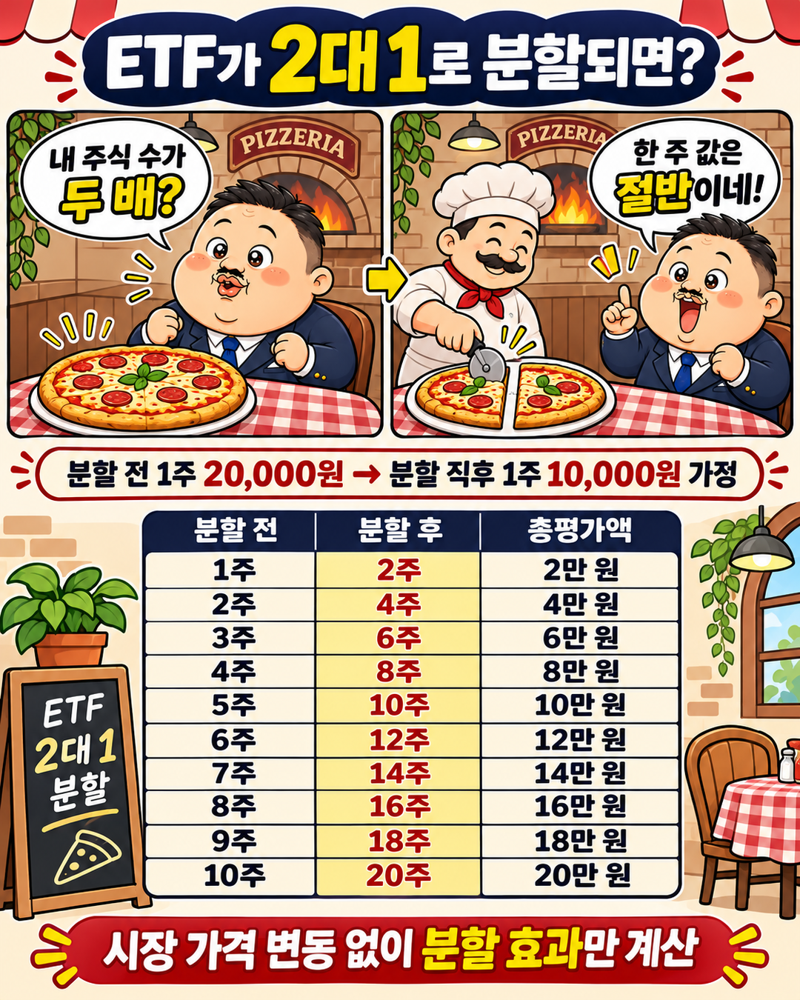

# QQQ와 QQQM, 주당 가격보다 보유기간이 중요한 이유

*민호와 천억이의 대화 및 Q&A는 편집부가 만든 질문입니다.*

민호가 피자집에서 같은 크기의 피자 두 판을 주문합니다. 한 판은 네 조각, 다른 판은 여덟 조각으로 잘라 달래요. 그때 천억이가 휴대폰을 보고 입을 쩍 벌립니다. 같은 나스닥 백을 따라가는 상품이라는데, 한 주 가격이 이렇게 다르다고? 민호가 묻습니다. 한 주가 싼 쪽을 사면, 같은 돈으로 지수를 더 싸게 사는 걸까요? 천억이가 휴대폰을 내려놓고 피자 두 판을 옆으로 밀어 봅니다. 먼저 조각값과 판값부터 확인하자고요.

두 상품은 인베스코의 큐큐큐와 큐큐큐엠입니다. 운용사 자료에서 두 상품 모두 나스닥 백 지수에 노출되는 구조를 확인할 수 있어요. 같은 지수가 투자 목표라는 사실은 비교의 출발점입니다. 내 주문 가격과 보유 기간, 내 계좌에 남을 현금은 그 다음 문제예요. 운용사의 이름이 같다고 내 주문이 같은 가격에 들어가거나 체결 시각이 같아지지는 않죠.

## 같은 1,000달러를 두 장부에 넣으면

천억이는 실제 상품의 오늘 가격을 잠시 덮고 가상의 가격으로 계산을 시작합니다. 미국 달러 천 달러를 처음에 한 번 넣어요. 추가 납입과 인출은 없고 한 달을 보유합니다. 현금 이자, 분배금, 재투자, 세금과 수수료, 환전은 모두 계산에서 뺍니다. 연율은 쓰지 않아요. 한 주 사백 달러인 펀드 에이와 한 주 백오십 달러인 펀드 비가 있습니다. 둘 다 정수 단위로만 살 수 있어요.

에이는 두 주를 사면 팔백 달러가 나가고 현금 이백 달러가 남습니다. 비는 여섯 주를 사면 구백 달러가 나가고 백 달러가 남아요. 조각 수를 보고 여섯 주가 두 주의 세 배라고 계산하면 어떻게 될까요? 실제 들어간 돈은 구백과 팔백 달러입니다. 두 사람의 펀드에서 같은 퍼센트만큼 가격이 오르더라도 이 백 달러 차이 때문에 계좌 손익은 달라집니다.

**그림 Q&A · 편집부가 만든 질문**　왜 두 막대의 전체 높이는 같을까요? 두 계좌의 시작 금액은 각각 1,000달러입니다. A는 800달러를 투자하고 200달러를 남겼으며, B는 900달러를 투자하고 100달러를 남겼습니다.

한 달 뒤 두 펀드가 모두 십 퍼센트 오른다고 놓습니다. 에이 쪽은 투자한 팔백 달러가 팔백팔십 달러가 되고 현금 이백 달러를 더하면 천팔십 달러입니다. 비는 구백 달러가 구백구십 달러가 되고 현금 백 달러를 더하면 천구십 달러가 됩니다. 민호는 처음에는 더 싼 상품이 지수를 더 잘 따라갔다고 생각했어요. 하지만 둘 다 같은 십 퍼센트가 올랐습니다. 비 쪽 계좌에서 십 달러 더 번 이유는 투자에 들어간 돈이 백 달러 더 많았기 때문이에요.

반대로 같은 기간 두 상품이 십 퍼센트 떨어지면 어떨까요? 에이에는 칠백이십 달러와 현금 이백 달러가 남아 구백이십 달러입니다. 비에는 팔백십 달러와 현금 백 달러가 남아 구백십 달러예요. 가격이 오른 장면에서 더 많이 벌던 쪽이 이번에는 십 달러 더 잃습니다. 주당 가격이 낮은 것이 손익 양쪽에서 무조건 유리한 게 아니라, 그날 주어진 돈으로 시장에 어느 정도 들어갔는지가 바뀐 겁니다.

## 피자 조각과 펀드 지분

민호가 피자 접시를 저울 위에 올려 봅니다. 피자를 자르기 전에는 한 판을 통째로 들고 있었고, 자른 뒤에도 그 접시에 같은 피자가 있어요. 가상의 펀드 한 주가 이만 원이고 이를 이 대 일로 분할한다고 해 보죠. 내가 갖고 있던 한 주는 두 주가 되고, 다른 가격 변화가 없으면 한 주당 가격은 만 원으로 바뀝니다. 계좌 평가액은 이만 원입니다. 오늘 시장에서 같은 펀드가 두 배의 이익을 낸 것이라면 이만 원이 사만 원이 되어야 하는데 계산은 그렇게 나오지 않죠. 쪼개기 전후의 기준 시점과 주식 수를 같이 써야 합니다.

*2만 원짜리 한 주가 1만 원짜리 두 주가 돼도 가상 평가액은 2만 원이다. 두 ETF의 주당 가격 차이를 읽는 보조 실험이다.*

그러면 쪼개는 것이 누구에게나 아무 영향도 없을까요? 민호가 처음 펀드를 사려는 날의 주문 조건을 바꿉니다. 살 수 있는 단위는 정수이고 예산은 만오천 원입니다. 분할 전 이만 원이었다면 한 주도 살 수 없어요. 분할 뒤 만 원이라면 한 주를 사고 오천 원을 현금으로 갖습니다. 기존 투자자의 전체 금액은 그대로인 순간에도 새로 들어오려는 사람의 최소 주문 단위는 달라진 거예요. 피자 전체가 더 싸졌다고 해석할 이유는 없지만 자기 예산으로 한 조각 살 수 있게 됐다는 차이는 실제로 중요합니다.

친구가 보낸 주가 차트를 다시 봅니다. 분할 전 이만 원과 분할 후 만 원을 아무 보정도 하지 않고 잇는다면 화면에 절반 떨어진 것처럼 보입니다. 그러면 펀드가 이틀 사이 반 토막이 났다고 말할 수 있을까요? 지분 수를 같이 보니 그 기간에 계좌는 그대로였죠. 데이터를 비교할 때 분할을 반영해서 과거 가격을 조정한 자료인지 먼저 확인해야 합니다. 분배금까지 포함한 총수익 자료인지, 단순히 분할 효과만 조정한 가격인지도 문서의 정의를 봅니다. 둘 다 조정이라는 말이 들어갈 수 있어서 차트 제목만 보고 재투자 여부를 고르면 틀릴 수 있어요.

소수 단위 매수가 되는 경우로 돌아갑니다. 같은 천 달러를 둘 다 전액 투자할 수 있고 가격과 체결 시점도 우리가 정한 그대로라고 가정해요. 사백 달러짜리는 두 점 오 주를 사고 백오십 달러짜리는 육과 삼분의 이 주를 살 수 있습니다. 현금이 남지 않습니다. 한 달 동안 모두 십 퍼센트 오른다면 둘 다 천백 달러입니다. 처음에 보였던 십 달러 차이는 정수 주문이라는 조건을 없애니 사라졌습니다. 여기서 실제 서비스가 소수 단위 수량을 어디까지 허용하고 어느 때 모아 체결하는지는 아직 정하지 않았습니다. 모형의 소수 단위 주문이 모든 계좌에 그대로 가능하다고 옮겨 쓰면 안 돼요.

민호가 자기가 가진 돈이 매달 고정돼 있다고 말합니다. 이달에 이백 달러를 넣고 다음 달에도 이백 달러를 넣어요. 첫날 가격은 사백 달러입니다. 소수 단위 없이 현금 이자도 없고 첫 달에는 주식을 사지 못합니다. 둘째 달 보태고 나서 가격이 그대로라면 한 주를 살 수 있습니다. 그런데 둘째 달에 가격이 사백사십 달러라면 두 달치 사백 달러로도 아직 시작할 수 없죠. 반대로 삼백육십 달러로 내려가면 한 주를 사고 사십 달러를 남깁니다. 같은 한 주라는 단위도 내 급여일과 펀드 가격이 만나는 지점에 따라 투자를 한 달 앞당기거나 늦춥니다.

## 한 해에 드는 돈과 주문 한 번에 드는 돈

이제 시간에 걸친 비용을 한 번 계산해 보죠. 가상 상품 둘에 각각 만 달러를 한 해 동안 넣어 둡니다. 평균 투자액은 그대로이며 분배, 세금, 환전과 별도 거래 비용은 없습니다. 한 펀드의 연 총보수가 영 점 일팔 퍼센트, 다른 쪽이 영 점 일오 퍼센트인 경우 차이는 영 점 영삼 퍼센트포인트예요. 만 달러에 곱하면 단순 근사로 한 해 삼 달러입니다. 십만 달러라면 삼십 달러고요. 주당 가격이 몇십 달러 싸다는 숫자와 연간 보수 차이 삼 달러를 맞대면 어떤 계산을 한 것인지 단위부터 어긋납니다.

다른 조건은 같고 연간 비용이 낮은 가상 상품의 매수와 매도에서 합계 육 달러를 더 지불해야 한다고 놓습니다. 평균 잔액 만 달러일 때 연 삼 달러를 절약하므로 단순 계산상의 갈림길은 이 년입니다. 일 년 뒤 팔면 삼 달러를 줄이는 대신 거래에서 육 달러를 더 썼고, 삼 년 뒤 팔면 연간 비용 차이 합계 구 달러가 육 달러를 넘어요. 실제 보수 차이와 잔액은 달라질 수 있고 미래 매도 비용도 지금 확정되지 않습니다. 이 예시가 보여 주는 것은 보유기간을 가정하면 서로 다른 종류의 비용을 한 통화로 맞춰 볼 수 있다는 점입니다.

실제 인베스코 페이지를 열면 큐큐큐의 총보수율은 영 점 일팔 퍼센트, 큐큐큐엠의 총보수율은 영 점 일오 퍼센트로 표시돼 있습니다. 이천이십육 년 십일월 이십칠일에 확인한 화면입니다. 앞의 만 달러 예시에서는 이 두 비율만 차용했고, 한 주 사백 달러와 백오십 달러라는 가격이나 한 달 십 퍼센트 상승은 별도로 만든 숫자입니다. 운용사 화면에서 직접 본 항목과 우리가 고른 숫자가 우연히 같은 단락에 들어 있더라도 각각 무엇을 확인한 것인지는 달라요. 현재 보수 표시와 앞으로 언제까지 그 보수가 적용되는지도 구별해야 합니다.

민호가 두 상품의 오늘 가격을 캡처해서 보내겠다고 합니다. 천억이는 가격 사진 대신 지금 사려는 수량과 매도호가, 그리고 팔 수 있는 매수호가도 함께 적어 달라고 해요. 한쪽 상품은 한 주 이백 달러 근처에서 매수와 매도 호가 차이가 십 센트이고, 다른 상품은 한 주 사백 달러 근처에서 같은 십 센트라고 칩시다. 달러 차이는 같아도 기준 가격으로 나누면 약 영 점 영오 퍼센트와 영 점 영이오 퍼센트입니다. 한 주의 차이가 같다는 사실만으로 같은 금액을 주문한 사람이 부담하는 비율까지 같지 않다는 얘기죠.

같은 시각에 각 최우선 호가에 내 주문 수량이 넉넉하다는 가정까지 있어야 방금 비교가 이루어집니다. 이백 달러에 두 주만 있고 다음 가격이 이백일 달러에 여덟 주라고 합시다. 두 가격이 유지되고 열 주가 모두 체결되면 총 이천팔 달러, 주당 평균 이백 달러 팔십 센트입니다. 첫 줄 가격을 열 번 곱해 놓은 장부보다 팔 달러 더 나갔어요. 큰 거래에서는 연 보수 차이에 앞서 지금 본 가격으로 몇 주를 살 수 있는지를 다시 묻게 됩니다. 물론 팔 달러는 실제 큐큐큐나 큐큐큐엠에서 관측한 비용이 아닙니다.

민호는 마지막으로 만 달러가 아닌 천 달러를 기준으로 시간표를 다시 씁니다. 평균 잔액 천 달러에 연 영 점 영삼 퍼센트포인트 차이면 삼십 센트입니다. 다른 가정은 유지하고 처음과 끝에 한 번씩 드는 비용 차이를 삼 달러라고 놓으면 단순 비교에서 십 년이 필요합니다. 아까 만 달러를 놓고 비교했던 달력에는 일 년마다 삼 달러가 적혀 있었는데 지금은 그 칸이 삼십 센트로 바뀌었습니다. 같은 두 상품의 비교표에서도 누가 언제 얼마를 투자하고 얼마를 주문하는가에 따라 지금 중요하게 볼 차이는 달라질 수 있어요.

## 같은 지수를 좇는 두 상품의 성적 읽기

피자가 식기 전에 민호가 영수증을 꺼냅니다. 매일 샀다 팔았다 하는 사람도 일 년에 한 번만 비용을 계산하면 되는지 묻습니다. 보유 비용을 생각할 때 일 년은 편리한 단위지만 주문마다 드는 비용은 따로 움직여요. 예를 들어 가상 계좌가 매수할 때마다 일 달러를 받는다고 합시다. 천 달러를 한 번에 넣으면 매수 수수료는 일 달러입니다. 백 달러씩 열 번에 넣으면 십 달러입니다. 이제 수수료가 건당 고정이 아니라 금액의 영 점 일 퍼센트이고 최소 부과액이 없다고 바꿔 보죠. 한 번 주문하면 일 달러이고 열 번 주문해도 십 센트씩 합쳐 일 달러입니다. 횟수만으로 비용을 결정하지 못하는 이유예요.

천억이는 실제 계좌의 수수료 화면에는 매수와 매도가 똑같이 적혀 있는지, 특정 기간 할인 조건이 있는지도 함께 확인하라고 말합니다. 예를 들어 주문을 열 번 넣는 동안 첫 다섯 번만 수수료가 면제된다면 당장 보이는 무료 배너를 열 번에 모두 대입할 수 없어요. 반대로 보수는 화면에서 매달 정해진 돈이 현금으로 빠져나가는 식으로 보이지 않을 수 있습니다. 펀드 자체의 가치에 반영되기 때문이죠. 이미 펀드 가치로 계산한 성과에서 같은 보수를 또 뺀다면 비용 하나를 두 번 계산하게 됩니다. 실제 계좌에서 별도로 낸 항목과 펀드 자체에 이미 반영된 항목을 이름 옆에 붙이는 게 좋습니다.

그러면 나스닥 백이라는 공통점 하나면 앞으로 두 펀드의 달러 수익률을 정확히 맞춰 쓸 수 있을까요? 두 가상 펀드가 같은 지수의 움직임을 쫓는다고 놓겠습니다. 한 달에 그 지수가 오 퍼센트 올랐어요. 첫 펀드의 한 주 순자산은 백 달러에서 백오 달러가 됐는데 둘째는 백 달러에서 백사 달러 팔십 센트가 됐다고 합시다. 조건과 날짜가 같은 순자산 기준이라면 둘째가 이십 센트 덜 늘었습니다. 보수, 현금 잔액, 구성 변경이나 거래에 드는 비용 같은 차이가 있을 수 있지만 이 예시만으로 어느 요인이 실제로 이십 센트를 만들었는지는 알 수 없어요. 그 원인을 알고 싶다면 해당 기간의 운용 설명을 찾아야 합니다.

같은 펀드인데 친구의 계좌에서 그달 백오 달러가 안 보였다고 해 봅시다. 매수는 장중 백일 달러에 했고 매도는 장중 백사 달러에 했어요. 한 주 매매 차이는 삼 달러입니다. 앞의 순자산 비교는 일관된 시작일과 끝일의 펀드 가치가 얼마나 달라졌는지 봤습니다. 친구는 다른 시각에 지분을 사서 시장 가격으로 되팔았어요. 그의 주문 내역과 운용사 성과표가 함께 맞을 수 있는 이유입니다. 순자산 수익률, 시장가격을 기준으로 계산한 성과와 자기 체결가로 구한 손익이 같은 칸에 들어갔는지 먼저 살펴야 해요.

## 달러 성과와 원화 장부

천억이는 여기서 새 영수증을 찢어 두 장을 나란히 놓습니다. 하나에는 배당이나 분배를 빼고 가격만 본다고 적습니다. 다른 하나에는 받은 돈을 포함해 본다고 씁니다. 가상의 자산 한 주를 백 달러에 사서 한 달 뒤 구십구 달러가 됐고 그동안 현금 이 달러를 받았다고 해요. 분배금을 보유하고 재투자는 안 했으며 다른 비용도 없다고 놓겠습니다. 가격만 보면 일 퍼센트 하락입니다. 한 주에 남은 구십구 달러와 받은 이 달러를 더하면 백일 달러라 단순 수익률은 일 퍼센트 상승입니다. 어떤 계산을 쓰는지 밝히기도 전에 둘의 차이를 상품의 운용 실력으로 쓰면 방향부터 달라질 수 있어요.

분배 날짜가 엇갈리는 경우도 있습니다. 월말에 한 상품의 가격이 낮고 다른 상품은 그대로인데, 한쪽은 그 전에 현금 지급 권리가 거래가격과 분리됐고 다른 쪽은 뒤에 그 일이 일어날 수 있어요. 두 자료를 끌어와 같은 날 무엇을 받았다고 볼지 결정하려면 펀드마다 분배락일과 지급일을 확인해야 합니다. 현금이 들어온 날의 계좌 잔액이 같다고 두 상품이 똑같은 수익을 냈다는 뜻으로 읽을 필요는 없어요. 어떤 성과표가 실제 현금 지급과 다른 방식으로 재투자를 가정했다면 그 산식을 들고 와야 같은 시점의 숫자끼리 비교할 수 있습니다.

민호는 미국 달러로 이익을 냈다는 문장 아래에 원으로는 얼마냐고 적습니다. 원화 백삼십만 원을 달러당 천삼백 원에 바꿔 천 달러를 투자했다고 합시다. 한 달 뒤 가치가 천오십 달러인데 그날 환율은 달러당 천이백 원이에요. 비용과 세금과 분배는 없고 첫날 모두 바꿔 투자해 마지막 날 모두 되돌린다고 합니다. 달러 가치는 오 퍼센트 늘었지만 원화로 바꿔 받는 돈은 백이십육만 원입니다. 원화로 시작한 돈과 비교하면 사만 원이 줄었죠. 주당 가격이 다른 문제에 통화를 섞으면 서로 다른 질문의 답을 한 화면에서 같은 수익률처럼 봅니다.

같은 날 비슷하게 거래한 두 친구가 각자 원화 수익률을 올려놓았다고 합시다. 첫 친구는 펀드를 사기 한 달 전에 이미 달러를 바꿨고 둘째는 매수하는 날 바꿨습니다. 시점별 환율이 달랐다면 펀드 매입 날짜가 같아도 전체 원화 장부는 다를 수 있어요. 달러 자금을 미리 들고 있었던 기간까지 셀지, ETF에 돈이 들어간 순간부터 셀지 먼저 정해야 합니다. 모두에게 같은 상품의 성적을 비교하는 질문이라면 달러 성과를 먼저 맞추는 편이 해석하기 쉬울 수 있고, 집으로 돌아오는 돈을 묻는다면 실제 자기 환전과 정확한 날짜를 써야 합니다.

이제 민호가 둘 중 한 상품을 잘못 고르면 분산투자를 못 하는지 묻습니다. 두 상품이 같은 지수를 목표로 한다면 특정 기업과 산업에서 비슷한 위험을 공유할 수 있습니다. 둘을 동시에 샀다고 해서 투자 대상 기업 수가 단순히 두 배가 되지는 않아요. 가상으로 같은 회사가 두 펀드에서 각각 십 퍼센트를 차지한다고 해 보죠. 한쪽에 팔백 달러, 다른 쪽에 구백 달러가 투자돼 있으면 그 회사 몫은 팔십 달러와 구십 달러를 합친 백칠십 달러입니다. 투자한 천칠백 달러에서의 비중은 여전히 십 퍼센트예요. 실제 두 상품의 오늘 보유 비중을 구하려면 날짜를 맞춘 구성 파일이 필요합니다. 지금 쓴 십 퍼센트를 실제 종목 비중으로 옮겨 쓰면 안 됩니다.

그리고 운용사 페이지에 들어가면 성과 숫자 주위의 기준일이 여러 개 보일 수 있습니다. 어떤 수익은 지난달 말까지고, 어떤 지표는 며칠 전까지일 수 있죠. 둘 다 오늘 휴대폰으로 열었다고 계산 기간이 일치하지 않습니다. 펀드의 설립일이 다를 때는 설립 이후 성과를 서로 비교하는 것도 조심해야 해요. 오 년 된 펀드가 오 년 동안 달성한 수익과 십 년 된 펀드가 십 년 동안 달성한 수익에 놓인 시장이 다르니까요. 시작일부터 끝일까지 양쪽에서 모두 구할 수 있는 기간을 적으면 비교하고 싶은 것이 무엇인지 선명해집니다.

민호는 기간을 맞추면서 이번엔 연으로 바꿔 쓴 수익과 전체 기간 수익을 같은 열에 두려고 합니다. 가령 한 펀드가 이 년 동안 원금 백에서 백이십일이 됐다면 전체 수익은 이십일 퍼센트입니다. 해마다 똑같은 비율로 불었다고 환산하면 첫해 백십, 둘째 해 백이십일이 되므로 연 십 퍼센트입니다. 이십일을 이로 나눈 십 점 오 퍼센트와는 다릅니다. 한쪽 자료에 이십일 퍼센트, 다른 쪽에 십 퍼센트라고 표시돼 있다고 해서 첫 상품이 두 배 넘게 벌었다고 결론 내릴 수 없어요. 같은 단위인지 확인하면 두 숫자가 하나의 성장 경로를 보여 줄 수도 있습니다.

현금이 남는 예에도 조건을 하나 더 붙여 봅니다. 앞서 천 달러를 정수 주문에 사용하니 백 달러와 이백 달러가 남았습니다. 그 현금이 이자도 없이 계좌에서 기다린다고 했죠. 만일 한 달 동안 남은 현금에서 각각 같은 비율의 이자가 생긴다면 차이가 조금 달라집니다. 교육용으로 한 달 현금 이자를 일 퍼센트라고 정하면 이백 달러 쪽은 이 달러, 백 달러 쪽은 일 달러예요. 주식이 십 퍼센트 오른 예에서 두 계좌는 천팔십이 달러와 천구십일 달러가 됩니다. 차이는 십 달러에서 구 달러로 줄었어요. 이율은 현실의 예금이나 증권사 이자 제안이 아니라, 기다리는 돈에도 역할이 있다는 걸 분리해 보기 위한 수치입니다.

같은 천 달러 예에서 다음 달에 백 달러를 더 넣는다면 남은 돈이 새 한 주를 사는 데 도움이 됩니다. 앞에서 펀드 가격이 움직이지 않았다고 다시 두고 계산합니다. 사백 달러짜리를 두 주 산 뒤 남았던 이백 달러에 백 달러를 더하면 삼백 달러라서 세 번째 주는 아직 못 삽니다. 백오십 달러짜리를 여섯 주 산 사람은 남은 백 달러에 백 달러를 보태 일곱 번째 주를 사고 오십 달러를 남깁니다. 정수 제약은 첫 달 계산에서 끝나는 일이 아니에요. 어떤 시점에 다음 납입이 들어오는지에 따라 실제 시장에 들어간 돈의 시간표도 바뀔 수 있습니다.

그때 펀드 값이 올랐는지 여부와 수수료가 얼마인지를 함께 바꾸지 않고 한 가지씩 따져 본 것이 중요합니다. 처음에는 한 주 단위 때문에 몇 달러를 남겼는지 봤고, 다음엔 그 잔액을 얼마나 오래 들고 있는지 봤어요. 둘을 한꺼번에 바꾸면 문제가 생겼을 때 어느 가정을 다시 확인할지 알기 어려워집니다. 민호는 비교표 맨 위에 자기 돈이 들어간 날짜를 적고, 바로 옆에 소수 단위 주문이 되는지 표시합니다. 그 뒤에 예상 보유 기간을 적어야 연간 비용을 자기 계획에 맞게 셀 수 있습니다. 이 비교의 첫 줄은 두 펀드 가운데 누가 이긴다는 문장이 아니었어요. 오늘 내 주문이 감당할 수 있는 조건이 무엇인지였습니다.

편집부가 만든 질문입니다. 주당 가격은 무시해도 된다고 정리하면 될까요? 최소 주문 단위와 현금 잔액을 판단할 때 주당 가격은 필요합니다. 투자한 달러마다 얼마나 잘 추종했는지 알아볼 때에는 한 주 가격 자체로 판단할 수 없어요. 만약 아주 짧게 주문하고 바로 나온다면 지금 실제로 살 수 있는 호가와 거래 수량의 의미가 커집니다. 긴 기간 동안 한 번에 넣어 둔다면 일 년마다 쌓일 수 있는 비용 차이를 살펴볼 이유가 커지고요. 그때도 시점이 다른 실제 호가를 비교하거나 미래 비용을 오늘 관측값으로 확정하지 않습니다.

계산을 끝내니 네 조각 피자와 여덟 조각 피자가 식탁에서 기다리고 있습니다. 천억이는 한 조각을 들어 보이며 처음 질문에 자기 말로 답해요. 조각이 작으면 내 예산으로 정확히 나눠 살 수 있는 경우가 있어. 그렇다고 피자 자체가 더 커지는 건 아니야. 민호는 다음에 상품을 비교할 때 자기 예산 하나를 적고 각 상품에서 살 수 있는 수량과 남는 현금을 바로 옆에 적기로 합니다. 그 밑에는 보유할 기간과 당시 확인한 총보수율을 둡니다. 여러분도 비교하려는 두 상품의 화면을 열어 한 번만 이 네 값을 같은 날에 적어 보세요. 그때 휴대폰에서 가장 크게 보였던 주당 가격이 내 장부에서 어떤 역할을 하는지 한눈에 보일 겁니다.

**자료 확인일**　2026년 11월 27일 Invesco 상품 페이지 표기 총보수율 QQQ 0.18%, QQQM 0.15%. 가상 가격·환율·체결액은 실측과 구분했습니다.

**원문**　[Invesco QQQ](https://www.invesco.com/qqq-etf/en/home.html) · [Invesco QQQM](https://www.invesco.com/us/en/financial-products/etfs/invesco-nasdaq-100-etf.html) · [미 SEC의 ETF 구조 안내](https://www.investor.gov/introduction-investing/investing-basics/investment-products/mutual-funds-and-exchange-traded-2)

**이어 읽기**　[S&P 500 기업이 해외에서 벌면 전세계 ETF를 가진 것과 같을까?](EP013.md) · [전자책 목차](목차.md) · [두 ETF의 겹침과 분산](FAQ01.md)
