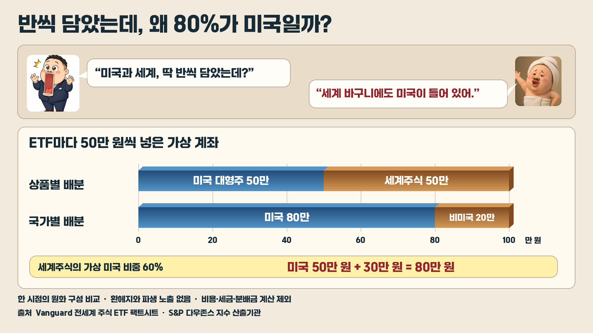

# 은퇴 자금, 미국 ETF와 세계 ETF에 반씩 넣었는데 왜 80%가 미국일까?

## 1. 두 바구니로 나눈 날

퇴직금을 정리하던 가상 인물 천억이는 공책을 반으로 접습니다. 왼쪽에는 미국 대형주 ETF, 오른쪽에는 세계주식 ETF라고 적습니다. “반씩 넣었으니 미국은 절반쯤이겠네.” 수건 친구는 오른쪽 바구니에도 미국 회사가 적힌 종이를 넣습니다. 천억이는 공책을 다시 폅니다.

## 2. 필요한 건 바구니 수보다 안의 비중

두 ETF에 돈을 나눴다는 말은 상품별 배분을 설명합니다. 국가별 배분은 각 상품이 가진 지분까지 펼쳐 봐야 알 수 있습니다. 미국 기업이 해외에서 제품을 팔면 해외 경기의 영향을 받습니다. 그 매출을 누리는 미국 기업의 지분을 갖는 것과 현지 기업의 지분을 직접 담는 것은 서로 다른 노출입니다.

## 3. 펀드 설명서에서 찾을 세 항목

S&P 500은 미국 대형주 지수입니다. 세계주식 ETF는 펀드마다 추종 지수의 범위가 다릅니다. 선진국만 담는지, 신흥국도 담는지, 미국을 포함하는지를 팩트시트에서 따로 확인합니다. 기업의 본사, 상장 시장, 매출 지역은 서로 다를 수 있으므로 국가 구성표에서 쓰는 분류 기준도 함께 읽습니다.

## 4. 같은 100만 원을 펼쳐 보기

원화 100만 원을 한 시점에 미국 대형주 ETF와 세계주식 ETF에 50만 원씩 넣는 가상 예시입니다. 미국 대형주 쪽의 미국 비중은 100%, 세계주식 쪽은 60%로 둡니다. 환헤지·파생 노출은 없다고 가정합니다. 보유 비중만 비교하므로 경과 수익, 세금, 거래 비용, 분배금 및 재투자는 계산하지 않습니다.

미국 대형주 쪽에서는 50만 원 전부, 세계주식 쪽에서는 50만 원의 60%인 30만 원이 미국 비중입니다. 둘을 합치면 **80만 원**, 전체의 **80%**입니다. 비미국 비중은 세계 쪽에서 나온 20만 원입니다. 60%는 계산을 위한 가정입니다.

*가상 원화 100만 원. 세계주식의 가상 미국 비중 60%를 반영하면 전체 미국 비중은 80%다.*

## 5. 발견 · 달러로 샀는데 비미국도 있다

미국 거래소에서 달러로 주문하더라도 펀드에 비미국 기업 주식이 들어갈 수 있습니다. 주문이 체결되는 통화와 기초자산이 노출되는 국가 및 통화는 각기 다른 항목입니다. 수건 친구는 영수증에는 ‘달러’, 보유종목 목록에는 ‘기업의 분류 국가’라고 별도로 적습니다.

## 6. 대가 · 이름 한 단어가 바꾼 결과

가상 세계 ETF를 미국 제외 상품으로 바꾸고 나머지 구성을 그대로 두면, 이 계산의 미국 비중은 50%가 됩니다. 반대로 상품은 그대로 두고 세계주식 ETF의 미국 비중 가정을 70%로 올리면 전체 미국 비중은 85%입니다. 같은 50만 원씩이어도 지수의 포함 범위와 그날의 구성 비중이 결과를 바꿉니다.

## 7. 돌아가기 · 내 계좌의 금액으로 다시

천억이는 처음 적은 50만 원씩을 지우고 현재 평가금액을 적습니다. 매수할 때 반반이었어도 이후 성과가 달라지면 오늘 비중은 달라집니다. 같은 기준일에 각 상품 평가금액에 미국 비중을 곱하고, 합계를 전체 평가금액으로 나눕니다. 국가 합계로 큰 방향을 본 뒤 같은 기업이 몇 개 겹치는지도 별도로 확인할 수 있습니다.

## 8. 달라진 공책

오늘 할 한 가지는 세계 ETF의 팩트시트에서 **미국 포함 여부와 국가 구성표 기준일**에 표시하는 것입니다. 천억이는 그 비중을 적은 다음에야 두 바구니에 얼마를 나눌지 다시 생각합니다.

**편집부 Q&A · 미국 기업의 해외 매출은 국가 구성에서 비미국으로 옮겨 적나요?**  
펀드의 국가 구성은 해당 자료의 기업 분류로 읽습니다. 매출이 어디에서 생기는지는 기업 매출의 지역 구성으로 따로 확인합니다.

**원문**　[Vanguard VOO 운용 팩트시트](https://institutional.vanguard.com/assets/corp/fund_communications/pdf_publish/us-products/fact-sheet/F0968.pdf) · [Vanguard 전세계 주식 ETF 팩트시트](https://institutional.vanguard.com/iippdf/pdfs/FS3141R.pdf) · [S&P 다우존스 지수 산출기관](https://www.spglobal.com/spdji/en/indices/equity/sp-500/)

**이어 읽기**　[VTI에 S&P 500을 더 사면 중소형주 비중이 늘어날까?](EP014.md) · [두 ETF의 겹침이 50%라면 내 계좌 절반이 같은 기업일까?](FAQ01.md) · [전자책 목차](목차.md)
