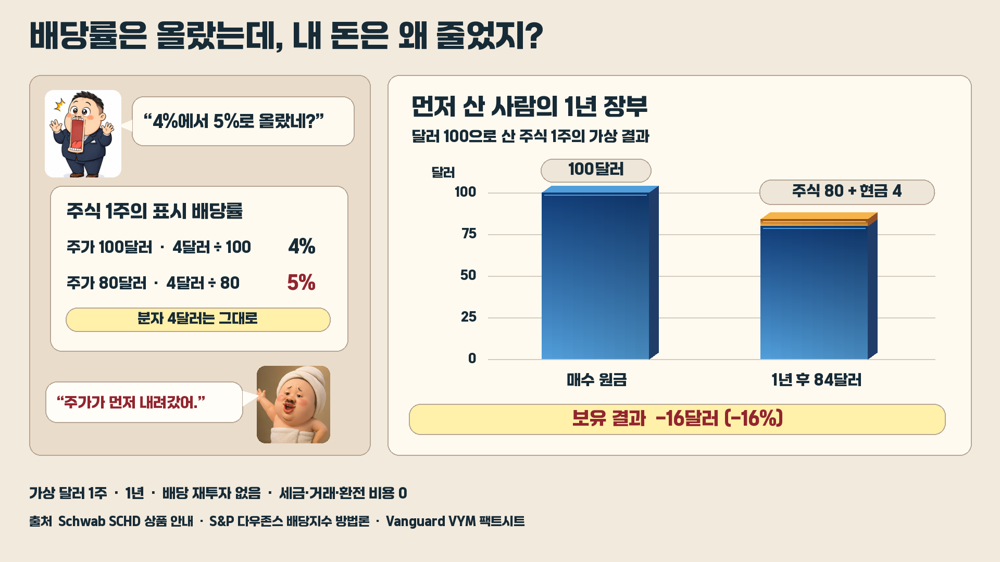

# 은퇴 후 배당으로 생활비를 보탤 때, SCHD와 VYM에서 먼저 볼 것

## 1. 월급 대신 들어올 돈

은퇴한 가상 인물 천억이는 이번 달 관리비 고지서를 보고 배당 ETF 두 개를 검색합니다. SCHD와 VYM. 둘 다 배당이라는 말이 붙어 있습니다. “숫자가 높은 쪽을 고르면 관리비 걱정이 줄겠지?” 수건 친구는 현재 표시율 옆에 빈칸 두 개를 그립니다. “받은 현금이랑, 팔 때 남는 돈도 써 봐.”

## 2. 내 생활비와 보고서의 숫자

기업은 배당금을 지급하고 ETF는 상품 규칙에 따라 분배금을 지급합니다. 기업 하나의 표시 배당률, 펀드의 분배금 이력, 내 계좌에 들어오는 원화 현금은 각각 다른 항목입니다. 천억이는 관리비의 원화 납부일과 펀드의 분배 지급일을 달력에 따로 적습니다. 상품에서 현금이 들어오는 시기와 원화 지출일이 자동으로 맞지는 않습니다.

## 3. 두 ETF가 들어가는 다른 문

SCHD는 Dow Jones U.S. Dividend 100 지수를 추종합니다. 지수 규칙에는 10년 연속 배당 지급 등 후보 조건이 있고, 고를 때 배당수익률뿐 아니라 배당 성장과 기업의 재무 지표도 봅니다. 10년 연속 지급 조건은 10년 내내 배당금이 늘었다는 조건과 다릅니다.

VYM은 FTSE High Dividend Yield 지수를 추종합니다. Vanguard 팩트시트는 예상 배당수익률이 높은 미국 주식에 초점을 둔다고 설명합니다. 따라서 ‘배당 ETF’라는 이름이 같아도 후보와 최종 보유 비중은 달라질 수 있습니다. 두 지수 모두 리츠를 제외하지만, 그 한 가지가 같다고 나머지 선발 규칙까지 같아지지는 않습니다.

## 4. 장부에 100달러 쓰기

어느 기업의 주식 1주를 100달러에 사고 1년 보유하는 가상 예시입니다. 연간 4달러를 현금 배당으로 받았고 연말 주가는 80달러입니다. 세금·거래비용·환전 비용은 0이며 배당은 재투자하지 않습니다. 원화 환산은 하지 않습니다.

주가가 100달러일 때 4달러의 비율은 4%입니다. 다음 배당도 4달러로 가정하고 80달러를 분모에 넣으면 5%입니다. 한편 이미 보유한 사람의 연말 자산은 주식 80달러와 현금 4달러를 합한 **84달러**입니다. 시작 원금 100달러 대비 기간 손익은 **−16%**입니다.

*가상 주식 1주. 표시율은 5%로 오르지만 매수 원금 100달러 중 1년 후 남은 금액은 84달러다.*

## 5. 숫자가 올라간 날 발견한 것

수건 친구는 고지서 옆에 5%를 써 놓고 밑에 ‘주가가 80달러’라고 적습니다. 표시율이 올라간 이유는 배당금 증가가 아니라 분모가 줄었기 때문입니다. 실제 펀드의 화면에서 여러 수익률을 만났다면, 각 숫자가 어떤 기간과 어떤 분모를 사용한 것인지 항목 이름과 설명을 함께 읽습니다.

## 6. 두 판단을 각각 뒤집어 보기

같은 종료 주가 80달러에서 예상 배당이 2달러로 줄면 새 표시율은 2.5%입니다. 주가만 보고 다음 분배금까지 예상할 수는 없습니다. 또 종료 주가가 106달러이고 보유 중 4달러를 받았다면, 같은 원금·기간·비용 가정에서 자산은 110달러로 +10%입니다. 보유 결과를 보려면 배당과 가격을 같은 장부에 넣습니다.

## 7. 상품으로 돌아가서 읽는 순서

두 팩트시트에서 추종 지수의 정식 명칭을 먼저 읽습니다. 이어서 같은 시점의 상위 종목과 업종 비중을 확인합니다. 마지막으로 과거 분배 이력을 볼 때 좌당 지급액과 지급일을 따로 적습니다. 상품을 두 개 가져도 특정 업종 비중이 겹칠 수 있고, 환율이 움직이면 같은 달러를 받아도 원화 생활비로 쓸 금액은 달라질 수 있습니다.

## 8. 생활비 달력에 적는 한 가지

천억이는 ‘배당률 5%’ 대신 고지서 납부일 옆에 자신이 확인한 분배 지급일을 적습니다. 오늘 할 일은 두 상품 중 하나의 공식 분배 이력에서 **좌당 지급액과 입금 예정일을 구분해 적는 것**입니다. 지난 지급액은 지난 기록으로 남기고 다음 달 관리비 계산에는 확정된 현금만 넣습니다.

**편집부 Q&A · 기업의 배당을 오래 받았다면 ETF 분배금도 매년 늘어나나요?**  
기업별 감액, 지수 구성 변경, 펀드 분배 기준이 영향을 줍니다. 좌당 분배 이력과 같은 기간의 가격 성과를 함께 확인합니다.

**원문**　[Schwab SCHD 상품 안내](https://www.schwabassetmanagement.com/products/schd) · [S&P 다우존스 배당지수 방법론](https://www.spglobal.com/spdji/en/documents/methodologies/methodology-dj-dividend-indices.pdf) · [Vanguard VYM 팩트시트](https://fund-docs.vanguard.com/F0923.pdf)

**이어 읽기**　[SOXX와 SMH, 반도체 ETF 한 주의 단일기업 위험 비교법](EP016.md) · [전자책 목차](목차.md)
