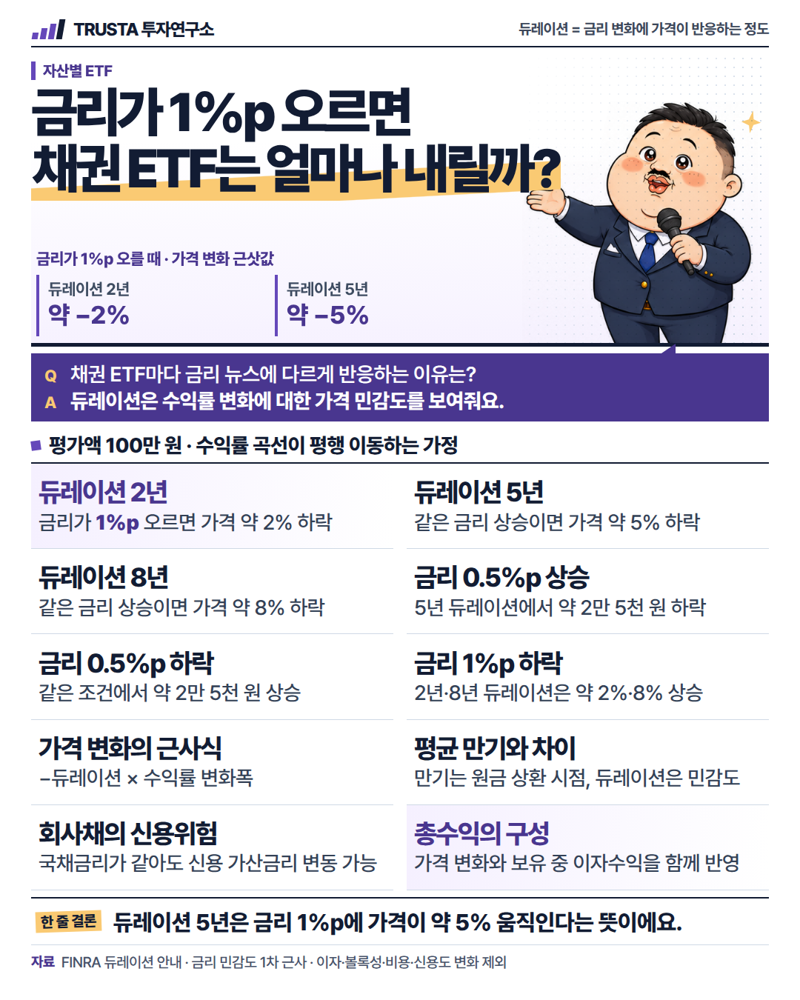
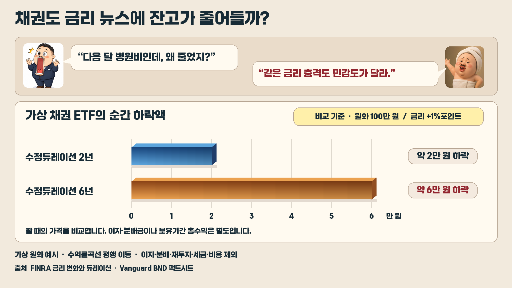

# 은퇴 생활비를 채권 ETF에 넣었는데, 금리 1%포인트에 왜 6만 원이 줄까?

## 1. 병원비 봉투 옆의 마이너스

은퇴한 가상 인물 천억이는 다음 달 병원비로 쓸 돈을 확인하다 채권 ETF 화면의 마이너스를 봅니다. “채권은 이자를 주는데 어떻게 지금 잔고가 줄어?” 수건 친구는 병원 예약표와 상품 설명서를 나란히 놓습니다. 오늘 팔 때 받는 값과 기다리면서 받을 수 있는 돈부터 나눠 보기로 합니다.

## 2. 두 채권 중 어느 것을 고를까?

같은 위험과 만기를 가진 채권을 비교해 봅니다. 기존 채권이 약속한 이자는 그대로인데 새 채권이 더 높은 이자를 준다면, 기존 채권이 같은 가격에 매력적이기는 어렵습니다. 다른 조건이 같다면 요구 수익률이 오를수록 기존 고정금리 채권의 가격은 내려갑니다. 기존 계약의 이자 지급과 오늘 거래 가격은 별개의 숫자입니다.

## 3. 만기 옆에 숨은 숫자

운용사 팩트시트에서 듀레이션과 평균 만기를 따로 찾습니다. 평균 만기는 포트폴리오 채권의 상환 시점에 관한 수치이고, 수정듀레이션은 수익률 변화에 대한 채권 가격의 민감도를 근사하는 수치입니다. 실제 BND 팩트시트에서도 평균 듀레이션과 평균 유효 만기를 별도 항목으로 제시합니다. 본문에 나오는 6년은 BND의 실제 수치가 아니라 가상 원화 펀드의 수정듀레이션입니다.

## 4. 100만 원의 순간 변동

가상 원화 채권 ETF의 시작 평가액은 100만 원, 수정듀레이션은 6년입니다. 수익률곡선 전 구간이 동시에 1%포인트 오르고, 신용 스프레드 등 나머지 조건은 고정한다고 둡니다. 이 순간의 가격 변화만 근사합니다. 이자·분배금·재투자·세금·비용은 들어가지 않습니다.

가격 변화율은 수정듀레이션 6에 금리 변동 0.01을 곱하고 부호를 바꾼 **약 −6%**입니다. 100만 원이면 약 **6만 원 하락**, 평가액 약 94만 원입니다. 0.25%포인트 상승이면 손실 근사는 **1만 5,000원**입니다. 1%포인트는 예를 들어 3%에서 4%로 가는 차이입니다.

*카드에서는 듀레이션 5년, 본문에서는 6년을 예로 든다. 모두 다른 조건이 일정한 작은 금리 변화의 근사다.*

## 5. 같은 금리 뉴스, 다른 잔고

가상의 두 번째 펀드가 같은 금리 충격을 받되 수정듀레이션이 2년이라면, 같은 원금의 근사 손실은 2만 원입니다. ‘금리가 올랐다’는 뉴스 하나로 모든 채권 ETF의 하락폭을 정할 수 없습니다. 수건 친구는 두 설명서의 민감도 항목을 골라 비교합니다.

*원화 100만 원, 같은 금리 충격에서 수정듀레이션 2년은 약 2만 원, 6년은 약 6만 원 하락한다.*

## 6. 금리가 내렸는데도 다르게 움직이는 날

국채금리가 내려가도 회사채에 요구하는 추가 금리가 오르면 회사채 가격 상승이 약해지거나 반대 결과가 나올 수 있습니다. 장기물과 단기물 금리가 서로 다르게 움직이는 날에는 모든 만기가 같이 움직인다는 이 예시의 전제가 깨집니다. 충격이 크면 직선 근사 오차도 커집니다. 해외 채권을 원화로 평가한다면 환율 효과와 환헤지 조건을 따로 봅니다.

## 7. 계좌 밖의 납부일로 돌아가기

몇 달을 보유하면 가격 변동에 이자와 분배, 재투자 결과가 더해집니다. 개별 채권은 계약상 만기 상환일을 확인할 수 있지만, 보유 채권을 계속 교체하는 일반 채권 ETF에는 그 개별 채권의 만기일을 내 펀드의 상환일처럼 적용할 수 없습니다. 만기형 상품이라면 별도의 만기와 종료 조건을 설명서에서 확인합니다.

## 8. 바뀐 한 줄

천억이는 병원 예약표 옆에 펀드 만기가 아니라 **듀레이션의 종류와 기준일**을 적습니다. 오늘 할 일은 운용사 자료에서 그 줄을 찾아, 같은 원금에 0.25%포인트 움직임을 대입해 보는 것입니다. 그렇게 얻은 순간 변동과 실제로 돈을 꺼낼 날짜를 나란히 놓습니다.

**편집부 Q&A · 금리 하락기에는 모든 채권 ETF가 같은 폭으로 오르나요?**  
듀레이션이 다르고 신용 스프레드와 환율도 움직일 수 있습니다. 같은 금리 뉴스라면 어떤 금리인지부터 확인합니다.

**원문**　[FINRA 금리 변화와 듀레이션](https://www.finra.org/investors/insights/bonds-interest-rate-changes-duration) · [Vanguard BND 팩트시트](https://workplace.vanguard.com/assets/corp/fund_communications/pdf_publish/us-products/fact-sheet/F0928.pdf)

**이어 읽기**　[금값은 그대로인데 금 선물 상품 수익이 달라지는 이유](EP018.md) · [전자책 목차](목차.md)
