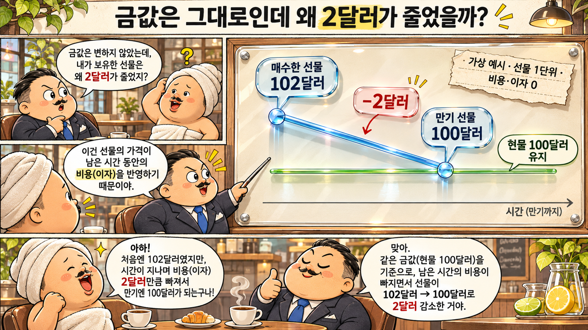
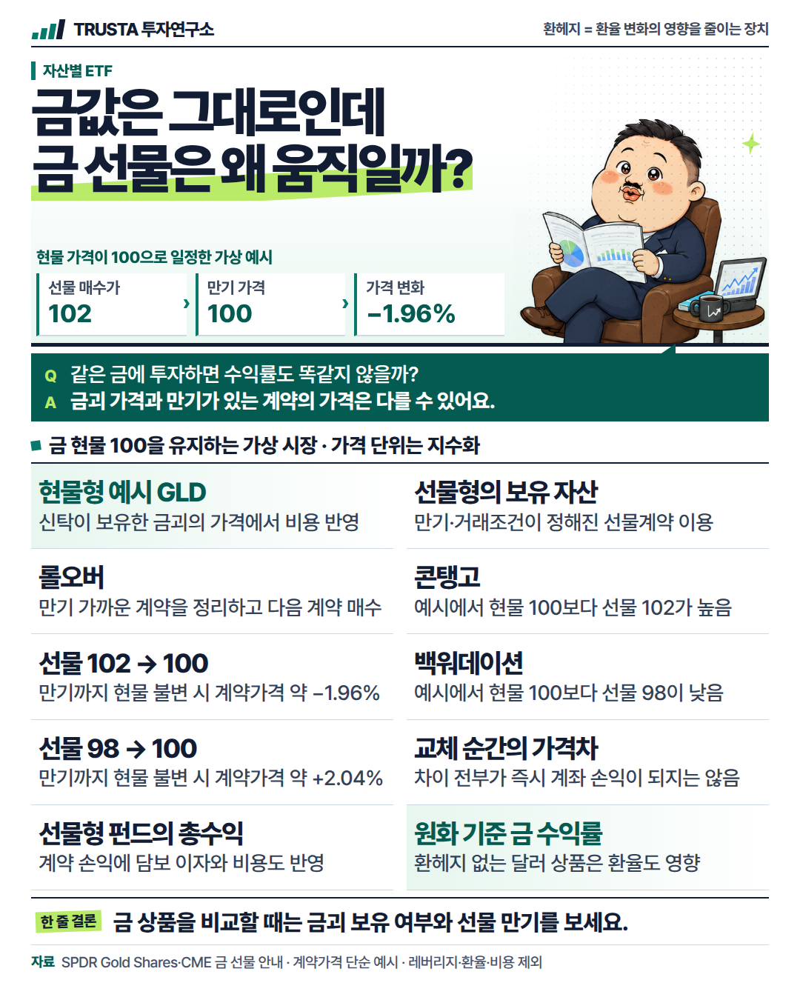

# 금값은 그대로인데 금 선물 상품 수익이 달라지는 이유

*민호와 천억이의 대화와 Q&A는 편집부가 만든 질문입니다.*

민호가 금은방 유리 진열대 앞에서 휴대폰을 두 번 새로 고칩니다. 어제도 금값은 백, 오늘도 백이라고 해요. 그런데 금 선물 상품을 넣어 둔 자기 장부는 조금 줄었습니다. 같은 금인데 누가 가격을 틀리게 쓴 걸까요? 천억이는 금품의 예약 인도일이 적힌 종이와 오늘 바로 받아 갈 수 있는 금의 가격표를 가리킵니다. 하나는 오늘 받을 물건, 다른 하나는 날짜를 정해 맺은 계약입니다. 이름에서 금을 찾았다면 그 뒤에 따라붙는 날짜부터 읽어 보자는 거예요.

## 현물이 그대로인 한 달

우선 편집부가 만든 실험 조건입니다. 원금은 미국 달러 천 달러이고 처음에 한 번 담보로 넣습니다. 한 달 동안 금 한 단위 상당의 가상 계약에 노출된 상태입니다. 중간 입출금은 없고 기간 수익을 연율로 바꾸지 않아요. 이자와 거래 비용, 세금은 영입니다. 분배금도 없어 재투자하지 않습니다. 원화 환산은 나중에 따로 하겠습니다. 그리고 금 현물은 처음부터 만기까지 한 단위에 백 달러로 그대로라고 정합니다.

다음 달 계약은 백이 달러에 사야 합니다. 만기에는 계약값도 현물값과 같은 백 달러가 된다고 해요. 계약에서 일어난 변화는 한 단위에 이 달러 하락입니다. 다른 항목이 움직이지 않았으니 원래 천 달러에서 이 달러를 빼고 구백구십팔 달러가 남아요. 민호가 휴대폰에 쓴 마이너스 이 퍼센트는 어느 돈을 기준으로 셌는지 모르는 답이었습니다. 계약 가격 백이 달러 대비 하락률은 약 일 점 구육 퍼센트지만, 담보 천 달러를 넣은 이 단순 계좌의 손익률은 마이너스 영 점 이 퍼센트예요. 같은 이 달러라도 나누는 숫자가 다릅니다.

**그림 Q&A · 편집부가 만든 질문**　현물은 그대로인데 왜 손실이 날까요? 보유한 선물 한 단위의 가격이 102달러에서 100달러로 내려 2달러가 줄었습니다.

이번에는 처음 사는 계약 가격만 구십팔 달러로 바꿉니다. 만기 현물과 선물이 백 달러로 만난다는 조건을 유지해요. 한 단위의 계약 가격이 그 사이 이 달러 오르니 계좌에는 천이 달러가 남습니다. 어제에서 오늘까지 금 현물은 내내 백이었는데 결과가 이번에는 플러스입니다. 천억이는 민호의 영수증에 처음 계약 가격과 마지막 계약 가격을 두 줄에 씁니다. 현재 현물 가격 하나만 보고 선물 투자 손익을 계산할 수 없었던 이유를 이제 종이에서 볼 수 있어요.

시카고상품거래소의 교육 원문에서 콘탱고는 선물 가격이 현물보다 높은 구조, 백워데이션은 반대로 선물 가격이 더 낮은 구조를 설명하는 말입니다. 민호의 첫 모형은 백보다 높은 백이였고 둘째는 백보다 낮은 구십팔입니다. 먼 날짜의 가격이 높아진 이유로 보관과 금융 비용 같은 요인을 생각할 수 있지만 실제 가격이 움직이는 원인을 그 한 가지로 확정할 수는 없습니다. 처음 보인 선물 가격은 만기 때 금이 꼭 그 값이 되리라는 약속도 아니고요. 다음 페이지에서는 같은 자리에서 비교한 여러 날짜의 가격과, 하나의 계약을 시간에 따라 추적한 가격을 분리해 봅니다.

*카드에는 가상 선물 102에서 100으로 수렴하는 변동률이, 본문에는 1단위 계약의 달러 손익이 나온다.*

## 만기별 가격과 한 계약의 시간 경로

천억이는 금은방에서 받은 종이에 오늘이라는 칸을 하나만 그립니다. 그 아래에 즉시 받는 상품 백 달러, 다음 달 계약 백이 달러, 두 달 뒤 계약 백사 달러를 씁니다. 이 셋은 같은 날에 들여다본 서로 다른 가격입니다. 백, 백이, 백사라는 순서가 나왔다고 해서 오늘 백 달러에 산 금이 다음 달에 백이 되고 그다음 달에 백사가 된다는 뜻은 아니에요. 두 달 뒤에 받기로 한 백사 달러짜리 계약이 내일 백일 달러로 바뀔 수도 있습니다. 달력의 가로 방향에 여러 만기를 쓰는 표와 하나의 계약을 고른 뒤 하루씩 가격을 기록하는 표를 섞으면, 아직 벌어지지 않은 시간의 이동을 이미 관측한 것처럼 보게 됩니다.

민호는 같은 만기의 가격을 다시 한 줄로 기록합니다. 첫날 백이, 중간에 백오, 만기 백 달러입니다. 중간에는 처음보다 삼 달러 올랐고 그다음에는 오 달러 내렸죠. 시작과 끝을 빼면 이 달러 손실입니다. 반대로 중간에 구십칠까지 떨어졌다가 백까지 올라도 출발과 만기가 같다면 끝까지 한 단위를 들고 간 손익은 똑같습니다. 다만 두 경로에서 버티는 경험은 달라요. 계약을 매일 정산하는 구조에서는 중간에 빠져나간 현금이 얼마인지가 중요하고, 중간에 정리해야 했던 사람은 만기의 같은 끝값까지 도달하지 않습니다.

그래서 천억이는 명목 금액과 증거금이라는 말을 분리합니다. 우리가 처음 쓴 천 달러는 모형의 전체 담보입니다. 계약 가격 백이 달러는 금 한 단위 노출에 해당하는 가격입니다. 매일 장부를 정산할 때 상품 운용자가 계약을 계속 보유하려면 필요한 담보를 갖춰야 합니다. 실제 상장 계약에는 거래 단위와 계약 승수가 따로 있으므로, 화면 가격 백이가 곧 계약 전체의 백이 달러라고 쓰면 틀릴 수 있어요. 지수의 점수인지 한 온스당 달러인지, 그 계약이 몇 단위를 대표하는지 먼저 확인해야 계좌의 달러 손익으로 내려올 수 있습니다.

별도의 가상 계약 한 장이 금 열 단위를 나타낸다고 정하면 어떻게 될까요? 시작 백이에서 만기 백으로 가는 경로는 그대로입니다. 한 단위의 이 달러 하락에 열을 곱하면 계약 전체 손실은 이십 달러입니다. 담보 천 달러를 그대로 놓으면 단순 계좌 손실률은 이 퍼센트예요. 처음 예시에서는 한 단위여서 영 점 이 퍼센트였죠. 가격표도 같고 담보도 같은데 계약 단위가 바뀌면서 결과가 열 배 차이 납니다. 위아래로 움직이는 작은 숫자를 보고 내 지갑에서 나갈 돈도 작겠지 생각하면 이 단계를 놓칩니다. 실제 상품 설명서에서 어떤 만기와 수량의 노출을 운용하는지 찾아가는 이유입니다.

## 교체 순간의 가격과 교체 뒤 손익

민호는 다음으로 골치 아픈 말 하나를 만납니다. 만기를 교체한다는 뜻의 롤입니다. 천억이는 금은방 예약증 두 장을 따로 듭니다. 가까운 날 받을 계약을 더는 들고 가지 않으려 정리하고, 다른 날 받을 계약을 새로 맺습니다. 가까운 계약이 백, 다음 계약이 백이라고 읽었다고 가정해 볼게요. 한 계약은 이미 지나온 경로에 따라 정리하는 순간까지 손익이 정해지고, 새 계약은 새로 정한 가격이 출발선입니다. 백에서 백으로 옮겨도 먼저 들고 있던 계약에서 전주에 생긴 이익이 없어지지 않습니다. 두 계약의 현재 가격표만 보고 그 주의 손익을 다시 적을 수는 없어요.

이번에는 가까운 계약 백, 다음 계약 백이입니다. 민호는 새 예약증을 받자마자 이 달러를 손실로 적습니다. 천억이는 가까운 계약을 얼마에 처음 맺었는지부터 물어요. 그 계약을 구십구에 잡아 백에 정리했다면 한 단위에서 일 달러 이익입니다. 새 계약을 백이에 맺었다고 그 순간 그 이익에서 이 달러가 자동으로 빠지는 것은 아닙니다. 실제 거래비용이 있을 수 있지만 계약 가격 차이와 별개의 항목이에요. 새 계약의 백이는 방금 들어온 출발선입니다. 이후 그 가격이 백으로 내려갔다면 그때 이 달러 손실이 생겨 앞의 일 달러 이익과 합쳐 마이너스 일 달러입니다.

다르게 움직이는 경우도 만나 봅시다. 가까운 계약을 백에 정리하고 다음 계약을 백이에 넣은 뒤 시장에서 새 정보가 나왔습니다. 만기의 현물과 선물이 백오에 이르렀다고 해요. 새 계약은 백이에서 백오로 움직였으니 삼 달러 이익입니다. 출발할 때 다음 만기 가격이 더 높았다는 사실은 그대로였지만 결과는 손실이 아니죠. 손익이 어느 방향으로 정해졌는지 설명하려면 이 달러라는 그날의 간격만 말할 수 없어요. 그 후 실제로 어떤 가격으로 움직였는지를 같이 말해야 합니다. 출발 시점의 기간별 가격 구조를 알아보는 일과 미래를 보장하는 일은 다릅니다.

민호는 어떨 때는 다음 만기가 싸니까 그냥 이익이 되는 줄 알았다고 말합니다. 새 계약을 구십팔에 맺었는데 만기의 금 자체가 구십오로 하락했다고 바꿔 봅시다. 만기 선물이 구십오에 맞춰지면 이번 손익은 마이너스 삼 달러입니다. 이전 예에서는 만기의 현물을 백으로 고정해서 구십팔에서 백으로 오르는 결과를 얻었습니다. 그 조건을 뺀 순간 결론이 달라졌죠. 그래서 천억이는 항상 말의 앞쪽에 만기 현물 가격을 먼저 붙입니다. 만기의 현물이 백으로 유지되고 계약이 그 값에 수렴한다면이라고요. 방향을 외우는 것보다 어떤 조건을 넣어 그 방향이 생겼는지 보는 게 결론을 오래 기억하는 방법입니다.

천억이는 다음 날 민호에게 예약증을 두 장 더 보여 줍니다. 첫 계약은 백이에 시작했고, 첫 교체일에 백에 끝났습니다. 둘째 계약은 그 교체일에 백삼에 시작해 다음 교체일에 다시 백에 끝났다고 놓겠습니다. 두 계약 모두 한 단위이고 교체 전후 별도 비용과 이자는 영입니다. 첫 계약에서 이 달러, 둘째에서 삼 달러가 줄었어요. 시작할 때 넣은 천 달러는 구백구십오 달러가 됐습니다. 같은 원금에서 계속 한 단위를 유지한 조건이어서 금액 둘을 더할 수 있습니다. 각 달에 같은 수익률만큼 투자금을 다시 조정하는 모형이었다면 수량이 달라질 수 있으니 이 금액을 그대로 쓸 수는 없죠.

## 교체 날짜와 계약 수량

민호가 놀란 건 현물 가격을 그동안 한 번도 바꾸지 않았다는 점입니다. 이처럼 반복해서 비싼 계약을 잡고 그 계약이 더 낮은 값으로 수렴하면, 그 경로에서 선물 쪽에 누적 손실이 생길 수 있습니다. 다만 미래 계약이 항상 해당 간격을 유지한다거나 금 현물이 반드시 같다는 뜻을 덧붙이면 이 모형을 넘어갑니다. 거래소의 만기별 가격표는 오늘 눈앞의 구조를 보여 줍니다. 다음 달에 그 표가 어떻게 바뀔지 알려면 그때의 가격이 필요하고, 내가 실제로 보유했던 수량과 교체 시점도 찾아야 합니다. 같은 달력의 마지막 날짜 하나만 보고 몇 달 치 손실을 복원할 수는 없습니다.

또 실제 지수 방식에 따라 어느 날 계약을 바꾸는지가 달라요. 민호가 구경하는 가상 상품 갑은 교체 수량 두 단위를 한날 모두 새 계약 백이에 맺습니다. 상품 을은 한 단위만 백이에 맺고, 다음 날 나머지 한 단위를 백일에 맺습니다. 두 상품이 그 새 계약을 각각 만기 백에 정리하고 그 밖의 구간 손익은 여기서 영이라고 정해요. 갑의 새 계약 손실은 두 단위에 각 이 달러로 사 달러입니다. 을은 이 달러와 일 달러를 더해 삼 달러 손실입니다. 금이라는 이름과 끝값이 같아도 어느 날에 무슨 가격으로 수량을 옮겼는지에 따라 출발선이 달라져요.

첫째 날이 오히려 더 쌌다면 위 결과가 반대로 나올 수 있습니다. 하루에 몰아 교체하는 방식이 나쁘다든지 나눠 교체하는 방식이 유리하다든지, 방금 숫자만으로 고정할 수는 없어요. 천억이는 두 상품의 지수 문서에서 정해진 교체 기간을 확인하는 이유가 바로 여기 있다고 말합니다. 그리고 바꾼 날의 가상 가격을 적은 종이 위에, 실제는 어느 계약 가격으로 집계했는지 확인하라고 덧붙여요. 시장 최종 체결가와 거래소 정산값이 같은 숫자라고 미리 정해 놓으면 중요한 시점이 또 빠집니다.

## 담보이자와 비용을 넣으면

교체할 때 계약 수량 자체가 달라지는 경우도 생각해 보죠. 이번에는 금 가격에 연결되는 명목 금액을 처음 천 달러 안으로 맞추는 소형 모형입니다. 계약 한 단위가 백 달러일 때는 열 단위가 가능합니다. 다음 계약 가격이 백이로 오르면 천 달러를 정확히 유지하려면 천을 백이로 나눠 약 아홉 점 팔 단위로 줄여야 해요. 실제 계약은 정수 단위와 승수가 있어서 정확히 맞추기 어려울 수 있습니다. 구 단위만 잡으면 명목은 구백십팔 달러이고, 열 단위를 쓰면 천이십 달러죠. 이는 거래할 때 비용으로 사라진 액수가 아니라 가격이 바뀌었을 때 금에 얼마만큼 연결돼 있는지를 나타내는 값입니다.

민호는 영수증에서 빈칸으로 남겼던 담보이자도 채워 봅니다. 아까 한 단위 선물의 손실이 이 달러였습니다. 새 가정에서는 같은 한 달에 담보 자금에서 삼 달러의 이자가 들어오고 운용과 거래에 일 달러가 나갑니다. 세금, 환율, 분배와 재투자는 그대로 적용하지 않습니다. 원래 천 달러에서 선물 이 달러를 빼고 이자 삼 달러를 더하고 비용 일 달러를 빼면 다시 천 달러입니다. 계약은 손실이었는데 총 장부는 제자리입니다. 민호가 선물 거래만 찍은 사진을 친구에게 보냈다면 친구는 전체 상품이 이 달러를 잃었다고 오해할 수 있었어요.

이자는 언제나 선물 손실을 메워 줄까요? 다른 조건을 그대로 두고 이자가 영이라면 이 달러의 계약 손실과 일 달러 비용이 남으니 구백구십칠 달러예요. 비용을 더 적게 받는 계좌라면 또 다릅니다. 실제 상품에서 사용할 수 있는 담보 자산과 그 자산에서 실제로 얻는 수익, 비용을 떼는 방식은 설명서에 따라 달라집니다. 예시에서 담보 이자라고 이름 붙인 항목과 시장 전체의 예금 금리가 같은 값이라고 놓아서는 안 돼요. 무엇을 비교하는 표인지에 따라 계약 성과만 쓸 때와 담보수익을 포함할 때를 밝혀야 합니다.

## 현물 보유형과 환율

이어서 지수의 성과표 제목도 읽어 봅니다. 어떤 자료는 계속 교체하는 선물 노출의 성과를 보여 주고, 어떤 자료는 담보가 얻는 수익을 별도로 더하는 총수익 기준을 사용합니다. 운용 상품은 그 지수와 동일한 조건으로 장부가 끝난다고 약속할 수 없어요. 운용 비용과 체결 여건, 담보 관리가 다를 수 있기 때문입니다. 민호가 손에 쥔 금이라는 한 단어를 여러 자료에서 찾았더라도, 그 자료가 가격으로 셌는지 선물 교체를 넣었는지 담보 이자까지 넣었는지 알아야 같은 기준으로 읽을 수 있습니다.

그제야 민호는 진열대의 금에 바로 투자하는 상품도 오늘 처음 열어 봅니다. 스파이더 골드 셰어스의 공식 안내는 신탁이 보유한 금과 신탁 비용을 고려하는 구조를 설명합니다. 얘는 금 선물의 다음 만기를 바꾸는 이야기가 아니라 지분이 가리키는 금과 운영 비용에 관한 이야기예요. 현물 보유형 지분을 갖는다고 해서 소액 투자자가 언제든지 금 한 조각을 직접 받아 갈 수 있다는 약속도 자동으로 생기지 않습니다. 실물 인도 권리가 궁금하면 지분 보유와 상환의 조건이 어떻게 다른지 해당 설명서에서 읽어야 합니다.

가상의 신탁이 처음 지분 한 단위에 금 한 단위씩 가지고 있고 금 시세는 백 달러로 그대로라고 해 봅시다. 비용을 충당한 뒤 지분당 남은 금이 영 점 구구 단위라고 정하면, 다른 항목이 없다면 지분이 가리키는 금의 가치는 구십구 달러입니다. 금 가격 표에는 여전히 백이라고 나옵니다. 선물의 백이와 백 차이를 하나도 쓰지 않고도 현물형 지분에서 변동이 나오는 모형을 만들 수 있어요. 영 점 구구는 설명용으로 정한 비율이고 실제 신탁이 어느 기간에 금을 얼마나 줄였는지는 별도의 자료에서 확인해야 합니다.

민호는 달러 화면에서 수익이 없으면 원화 지갑도 그대로라고 생각했던 일을 떠올립니다. 백 달러를 달러당 천삼백 원에 마련해 한 달 동안 들고 있었고 끝에도 백 달러라고 정합시다. 처음과 끝에만 원화로 바꾸고 수수료와 세금은 영, 분배금은 없습니다. 끝 환율이 달러당 천이백오십 원이면 처음 십삼만 원이 십이만 오천 원이 됩니다. 달러 수익률은 영인데 원화로는 오천 원 차이가 납니다. 반대로 끝 환율이 천삼백오십 원이면 오천 원 늘어요. 금 선물을 팔았기 때문에 나온 차이인지 환율에서 나온 차이인지, 현금이 어느 통화로 움직였는지 기록해야 합니다.

달러 수익률이 플러스였어도 원화 결과는 바뀔 수 있어요. 가상의 금 계좌가 백 달러에서 백오 달러로 불었는데 처음 환율 천삼백 원이 천이백 원으로 바뀌었다고 해 봅시다. 출발 원화는 십삼만 원, 돌아온 원화는 십이만 육천 원입니다. 금과 환율을 한 문장에 억지로 붙여 오 퍼센트 수익이라고 말하면 자기 통장으로 돌아온 결과를 설명하기 어렵죠. 민호는 자기가 원화로 매매했다는 사실과 상품이 환율 영향을 줄이려는 설계를 포함하는지를 두 칸에 놔 둡니다. 헤지 범위와 비용을 보지 않고 상품 이름이나 앱의 표시 통화만으로 금액을 채우지 않습니다.

여기까지 왔는데도 민호의 계좌 수익률을 설명할 때 실수할 수 있습니다. 앱이 보여 주는 건 증권 거래에서 내가 산 가격과 지금 내다 팔 수 있는 가격일 수 있어요. 펀드의 순자산은 들어 있는 자산과 계약을 평가한 값입니다. 가상의 순자산이 백 달러로 유지됐고 내가 시장에서 백일 달러에 샀다가 나중에 백에 팔았다면 매매에서는 일 달러가 줄죠. 선물 만기 교체가 실제로 손실을 냈는지 그 한 줄로는 모릅니다. 반대로 내가 할인된 가격에서 시작했다면 펀드 가치와 다른 방향의 계좌 손익이 생길 수도 있어요. 원인을 찾으려면 상품 문서와 자기 주문 내역을 서로 다른 곳에서 열어야 합니다.

민호는 드디어 금의 종류 세 개를 다른 줄에 놓을 수 있게 됩니다. 금을 금고에 보유하는 신탁, 만기를 가진 금 계약을 편입하는 상품, 그리고 금을 캐는 기업의 주식을 담는 펀드입니다. 세 번째는 금 가격과 관련이 있을 수 있지만 채굴 비용과 기업의 부채, 생산 차질에도 영향을 받습니다. 금 현물 가격이 옆으로 움직인 하루에 채굴회사가 떨어졌다는 사실만으로 금 선물 교체 비용으로 설명할 수는 없어요. 내가 산 종목의 공식 이름과 설명서의 투자 목적을 먼저 맞춰야 그다음에 어느 표가 필요한지 정할 수 있습니다.

이 대화에 나온 모의 가격은 실제 시장에서 본 값이 아닙니다. 실제 화면 예시를 확인하고 싶다면 오늘 읽은 날짜와 시장을 적고, 그 화면에서 가장 가까운 두 만기의 이름과 각 가격 단위를 함께 찾아야 합니다. 현물은 언제 어느 시장에서 본 값인지, 선물 가격은 장중 호가인지 거래소의 그날 정산값인지를 확인합니다. 날짜가 달라 직접 비교가 어렵다면 정확한 두 가격을 얻을 때까지 미확인으로 남길 수 있어요. 저장한 화면 하나로 내가 실제로 샀던 계약의 과거 거래 경로를 대신할 수는 없습니다.

그럼 편집부가 만든 질문입니다. 만기 교체로 손해를 봤다는 글을 읽을 때 무엇을 하나만 먼저 물을까요? 천억이는 얼마에 들어갔고 어디에서 나왔느냐고 묻습니다. 정리한 계약과 새로 산 계약 각각의 시작값, 끝값 그리고 수량을 확인하면 어느 구간에서 손실이 생겼는지 찾을 수 있어요. 그 뒤 담보 이자와 수수료, 환율을 더할 수 있지만, 서로 다른 계약의 한때 가격만 빼서 내 계좌에서 그 돈이 당장 나갔다고 쓰면 다시 진열대와 예약증을 한 칸에 넣게 됩니다.

실제로 첫 계약을 만기보다 일찍 팔았다면 만기 가격 대신 그날 정리한 가격을 넣어야 합니다. 백이에 산 계약을 백일에 정리한 사람의 손실은 일 달러입니다. 이후 계약이 백에 도달해도 이미 닫힌 자기 장부에 두 번째 일 달러가 적히지는 않습니다.

민호는 금은방을 나서기 전 아까 들고 있던 종이를 뒤집습니다. 한쪽에는 오늘 금을 사는 값, 다른 쪽에는 자기 상품이 들고 있는 계약의 만기와 시작 가격을 적어요. 휴대폰에서 금 백이라는 숫자를 다시 읽었을 때는 이제 무슨 숫자인지 먼저 묻습니다. 독자도 상품 하나만 골라 설명서에 나온 보유 자산 문장을 찾아 보세요. 금 보유량을 읽어야 할지, 선물의 교체 시점을 읽어야 할지가 드러납니다. 민호는 처음 본 유리 진열대 앞에 종이를 한 번 더 놓습니다. 금이 놓여 있던 자리와 자기한테 날짜를 약속한 종이가 같은 물건은 아니었어요.

**자료 시점**　원문 확인일 2026년 11월 27일. 100·102·98달러는 가상의 단위당 가격이며 실제 관측 시세는 사용하지 않았습니다.

**원문**　[SPDR Gold Shares 보유 구조](https://www.spdrgoldshares.com/usa/gld/) · [CME 귀금속 선물 만기별 가격 설명](https://www.cmegroup.com/education/courses/introduction-to-precious-metals/what-is-contango-and-backwardation) · [미 SEC의 ETF 구조 안내](https://www.investor.gov/introduction-investing/investing-basics/investment-products/mutual-funds-and-exchange-traded-2)

**이어 읽기**　[리츠 ETF의 분배금, 세입자가 내는 월세처럼 예측할 수 있을까?](EP019.md) · [전자책 목차](목차.md) · [두 ETF의 겹침과 분산](FAQ01.md)
