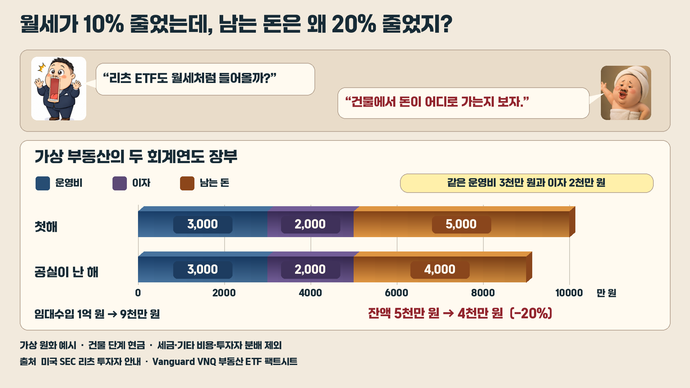

# 은퇴 후 월세처럼 받으려던 리츠 ETF, 공실 하나가 내 생활비에 닿기까지

## 1. 통장에 찍힐 날짜를 정하는 날

은퇴한 가상 인물 천억이는 관리비가 나가는 날에 맞춰 현금이 들어오기를 바랍니다. 부동산을 담는 리츠 ETF를 보며 수건 친구에게 묻습니다. “건물이 월세를 받으면 나도 매달 같은 돈을 받는 거야?” 친구는 월세 장부, 대출 이자 고지서, 펀드 분배 내역을 식탁에 차례로 펼칩니다.

## 2. 월세와 통장 사이의 장부

임차인이 임대료를 내면 건물을 운영하는 법인에는 관리, 수선, 차입 비용 등이 생깁니다. 그다음 리츠의 배당을 거쳐 ETF가 보유한 자산과 현금 흐름에 반영될 수 있습니다. 리츠 ETF에는 여러 리츠가 들어갈 수 있으므로 임차인 한 사람의 입금 날짜를 펀드 투자자의 분배 일정으로 옮겨 적기 어렵습니다.

## 3. 내 돈과 건물 돈을 분리하기

리츠에 직접 투자할 때는 해당 기업의 부채 만기, 고정금리 비중, 임차인 집중을 봅니다. 리츠 ETF에서는 어느 유형의 부동산을 얼마나 담는지와 보유종목부터 확인합니다. 물류·주거·데이터센터는 주요 임차인과 계약 기간이 다를 수 있습니다. 해외 ETF라면 청구서 통화와 지급 통화도 확인합니다.

## 4. 공실이 난 해의 가상 장부

원화로 기록하는 가상 리츠의 건물 단계 예시입니다. 두 해의 장부를 비교합니다. 첫해 임대수입 1억 원, 운영비 3천만 원, 이자 2천만 원이라면 세금과 기타 비용을 빼기 전 잔액은 **5천만 원**입니다. 다음 해 임대수입이 10% 감소해 9천만 원이 되고 두 비용이 같다면 잔액은 **4천만 원**입니다. 임대수입은 10% 줄었지만 장부 잔액은 20% 줄었습니다.

투자자 원금과 주가를 넣지 않은 현금 흐름 예시입니다. 세금, 기타 거래 비용, ETF 분배와 재투자, 자산 가격 상승은 계산에서 제외합니다. 20%는 투자자의 기간 수익률이 아니라 건물의 두 회계연도 간 잔액 감소율입니다.

*가상 원화 건물 장부. 운영비와 이자가 고정된 경우 임대수입이 10% 줄면 장부 잔액이 20% 줄어든다.*

## 5. 공실을 메웠는데도 돈이 준 날

다른 가정에서는 새 임차인이 들어와 임대수입이 1억 원으로 유지됩니다. 운영비 3천만 원이 그대로여도 이자가 2천만 원에서 3천만 원으로 오르면 잔액은 다시 4천만 원입니다. 임대수입이 유지돼도 만기가 돌아온 대출을 더 높은 비용으로 바꾸면 잔액이 줄 수 있습니다. 반대로 고정금리 계약이 당분간 유지된다면 금리 뉴스가 지출에 바로 반영되지는 않을 수 있습니다.

## 6. 잔액이 늘어도 내가 받는 돈은 다르다

추가 수선이나 다음 만기 준비에 필요한 현금을 빼고 나면 리츠가 주주에게 지급하는 금액은 위 장부의 잔액과 다를 수 있습니다. ETF는 편입 리츠의 배당을 받고 자체의 비용과 분배 일정도 따릅니다. 상장 리츠와 ETF의 거래 가격은 투자자들이 거래하는 시장에서 움직입니다. 건물 장부의 개선이 같은 폭의 주가 상승을 뜻하지는 않습니다.

## 7. 고지서 날짜로 돌아가기

천억이는 지난 분배금의 액수와 지급일을 따로 씁니다. 달러로 지급됐으면 같은 달러 금액이라도 실제 환전 후 원화가 얼마였는지 확인합니다. 펀드의 보유 내역과 분배 내역에서 확인한 값만 옮기면 어느 돈이 확정됐고 어느 돈이 예상인지 구별할 수 있습니다.

## 8. 달력에서 할 한 가지

오늘 할 일은 보유하거나 검토 중인 ETF의 공식 분배 이력에서 **최근 지급일과 좌당 지급액을 한 줄씩** 적는 것입니다. 천억이는 관리비 납부일과 나란히 놓고, 지급 간격과 생활비 날짜 사이에 빈칸이 있는지 봅니다.

**편집부 Q&A · 임대료가 오르면 ETF 가격도 꼭 오르나요?**  
금리·운영비·대출 만기 조건과 시장에서 요구하는 수익률이 함께 바뀔 수 있습니다. 건물의 임대료와 ETF 가격은 같은 장부에 있는 숫자가 아닙니다.

**원문**　[미 SEC 리츠 투자자 안내](https://www.investor.gov/introduction-investing/investing-basics/investment-products/real-estate-investment-trusts-reits) · [Vanguard VNQ 부동산 ETF 팩트시트](https://workplace.vanguard.com/assets/corp/fund_communications/pdf_publish/us-products/fact-sheet/F0986.pdf)

**이어 읽기**　[AI·테마 ETF의 이름값, 실제 매출과 편입 비중으로 확인하기](EP020.md) · [전자책 목차](목차.md)
