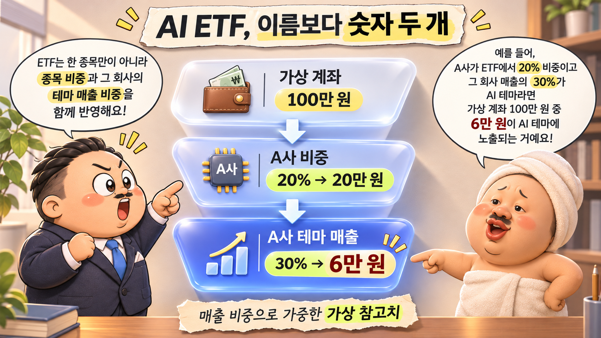

# AI·테마 ETF의 이름값, 실제 매출과 편입 비중으로 확인하기

*민호와 천억이의 대화와 Q&A는 편집부가 만든 질문입니다.*

민호가 전자제품 매장에서 작은 스티커 세 장을 떼어 옵니다. 세 장 다 인공지능이라고 적혀 있는데 하나는 노트북, 하나는 선풍기, 하나는 스피커에 붙어 있었어요. 집에 가서 휴대폰을 열면 투자 상품 세 개 이름에도 인공지능이 들어갑니다. 같은 주제로 다른 곳에 나눠 투자한 거라면 세 가지 다른 인공지능 사업에 돈이 고르게 들어간 걸까요? 천억이는 스티커부터 내려놓고 제품 설명을 펼칩니다. 이름은 세 개지만 그 이름이 가리키는 회사나 매출을 아직 보지 않았잖아.

## 편입 비중과 매출 비중을 곱하는 법

오늘 계산할 계좌는 편집부가 만든 가상 사례입니다. 원화 백만 원을 관측일에 한 번 배치하고, 추가 납입이나 인출은 없습니다. 한 시점의 보유 구성을 비교하므로 수익률과 연율을 계산하지 않아요. 분배금과 재투자, 세금과 거래비용도 이 계산에 들어가지 않습니다. 회계 자료에 테마 매출이 있다고 표시한 가상 기업 에이가 있고, 첫 펀드의 에이 비중을 이십 퍼센트로 둡니다. 내가 넣은 백만 원 중 에이 회사 몫은 이십만 원이에요. 여기까지는 그 회사 주식에 연결된 금액이라는 답입니다.

이제 두 번째 숫자가 나옵니다. 가상 기업 에이의 전사 매출에서 이번에 정의한 테마 관련 매출이 삼십 퍼센트입니다. 이십만 원에 삼십 퍼센트를 곱하면 육만 원입니다. 이 육만 원은 회사 안에서 테마 매출이 차지하는 비중을 펀드 보유 비중에 곱한 참고값입니다. 증권 계좌에서 에이 회사의 특정 공장으로 육만 원을 송금했다는 뜻과는 다릅니다. 회사 가치와 이익에서 그 사업이 정확히 삼십 퍼센트를 차지한다는 뜻도 아니죠. 민호는 영수증에 에이 주식 이십만 원, 매출로 가중한 참고값 육만 원이라고 서로 다른 이름을 붙입니다.

**그림 Q&A · 편집부가 만든 질문**　6만 원은 어떤 숫자인가요? 가상 계좌에서 A사 주식 몫 20만 원을 구하고, 그 금액에 A사의 테마 관련 매출 비중 30%를 적용한 참고값입니다.

민호가 다시 묻습니다. 그럼 이름이 인공지능인 다른 상품은 참고값도 더 높지 않을까? 두 번째 가상 펀드의 같은 기업 비중이 십 퍼센트라고 해 보죠. 동일한 회사 매출 분류와 같은 날짜를 사용한다면 백만 원 중 이 기업의 주식 노출은 십만 원, 매출 가중 참고값은 삼만 원입니다. 아무리 상품명 글자가 큼직해도 같은 회사가 덜 들어 있다면 이 회사가 기여하는 항목은 작아집니다. 다만 둘째 펀드의 다른 기업이 우리 기준에서 관련 매출이 많을 수 있어요. 이 한 기업의 참고값을 두 상품 전체의 테마 비중이라고 제목 붙이지 않습니다.

매장 스피커 쪽에 이런 말이 적혀 있습니다. 인공지능을 써서 음질을 조절한다. 민호는 그러면 스피커 판매액 전부를 테마 매출에 넣자고 해요. 천억이는 이번 비교에서 무엇을 셀지 먼저 고르자고 합니다. 인공지능 기능이 있는 기기 전체를 생각하는지, 따로 돈을 받은 인공지능 소프트웨어 기능을 세는지에 따라 계산할 매출이 달라집니다. 회사 공시에 그 기능만의 매출을 나누어 쓰지 않았다면, 소프트웨어 부분을 자의적으로 정해 채우기 어렵습니다. 그 칸에는 영 퍼센트나 백 퍼센트 대신 자료 미분류라고 적습니다.

## 실제 공시에서 찾을 수 있는 숫자

그러면 실제 공시 한 장을 읽어 보죠. 엔비디아의 이천이십오 회계연도 보고서에서 연간 매출 합계는 천삼백사억 구천칠백만 달러로 나옵니다. 이 회계연도는 이천이십오 년 일월 이십육일에 끝났습니다. 달력에 적힌 이천이십오 년 일월부터 십이월까지의 매출을 모두 더한 수치가 아니에요. 보고서가 매출을 어떤 부문으로 묶었는지부터 보면 컴퓨트 앤 네트워킹이나 그래픽스라는 이름이 나옵니다. 설명 속의 데이터센터라는 말과 회계상 부문 이름을 서로 바꿔 붙이면 분자와 분모가 다른 표에서 나올 수 있어요.

민호가 보고서에서 데이터센터 항목을 찾았다고 칩시다. 데이터센터에는 인공지능 계산을 위한 칩과 네트워크가 들어가지만, 그 부문 매출 전체를 우리 설명서에서 방금 정한 인공지능 소프트웨어 매출로 볼 수 있을까요? 그 분류는 훨씬 좁아요. 공시에서 어느 제품이나 서비스에 얼마를 따로 받았는지 확인되지 않는다면 답은 미분류입니다. 반대로 우리가 인공지능 처리를 돕는 인프라 공급까지 테마에 넣는다면 데이터센터의 일부 항목이 검토 대상에 포함될 수 있겠죠. 경계를 바꾸기로 했다면 다른 회사에도 같은 뜻으로 적용해야 합니다. 마음에 드는 회사만 넓게 세면 비교 결과에 기준 변화가 들어갑니다.

천억이는 금액을 한번 나누어 보는 별도의 문제를 꺼냅니다. 가상 기업의 연 매출이 백억 원이고 그중 컴퓨팅 장비 묶음이 사십억 원이라고 해요. 사십억 원 안에 실제로 인공지능 전용 제품이 얼마나 있는지는 공시가 안 되어 있습니다. 민호는 우선 사십 퍼센트라고 쓰려고 합니다. 그런데 사십 퍼센트는 공개된 장비 묶음 전체의 비율입니다. 같은 조건에서 전용 제품이 그 묶음의 일부만 차지한다고 가정한다면, 확인된 범위는 영부터 사십 퍼센트 사이일 수 있어요. 제품이 전사 다른 부문에 걸쳐 있다면 이 상한마저 그대로 쓸 수 없습니다. 지금 무엇이 공개됐고 무엇을 가정했는지 표 바로 아래에 적어 둡니다.

공시 표의 지역 이름을 봐도 비슷한 실수가 생깁니다. 실제 엔비디아 보고서에는 매출 지역을 고객 청구지 기준으로 표시하고, 배송지나 최종 고객 위치는 다를 수 있다고 설명합니다. 싱가포르 청구지 기준으로 해당 연도 전체의 약 십팔 퍼센트였지만, 싱가포르로 배송된 비중은 이 퍼센트 미만이라고 적혀 있어요. 민호는 같은 회사 같은 해 같은 나라 이름인데 숫자가 이렇게 다른 데 놀랍니다. 주문서의 청구지와 제품이 도착한 곳은 서로 다른 항목이거든요. 청구지 지도 하나를 가져와 그 나라에서 최종 인공지능 수요가 그만큼 생겼다고 옮겨 적을 수 없습니다.

## 미분류가 있을 때 분모 읽기

가상 펀드의 두 번째 줄로 돌아갑니다. 백만 원 가운데 삼십만 원은 기업 비에 들어 있고, 그 기업의 매출 분류 자료를 아직 찾지 못했습니다. 에이의 참고값 육만 원은 확인한 가정대로 두고, 비의 참고값을 영으로 써서 계좌 테마 비중이 육 퍼센트뿐이라고 결론 내릴까요? 미분류가 영인 경우와 비의 매출이 전부 테마인 경우를 생각해 보면 범위가 달라집니다. 나머지 종목에서 해당 매출이 없다고 별도로 확인했다는 조건에서만, 이 모형의 참고값은 육만 원에서 삼십육만 원 사이입니다. 자료를 못 구한 금액이 크면 정확해 보이는 한 숫자보다 확인된 금액과 아직 열려 있는 범위를 함께 적습니다.

반대로 분류한 회사만 다시 계산할 수도 있습니다. 방금 계좌에서 확인된 종목 평가액이 칠십만 원이고 매출 가중 참고값이 육만 원이라면, 확인된 부분 안에서의 비율은 약 팔 점 오칠 퍼센트입니다. 전체 계좌에서 확인한 최소값은 육 퍼센트이고요. 두 값의 차이는 계산 실수가 아니라 어떤 범위를 분모로 잡았는지에서 나왔습니다. 확인 대상이 적은 상품에서 계산된 큰 비율과 대부분을 확인한 상품의 전체 비율을 같은 순위로 비교하지 않아야 합니다. 자료를 채운 비율을 표 위에 두면 어디에서부터 숫자를 읽어야 하는지 드러나요.

민호가 상품 이름 세 개를 다시 책상에 놓습니다. 세 상품에서 에이 회사의 비중이 각각 이십 퍼센트, 십오 퍼센트, 십 퍼센트라고 해요. 원화 백만 원을 오십만 원, 삼십만 원, 이십만 원으로 나눈 가상 계좌입니다. 세 곳에서 에이 주식 몫을 꺼내면 십만 원, 사만 오천 원, 이만 원입니다. 합계 십육만 오천 원이죠. 에이 회사의 테마 매출 비율을 앞의 삼십 퍼센트로 유지하면 참고값은 사만 구천오백 원입니다. 이름을 세 개 샀다는 사실에서 노출이 세 배라는 결론은 나오지 않아요. 에이 기업을 실제로 얼마나 나눠 들고 있는지가 먼저입니다.

여기서는 같은 회사의 주식 노출을 합친 뒤 회사 매출 비율을 한 번 곱했습니다. 펀드마다 보유분에 삼십 퍼센트를 한 번씩 적용한 뒤 참고값을 합쳐도 계산 결과는 같습니다. 두 경로가 같은지 검산해 볼 수 있어요. 다만 각 펀드의 같은 기업에 매출 비율을 적을 때 서로 다른 회계연도를 끌어왔다면 계산 중간부터 조건이 다릅니다. 값이 왜 같아야 하는지 모르면 맞지 않는 결과를 반올림 탓으로 돌리기 쉽습니다. 같은 기업, 같은 매출 기준, 같은 회계 기간부터 맞추면 합치는 순서를 바꿔도 낯설지 않습니다.

## 같은 회사라도 지수마다 다른 무게

민호는 이번에는 상품이 그 기업을 왜 샀는지 궁금합니다. 회사의 매출 표를 열기 전에 지수의 편입 설명부터 펼쳐요. 어떤 가상 지수는 전체 매출의 절반 이상을 지정한 제품에서 얻어야 후보가 된다고 합시다. 다른 지수는 미래에 그 시장에 진입할 가능성이나 선별위원회의 판단도 고려합니다. 같은 회사가 첫 지수에는 들어가지 않고 둘째에는 들어갈 수 있죠. 둘째가 들고 있다는 사실이 그 회사의 오늘 테마 매출이 절반을 넘는다는 증거가 되지 않습니다. 첫 지수도 회사가 나중에 성장하리라고 보장하지 않아요. 지수의 편입 조건은 상품이 어떤 관점으로 후보를 골랐는지 알려 줍니다.

그다음에는 뽑힌 회사에 얼마씩 돈을 놓았는지 확인합니다. 가상의 테마 지수에 두 회사가 있고 첫 회사의 시가총액은 삼백억 원, 둘째 회사는 백억 원입니다. 다른 제한 없이 시장 규모에 비례하는 규칙에서는 첫 회사가 칠십오, 둘째가 이십오 퍼센트입니다. 둘을 같은 비중으로 두는 규칙에서는 오십 퍼센트씩이죠. 첫 회사의 테마 매출 비중이 이십 퍼센트, 둘째는 팔십 퍼센트라면 결과가 어떻게 될까요? 시장 규모 비례에서는 칠십오의 이십 퍼센트인 십오와 이십오의 팔십 퍼센트인 이십을 더해 삼십오 퍼센트입니다. 같은 비중 규칙에서는 십과 사십을 더해 오십 퍼센트입니다.

회사 수는 그대로였는데 상품의 매출 가중 참고비율이 십오 퍼센트포인트나 벌어졌습니다. 작은 회사가 테마와 더 관련 있다고 가정한 탓이죠. 큰 회사가 대신 테마 매출이 더 높았다면 방향이 바뀔 수 있습니다. 그래서 민호는 시가총액 가중과 동일 비중 중 어느 쪽이 언제나 테마가 진하다고 적지 않아요. 두 방법 중 어떤 쪽이 관련성이 높은 회사를 더 많이 담았는지 이번 자료에서 계산합니다. 시가총액과 실제 투자 가능 주식 비중처럼 지수가 가중치 계산에 사용하는 값도 같은 뜻으로 처리하지 않습니다. 상세 정의는 지수 제공 문서에서 확인합니다.

자산을 배정할 때 한 회사에 최대 이십 퍼센트를 준다고 적힌 가상 규칙도 봅시다. 이 규칙이 적용되는 건 매 분기 어느 날이라고 가정해요. 그날 이후 한 회사의 가격이 상승하면 다음 분기까지 그 회사의 비중이 이십 퍼센트를 넘을 수 있습니다. 전체 백만 원 중 처음 이십만 원인 회사만 오만 원 늘고 나머지가 그대로라면 분자는 이십오만 원, 분모는 백오만 원이 됩니다. 약 이십삼 점 팔일 퍼센트죠. 회사 매출이 바뀌지 않아도 주가가 달라져 펀드 안의 비중과 우리가 만든 참고값이 움직입니다.

반대로 가격이 요지부동인데 공시의 다음 회계연도에서 테마 매출 비율이 달라질 수도 있습니다. 에이가 백만 원 가상 계좌에서 이십만 원으로 유지되고 종전 비율 삼십 퍼센트가 새 자료에서 사십 퍼센트로 바뀌었다고 해요. 명목 주식 노출은 여전히 이십만 원이지만 가중 참고값은 육만 원에서 팔만 원으로 늘어납니다. 이 증가를 펀드에서 주식을 더 샀다는 기록으로 붙일 수는 없어요. 회사의 분류나 매출 구성에서 입력 한 줄이 바뀌었을 뿐이니까요. 천억이는 계산표에 무엇이 바뀌었는지 날짜와 함께 짧게 적습니다.

## 관련 매출이 늘면 이익도 늘까

그런데 새 회계 자료가 나왔다고 모든 변화를 사업 성장으로 볼 수 있을까요? 가상의 회사에서 테마 매출이 삼십억 원으로 그대로입니다. 전체 매출이 백억 원에서 칠십오억 원으로 줄면 비율은 삼십 퍼센트에서 사십 퍼센트로 올라요. 같은 사십 퍼센트도 테마 매출 자체가 늘어 얻은 비율과 나머지 사업이 줄어 얻은 비율은 다른 길에서 왔습니다. 민호가 사고 싶었던 것은 인공지능 관련 수요가 커지는 기업이었어요. 그러면 비율만 둥글게 표시할 게 아니라 절대 매출이 각 기간에 어떻게 바뀌었는지도 문서에서 찾아야 합니다.

매출이 늘었는데 이익은 줄어드는 가상 사례도 있어요. 첫해 테마 매출이 삼십억 원이고 그 사업을 하는 데 든 원가를 이십억 원이라고 간단히 둡니다. 다음 해에는 매출 사십억 원, 원가 삼십오억 원입니다. 예시에서 다른 항목을 빼고 보면 매출에서 원가를 뺀 금액이 십억 원에서 오억 원으로 줄었어요. 에이 기업의 테마 매출 비중이 높다고 적은 표에는 원가나 추가 투자비가 없습니다. 그 표로 이익이 같은 비율만큼 움직인다고 가정하면 계산에 없던 항목이 들어가요. 투자 가치에 얼마나 중요한지 묻는 질문에는 마진과 현금 흐름을 다른 자료에서 읽어야 합니다.

상품 이름이 붙기 전에도 그 지수의 과거 차트가 길게 보일 때가 있습니다. 민호는 지수가 오래 존재한 줄 알고 연간 수익률 한 줄을 그대로 캡처합니다. 가령 어떤 지수가 이천이십오 년에 공표됐는데 화면의 출발은 이천십오 년으로 표시됐다고 해 봅시다. 앞부분은 그때 실제로 거래된 펀드의 성적이 아니라 규칙을 옛 자료에 적용해 계산한 값일 수 있어요. 언제부터 실시간 산출됐는지, 펀드는 언제 설정돼 거래를 시작했는지 찾아야 합니다. 같은 선이라도 어떤 구간은 계산으로 복원한 역사이고, 어떤 구간은 상품이 실제로 운용된 결과입니다.

## 성장 기대와 차트의 시작일

백테스트 날짜를 읽고도 쉽게 놓치는 것은 그때 실제로 제공되던 정보입니다. 과거로 돌아가 테마 기업을 고를 때 오늘 보이는 회사 분류와 오늘 찾은 사업보고서를 사용하면, 과거의 독자가 알 수 없던 숫자를 쓰게 될 수 있어요. 당시 회사가 공시를 낸 날짜와 어느 시점의 종류주가 살아 있었는지를 알아야 비슷한 비교를 다시 만들 수 있습니다. 지금 성공한 기업만 남아 있는 목록으로 과거 실적을 모의 계산하는 것도 문제가 됩니다. 민호는 자료 설명에 실시간인지 소급인지 확인되지 않으면 아주 오래된 성과를 실제 투자 성적으로 옮기지 않습니다.

이번에는 민호가 시장이 인공지능 뉴스에 반응할 때의 주식 가격을 가정합니다. 한 회사의 다음 해 매출을 처음에는 백억 원으로 예상했다가 기업이 백이십억 원을 발표했다고 해 보죠. 발표 직전 시장의 여러 참여자가 이미 백삼십억 원을 기대했다면, 백이십억 원은 전년과 비교해 성장했어도 기대보다 낮습니다. 이 조건에서 주가가 하락하는 반응을 상상할 수 있어요. 뛰어난 제품이라면 가격도 지금부터 반드시 오른다는 식으로 말할 수는 없습니다. 어떤 성장이 이미 가격에 고려됐는지와 실제 미래에 일어난 일이 어떤 관계였는지 함께 설명해야 합니다.

반대로 가상 기업의 현재 매출에 관련 사업 비율이 영이어도 시장 참여자가 미래의 신제품을 높게 볼 수 있습니다. 그 경우에는 오늘 매출로 가중한 참고값이 영이고, 주가가 미래 기대에 반응할 가능성은 남아요. 민호의 장부는 오늘 공시로 확인한 매출에 답하는 표입니다. 내년 사업 성공 확률이나 주가 차트를 대신하지 않죠. 지수에서 미래 가능성을 이유로 기업을 선정한다면 편입된 이유와 현재 매출을 같은 날 확인할 수 있습니다. 무엇을 문제로 삼고 있느냐에 따라 같은 기업을 본 두 사람이 다른 답을 갖는 이유입니다.

종목을 선정하는 지역 조건도 테마와 별개인 문을 열어요. 어떤 지수는 특정 거래소에서 거래 가능한 기업만 고를 수 있고 다른 지수는 여러 나라에 상장된 증권을 담는다고 가정합니다. 인공지능 매출이 높은 한 회사가 첫 지수에서 빠져도 단순히 관련성이 낮다고 볼 수는 없습니다. 시장의 규모나 거래 요건, 유동성 기준에 맞지 않았을 수도 있죠. 민호가 두 보유표에서 비슷한 이름만 비교하다 더는 읽히지 않자 천억이는 지수 규칙의 앞 페이지로 돌아갑니다. 먼저 후보가 될 수 있는 범위를 읽고, 그다음 그 안에서 고른 순서를 살펴요.

그동안 읽은 자료를 다시 맞출 때는 회계 기간을 한 줄 더 씁니다. 어느 기업은 일월에 회계연도가 끝나고 다른 회사는 십이월에 끝날 수 있습니다. 이름이 둘 다 이천이십오 회계연도라고 적혀 있어도 실제 매출을 담은 달이 대부분 다를 수 있어요. 상장지수펀드에서 에이 기업을 들고 있는 비중의 날짜도 별도로 적습니다. 올해 사월 기준의 펀드 구성에 이 회사의 지난해 실적을 곱한 수치는 만들 수 있지만, 둘이 같은 기간을 관측했다고 쓰면 안 됩니다. 현재 포트폴리오에 공개된 가장 최근 매출 정보를 대입했다는 뜻으로 확인일과 두 자료의 기준을 같이 표시합니다.

천억이는 지금 판단을 누가 다음 달에 재현해야 한다고 가정합니다. 표에 회사 이름, 상품 속 비중, 회계 기간, 보고서 항목 이름, 해당 금액과 단위, 전사 매출을 가리키는 줄을 적어야죠. 항목이 여러 회사에 걸쳐 동일하게 해석되는지 애매하면 이유를 한 칸 남깁니다. 공시에서 동일한 제품 매출이 두 부문에 따로 있는지 모를 때에는 둘을 무작정 더하지 않습니다. 총합과 부분합이 동시에 보이는 표를 옮길 때도 어디까지가 중복인지 먼저 봐요. 정리를 요약하는 숫자 하나보다 그 숫자를 다시 만드는 경로가 남는 편이 검산하기 쉽습니다.

편집부가 만든 질문으로 돌아옵니다. 우리 상품이 가장 인공지능다운 상품이라고 운용사가 쓰면 그 표현대로 순위를 매길 수 있을까요? 비교할 대상들에 같은 매출 정의를 적용하고, 동일 기준일 구성에서 미분류까지 계산할 수 없다면 아직 순위를 말할 근거가 모자랍니다. 광고 문구에서 말하는 범위가 우리의 매출 경계보다 넓을 수도 있어요. 민호가 할 수 있는 일은 상위 기업 하나의 공시를 펴고, 그 회사의 매출에서 테마라고 자신 있게 부를 수 있는 문장 하나를 찾는 것입니다. 찾지 못하면 왜 찾지 못했는지 써 둡니다.

민호는 나중에 친구와 계산을 바꿔 해 보려고, 공시의 해당 매출을 어떤 단위로 옮겼는지도 기록합니다. 단위가 백만 달러인 표에서 숫자만 복사해 원화 열에 붙이면 서로 비교할 수 없어요. 한 회사의 관련 매출과 전사 매출을 같은 통화와 단위로 나누면 비율을 구할 수 있습니다. 반대로 두 회사의 매출 금액을 합칠 경우에는 같은 통화와 시점의 환산 기준도 필요합니다.

전자제품 매장이 문을 닫기 직전, 직원이 처음 들고 온 스티커를 다시 건넵니다. 민호는 이번엔 스티커 뒷면에 두 줄을 씁니다. 내 계좌에서 그 회사가 차지하는 돈. 회사 공시에 그 테마의 매출이 차지하는 몫. 삼십 퍼센트를 어디에서 읽었느냐고 묻는 친구에게는 자기가 택한 정의와 자료를 같이 보여 줘요. 가상의 첫 계좌에서는 이십만 원에 삼십 퍼센트를 곱해 육만 원이었습니다. 독자는 오늘 자기가 가진 상품에서 기업 하나만 골라도 됩니다. 그 두 줄을 적고 각 날짜를 붙이면 비슷한 이름을 몇 개 샀는지 대신 무엇에 어느 정도 연결돼 있는지 말할 수 있어요.

**자료 시점**　엔비디아 회계연도 종료일 2025년 1월 26일, 원문 확인일 2026년 11월 27일. 실제 테마 ETF 전체의 AI 매출 비중과 순위는 미확정입니다.

**원문**　[미 SEC의 ETF 구조 안내](https://www.investor.gov/introduction-investing/investing-basics/investment-products/mutual-funds-and-exchange-traded-2) · [엔비디아 2025 회계연도 10-K 원문](https://www.sec.gov/Archives/edgar/data/1045810/000104581025000023/nvda-20250126.htm) · [FINRA 분산투자 안내](https://www.finra.org/investors/investing/investing-basics/asset-allocation-diversification)

**이어 읽기**　[리츠 ETF의 분배금, 세입자가 내는 월세처럼 예측할 수 있을까?](EP019.md) · [두 ETF의 겹침이 50%라면 내 계좌 절반이 같은 기업일까?](FAQ01.md) · [전자책 목차](목차.md)
