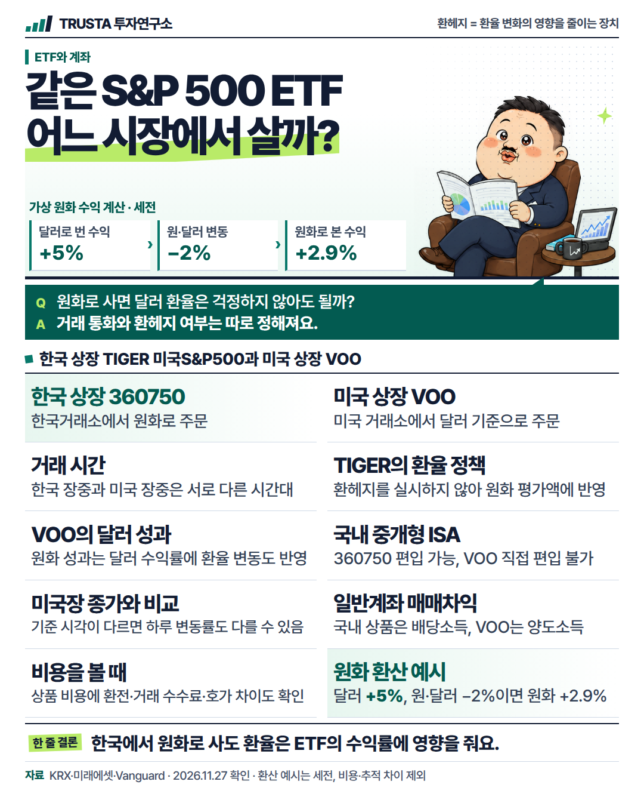

# 국내 상장 미국 ETF와 미국 직상장 ETF, 세금 장부가 갈리는 곳

*민호와 천억이의 대화와 Q&A는 편집부가 만든 질문입니다.*

민호가 세탁소에서 바지 두 벌을 받아 옵니다. 겉으로는 같은 색인데 주머니에서 나온 영수증은 서로 다른 가게의 것이에요. 천억이 앞에 그 두 장을 펼쳐 놓고 오늘 앱에서 본 투자 거래를 설명합니다. 미국 대형주 지수를 따라가는 두 펀드를 같은 날 팔았어. 하나는 국내에서 원화로, 하나는 미국 시장에서 달러로 거래했지. 원화로 보면 둘 다 십만 원씩 늘었는데 같은 세금 장부에 한꺼번에 넣어도 될까? 천억이는 일단 금액을 가리고 영수증의 가게 이름부터 봅니다. 지금 중요한 건 어느 지수를 따라갔는지에 더해 어떤 상품을 어느 계좌에서 팔았는지입니다.

## 상장 시장과 계좌 확인

오늘은 일반계좌에서 일어난 두 매도를 보는 이야기입니다. 실제 종목이나 개인의 납부액을 계산하는 대신 장부가 갈리는 지점을 비교합니다. 먼저 종목코드, 상장 시장, 계좌 종류를 적습니다. 국내 상장 상품이라도 국내 주식에 투자하는 유형과 해외 주식 등에 투자하는 기타 유형의 과세 구조가 다를 수 있어요. 달러를 썼다는 결제 방식만으로 소득 유형을 분류하기도 어렵습니다. 이름에 미국이 들어 있는 국내 상장 펀드와 미국 거래소의 펀드는 각각 어떤 법적 상품인지 확인해야 합니다.

## 국내 상장 해외 ETF의 단순 과세 예시

첫 번째로 국내 일반계좌에 있는 가상의 해외주식형 상품을 봅니다. 원화 백만 원을 첫날 한 번 투자하고 일 년 뒤 전부 팝니다. 중간에 넣고 빼는 돈은 없고 운용 기간 중 분배는 없어서 재투자도 하지 않습니다. 거래 수수료와 다른 과세 조정은 없다고 두고, 어느 금액을 과세 계산에 넣는지만 보려고 합니다. 시장에서 받은 돈은 백십만 원입니다. 같은 수량을 기준으로 표시한 과표기준가격의 증가분은 육만 원으로 정합니다. 기간은 일 년이지만 이 예시에서는 연율을 새로 환산하지 않습니다.

민호는 매매차익 십만 원이라고 장부에 적습니다. 여기까지는 샀던 돈과 판 돈의 차이입니다. 이제 천억이는 옆에 육만 원을 씁니다. 우리가 정한 단순 사례에서는 두 값이 모두 양수이고 분배에서 이월된 조정도 없습니다. 보유기간 과세에서 사용하는 금액은 매매차익 십만 원과 과표기준가격 증가분 육만 원 가운데 작은 육만 원입니다. 이 육만 원은 내는 세금 액수가 아니라 세금을 계산할 때 사용하는 금액이에요. 민호가 그 차이를 구분하기 전에는 앱에서 얼마를 벌었다는 문장을 가지고 계좌에서 얼마가 빠져나갈지 말하기 어려웠습니다.

이번에는 실제 매매차익을 바꾸지 않고 과표기준가격의 증가를 십이만 원으로 바꿔 봅시다. 단순 비교에서 이번에 작은 쪽은 매매차익 십만 원입니다. 두 자료 중 어느 하나만 언제나 계산에 들어가는 게 아니죠. 조건을 뒤집으면 어느 값이 선택되는지 바뀝니다. 과표기준가격을 어디서 확인하는지 모르는 투자자라면 증권사의 과세 내역과 발행사의 자료에서 같은 종목코드를 먼저 대조합니다. 한 좌당 기준값을 봤다면 그 값이 자신이 판 전체 수량의 금액과 섞이지 않았는지 다시 봐요.

**그림 Q&A · 편집부가 만든 질문**　왜 국내 상장 사례의 과세 계산에 6만 원이 들어갈까요? 분배나 과세 조정이 없고 두 값이 양수인 가정에서 과표 상승분 6만 원이 실제 매매차익 10만 원보다 작기 때문입니다.

세탁소 영수증으로 다시 숫자를 쪼개 봅니다. 열 좌가 있고, 좌당 매수가가 십만 원, 매도가가 십일만 원이라고 가정합니다. 열 좌 전체의 매매차익은 십만 원입니다. 같은 수량으로 좌당 과표기준가격이 육천 원 올랐다면 전체의 상승분은 육만 원입니다. 만일 처음부터 좌당 육천 원을 총 매매차익 십만 원과 바로 비교했다면 결과는 육천 원으로 잘못 적혔겠죠. 한 화면이 좌당 숫자를 주고 다른 내역이 계좌 합계를 줄 때는 수량부터 맞춰야 합니다. 소수점 단위나 조정 내용을 따져야 하는 실제 사례에서는 증권사의 계산 내역을 먼저 열어 봅니다.

민호가 받은 다른 영수증에는 매도 수량이 열 좌가 아니라 넉 좌입니다. 가상 가격과 과표의 좌당 변화는 그대로예요. 넉 좌에서 매매차익은 사만 원, 과표기준가격 상승분은 이만 사천 원입니다. 다른 조정이 없다는 단순 사례에서 작은 쪽은 이만 사천 원이에요. 원래 열 좌 갖고 있었다고 세금 계산에도 전부 넣으면 아직 팔지 않은 여섯 좌 몫까지 섞입니다. 나중에 그 여섯 좌를 팔 때에는 당시의 가격과 과표기준가격이 달라질 수 있고요. 이 예에서는 가격이 정확히 비례하도록 잡았지만 실제 매수일이 여러 번이면 매입 기록과 세금 명세를 같이 확인해야 합니다.

국내 상장 기타 펀드 범위를 확인할 때에는 국내에 있다는 말만 외우면 곤란합니다. 국내 거래소라는 것은 지분을 거래한 장소입니다. 발행 문서에서는 어떤 자산에 주로 투자하는지와 분배 및 매도에 관한 과세 원칙을 따로 안내할 수 있어요. 한국거래소의 안내와 운용사 설명에서 기타 상장지수펀드의 보유기간 과세 구조를 읽을 수 있습니다. 다만 중간의 과세 유보 금액 같은 조정이 있는 사례까지 무조건 두 원시 값의 최소로 계산한다고 일반화하지 않습니다. 이 모형이 처음부터 분배를 빼고 별도 조정을 영으로 정한 이유가 거기에 있어요.

## 미국 상장 ETF와 원화 환산

이제 미국 시장 영수증을 집어 봅니다. 가상의 매입과 매도에서 달러 가격이 같았다고 합시다. 한 주 백 달러를 열 주 샀고 한 해 뒤 같은 가격에 전부 팔았습니다. 분배와 재투자, 거래비용은 없고 중간 입출금도 없습니다. 매입에 해당하는 환산 기준을 달러당 천삼백 원, 매도 기준을 천사백 원이라고 놓겠습니다. 단순 환산으로는 처음 백삼십만 원, 마지막 백사십만 원입니다. 달러 기준 가격은 제자리인데 원화 환산 차액은 십만 원이에요. 이 계산은 환율이 원화 손익을 바꾼다는 것을 보여 주고, 실제 세법에 따라 어느 날짜의 어떤 환율을 적용할지는 공식 자료와 증권사 자료에서 확인합니다.

환율만 역으로 바꾸면 결과는 또 달라집니다. 달러 자산이 백에서 백오로 올라 오 퍼센트 늘었는데 달러당 원화 가격이 천삼백 원에서 천이백 원으로 내려갔다고 합시다. 한 단위 투자라면 원화 환산액은 십삼만 원에서 십이만 육천 원으로 줄어요. 달러에서 번 돈과 원화에서 변한 돈이 다른 방향입니다. 국내 상장 비교 상품에서도 기초자산과 환율은 가격에 영향을 줄 수 있고, 상품이 환헤지 구조를 쓰는지도 별도로 확인합니다. 하지만 오늘 비교하는 세금 장부에서는 단순히 두 상품의 원화 결과가 비슷하다는 사실만으로 같은 소득 항목을 쓸 수 없습니다.

*가상 달러 수익 +5%와 환율 −2%의 원화 가격수익은 +2.9%다. 본문의 국내 과표 사례와는 다른 실험이다.*

일반계좌에서 해외 상장 펀드의 매도 손익을 읽으려면, 국세청 안내의 국외주식 등의 양도 항목과 자기 거주 요건을 봅니다. 양도일까지 계속 국내에 주소나 거소를 둔 기간에 관한 조건을 안내에서 확인할 수 있어요. 나라를 옮긴 적이 있거나 경계에 있는 사람이라면 앱에서 보인 통화만으로 판단할 수 없습니다. 귀속연도와 과세 대상에 해당하는 다른 양도 거래, 취득 가격을 문서에서 확인합니다. 이 안내의 제목이 비슷하다고 분배금 수령에 같은 규칙을 넣어서는 안 됩니다. 그 돈이 지분을 판 거래에서 나왔는지 가지고 있는 동안 지급된 돈인지 묻는 것부터 시작합니다.

## 연간 양도손익과 기본공제

국세청 자료를 읽을 때 민호는 양도차익과 과세표준의 칸도 구분합니다. 여러 거래 중 어느 것이 과세 대상인지 먼저 판별하고, 허용되는 같은 귀속연도의 손익을 모은 다음 적용되는 공제를 확인하는 순서예요. 가령 요건을 충족한 가상 투자자의 해당 연도 과세 대상 거래에서 한 건은 삼백만 원 이익이고 다른 한 건은 팔십만 원 손실이라고 해 볼게요. 두 건의 합산이 허용된다고 놓으면 이백이십만 원입니다. 국세청 안내에 나오는 연 이백오십만 원 기본공제를 이 모형에 그대로 적용할 수 있다고 가정하면 남는 과세표준은 영 원입니다. 삼백만 원 한 줄만 보고 적은 값과 달라져요.

만일 손실 거래의 귀속이 다음 해라면 같은 장부로 묶을 수 있는지 다시 판정해야 합니다. 첫해에 삼백만 원만 있고 다른 과세 대상 거래는 없으며 같은 기본공제를 전액 쓸 수 있다는 조건이면 공제 뒤 오십만 원이 남습니다. 다음 해의 손실을 먼저 가져와 첫해 칸을 메우는 산식은 이 가상의 연도별 비교에서 쓰지 않습니다. 어디까지 같은 해 손익인지를 제대로 찾으려면 주문 버튼을 누른 때와 법상 양도 시점을 뒤섞지 않아야 합니다. 연말 거래라면 특히 증권사의 귀속연도 분류와 신고 자료를 확인해 보세요.

민호는 한 계좌에서 확인한 기본공제를 다른 증권사에서도 똑같이 한 번 더 넣으려고 합니다. 천억이는 영수증의 주인이 바뀌지 않았다는 점을 짚습니다. 국세청 안내가 연간 과세 대상 국내외 주식의 공제 범위를 함께 설명한다면, 단순히 앱이 두 개 있다는 사실이 개인에게 적용되는 연간 공제를 둘로 늘려 주지는 않죠. 실제 공제를 적용할 때는 과세 대상에 해당하는 거래가 있는지를 먼저 알아야 합니다. 국내 주식이라는 이름만 보고 아무 거래나 넣는 것도, 해외 계좌 하나만 보고 나머지를 빼는 것도 연간 장부를 틀어지게 할 수 있습니다.

조건을 바꾸어 두 거래가 모두 이익인 장면을 봅니다. 첫 증권사에서 백구십만 원, 둘째 증권사에서 백십만 원의 양도차익이 났어요. 둘을 합산하는 과세 대상이라고 하고 다른 손익은 없습니다. 두 앱을 각각 열면 둘 다 이백오십만 원보다 작습니다. 하지만 한 사람의 같은 연도 과세 대상 손익을 합치면 삼백만 원이고 공제를 한 번 적용하는 경우 오십만 원이 남습니다. 민호가 이제 묻는 것은 앱이 얼마를 벌었다고 표시했나가 아닙니다. 신고에 반영할 거래가 어느 계좌에 흩어져 있느냐입니다.

## 분배금과 지분 매도

다시 국내 상품의 분배금으로 넘어오죠. 예시에서는 지분을 파는 날의 과세대상 금액만 봤지만 보유 중에 따로 분배금을 받는 경우가 있습니다. 한 펀드 지분의 처음 가격이 만 원, 끝 가격이 구천구백 원이고 사이에 현금 이백 원을 지급받았다고 해 봅시다. 비용과 세금은 우선 빼고 현금으로 남겼다면 내 보유 가치와 현금을 합한 단순 결과는 만 백 원입니다. 가격만 보면 백 원 손실, 현금을 함께 보면 백 원 이익입니다. 투자 손익을 보는 이 산식으로 실제 분배금에서 세금을 얼마 떼는지까지 답할 수는 없어요. 지급 항목과 매도 항목은 각각 어떤 과세 자료가 쓰였는지 알아야 합니다.

두 종류의 ETF를 같은 날 팔았더라도 분배 날짜가 같을 이유는 없습니다. 이미 받을 권리가 생겼지만 지급은 뒤에 되는 경우가 있죠. 민호가 증권사 화면에서 지급 전 예정 금액을 보고 매도금액에 바로 더하려고 합니다. 아직 내 계좌에 들어온 돈인지, 주가에서 권리가 분리된 금액인지 두 가지를 확인해야 합니다. 실제 거래내역을 볼 때에는 매도 금액과 현금 분배를 다른 줄에 쓰고, 빠진 세액이나 입금 날짜를 옆에 붙일 수 있습니다. 가상 수익률을 재현하는 장부와 실제 납세 자료는 서로 맞춰 볼 수 있지만 각자 다루는 입력과 시점이 다릅니다.

천억이는 민호에게 매수일이 둘인 영수증을 줍니다. 첫날에는 한 좌 만 원에 다섯 좌를 샀고 둘째 날에는 한 좌 만 천 원에 다섯 좌를 샀습니다. 같은 한 좌 만 이천 원에 모두 팔았다면 첫 묶음의 매매차익은 만 원, 둘째는 오천 원입니다. 그런데 과표기준가격은 각 매수 시점에서 다르게 출발할 수 있어요. 첫 묶음의 좌당 과표 상승분이 천오백 원, 둘째가 이백 원이라고 단순히 놓고 각각 계산해 보면 첫 묶음은 칠천오백 원, 둘째는 천 원이라는 비교 금액을 얻게 됩니다. 이 단순 계산을 실제 배정 방식이라고 단정하지는 않고 증권사 거래별 명세를 확인해야 합니다.

이제 민호가 왜 올랐는데 세금이 전혀 안 보이는 거래도 있냐고 묻습니다. 한도와 공제나 세금이 징수되는 시점이 다를 수 있으니, 시장 수익률 하나를 세금 원인에 넣을 수는 없어요. 예를 들어 국내의 가상 과표 상승분이 영이고 양수인 매매차익만 있다고 가정하면 두 값 가운데 작은 것은 영입니다. 반대로 실제 차익이 아주 작고 과표가 더 크게 올랐다면 작은 매매차익이 한도가 되는 단순 예시를 앞에서 봤죠. 실제 사례에서는 분배나 과세 조정이 없는 것까지 확인해야 숫자를 옮겨 쓸 수 있습니다.

같은 일반계좌에서 거래하다가 친구가 아이에스에이 계좌를 열었다고 합니다. 방금 세탁소의 국내 영수증과 똑같은 장부를 가져가면 될까요? 그 계좌에서 어떤 상품을 주문할 수 있는지와 어떤 시점에 손익을 정산하는지부터 확인해야 합니다. 연금 계좌에서도 편입 가능 여부와 인출 때 고려할 조건을 별도로 봅니다. 일반계좌 한 장에 설명된 세금 사례를 모든 계좌에 공통으로 붙이면 실제 거래 제한과 정산 시점을 놓쳐요. 오늘 처음 적은 계좌 종류는 장식이 아니라 뒤쪽 계산으로 이어지는 조건이었습니다.

세탁소 카운터 위의 두 영수증에서 민호는 숫자를 지우고 날짜부터 적습니다. 한쪽 종목을 같은 날 여러 차례 샀다면 체결 단가가 모두 같은지도 확인합니다. 화면에는 평균 단가 하나만 보여도 원래 거래 행에는 날짜와 수량과 가격이 여러 줄일 수 있어요. 증권사를 옮겼다면 새 앱에 보이는 단가가 기록을 제대로 승계했는지도 확인할 필요가 있습니다. 단가가 비어 있다고 그 주식을 공짜로 얻었다는 뜻은 아니죠. 신고나 정정에 쓰기 전에 처음 체결 내역과 이동 내역을 연결할 근거를 찾습니다.

## 거래일부터 신고용 자료까지

예를 들어 가상 계좌에서 열 주를 총 천 달러에 취득했고 매도 때 총 천백 달러를 받았다고 해요. 매입과 매도 각각에 별도로 비용이 발생했다면 단순히 달러 백의 차이만 화면에 띄워서는 그 계좌의 실현 손익을 다 보여 주지 못합니다. 가상의 매도비용이 오 달러라면 현금으로 들어오는 돈은 천구십오 달러라고 계산할 수 있어요. 그 비용을 세법상 필요경비로 인정받는지와 어떤 단위로 반영할지는 적용 규정과 증빙에서 확인합니다. 거래 과정의 현금과 세금 신고서의 계산은 각각 항목을 적어 맞춰야 합니다.

이번에는 원화로 이미 환전한 날짜와 해외 주식을 실제로 매도한 날짜를 따로 적습니다. 가령 투자자가 판 날 바로 달러를 바꾸지 않고 한 달 뒤에 바꿨다면, 그 한 달 동안의 환율 변화는 실제로 환전해 받은 원화에 영향을 줍니다. 그렇다고 그 날짜를 매도 거래의 환산 기준으로 바로 가져올 수는 없어요. 세금에서 어떤 환산 시점을 요구하는지와 내가 후속 환전을 언제 했는지를 따로 찾습니다. 민호는 같은 달러가 한 달 동안 계좌에 있었던 과정까지 기록하고 나서 두 날짜를 바꾸어 쓰지 않게 됩니다.

친구가 말합니다. 그런데 나는 아직 한 주도 팔지 않았고 앱에만 십만 원 수익이라고 떠. 이 문장에는 구분해야 할 사건이 들어 있습니다. 보유 중에 가격이 바뀌어 표시된 평가손익과 실제로 지분을 처분해 생긴 손익은 다릅니다. 계좌에 분배금이 들어왔다면 그 지급 역시 별도의 사건이고요. 오늘 다루는 매도 장부의 두 칸에 숫자를 쓰려면 매도가 있었는지부터 확인해야 합니다. 같은 날 앱의 수익 화면을 찍어 두는 것은 기록의 일부일 뿐이고 거래일과 거래 유형이 있는 명세서가 그다음 단계입니다.

천억이는 이제 실수하기 쉬운 날짜를 세 가지 내놓습니다. 처음 돈이 사람에게 들어온 날, 주문이 체결된 날, 세금 자료에서 거래가 해당 연도로 분류된 날입니다. 실제 일자가 같을 수도 있지만 계산과 문서에서 가리키는 뜻은 다릅니다. 모든 해외 거래의 귀속 날짜를 휴대폰 달력만 보고 정할 수는 없어요. 특히 십이월 마지막 무렵에는 현지 휴장과 결제 절차가 겹칠 수 있습니다. 회사가 배당을 발표한 날짜와 그 돈이 내 계좌에 들어온 날짜도 같이 놓을 수 있고요. 각각의 과세 항목에서 어느 날짜를 쓰는지 확인하고 그 이유를 한 줄 남깁니다.

민호는 자기가 받은 돈의 실제 원천징수 명세를 처음으로 펼쳐 봅니다. 어느 줄에는 분배가 표시되고, 어느 줄에는 매도에 관한 세금 항목이 보일 수 있습니다. 같은 계좌의 현금이 줄었다고 모두 같은 세금으로 합산하면 그해에 이미 어떤 항목을 냈는지 알기 어려워요. 반대로 표시가 없다는 이유만으로 신고할 일이 없다고 정할 수도 없습니다. 원천징수 자체로 처리되는 항목과 이후 신고를 검토해야 하는 항목은 세금을 어느 방식으로 다루는지에 따라 다릅니다. 민호는 단순한 금액 비교가 끝난 뒤 실제 자료를 대조하는 칸을 따로 남깁니다.

편집부가 만든 질문입니다. 국내에 상장돼 있다는 이유로 두 상품에서 같은 매매차익 세금이 나오나요? 천억이는 두 종류의 상품 이름을 다시 봅니다. 어떤 자산에 투자하는 펀드인지, 이 계좌에서 어떤 규칙으로 주문했는지부터 보면 됩니다. 국내 주식형과 국내 상장 해외주식형이 모두 국내 거래소에서 거래되더라도 발행사의 과세 설명에서 서로 다른 부분을 찾을 수 있어요. 미국 직상장 상품의 사례에서는 국세청 안내에서 국외주식 거래를 어떤 사람과 어떤 거래에 적용하는지를 읽습니다. 상장지와 기초자산은 표의 한 줄에 함께 들어가지만 각자 다른 질문에 답합니다.

민호는 처음 말한 차익 십만 원을 두 영수증에 다시 씁니다. 국내의 단순 사례에서 과표 상승 육만 원이 있는 경우에는 그 값이 과세 계산에 들어갔습니다. 미국 시장에서 팔아 환산한 단순 차익 십만 원은 거주 조건, 해당 연도 과세 대상 손익, 공제 같은 항목을 거쳐야 한다는 것도 알게 됐어요. 두 숫자가 왜 같은 칸에 들어가지 않았는지 자기 말로 설명합니다. 이제 장부를 다시 펴면 어디서 비어 있는지 모르는 게 문제였던 처음과 달라요. 증권사 과세 명세, 운용사 안내, 국세청 자료 가운데 지금 열어야 할 문서를 고를 수 있습니다.

민호가 마지막으로 확인한 것은 서류의 이름입니다. 거래 확인서에는 몇 주를 얼마에 사고팔았는지가 있고, 연간 신고용 자료에는 해당 연도의 거래를 모은 계산이 나옵니다. 같은 매도가 양쪽에 올라 있어도 두 건으로 세면 안 됩니다. 반대로 신고용 자료가 한 증권사의 거래만 보여 준다면 다른 곳에서 팔았던 지분은 그 표에 자동으로 들어오지 않을 수 있어요. 계좌 번호와 종목, 날짜와 수량을 맞춰 보면 똑같은 거래를 두 번 더하거나, 필요한 한 줄을 놓치는 일을 발견할 수 있습니다. 확인이 안 된 매입단가나 세금 항목은 빈칸으로 남기고 원본과 맞춰요. 민호는 모르는 칸에 영 원을 쓰면 실제로 없었다는 뜻으로 읽힌다는 점을 알게 됐습니다.

세탁소에서 민호가 두 바지를 접어 옷장에 넣습니다. 이번에는 영수증을 버리기 전에 휴대폰의 투자 거래 한 건에 종목코드와 상장 장소와 계좌를 붙여 써요. 아래에는 매도일과 지급 내역을 적고, 자료에 표시된 양도 거래의 귀속연도를 찾아 둡니다. 독자도 자기 거래 한 건으로 이 연습을 해 볼 수 있습니다. 매수와 매도 수량을 맞춘 뒤 그 줄이 매도인지 분배인지 먼저 표시해 보세요. 두 장부의 숫자가 우연히 똑같아도 각각 어디에서 나온 결과인지 확인할 수 있습니다.

**자료 시점**　국세청·한국거래소·운용사 안내 확인일 2026년 11월 27일. 본문의 가격·환율·양도손익은 원리를 보여 주는 가상값이며 개인의 확정세액은 미확정입니다.

[삼성자산운용 ETF 세금 안내](https://www.samsungfund.com/etf/insight/guide/view05.do)

**원문**　[한국거래소 ETF 세금제도](https://regulation.krx.co.kr/contents/RGL/03/03060105/RGL03060105.jsp) · [국세청 국외주식 양도소득](https://www.nts.go.kr/nts/cm/cntnts/cntntsView.do?cntntsId=8800&mi=12274) · [Vanguard VOO 운용 팩트시트](https://institutional.vanguard.com/assets/corp/fund_communications/pdf_publish/us-products/fact-sheet/F0968.pdf)

**이어 읽기**　[ISA에 매달 100만 원씩 3년, 납입원금과 과세이익 나누기](EP025.md) · [전자책 목차](목차.md) · [중개형 ISA에서 거래할 수 있는 ETF](EP022.md)
