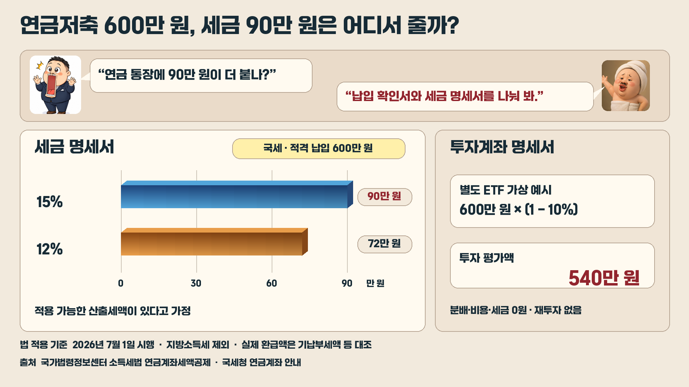

# 퇴직 앞두고 연금저축 600만 원, 세금 90만 원은 누구에게 줄어들까?

## 1. 월급 마지막 해의 두 장부

가상 인물 천억이는 올해 마지막 급여명세서를 정리하다 연금저축에 600만 원을 넣으면 90만 원을 돌려받는다는 말을 듣습니다. 내년에는 급여가 없을 수도 있습니다. 같은 금액을 넣어도 올해와 내년의 세금이 똑같이 줄까요? 수건 친구가 납입 확인서와 세금 계산서를 두 장으로 나눕니다.

## 2. 줄어드는 곳부터 찾기

연금계좌 세액공제는 해당 과세기간의 산출세액에서 일정액을 빼는 제도입니다. 연금계좌의 ETF 가격은 시장에 따라 따로 움직입니다. 세액공제 계산에서 법에 정한 액수가 나와도, 이미 낸 세금과 최종 세액을 대조하기 전에는 계좌로 들어올 환급액을 확정할 수 없습니다.

## 3. 15% 문턱과 한도

2026년 7월 1일 시행 소득세법 제59조의3을 기준으로 봅니다. 근로소득만 있는 거주자는 총급여 5,500만 원 이하일 때 국세 공제율 15%를 적용하는 구간에 해당합니다. 그 외에는 종합소득과세표준에 합산하는 종합소득금액 4,500만 원 이하인지 등을 법의 구분대로 확인합니다. 해당 구간을 벗어나면 조문상 기본 공제율은 12%입니다.

연금저축 납입분의 공제 대상은 연 600만 원 한도입니다. 해당 연금저축분과 공제 대상 퇴직연금 납입분을 합치는 통상 한도는 연 900만 원입니다. 둘을 더해서 1,500만 원을 공제받을 수 있다는 뜻으로 읽으면 계산이 잘못됩니다. 과세가 이연된 퇴직소득 및 다른 연금계좌에서 계약이전으로 들어온 금액은 조문상 일반 납입액에서 제외합니다.

## 4. 90만 원이 나온 가상 장부

가상으로 근로소득만 있고 총급여 구간, 적격 납입 및 공제 가능한 세액 요건을 충족한 사람이 해당 연도에 원화 600만 원을 납입합니다. 15%를 적용한 국세 공제액은 **90만 원**입니다. 지방소득세는 계산에서 제외합니다. 동일한 적격 납입액에서 12%가 적용되는 경우는 **72만 원**으로 18만 원 차이입니다. 둘 다 원천징수 내역을 반영한 최종 환급액을 계산한 숫자는 아닙니다.

별도의 가상 투자 장부에서 같은 원화 600만 원을 연초에 ETF에 넣고 1년간 10% 하락했다고 가정합니다. 분배금·거래 비용·투자자 세금은 제외하고 재투자하지 않습니다. 연말 평가액은 **540만 원**입니다. 세액공제를 적용했다고 ETF 평가액이 630만 원으로 바뀌지는 않습니다.

*과세 요건을 충족한 600만 원 납입 예의 국세 공제와 ETF 시가를 분리한 카드다.*

*적격 납입과 적용 가능한 산출세액을 가정한 국세 계산. 투자계좌 평가액은 별도 가상 사례다.*

## 5. 내년에 월급이 없어지는 경우

천억이는 올해 90만 원을 계산한 식을 내년에 복사하려다 멈춥니다. 내년에 종합소득이 없고 공제로 줄일 해당 산출세액도 없다면, 같은 금액을 납입하더라도 위 가상의 국세 절감 90만 원을 그대로 기대할 수 없습니다. 퇴직 후에도 다른 과세 대상 소득이 있는 경우에는 어떤 소득과 세액이 있는지부터 다시 확인합니다.

## 6. 계좌로 들어온 돈의 이름 확인하기

가상의 납입 확인서에 600만 원이 적혀 있어도 전부가 같은 방식으로 들어온 것은 아닐 수 있습니다. 본인이 새로 납입한 돈, 과세가 이연된 퇴직소득, 다른 연금계좌에서 이전한 돈이라면 위 조문이 구분하는 항목을 적용합니다. ISA 만기자금을 연금계좌로 이전한 경우도 조문에 별도 조건이 있으므로 일반 납입 한도와 섞지 않습니다.

## 7. 생활비를 꺼내는 날의 규칙

현재 납입 공제와 나중에 돈을 꺼낼 때의 과세 조건은 각각 확인합니다. 공제받은 납입분과 공제받지 않은 원금, 운용 수익 등을 명세에서 구분해 두면 훗날 인출할 때 어떤 돈을 꺼내는지 확인하는 데 도움이 됩니다. 다음 달 쓸 돈이라면 공제율을 보기 전에 실제 인출 조건과 필요한 시기를 함께 봅니다.

## 8. 마지막 급여명세서 옆의 세 칸

천억이는 납입액, 공제 대상액, 실제 공제액을 세 칸으로 나눕니다. 오늘 할 한 가지는 **납입 확인서와 연말정산 또는 종합소득세 명세에서 세 칸을 직접 대조하는 것**입니다. 납입액과 세금이 줄어든 액수의 차이가 보이면, 다음 해 생활비 달력도 그 차이를 반영해 다시 적을 수 있습니다.

**편집부 Q&A · 600만 원씩 넣은 두 사람이 같은 환급금을 받나요?**  
공제율, 적용할 산출세액, 이미 낸 세금 등이 다를 수 있습니다. 연금계좌 납입액만으로 최종 환급을 판단하기 어렵습니다.

**원문**　[소득세법 제59조의3](https://www.law.go.kr/lsLinkCommonInfo.do?lsJoLnkSeq=1032953453) · [국세청 연금계좌 세액공제](https://www.nts.go.kr/nts/cm/cntnts/cntntsView.do?cntntsId=7875&mi=6608) · [국세청 연금소득 원천징수](https://www.nts.go.kr/nts/cm/cntnts/cntntsView.do?cntntsId=7888)

**이어 읽기**　[일본 NISA와 한국 ISA, 팔면 다시 생기는 한도가 같을까?](EP028.md) · [전자책 목차](목차.md)
