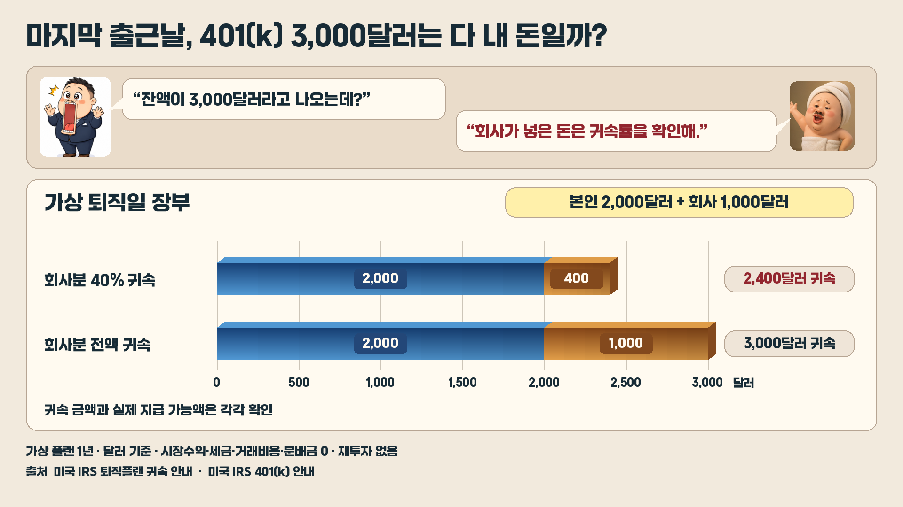

# 은퇴·귀국 전 미국 401(k), 화면의 3,000달러를 다 가져갈 수 있을까?

## 1. 마지막 출근날에 받은 서류

미국에서 일하다 한국으로 돌아가려는 가상 인물 천억이는 마지막으로 복지 사이트를 엽니다. 계좌에 3,000달러가 보이고, 옆에 회사가 보탠 돈이 있습니다. “내 회사 계좌에 있던 금액인데, 퇴직하면 그대로 내 통장에 들어오겠지?” 수건 친구는 잔액 옆에 퇴직 예정일을 적고, 보이는 숫자를 세 줄로 나누자고 합니다.

## 2. 내 납입·회사 납입·내 권리

401(k)는 고용주가 제공하는 미국의 은퇴 플랜입니다. 직원 급여에서 납입한 돈과 고용주가 넣은 돈을 구분합니다. 미국 국세청은 직원이 자신의 납입분에는 항상 완전한 권리를 갖는다고 설명합니다. 고용주 납입분은 플랜의 종류와 규칙에 따라 즉시 귀속되거나 일정 근속 기간이 지나야 귀속될 수 있습니다. 이 귀속을 안내서에서 vesting이라고 부릅니다.

## 3. 잔액보다 먼저 볼 플랜 문장

회사 매칭은 직원 납입에 대응해 회사가 보태는 금액입니다. 얼마나 매칭하는지 정하는 산식과 보탠 금액에 내 권리가 언제 생기는지 정하는 일정은 다른 항목입니다. 급여의 어느 부분이 계산 기준인지, 근속연수를 어떤 기준으로 세는지, 퇴직 예정일의 귀속 비율은 얼마인지 해당 플랜 설명서에서 확인합니다.

## 4. 3,000달러를 가상으로 계산하기

연봉 50,000달러인 사람이 1년간 급여의 4%를 넣고 회사가 그 납입액의 절반을 매칭하는 가상 플랜입니다. 직원 납입액은 **2,000달러**, 회사 부담액은 **1,000달러**입니다. 1년 말 평가 전 납입 합계는 3,000달러입니다. 기간 중 운용수익·세금·거래비용·분배금은 0으로 두며 재투자와 원화 환산은 하지 않습니다. 실제 플랜 한도나 특정 회사의 정책을 제시하는 예시는 아닙니다.

## 5. 퇴직하는 날 펼쳐 본 잔액

가상으로 퇴직일에 회사 부담액의 40%만 귀속된 상태라면, 본인 납입액 2,000달러에 회사 부담액 중 400달러를 더해 **2,400달러**가 귀속됩니다. 같은 가정에서 회사 부담액이 전부 귀속된 상태라면 **3,000달러**입니다. 차이는 600달러입니다. 귀속 잔액은 세금 등을 처리한 뒤 당장 계좌 밖에서 받을 금액과 별도입니다.

*가상 401(k) 플랜의 귀속 비교. 현재 지급 가능액과 세후 수령액은 별도로 확인한다.*

## 6. 계좌를 옮긴다는 말에 들어 있는 두 질문

IRA는 미국의 개인 은퇴계좌이고 401(k)는 고용주 플랜입니다. 전통형과 Roth는 납입과 인출 단계의 세제 조건이 다를 수 있습니다. 귀속된 돈을 어디로 어떻게 옮길 수 있는지, 지금 지급받으면 어떤 처리가 되는지는 플랜과 세무 조건을 따로 봅니다. 한국 IRP나 연금저축은 국내 법과 상품 조건을 적용하므로 미국 플랜의 매칭·귀속 규칙을 그대로 넣어 계산하기 어렵습니다.

## 7. 귀국 달력 옆에 세금 달력 펴기

천억이는 출국 예정일과 계좌 처리를 하려는 날짜를 따로 표시합니다. 실제 국경 간 세금은 소득 유형, 세법상 거주지, 원천징수와 적용되는 조세조약 등을 확인해야 합니다. 계좌 이름이 비슷해 보여도 어느 나라에서 어떤 서류로 신고할지는 별도의 문제입니다. 이번 가상 계산에는 국경 간 인출 세액을 포함하지 않았습니다.

## 8. 마지막 근무일 전에 볼 곳

오늘 할 한 가지는 플랜 설명서의 **직원 부담과 회사 부담의 귀속 일정**을 찾아, 자신의 퇴직 예정일을 각각 대입하는 것입니다. 천억이는 잔액과 귀속 금액에 서로 다른 밑줄을 긋고 회사의 플랜 담당자에게 확인할 항목을 메모합니다.

**편집부 Q&A · 이미 귀속된 금액은 바로 생활비로 쓸 수 있나요?**  
귀속은 권리가 생겼다는 뜻입니다. 지급 가능 시점, 지급 절차, 원천징수와 세금은 플랜 문서와 해당 세무 조건에서 확인합니다.

**원문**　[미 IRS 401(k) 안내](https://www.irs.gov/retirement-plans/401k-plans) · [미 IRS 퇴직플랜 귀속 안내](https://www.irs.gov/retirement-plans/plan-participant-employee/retirement-topics-vesting) · [미 IRS 개인은퇴계좌 안내](https://www.irs.gov/retirement-plans/individual-retirement-arrangements-iras) · [국세청 연금계좌 안내](https://www.nts.go.kr/nts/cm/cntnts/cntntsView.do?cntntsId=7875&mi=6608)

**이어 읽기**　[ETF 세금 상담 전 적을 열 가지, 같은 이익을 두 번 세지 않는 방법](EP030.md) · [전자책 목차](목차.md)
