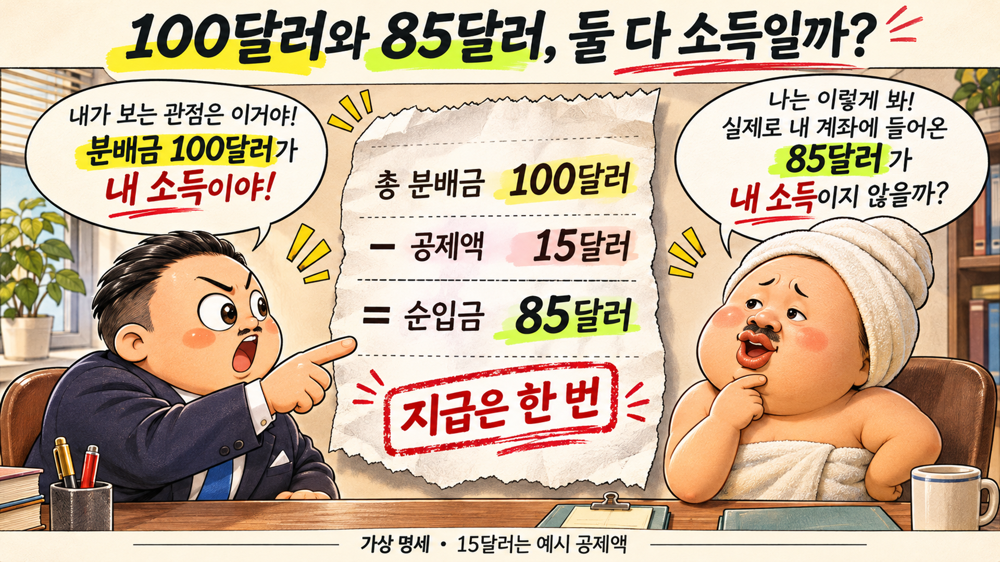

# ETF 세금 상담 전 적을 열 가지, 같은 이익을 두 번 세지 않는 방법

*민호와 천억이의 대화와 Q&A는 편집부가 만든 질문입니다.*

민호가 세금 상담 예약을 한 날, 카페에서 노트북을 펼칩니다. 화면에 상장지수펀드 분배금 백 달러와 외화 입금 팔십오 달러가 나란히 나옵니다. 둘 다 달러라고 적혀 있어서 합계에 백팔십오 달러를 써 놓았어요. 천억이는 그 숫자를 지우기 전에 각각 찍힌 거래 번호를 찾아 달라고 합니다. 두 줄에 붙은 종목과 지급일이 같은데, 돈이 두 번 생긴 걸까요? 상담 시작까지 얼마 남지 않아서 민호는 더하기부터 끝내려 했지만, 지금 해야 할 일은 몇 건의 사건인지 세는 것이었습니다.

우리는 사례를 가정합니다. 민호의 일반계좌에서 미국 달러로 분배를 한 번 받았고, 증권사 자료에 총액 백 달러와 공제액 십오 달러와 순입금액 팔십오 달러가 확인됐어요. 십오 달러는 이 가상 명세가 보여 주는 금액입니다. 모든 투자자에게 붙는 세율을 뜻하지 않습니다. 기간 수익을 구하지 않고 한 번의 지급만 살핍니다. 직접 재투자하거나 별도로 입금한 돈은 없으며 공제 외에 비용도 없다고 놓겠습니다. 이 세 숫자를 그대로 같은 칸에서 더하면 한 사건 속 돈을 여러 번 셉니다.

천억이가 영수증처럼 종이를 접어요. 첫 줄은 총액 백 달러, 둘째는 이미 빠진 십오 달러, 마지막은 통장으로 들어온 팔십오 달러입니다. 백에서 십오를 빼면 팔십오예요. 입금 화면이 총액에 없던 또 다른 지급을 보여 준 것이 아니라, 그중 실제로 들어온 금액을 보여 줬습니다. 상담 자료에서 세 숫자는 모두 필요할 수 있어요. 다만 백과 팔십오를 두 소득으로 만들어 합치면 과장됩니다. 민호는 양쪽 기록에 있는 지급 식별번호와 종목코드와 지급일이 함께 맞는지 먼저 찾아 같은 사건으로 표시합니다.

**그림 Q&A · 편집부가 만든 질문**　100달러와 85달러를 더해도 될까요? 가상 명세의 두 줄은 지급 한 건을 설명합니다. 100달러에서 예시 공제액 15달러가 빠져 85달러가 들어왔습니다.

조건을 바꿔 입금이 진짜 두 번 있었다고 해 볼게요. 같은 상품의 분배금이 두 번 나왔고 지급 식별 정보는 다릅니다. 첫 번째는 총 백 달러와 순 팔십오 달러, 두 번째는 총 사십 달러와 순 삼십사 달러예요. 각 지급에서 공제액은 그 차이인 십오 달러와 육 달러입니다. 두 지급의 총액을 모으면 백사십 달러, 입금액을 모으면 백십구 달러입니다. 총액 첫 줄과 다른 지급의 순액을 섞어서 백삼십사 달러라고 하면 뭘 더했는지 설명할 수 없어요. 거래 번호를 연결해 본 뒤 총액은 총액끼리, 순액은 순액끼리 합칩니다.

## 거주 요건과 계좌·상품 종류

상담용 자료 첫 줄에는 금액보다 사람이 가진 조건이 들어갑니다. 그해 어느 나라의 세법상 거주자로 검토해야 했는지, 중간에 거주지가 바뀌었는지 적어요. 여권의 국적이나 앱의 언어만으로 판단하지 않습니다. 해외 주소가 있었다고 실제로 어디에서 생활했는지까지 한 문장에 담기지는 않죠. 민호는 국내에 머문 기간과 주소가 바뀐 시점, 제출한 증명 자료가 있는지를 날짜순으로 정리합니다. 어느 조건을 충족하는지 여기서 단정하지 않아도 상담자는 확인할 자료부터 골라 볼 수 있습니다.

그다음에 계좌를 적습니다. 일반계좌 두 개가 있어도 한 계좌에 든 거래만 출력하면 다른 쪽은 자료에 나오지 않을 수 있어요. 반대로 국내 일반계좌와 중개형 아이에스에이와 연금계좌가 한 앱의 전체 자산 화면에 같이 보인다고 세금 계산도 화면처럼 한 번에 이루어진다고 볼 수는 없습니다. 각각 상품을 넣을 수 있는 범위와 인출 및 정산 조건을 살펴야 합니다. 민호는 계좌를 이체하거나 종목을 다른 곳으로 옮긴 기록이 있으면 뒤에 붙입니다. 단가가 새 앱에서 비어 있는 거래가 보이면 취득 자료부터 연결해야 다음 계산을 할 수 있습니다.

상품 자체의 상장 시장과 법적 유형도 기록합니다. 국내에서 원화로 산 미국 지수 상품과 해외 거래소에서 산 지분이 두 장 보인다면, 무엇을 따라가는지와 어디에서 거래했는지를 나눠 봅니다. 국외주식 등의 양도 규정을 찾아갈지, 국내 상장 기타 ETF의 보유기간 과세 자료를 살필지 이 사실에서 방향이 갈립니다. 상품 소개 어디에 적힌 약칭만 쓰면 비슷한 이름의 다른 증권과 헷갈릴 수 있어요. 민호는 종목코드를 앞에 쓰고 발행사 문서의 공식 이름과 연결합니다.

다음은 돈이 왜 생겼는지를 찾습니다. 주식을 팔아 받은 대금에는 투자 원금의 일부가 함께 돌아올 수 있습니다. 현금으로 받은 분배금은 보유 중 지급된 금액이에요. 같은 계좌에 현금이 입금됐다고 두 줄을 모두 투자 이익으로 더하면 원금이 이익으로 바뀌어 버립니다. 가령 가상 종목을 총 백만 원에 취득해 백십만 원에 팔았고 별도로 분배금 삼만 원을 받았다고 놓습니다. 수수료와 세금은 영이고 재투자하지 않았습니다. 현금 유입 합계는 백십삼만 원이지만 시작 원금 백만 원을 대조한 경제적 변화는 십삼만 원입니다. 법적으로 세금을 정하는 숫자는 두 사건을 분류한 다음 각각의 근거와 조정을 살펴야 합니다.

## 날짜와 통화의 기준

날짜에는 배당을 받을 권리가 정해진 날과 실제 지급된 날이 있고, 주문을 체결한 날과 돈이 결제되는 날도 있습니다. 연말의 거래가 어느 연도의 양도 목록에 올라 있는지 궁금하다면 캡처한 휴대폰 시계가 아니라 증권사의 해당 거래 명세와 법적 귀속 기준을 확인합니다. 해외 시장에서 자정이 언제인지도 국내 달력과 다를 수 있어요. 민호는 날짜 열을 하나만 만들어 놓았다가 지급과 매도에 각각 어떤 시각이 들어 있는지 보고 열을 나눕니다. 상담자에게 모두 같은 시점으로 설명하기 전에 먼저 서류에 붙은 항목 이름부터 읽습니다.

다음 줄은 통화입니다. 민호는 진짜로 받은 팔십오 달러를 지난달에 본 달러당 천삼백 원으로 바꾸어 십일만 오백 원이라고 메모합니다. 그런데 지급 명세에는 지급일이 적혀 있고, 별도로 원화 환전한 날에는 실제로 다른 환율이 적용됐어요. 예를 들어 달러당 천이백팔십 원에 팔십오 달러를 환전했다면 실제 환전액은 십만 팔천팔백 원입니다. 두 값의 차이는 천칠백 원이고, 예시에서는 환전 수수료를 따로 두지 않았습니다. 이 계산으로 알 수 있는 것은 환율 기준에 따라 원화 표시액이 달라진다는 점입니다. 신고에서 어떤 날짜의 환율을 쓰는지는 적용 기준을 확인해야 합니다.

그렇다고 원화 입금액을 보고 외화 총액을 지나칠 수는 없어요. 실제 명세에서 총액은 얼마였고 어느 항목에서 무엇을 뗐는지 별도로 필요할 수 있습니다. 가상의 지급 두 건에서 총액은 백 달러씩으로 같고 첫 건 공제액은 십오 달러, 둘째 건은 십 달러라고 해요. 이 경우 순입금은 팔십오와 구십 달러로 다릅니다. 두 지급의 총액이 다르다고 고치는 대신 공제 근거를 찾아야 합니다. 환율도 다르면 원화 입금 차이는 더 벌어질 수 있으니 거래를 설명할 때에는 표시 통화와 같은 통화에서 먼저 맞춥니다.

천억이는 숫자 옆에 플러스와 마이너스만 쓰지 말고 원인을 붙이라고 합니다. 어떤 명세의 십오 달러가 원천징수인지, 별도 수수료인지, 사후 조정인지에 따라 같은 차감이라도 의미가 다릅니다. 이번 이야기의 단순 영수증에서는 공제가 하나라고 밝혔지만 실제 화면에서는 먼저 떼고 남은 금액에서 다른 공제를 또 할 수 있어요. 예를 들어 총 백 달러에 세금 십오 달러와 별도 비용 이 달러가 빠졌다면 실제 입금은 팔십삼 달러입니다. 총액에서 순액을 뺀 십칠 달러 전부를 이미 낸 세액이라고 쓰면 수수료도 세금 칸에 들어갑니다.

## 취득가와 비용을 확인하는 법

취득에 관한 기록은 지금 주식을 가진 증권사에만 있을까요? 민호는 올봄에 증권사를 바꿨습니다. 새 앱은 들어온 날짜와 당시 평가액을 보여 주고, 옛 앱에는 실제 매입일의 체결 내역이 남아 있다고 해요. 새 앱에 들어온 날이 처음 투자한 날은 아닙니다. 가상의 주식 열 주를 모두 옮겨 왔다면, 상담 자료에는 실제 매입한 수량과 증권사 간 이동한 수량이 일치하는지부터 보죠. 중간에 세 주를 먼저 팔았다면 남은 일곱 주만 들어온 것이어서 당연히 숫자가 달라요. 수량과 날짜를 한꺼번에 이어 보면 취득 단가를 왜 다시 찾아야 하는지도 알 수 있습니다.

그 주식을 팔아 받은 가상의 원화 금액이 백십만 원, 처음 취득이 백만 원이라고 해 볼게요. 확인된 별도 비용은 삼천 원입니다. 단순 경제 장부에서 비용을 반영한 차이는 구만 칠천 원입니다. 실제 세금 계산에서 그 비용이 인정되는지, 이미 보고서의 순매도금액에 차감됐는지 확인하지 않고 천 원 단위만 더하거나 빼면 안 돼요. 이미 받은 돈이 백구만 칠천 원으로 표시돼 있는데 또 삼천 원을 뺀다면 같은 비용을 두 번 센 겁니다. 총액과 차감과 순액을 연결하는 방법은 분배금뿐 아니라 매도 영수증에도 같습니다.

반대의 문제도 있습니다. 가상 내역에서 매도대금 백십만 원이 수수료 전 금액인데 순액이라고 잘못 읽을 수 있어요. 그러면 실제 통장에 들어오는 백구만 칠천 원과 삼천 원 차이가 납니다. 어느 행에 어떤 항목이 들어 있는지 알아야 두 기록을 맞출 수 있죠. 읽어 온 값에 입금이라는 제목만 붙이는 대신 원문 열의 이름과 단위를 같이 남깁니다. 해외 거래이면 금액에 적용한 날과 환율, 수수료가 결제된 통화까지 함께 적으면 상담 때 빠진 행을 다시 찾기 쉽습니다.

민호는 매도 결과와 보유 평가 결과를 같은 줄에 놓은 일도 발견합니다. 지금 남은 펀드 평가손익은 마이너스 이십만 원이고 이번에 실제 판 다른 거래의 경제적 차익은 십만 원이라고 해요. 두 값을 더해 장부 전체가 마이너스 십만 원이라고 분석할 수는 있지만 그것을 곧바로 어느 세금의 과세 대상 금액으로 옮길 수는 없습니다. 아직 팔지 않은 평가손실인지, 실현한 거래인지, 계좌가 같은지, 소득 항목이 통산에 들어가는지는 각각 근거가 필요합니다. 연금과 일반계좌를 한 앱에서 볼 때에도 앱의 통합 그래프와 세금 명세가 같은 범위를 다룬다고 가정하지 않습니다.

원래 질문처럼 두 계좌에서 같은 종류의 과세 대상 양도 거래가 있었다면 그때는 어떤 자료를 모을까요? 가상으로 하나의 이익이 삼백만 원, 다른 곳의 손실이 팔십만 원이라고 해 봅시다. 둘이 법적으로 같은 범위와 같은 귀속연도에서 합산 가능하다는 것을 확인했다면 손익만 이백이십만 원입니다. 아직 공제나 세율을 넣기 전 값이에요. 반대로 팔십만 원이 양도손실이 아니라 다른 상품의 아직 실현하지 않은 평가손실이면, 같은 계산은 할 수 없습니다. 휴대폰에서 둘 다 손익이라고 표시하지만 상담 자료의 거래 유형이 달라지면 되는 계산과 보류하는 계산이 갈립니다.

## 같은 분배에 붙은 차감 내역

민호가 이제 원천징수 내역을 꺼냅니다. 같은 분배금에 해외에서 먼저 빠진 금액과 국내 명세에 적힌 금액이 함께 보여요. 여기에서 두 기관이 쓴 숫자를 무조건 더하거나 하나를 무시하면 안 됩니다. 국세청의 해외주식 세금 안내에서는 소득을 지급할 때 외국에서 낸 세액의 반영과 국내 원천징수에 관한 규칙을 구분해 설명합니다. 실제로 어떤 조정이 들어갔는지 알려면 같은 지급 건의 총액, 해외 차감, 국내 차감, 실제 입금이 이어지는 자료를 봐야 해요. 민호가 처음 만든 가상의 십오 달러는 그 지급에서 이미 빠진 금액이라는 뜻이었고, 어떤 나라든 동일한 공제를 받는다는 근거는 아니었습니다.

또 증권사에서 보여 준 총차감과 국세청에 제시할 수 있는 기납부세액이 항목 이름까지 같다고 단정할 수 없어요. 경비가 한꺼번에 들어가 있거나 외국과 국내에서 처리한 명세가 분리되어 있을 수 있습니다. 어느 나라에서 어떤 이름으로 징수했는지 자료를 찾아 연결합니다. 서류가 없을 때에는 세액을 자기가 계산해서 이미 냈다고 표시하는 대신 확인하지 못했다고 적습니다. 실제 공제나 정산을 신청할 수 있는지도 소득 유형과 서류, 거주 요건에 따라 다를 수 있어요. 상담 전에 필요한 것은 먼저 징수 내역에 실제로 들어 있는 세액과 그 근거입니다.

가상의 두 번째 영수증에서 총 분배는 백 달러이고 해외 차감 십 달러, 국내 차감 삼 달러가 같은 날 적용됐다고 해 볼게요. 별도 비용은 없습니다. 그날 입금은 팔십칠 달러에요. 이후 증권사가 차감액 가운데 이 달러를 취소해 돌려줬다고 정합니다. 그러면 최종 순입금은 팔십구 달러입니다. 처음부터 발생한 분배는 여전히 한 번, 총액 백 달러예요. 후속 이 달러가 원래 지급의 정정이라는 연결 근거가 있다면 이를 별개의 분배로 한 번 더 더하지 않습니다. 정정 전 명세를 보존해 놓고 새로운 정정일과 실제 추가 입금을 옆에 붙여 두면 나중에 두 값이 왜 다르게 나오는지 설명할 수 있습니다.

정정과 다음 분배를 구별하는 작은 실습도 해 봅니다. 입금일이 같고 액수도 같은 이 달러 두 줄이 있다고 해요. 하나는 지난 지급에서 너무 많이 빠졌던 금액을 다시 주는 행이고 다른 하나는 새로운 분배입니다. 달력과 금액만으로는 같아 보이지만 거래 유형과 연결 번호가 다릅니다. 민호는 같은 금액이라는 이유로 하나를 지우지 않고, 애초에 기록된 총액과 각 행이 가리키는 사건을 확인합니다. 두 문서를 함께 받을 수 없다면 증권사에 질문할 수 있게 문서 이름과 거래 식별 정보만 먼저 적어 둡니다. 확인할 수 없는 값을 영 원으로 고쳐 넣지는 않습니다.

배당을 받자마자 자동으로 재투자하는 경우도 있습니다. 가상으로 총 백 달러의 분배에서 십오 달러가 빠지고 팔십오 달러로 같은 펀드를 새로 샀다고 합시다. 그날 실제로 현금 통장에 남은 금액은 영일 수 있어요. 그렇다고 지급이 없었다는 뜻은 아닙니다. 지급 명세와 매수 명세에 이어지는 두 사건이 있고, 남은 잔고는 그 결과입니다. 나중에 그 새 지분을 팔 때에는 언제 얼마에 추가 취득했는지 알기 위해 매수 명세가 다시 필요합니다. 분배금을 받았다는 기록을 삭제하거나 매수 비용과 과거 원금을 섞으면 미래의 장부까지 달라집니다.

민호는 통산이라는 말을 듣고 투자 손실이 있으면 다른 곳에 낸 세금도 바로 환급된다고 생각합니다. 편집부가 만든 질문을 하나 적어 보죠. 가상으로 일반계좌에서 보유한 해외 상품의 평가손익이 마이너스 백만 원이고, 같은 계좌에서 분배금 백 달러를 받았다면 이미 공제된 돈은 자동으로 돌아올까요? 실제 제도가 해당 손실과 지급을 어느 한 계산에 넣는다고 확인하기 전에는 그런 결론을 쓸 수 없습니다. 먼저 손실이 실현됐는지, 지급과 같은 소득 유형인지, 어떤 계좌인지 확인해야 합니다. 질문 속 두 금액을 그냥 더하기 전에 통화와 사건부터 맞춰야 해요.

똑같은 사람이 두 계좌에서 모두 실제로 팔았다고 바꾸면 볼 자료가 또 달라집니다. 각 거래가 과세 대상 양도손익인지 확인하고 거래의 귀속연도와 적용 기준을 맞출 수 있습니다. 하나가 일반계좌이고 다른 하나가 계좌 안에서 별도의 정산 기준을 적용하는 계약이라면 함께 처리할 범위도 확인해야 합니다. 투자 앱에서 계좌를 합쳐 표시하는 기능이 상담을 편하게 만들 수는 있지만, 화면에서 합쳐져 있다는 이유로 세법의 통산 범위까지 결정되지는 않아요. 민호는 문서마다 어떤 소득과 어떤 사람의 거래가 들어 있는지 기록합니다.

## 손익을 합치기 전에 확인할 사실

어느 시점에 자료를 내려받았는지도 중요한 이유가 있습니다. 지난주에 받은 연간 거래표에는 가장 최근 매도분이 누락됐을 수 있고, 이번에 받은 자료는 옛 금액의 수정분을 반영했을 수 있어요. 날짜만 새롭다고 모든 비교에 새 파일을 덮어 쓰는 대신 어느 판에서 어떤 줄이 바뀌었는지 찾습니다. 예를 들어 월초 파일에는 취득 비용이 비어 있었는데 수정본에 십만 원이 들어왔다고 해요. 다른 조건이 그대로라면 필요 경비에 해당하는지 확인한 뒤 그 칸의 차이를 비교할 수 있습니다. 원인을 확인하지 않고 연간 손익이 왜 달라졌는지 환율로만 설명하면 수정의 이유를 놓치게 됩니다.

증빙을 복사해 정리할 때에는 한 줄로 가릴 정보를 정해 두면 편합니다. 상담할 사람에게 필요한 종목코드, 거래일, 금액과 통화는 남기고, 어디에 보내는 자료인지에 따라 필요 없는 부분은 발행 문서에서 직접 확인합니다. 원본과 차감 내역을 따로 저장해 놓으면 표를 처음 본 사람이 원화에서 달러로 바뀐 지점이나 수량을 다시 찾아갈 수 있어요. 이 이야기에 담은 가상 값들은 실제 자료를 익명으로 바꿔 가져온 숫자가 아닙니다. 자기 자료가 있다면 특히 어떤 열이 이미 반영된 금액인지에 표시를 합니다.

천억이는 상담 노트 앞면에 질문 하나를 골라 쓰게 합니다. 이 백 달러가 어떤 소득으로 분류되는지와 십오 달러가 어디에서 이미 빠졌는지를 확인하고 싶습니다. 이렇게 적어 놓으면 모든 세금을 한 번에 계산해 달라는 말보다 상대가 확인할 자료를 찾기 쉬워요. 그리고 같은 날 화면에서 보인 팔십오 달러가 정확히 같은 지급인지 묻습니다. 지급 번호가 있고 총액과 차감과 순액을 대조할 수 있다면 오늘의 가상 계산에서 그 지급은 한 건입니다. 입금이 여러 건이면 한 줄씩 연결해서 실제 지급 횟수를 얻습니다.

끝으로 두 계좌 분류를 바꿔 보는 작은 반례를 만듭니다. 두 거래의 실현 차익이 각 십만 원이라고 해요. 둘 다 같은 법적 유형의 양도 거래이고 같은 연도에 통산할 수 있다고 확인됐다면 해당 차익을 먼저 합친 이십만 원을 적을 수 있습니다. 그런데 그중 하나가 매도 차익이 아닌 다른 계좌의 총 분배금 십만 원이라면 분류부터 바뀝니다. 앱에서 수익으로 표시된 크기가 똑같아도 세금 계산을 시작하는 줄은 같지 않아요. 숫자를 읽기 전에 계좌, 종목, 사건과 날짜를 쓴 메모가 왜 필요한지 이제 민호가 다른 사람에게 설명할 수 있습니다.

같은 상품을 여러 증권사에서 샀다면 계좌별 명세를 모을 때도 사건 번호를 한 번 더 봅니다. 가상으로 열 주 가운데 다섯 주는 다른 증권사로 이동하고 남은 다섯 주만 매도했다고 합시다. 이동 명세의 다섯 주를 보고 매도가 두 번 있었다고 적으면 실제로 팔지 않은 지분까지 이익 계산에 넣게 됩니다. 반대로 이동한 주식이 나중에 새 계좌에서 실제로 팔렸다면 그때의 매도 자료를 기존 취득 명세와 연결합니다. 민호는 행마다 매수, 이동, 지급, 매도라는 거래 유형을 그대로 옮기고 한꺼번에 더하기 전에 같은 사건인지 확인합니다.

민호는 상담을 시작하기 전에 첫 장으로 돌아갑니다. 백팔십오 달러라고 적었던 합계 옆에 줄을 그은 뒤 총액 백 달러, 공제액 십오 달러, 순입금 팔십오 달러를 넣어요. 거래 번호로 뒷장에 있는 두 문서를 연결합니다. 독자도 처음에는 거래 한 건만 골라도 됩니다. 증권사 명세에서 세 항목을 찾아 같은 통화인지와 같은 지급에 대한 값인지부터 확인해 보세요. 가상의 영수증에서는 이 차이로 실제 들어온 현금이 설명됐습니다. 처음 봤던 두 줄이 제자리에 놓이자 민호에게 이제 무엇을 물어봐야 할지가 보입니다.

**상담 전 확인할 열 가지**

① 해당 연도 거주지는 어디인가. ② 일반계좌인가 절세계좌인가. ③ 상장국은 어디인가. ④ 세법상 상품 유형은 무엇인가. ⑤ 돈은 분배인가 매도 대금인가. ⑥ 권리일·지급일·매매일·결제일 중 어떤 날짜인가. ⑦ 금액과 환산 통화는 무엇인가. ⑧ 취득가와 인정 비용은 얼마인가. ⑨ 이미 원천징수된 세금은 얼마인가. ⑩ 다른 계좌의 어떤 손익과 법적으로 합칠 수 있는가.

**자료 시점**　거래소·국세청·법령 확인일 2026년 11월 27일. 거래 금액·공제액·환율은 가상값입니다. 개인별 적용세액은 미확정입니다.

[국세청 해외주식 보유 시 세금 안내](https://taxlaw.nts.go.kr/downloadPDFFile.do?fleId=300000000001047678&fleSn=923559)

**원문**　[한국거래소 ETF 세금제도](https://regulation.krx.co.kr/contents/RGL/03/03060105/RGL03060105.jsp) · [국세청 국외주식 양도소득](https://www.nts.go.kr/nts/cm/cntnts/cntntsView.do?cntntsId=8800&mi=12274) · [국세청 연금계좌 세액공제](https://www.nts.go.kr/nts/cm/cntnts/cntntsView.do?cntntsId=7875&mi=6608) · [조세특례제한법 제91조의18](https://www.law.go.kr/lsLinkCommonInfo.do?chrClsCd=010202&lsJoLnkSeq=1033238719)

**이어 읽기**　[미국 IRA·401(k)와 한국 연금저축, 이직할 때 무엇을 비교할까?](EP029.md) · [전자책 목차](목차.md) · [국내 상장과 미국 직상장 ETF의 세금 장부](EP024.md)
