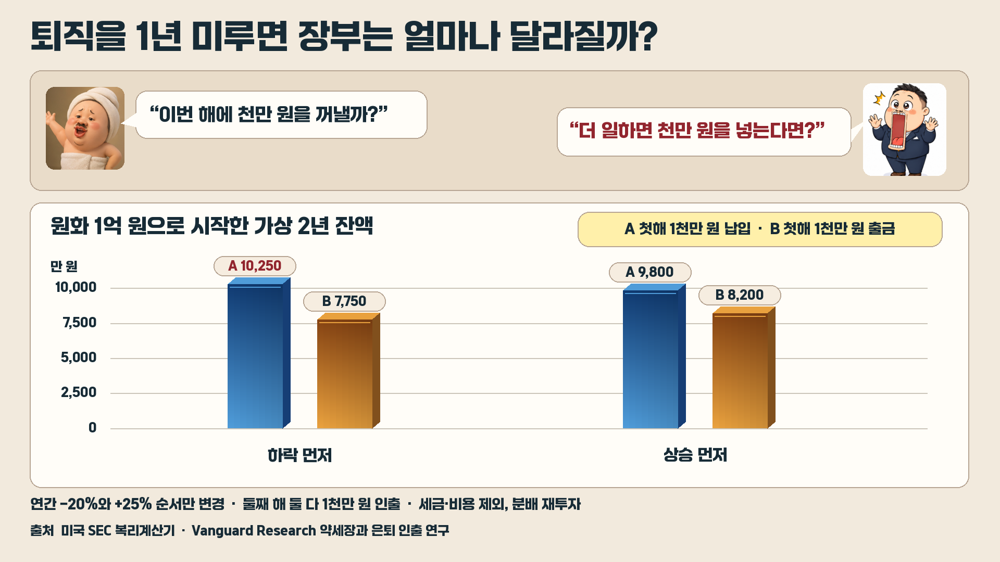

# 퇴직을 1년 미루면 하락장이 덜 무서울까? 마지막 월급이 바꾸는 두 장부

## 1. 퇴직원에 날짜를 쓰는 날

가상 인물 천억이는 퇴직 희망일에 동그라미를 칩니다. 당장 퇴직하면 생활비 일부를 투자계좌에서 꺼내야 합니다. 1년 더 일하면 급여로 생활비를 내고 일부는 저축할 수도 있습니다. 수건 친구가 같은 시장을 겪는 두 달력을 펼칩니다.

## 2. 마지막 출근과 첫 출금

마지막 근무일, 마지막 급여일, 첫 연금 입금일이 같은 날인지는 따로 확인합니다. 퇴직 날짜를 정할 때는 어느 달부터 정기 입금이 지출에 모자라는지 표시합니다. 같은 날에 퇴직해도 확보한 현금에 따라 투자계좌에서 첫 출금하는 날짜는 달라질 수 있습니다.

## 3. 원금은 같고 돈의 방향은 다르다

가상 원화 원금 1억 원, 기간 2년입니다. 연간 총수익률 −20%와 +25%의 순서만 바꿉니다. 분배금은 재투자한 상태로 두고 세금·비용·물가 변화는 제외합니다. 첫해 말에 바로 퇴직한 경우는 1,000만 원을 출금하고, 1년 더 일한 경우는 1,000만 원을 납입합니다. 두 번째 해에는 둘 다 연말에 1,000만 원을 출금합니다. 연말의 입출금은 그해 수익률 적용 뒤입니다.

## 4. 하락이 먼저 찾아온 장부

첫해 1억 원은 8,000만 원으로 줄어듭니다. 여기에 1,000만 원을 보탠 계좌는 9,000만 원이 되고, 그다음 25% 상승과 마지막 출금을 반영하면 **1억 250만 원**이 됩니다. 먼저 1,000만 원을 뺀 계좌는 7,000만 원에 반등이 붙고 마지막 출금 뒤 **7,750만 원**이 됩니다. 차이는 2,500만 원입니다.

## 5. 상승이 먼저였던 장부

첫해 상승으로 1억 2,500만 원이 된 뒤 추가 납입한 계좌는 1억 3,500만 원, 출금한 계좌는 1억 1,500만 원입니다. 둘째 해에 20%씩 하락하고 각각 1,000만 원을 꺼내면 **9,800만 원**과 **8,200만 원**입니다. 차이는 1,600만 원입니다. 첫해 자금 이동의 2,000만 원 차이에 둘째 해 시장 변화가 붙습니다.

*가상 원화 1억 원의 2년 비교. 두 경우 모두 둘째 해 말 1,000만 원을 출금한다.*

## 6. 더 일해도 추가로 모으지 못한다면

급여로 생활비를 모두 내고 첫해 납입도 하지 않는 경우를 따로 적습니다. 첫해 입출금을 0원으로 고정하면 두 시장 경로 모두 시장 변화만으로 1억 원에 도달한 뒤 둘째 해 말 1,000만 원을 써서 **9,000만 원**이 남습니다. 투자계좌에서 일부를 꺼내야 한다면 그 금액과 날짜를 다시 넣습니다.

## 7. 고려할 날짜가 하나 더 있다

두 해의 자산 잔액에 초점을 맞춘 계산입니다. 추가 근로 가능 여부, 출퇴근 비용과 건강·돌봄 일정은 장부에 따로 적습니다. 천억이는 ‘1년 더 일한다’는 문장 옆에 실제로 더 저축할 수 있는 돈과 그 돈이 들어오는 날짜를 씁니다. 들어올 것으로 예상했던 급여가 늦어지는 조건도 별도로 봅니다.

## 8. 연금까지 비는 달 표시하기

오늘 할 한 가지는 **첫 투자계좌 출금이 필요한 달과 그 금액**을 적는 것입니다. 1년 뒤 퇴직하는 달력에도 같은 항목을 적고, 확정된 급여·연금·별도 현금을 날짜 순으로 배치합니다.

**편집부 Q&A · 추가 납입 효과와 시장 반등 효과를 어떻게 구별하나요?**  
같은 시작·종료일에 같은 시장 수익률 경로를 적용한 뒤, 납입과 출금만 바꿔 종료 잔액을 비교합니다.

**원문**　[미 SEC 복리계산기](https://www.investor.gov/financial-tools-calculators/calculators/compound-interest-calculator) · [Vanguard Research 약세장과 은퇴 인출 연구](https://www.vanguard.co.uk/content/dam/intl/europe/documents/en/whitepapers/safeguarding-retirement-bear-market.pdf)

**이어 읽기**　[월 생활비 200만 원, 연금을 빼고 필요한 은퇴자산 역산하기](EP034.md) · [전자책 목차](목차.md)
