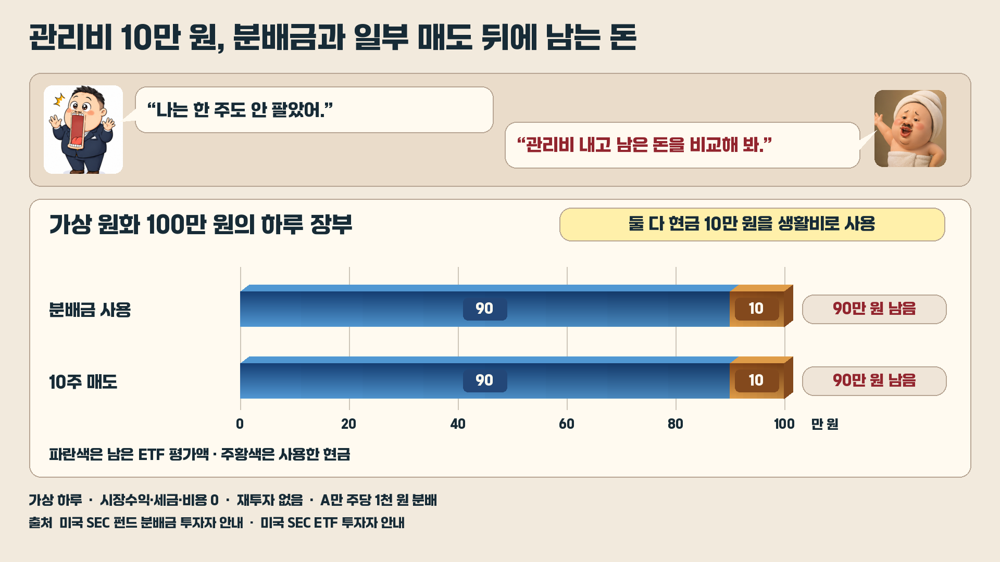

# 은퇴 생활비 10만 원, ETF 분배금을 쓰는 것과 10주를 파는 것의 차이

## 1. 내일 나가는 관리비

가상 인물 천억이는 은퇴 후 통장에 들어온 분배금 10만 원을 관리비에 쓰려 합니다. 수건 친구는 분배금을 받지 않고 ETF 일부를 팔았습니다. 천억이는 친구의 계좌에서 주식 수가 줄어든 것을 보고 자신이 자산을 더 잘 지켰다고 생각합니다. 두 사람은 관리비가 빠진 뒤 잔액을 비교해 보기로 합니다.

## 2. 주식 수와 쓸 수 있는 돈

ETF의 분배금은 펀드가 투자자에게 지급하는 현금입니다. 지급한 만큼의 가치가 펀드 밖으로 이동하므로 분배금과 분배 후 가격을 나란히 봅니다. 분배락일에는 다른 시장 변동도 생길 수 있어 실제 체결가가 분배금만큼 정확히 내려간다고 단정할 수 없습니다. 일부 매도는 투자자가 보유 수량 일부를 시장에서 현금으로 바꾸는 거래입니다.

## 3. 가상 장부에 같은 원금을 놓기

둘 다 원화 100만 원으로 주당 1만 원인 ETF를 100주 갖고 시작합니다. 비교 시점은 하루 뒤입니다. 외부 시장 수익률·세금·거래비용은 0으로 둡니다. 그날 바로 현금을 쓸 수 있다고 가정하고 분배금 재투자는 없습니다. A만 주당 1,000원을 분배하고, B에는 분배가 없습니다. 가격과 수량을 비교하기 위해 나머지 조건을 고정합니다.

## 4. 잔액을 닫았더니 둘 다 90만 원

A는 현금 10만 원과 9,000원짜리 100주를 갖습니다. B는 1만 원에 10주를 팔아 현금 10만 원과 1만 원짜리 90주를 갖습니다. 둘 다 관리비 10만 원을 내고 나면 남은 평가액은 **90만 원**입니다. 천억이의 주식 수는 그대로였고, 친구는 10주를 팔았습니다. 이 가정에서 남은 자산 가치는 같습니다.

*카드는 생활비 5만 원, 본문은 10만 원으로 두었다. 분배 후 평가액과 부분 매도 후 평가액을 비교한다.*

*가상 하루 비교. 각각 현금 10만 원을 사용한 뒤 남은 평가액은 90만 원이다.*

## 5. 같은 10만 원이어도 날짜가 어긋날 때

실제 상품은 분배락일과 지급일이 다를 수 있습니다. 지급일이 관리비 다음 날이면 그 현금으로는 납부일을 맞출 수 없습니다. 매도 역시 주문을 넣은 순간부터 현금을 출금할 수 있는 시각까지 차이가 날 수 있습니다. 시장과 계좌에서 적용되는 결제·출금 가능일을 확인한 뒤 지출 일정과 맞춥니다.

## 6. 가격이 내린 날과 분배금이 줄어든 날

가상 B의 주가가 8,000원으로 내려갔다면 10만 원을 내려면 12.5주가 필요합니다. 정수 주만 팔 수 있다면 13주를 팔아 104,000원을 마련하고 4,000원을 현금으로 남깁니다. 이 경우 남은 87주가 696,000원이고, 잔여 현금까지 합하면 70만 원입니다. 이 반례는 첫날의 외부 시장수익 0% 조건을 바꾼 것입니다.

반대로 A에서 주당 분배금이 600원으로 줄면 100주에서 들어오는 돈은 6만 원입니다. 관리비에는 4만 원이 모자랍니다. 당일 저축에서 채울지 일부를 팔지에 따라 남은 장부가 달라집니다. 두 경우 모두 세금과 거래 비용은 생략했습니다.

## 7. 실제 통장은 세후와 비용까지 읽기

분배와 매도에 적용되는 세금은 상품·계좌와 개인 상황에 따라 확인합니다. 매도 거래의 호가 차이와 매매 수수료, 외화 상품의 실제 환전 비용도 남는 돈을 바꿀 수 있습니다. 장부는 주식 수에 주당 평가액을 곱하고 아직 쓰지 않은 현금을 더한 뒤 닫습니다.

## 8. 지출일과 잔액을 한 줄씩

천억이는 이번 달 **분배금의 실제 입금일과 세후 입금액**, 그리고 관리비 납부일을 한 줄에 놓습니다. 같은 현금을 매도로 마련했을 때의 거래 가격과 출금 가능일도 그 아래에 씁니다. 날짜가 맞는지 확인하고 두 경우에 남을 자산을 계산합니다.

**편집부 Q&A · 주식을 한 주도 팔지 않으면 원금이 유지되나요?**  
보유 수량은 남아도 주당 가격은 변합니다. 분배금 사용 뒤 남은 평가액은 같은 시점의 가격과 잔여 현금으로 확인합니다.

**원문**　[미 SEC 펀드 분배금 투자자 안내](https://www.investor.gov/introduction-investing/general-resources/news-alerts/alerts-bulletins/investor-bulletins/fund-distributions-investor-bulletin) · [미 SEC ETF 투자자 안내](https://www.investor.gov/introduction-investing/general-resources/news-alerts/alerts-bulletins/investor-bulletins-24)

**이어 읽기**　[퇴직일과 국민연금 첫 입금일 사이, 필요한 생활비는 얼마일까?](EP036.md) · [분배락 뒤 당일 손실과 실제 입금, 지급 전에는 어디에 적을까?](FAQ03.md) · [전자책 목차](목차.md)
