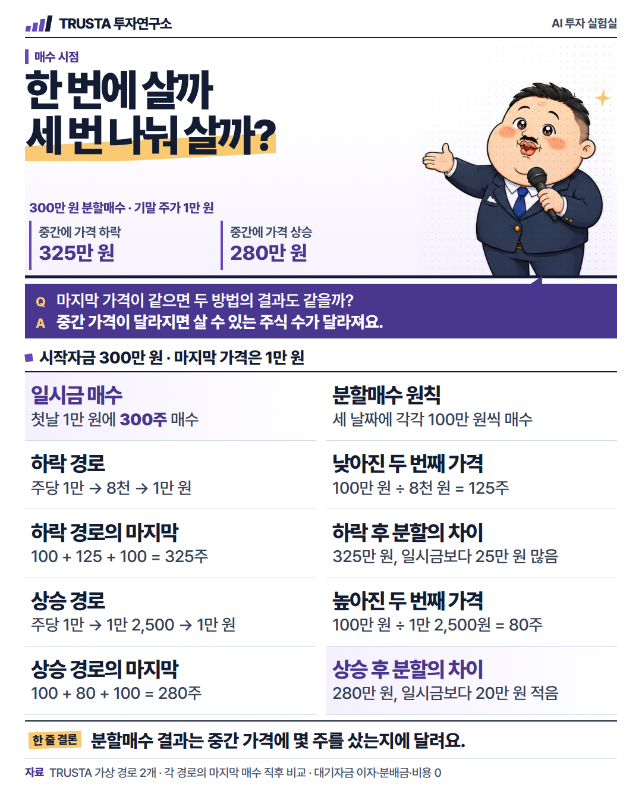
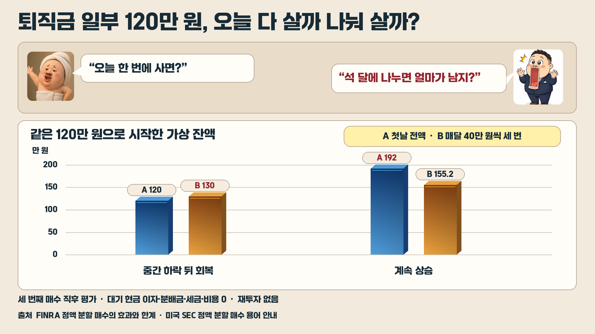

# 퇴직금 일부 120만 원, 오늘 다 살까 석 달에 나눠 살까?

## 1. 마지막 급여 알림

가상 인물 천억이는 퇴직금을 정리하고 그중 120만 원으로 ETF를 알아봅니다. 오늘 다 사자니 내일 가격이 떨어질까 마음이 쓰입니다. 석 달에 나누면 마음은 편할 것 같지만, 오르는 동안 절반 이상이 통장에 남을 수도 있습니다. 수건 친구는 투자 장부 옆에 아직 쓰지 않은 현금 장부를 펼칩니다.

## 2. 두 선택의 출발선을 맞추기

두 장부에 첫날 원화 120만 원을 똑같이 넣습니다. A는 첫날 전액을 씁니다. B는 첫째·둘째·셋째 달의 매수일에 각각 40만 원씩 씁니다. 셋째 매수 직후 같은 가격으로 평가합니다. 가상 기간 동안 분배금·세금·매매비용은 0원, 대기 현금 이자도 0원이며 재투자는 없습니다. 가격은 연율이 아닌 각 매수일의 가상 거래가입니다.

## 3. 현금을 남긴 첫날

처음 한 주가 1만 원이면 A는 120주를 갖고 현금은 없습니다. B는 40주와 현금 80만 원을 갖습니다. 같은 순간 평가액은 둘 다 120만 원입니다. 가격이 움직인 뒤 계좌 전체가 얼마나 변하는지는 대기하는 현금과 이미 산 주식의 비중에 달려 있습니다.

## 4. 중간에 가격이 떨어진 달력

한 주 가격이 1만 원, 8,000원, 1만 원 순으로 움직입니다. A는 둘째 매수일 가격에서 96만 원으로 평가됩니다. B는 둘째 매수 직전 40주의 가치 32만 원과 현금 80만 원을 합해 112만 원입니다. 둘째 매수 직후에는 주식 수와 현금이 바뀌지만 그 순간 전체 장부는 여전히 112만 원입니다.

마지막 날에 A는 120주로 **120만 원**입니다. B는 40주, 50주, 40주를 모아 130주이고 **130만 원**입니다. B의 실제 취득단가는 전체 매수액 120만 원을 130주로 나눠 약 9,231원입니다. 각 매수일의 주가를 세 번 더해 나눈 값과는 다릅니다.

*카드는 첫날 300만 원, 본문은 120만 원에서 시작한다. 두 경우 모두 첫날 가용 현금을 같게 두고 비교한다.*

## 5. 가격이 계속 오르면 뒤집히는 결과

이번 가상의 세 매수가는 1만 원, 12,500원, 16,000원입니다. A는 120주를 유지해 **192만 원**이 됩니다. B는 40주, 32주, 25주를 사서 97주, **155만 2,000원**으로 끝납니다. 아직 쓰지 않은 돈은 오르는 장에 참여하지 않았습니다. 반대로 기다리는 동안 대기 현금에서 실제 이자를 받는다면 이자를 별도 칸에 더해 두 장부를 비교합니다.

*원화 120만 원이 첫날 이미 있는 가상 조건. 세 번째 매수 직후 평가액을 비교한다.*

## 6. 월급에서 저축할 때는 출발선이 달라진다

매달 들어오는 새 돈 40만 원을 그때마다 납입하는 사람은 첫날부터 120만 원을 갖고 있지 않습니다. 본문은 첫날 가용 현금이 같은 두 경우를 비교했습니다. 월별 저축을 비교하려면 실제 입금일에 현금을 넣고 그날 가능한 거래부터 계산합니다. 미래 납입액을 첫날 보유한 돈처럼 가정하면 다른 질문이 됩니다.

## 7. 생활비가 필요해지면

천억이는 다음 달에 50만 원을 써야 하는 경우를 달력에 적습니다. 가상 B에는 첫 매수 뒤 현금 80만 원이 있지만, 둘째 매수를 끝내면 40만 원입니다. 지출 날짜가 그 뒤라면 현금만으로 10만 원이 모자랍니다. A는 첫 매수 뒤 대기 현금이 없습니다. 매수 방식의 차이가 생활비 마련 가능성에도 나타납니다.

## 8. 오늘 적는 한 줄

오늘 할 일은 **첫날 이미 있는 돈과 뒤늦게 들어올 돈을 나눠 적고, 각 매수 후 남을 현금을 적는 것**입니다. 천억이는 같은 종료일의 평가금액 옆에 석 달 동안 가장 급히 써야 할 날짜도 적습니다.

**편집부 Q&A · 평균 매입단가가 낮은 쪽이면 항상 유리한가요?**  
평가일에 몇 주를 보유하는지, 아직 현금이 얼마인지 함께 보세요. 한 번에 쓸 돈이 생기는 날에는 평가액과 바로 꺼낼 수 있는 현금도 구분합니다.

**원문**　[FINRA 정액 분할 매수의 효과와 한계](https://www.finra.org/investors/insights/dollar-cost-averaging) · [미 SEC 정액 분할 매수 용어 안내](https://www.investor.gov/introduction-investing/investing-basics/glossary/dollar-cost-averaging)

**이어 읽기**　[물가가 연 2·3·5%일 때, 오늘 월 200만 원은 20년 뒤 얼마일까?](EP038.md) · [전자책 목차](목차.md)
