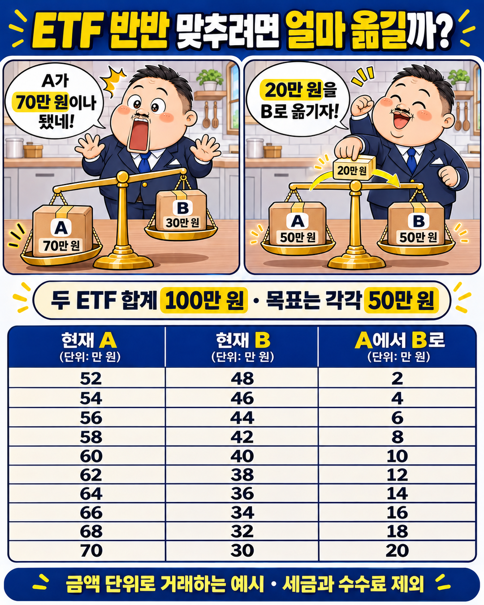
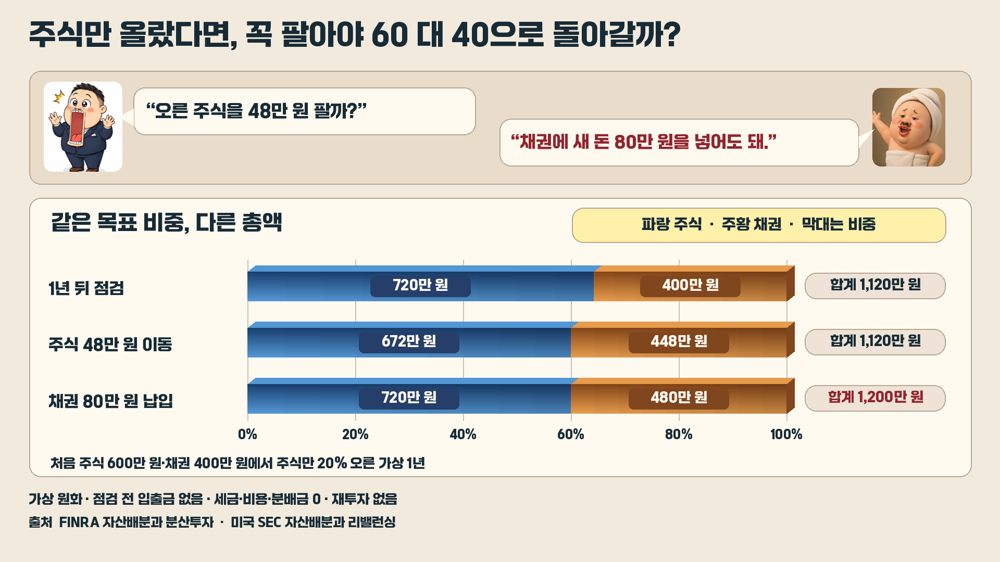

# 은퇴 계좌에서 주식만 올랐다면? 48만 원을 팔거나 80만 원을 넣는 차이

## 1. 오르는 건 반가운데, 팔아야 할까?

가상 인물 천억이는 은퇴 계좌의 주식이 오른 걸 보고 웃습니다. 주식 60%, 채권 40%로 정한 장부에서는 숫자가 바뀌어 있습니다. “원래대로 맞추려면 오른 주식을 꼭 팔아야 해?” 수건 친구가 거래창 대신 새로 생길 현금이 있는지부터 묻습니다.

## 2. 비율을 바꾸는 두 방법

리밸런싱은 목표 배분과 달라진 지금의 배분을 다시 맞추는 일입니다. 보유 자산 사이에서 돈을 옮기면 총액은 같고, 외부 현금을 추가하면 전체 자산이 늘어납니다. 따라서 같은 60 대 40을 만들더라도 필요한 원화 금액은 다를 수 있습니다. 60 대 40은 이번 계산의 목표입니다.

## 3. 1년 뒤 평가액을 꺼내기

가상으로 원화 주식 600만 원과 채권 400만 원에서 출발합니다. 1년 동안 주식은 20% 오르고 채권은 그대로입니다. 첫 정기 점검 전에는 납입이나 인출이 없고 세금·비용·분배금은 0원, 재투자도 없습니다. 점검일에 주식은 720만 원, 채권은 400만 원, 총액은 1,120만 원입니다. 주식은 전체의 **64.29%**로 목표보다 약 **4.29%포인트** 높습니다.

## 4. 계좌 안에서 48만 원 옮기기

같은 총액 1,120만 원의 60%는 672만 원입니다. 주식에서 48만 원을 줄여 채권으로 옮기면 주식 672만 원, 채권 448만 원입니다. 같은 가격에 매매되고 거래비용이 없다는 계산입니다. 실제 거래에서는 순서와 결제 시점도 확인해야 합니다.

*만화의 목표는 50 대 50이라 20만 원을 옮긴다. 본문의 목표는 60 대 40이다.*

## 5. 주식에 손대지 않고도 맞추기

주식 720만 원을 그대로 60%로 유지하려면, 전체 평가액은 720만 원을 0.60으로 나눈 1,200만 원이어야 합니다. 채권에 새 돈 **80만 원**을 넣으면 주식 720만 원과 채권 480만 원이 됩니다. 여기서 80만 원은 밖에서 들어온 새 돈이므로, 두 방법의 최종 총액만 보고 운용 성과를 비교하면 납입 효과가 섞입니다.

*두 경우 모두 주식 60%, 채권 40%지만 총액은 각각 1,120만 원과 1,200만 원이다.*

## 6. 넣을 돈이 없고 꺼낼 돈이 있다면

같은 점검일에 생활비 120만 원이 필요하다고 가정합니다. 120만 원을 주식에서 꺼내면 주식 600만 원, 채권 400만 원으로 남습니다. 반대로 채권에서만 꺼내면 주식 720만 원과 채권 280만 원으로, 남은 자산의 주식 비중은 72%입니다. 이 사례에서는 같은 지출이라도 어느 쪽에서 꺼내느냐가 이후 위험 비중을 바꿉니다.

## 7. 계획서로 돌아가기

매도할 때의 세금과 거래비용, 최소 주문 단위, 현금 확보 시점을 먼저 읽습니다. 계좌가 여러 개라면 합산 배분을 맞추는 일과 특정 계좌에서 현금을 옮기는 조건을 구분합니다. 은퇴일이나 필요한 생활비가 달라졌다면 비중을 예전 목표에 맞추기 전에 그 목표를 다시 확인합니다. 목표 주변에 허용할 범위를 쓰면 작은 변화마다 매도하는 문제를 줄이는 데 도움이 될 수 있습니다.

## 8. 내 앱에서 한 가지

천억이는 앱의 합산 평가액과 주식 평가액을 같은 시각에 기록합니다. **현재 비율과 목표 비율의 차이**를 적고, 다음에 들어올 돈과 나갈 돈이 있는지 나란히 표시합니다. 그래야 어느 방식이 지금 가능한지 판단할 수 있습니다.

**편집부 Q&A · 주식과 채권 둘 다 오르면 비중 조정이 필요 없을까요?**  
두 자산의 상승률이 같으면 같은 조건에서 비중도 유지됩니다. 상승률이 다르거나 중간에 납입·인출하면 점검일 비중을 다시 계산합니다.

**원문**　[FINRA 자산배분과 분산투자](https://www.finra.org/investors/investing/investing-basics/asset-allocation-diversification) · [미 SEC 자산배분과 리밸런싱](https://www.investor.gov/introduction-investing/getting-started/asset-allocation)

**이어 읽기**　[은퇴계획 한 장에 어떤 숫자를 넣어야 실제로 쓸 수 있을까?](EP040.md) · [두 ETF의 겹침이 50%라면 내 계좌 절반이 같은 기업일까?](FAQ01.md) · [전자책 목차](목차.md)
