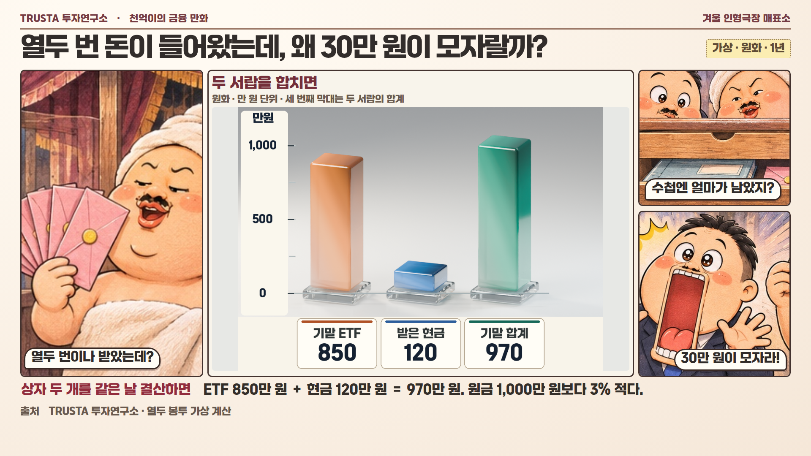
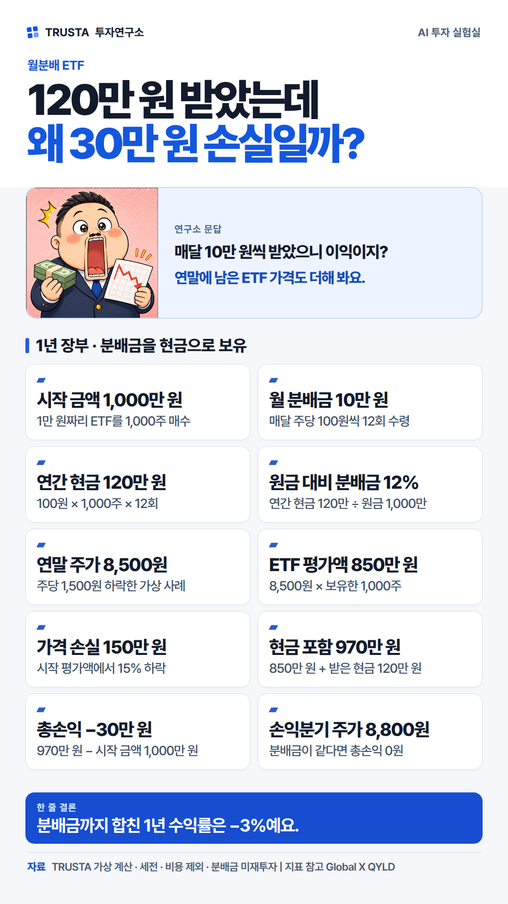
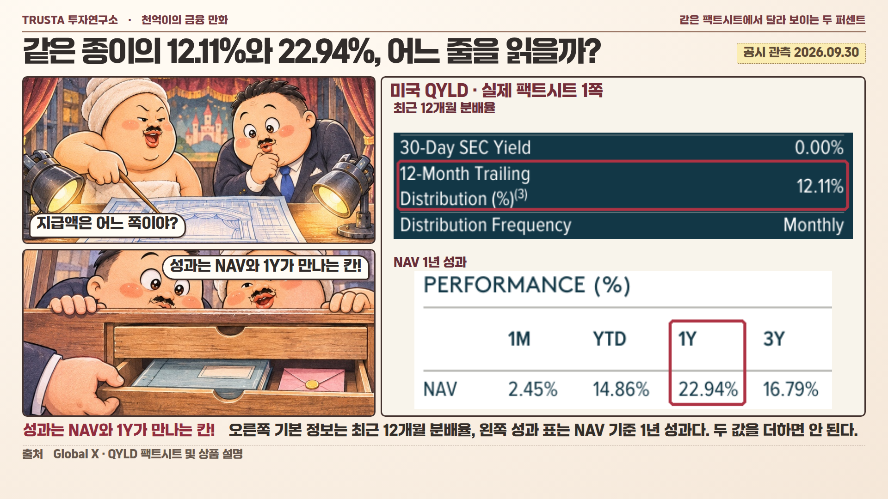

# 월분배금 120만 원을 받았는데, 왜 ETF에서 30만 원을 잃었을까?

## 열두 번째 봉투에 ‘이익’이라고 써도 될까

매달 십만 원씩 꼬박 들어왔어요. 열두 번째 입금 알림이 뜨면 올해 백이십만 원 벌었다고 써도 될까요? 동네 인형극장의 마지막 겨울 공연이 끝난 밤, 천억이는 정말 그렇게 썼습니다. 금박 스티커가 붙은 분홍 봉투에 굵은 사인펜으로요. 잉크가 마르기도 전에 수건 친구가 그 말을 손바닥으로 쓱 문질렀습니다. 둘은 오늘 돈의 행방을 따라갈 가상의 인물입니다.

봉투는 극장 매출이냐고요? 극장 일은 이미 끝났어요. 둘이 빈 매표소에 조금 더 남은 건 천억이 개인 장부를 정리하기 위해서였습니다. 이 창구에는 위아래로 얕은 서랍이 두 개 있습니다. 한 해 동안 들어온 분배금을 적은 쪽지는 위에, 가지고 있는 ETF의 수량과 가격을 적은 파란 수첩은 아래에 넣어 뒀죠. 마감 도장을 하나만 찍으면 끝날 줄 알았는데 아래 서랍은 뒤틀려서 잘 열리지도 않습니다.

천억이가 위에서 쪽지를 한 장씩 꺼냅니다. 일월, 이월, 삼월. 맨 끝에 십이월. 빠진 달도 없고 잘못 들어온 돈도 없어요. 각 쪽지에는 십만 원. 친구가 가만히 보더니 묻습니다. “저건 다 네 돈 맞지. 그런데 올해 처음 갖고 온 돈은 지금 어디 있어?” 이게 꽤 얄미운 질문입니다. 통장은 거짓말을 한 적이 없거든요. 다만 통장이 보여 준 건 한 해 동안 문으로 들어온 돈이고, 친구가 찾는 건 지금 방 안에 남아 있는 돈입니다.

우리도 같은 자리에서 시작해 볼게요. 앞으로 펼칠 장부는 실제 상품의 거래 내역을 본뜬 가상 원화 실험입니다. 연초에 주당 만 원짜리 ETF를 천 주 사서 천만 원을 넣었습니다. 그 뒤 한 주도 더 사거나 팔지 않았어요. 가상의 지급일은 매달 마지막 날, 주당 백 원씩 열두 번입니다. 주식 수가 그대로라서 매번 십만 원이 들어옵니다. 현금에 붙는 이자는 없고 세금과 거래비용, 그 밖의 비용은 모두 영으로 둡니다. 받은 돈은 봉투에 그대로 두고 재투자하지 않습니다. 마지막 날 주가는 마지막 분배락이 이미 반영된 팔천오백 원입니다. 분배금도 모두 들어온 시각에 창구를 닫습니다.

이제 오늘의 답을 미리 한 번 열어 봅시다. 아래 서랍의 평가액은 팔백오십만 원. 위 서랍 현금은 백이십만 원. 둘 다 쓸 수 있는 내 재산으로 합치면 구백칠십만 원이에요. 처음보다 삼십만 원 적습니다. 받은 돈은 분명히 플러스인데 두 서랍을 같이 닫으면 마이너스가 나옵니다. 천억이가 놀라 입을 쩍 벌릴 만하죠. 하지만 여기서 잠깐, 분홍 봉투가 손실을 만들었다는 뜻일까요? 열두 번 다 받지 않았더라면 처음 천만 원이 고스란히 남았을까요? 그러려면 봉투 밖에서 일어난 일도 봐야 합니다.

수건 친구가 사인펜을 빌려 ‘이익’의 번진 자리에 ‘받은 돈’이라고 작게 씁니다. 이러면 쪽지를 버릴 필요가 없습니다. 나중에 꼭 필요한 기록이니까요. 대신 연필로 써야 하는 자리가 하나 있어요. “분홍 봉투를 다 합쳐도 아직 모자란 삼십만 원은 어느 줄에서 나왔지?” 천억이는 그 질문을 뒤집힌 공연 전단에 적습니다. 종이에 묻은 잉크 때문에 손끝도 분홍색이에요. 그 손으로 아래 서랍을 양쪽에서 잡고 천천히 당깁니다.

장부를 함께 읽는 동안에는 남에게 이 ETF가 어울리는지 결론 낼 필요가 없습니다. 오늘 우리에게 필요한 건 한 문장으로 대답할 수 있는 기준입니다. 누가 일 년 동안 얼마나 받았느냐고 물으면 위 서랍을 열고, 일 년 동안 얼마나 벌었느냐고 물으면 아래 서랍까지 열 수 있는가. 두 번째 질문에 첫 번째 서랍으로 답하면 숫자는 정확한데 판단이 틀립니다. 천억이가 붙이려던 도장에 꼭 그런 일이 생겼습니다.

| 같은 1년의 가상 원화 장부 | 계산 | 금액 |
|---|---|---:|
| 연초 원금 | 1,000주 × 10,000원 | 10,000,000원 |
| 받은 현금 | 1,000주 × 100원 × 12회 | 1,200,000원 |
| 기말 ETF | 1,000주 × 8,500원 | 8,500,000원 |
| 기말 총액 | ETF + 보관 현금 | 9,700,000원 |

*가상 1년, 원화, 세금·비용·이자 0, 미재투자. 열두 번 받은 현금을 남은 ETF에 보태면 30만 원 손실이다.*

## 파란 수첩에서 사라진 돈

서랍을 힘껏 잡아당기자 바닥에 극장표 한 장이 떨어집니다. 표 뒷면에 주당 만 원, 천 주라고 적혀 있어요. 옆에는 연말 단가 팔천오백 원. 천억이는 두 가격 사이에 작은 뺄셈 기호를 긋습니다. 한 주를 살 때 쓴 돈과 지금 한 주로 바꿀 수 있는 돈의 차이는 천오백 원. 주식이 천 주였으니 보유분의 가격 하락액만 백오십만 원입니다. 그중 백이십만 원에 해당하는 돈은 위 서랍에 있어요. 빈 곳이 삼십만 원입니다. 누군가 돈을 가져갔다는 뜻은 아니고 두 시점의 자산가치를 비교한 차이죠.

돈의 크기가 잘 와닿지 않으면 한 주짜리 표로 줄여 보면 됩니다. 처음 표 한 장에 만 원을 냈습니다. 나중에 그 표를 팔 수 있는 값은 팔천오백 원이고, 그동안 그 표에 붙어서 온 현금은 합계 천이백 원이에요. 표와 현금을 같이 건네받으면 구천칠백 원. 내 주머니에서는 한 장당 삼백 원이 모자랍니다. 이 작은 삼백 원이 천 장에 걸쳐 모이면 삼십만 원이 돼요. 계산을 천 주로 한 번 하고 한 주로 한 번 해 보면, 주당 금액에 주식 수를 빠뜨린 실수가 금방 보입니다.

이제 퍼센트를 아무 데나 찍으면 곤란하다는 것도 보이죠. 최초 천만 원을 기준으로 연간 받은 현금의 비율을 계산하면 십이 퍼센트예요. 같은 최초 천만 원을 기준으로 가격 쪽의 변화만 보면 마이너스 십오 퍼센트입니다. 두 값은 이 실험에서 같은 원금, 같은 천 주, 같은 일 년을 봅니다. 그래서 가격 변화와 현금 수령을 합쳐 마이너스 삼 퍼센트라는 단순 보유기간 수익률을 얻을 수 있습니다. 화면에 ‘분배율’이라고 쓰인 아무 숫자와 가격 수익률을 언제나 이렇게 더할 수 있다는 뜻은 아닙니다. 분모와 계산 기간을 맞춘 덕분에 이번에 더할 수 있었어요.

친구는 전단 가운데에 가느다란 선을 긋습니다. 천만 원이라는 결승선이에요. 봉투에 백이십만 원이 이미 있으니 아래 서랍에는 얼마가 있어야 선에 닿을까요? 천만 원에서 백이십만 원을 빼면 팔백팔십만 원. 천 주로 나누면 한 주에 팔천팔백 원입니다. 내일 그 가격이 된다는 예상은 여기에 없어요. 같은 현금과 수량을 둔 채 마지막 가격 한 칸만 바꿀 때 어디에서 손익의 부호가 뒤집히는지 찾아낸 겁니다.

수건 친구는 손익분기점 양쪽에 종이표를 한 장씩 놓습니다. 왼쪽에는 팔천칠백 원, 오른쪽에는 팔천구백 원이라고 썼어요. 두 표 모두 처음 단가인 만 원보다 낮습니다. 왼쪽 값으로 보유분을 마감하면 팔백칠십만 원에 현금 백이십만 원, 합이 구백구십만 원입니다. 오른쪽 값으로 끝나면 팔백구십만 원에 같은 현금, 천십만 원이 됩니다. 한 해 내내 입금 알림은 똑같았는데 한쪽은 십만 원 손실, 다른 쪽은 십만 원 이익입니다. 두 값을 벌린 사건은 마지막 주가가 이백 원 달랐다는 것 하나뿐이에요.

“그럼 팔아야 손해가 확정돼? 지금은 안 팔았잖아.” 천억이가 표를 손바닥으로 감쌉니다. 지금 계산한 건 정해진 시점에 보유분에 값을 매긴 기간 성과예요. 팔지 않고 있어도 그날의 평가값으로 계산할 수 있습니다. 얼마에 실제로 팔았는지를 묻는다면 다음 거래에서 체결된 가격과 비용을 가져와야죠. 이 실험은 마감 가격에 비용 없이 전량 처분할 수 있다고 보아도 결과가 같게 설계했습니다. 지나가는 시세를 보고 실제 통장에 구백칠십만 원 입금됐다고 써 버리면, 그건 또 다른 장부 실수입니다.

친구가 마지막으로 묻습니다. “받은 돈을 지우고 가격표만 읽으면 어떻게 돼?” 천억이는 백오십만 원 손실이라고 대답합니다. 앞에서는 입금만 봐서 백이십만 원 이익이라더니 이번엔 손실을 너무 크게 썼어요. 같은 사건을 양끝에서 잘라 읽으면 이렇게 다르게 보입니다. 이때 열두 장 쪽지를 한꺼번에 보지 말고 단 하루만 확대하면 한 가지가 더 풀립니다. 돈을 지급하는 날, 펀드 쪽에서는 무슨 일이 일어날까요? 손가락만 한 공연표에 마침 절취선이 있습니다.

*가상 장부에서 현금은 원금의 12%, 단순 보유기간 수익률은 −3%다. 두 서랍이 손익분기를 이루는 기말 가격은 8,800원이다.*

## 절취선에서 표를 찢어도 금액은 남는다

천억이는 공연표에 만 원이라고 씁니다. 오른쪽 좁은 꼬리표에 백 원을 쓰고 절취선을 따라 똑 찢었어요. 왼손에는 구천구백 원짜리 몸표, 오른손에는 백 원짜리 꼬리표. 방금 찢는 소리가 꽤 경쾌했죠. 소리가 났다고 손안의 재산이 백 원 늘었을까요? 두 조각을 나란히 놓으면 그대로 만 원입니다. 이건 입장권의 실제 회계 이야기가 아니에요. 펀드가 보유한 돈 가운데 일부를 받을 권리가 떨어져 나오는 순간을 손으로 만져 보는 모형입니다.

하루짜리 가정을 따로 적어 볼게요. 분배락 직전 한 주의 순자산가치는 만 원이고 주당 백 원을 지급하기로 했어요. 기초자산 가격은 그대로, 비용도 세금도 없고 다른 사건도 일어나지 않았다고 칩시다. 그 분배가 반영되면 이론상 한 주의 순자산가치는 구천구백 원이고, 지급받을 권리가 있는 사람에게는 주당 백 원이 돌아갑니다. 입금까지 시간이 걸리면 아직 현금이 아닌 받을 돈입니다. 받을 돈을 자산으로 적었다면 실제 현금이 들어올 때에는 그 줄을 현금으로 옮겨야 합니다. 받을 돈과 받은 현금을 나란히 두면 같은 꼬리표를 두 장으로 세게 돼요.

그런데 실제 ETF는 거래소에서 체결됩니다. 순자산가치는 펀드 안 자산에서 부채를 뺀 한 주의 몫이고, 시장가격은 그 시각에 누군가 사고판 값입니다. 분배락일에 다른 좋은 소식이 생겨 보유자산 가격이 올라갈 수도 있죠. 모형에서 구천구백 원이 된 바로 그날 다른 시장 움직임까지 겹쳐 거래가격이 만 원을 넘을 수도 있고, 더 밑으로 갈 수도 있어요. 분배락 직전과 직후의 두 거래가격 차이가 매번 정확히 백 원이어야 한다고 믿으면, 시장이 움직인 몫까지 분배금 탓으로 돌리게 됩니다.

그럼 오늘 장부의 백오십만 원 하락을 놓고 ‘전부 운용 실패’라고 말할 수 있을까요? 처음 가격과 마지막 가격만으로는 중간에 번 소득, 시장에 의한 가격 등락, 실제 지급한 재원의 구성을 다 복원할 수 없습니다. 우리에게 주어진 자료로 정확히 말할 수 있는 건 천 주의 평가액이 백오십만 원 줄었고 백이십만 원을 돌려받아서 최종 재산 차이가 삼십만 원이었다는 데까지예요. 최종 손실이 삼십만 원이라고 해서 분배금 중 삼십만 원이 원금에서 나왔다고 판정할 수도 없습니다. 장부가 대답하는 질문과 회계 공시가 대답하는 질문은 따로 있습니다.

친구가 두 번째 꼬리표를 만듭니다. 이번에는 만 원짜리 표에서 백 원을 떼서 건네는 날에 다른 보유자산 가치가 주당 이백 원 올랐다고 해 보죠. 같은 이론 모형에서 남은 한 주는 만 백 원, 받을 금액은 백 원입니다. 두 칸을 더하면 만 이백 원이에요. 원래 만 원과 비교한 하루 이익은 이백 원입니다. “백 원을 받았는데 이백 원을 벌었다고?” 천억이가 종이 두 장을 다시 포갭니다. 지급한 백 원을 더한 것도 맞고, 만 백 원 안에는 지급이 반영된 것도 맞습니다. 새로운 이백 원은 시장 쪽에서 생겼어요.

반대로 시장에서 주당 이백 원의 가치가 빠졌다면 같은 백 원 지급 뒤 남은 부분은 구천칠백 원이고 받을 돈은 백 원입니다. 둘을 합쳐 구천팔백 원, 이백 원 손실이죠. 지급액을 고정하고 시장에서 일어난 일만 뒤집었더니 하루 손익의 부호가 바뀌었습니다. 종이를 찢는 동작은 어느 장면에서나 똑같았어요. 이 작은 실험 덕분에 천억이는 연말 봉투만 보고 연중 시장이 좋았는지 나빴는지 단정할 수 없게 됐습니다.

미국 증권거래위원회의 투자자 안내에는 펀드가 분배를 할 때 순자산가치와 투자자가 가진 현금 또는 새 지분 사이에서 가치가 이동한다고 설명돼 있습니다. 또 펀드의 배당·이자·실현한 이익과 투자원금에서 지급되는 돈을 구분합니다. 특정 지급의 성격이 궁금하면 운용사의 해당 지급 공지까지 가야 해요. 누군가 찍어 둔 입금 화면은 내 통장에 찍힌 금액을 보여 줍니다. 그 금액이 펀드 안에서 어떤 경로로 마련됐는지까지 보여 주지는 않습니다.

친구가 표 몸통을 서랍에 넣고 꼬리표를 창틀 위에 놓습니다. 그런데 다음 날 아침 일찍 극장에 온 사람이 몸통만 사 갔다면 창틀에 있던 꼬리표까지 가져갈 수 있을까요? 이젠 금액 문제가 아닙니다. 어떤 시점에 몇 주를 가지고 있었는지, 장부의 날짜 칸이 돈의 주인을 가릅니다.

[SEC 펀드 분배금 투자자 안내](https://www.investor.gov/introduction-investing/general-resources/news-alerts/alerts-bulletins/investor-bulletins/fund-distributions-investor-bulletin)

## 열두 걸음 뒤에 도착한 사람은 몇 장을 받나

수건 친구가 달력에서 공연날을 세다가 엉뚱한 칸을 짚습니다. “이날 분배금이 들어왔네. 그날 아침에 사도 내 몫이야?” 가상 공연표라면 창구에서 표를 넘길 때 꼬리표를 누구 손에 남길지 우리가 정할 수 있어요. 실제 펀드에서는 해당 지급 일정에 권리를 가르는 날과 돈을 지급하는 날이 정해져 있습니다. 미국 상품 공시에서 엑스 데이트라고 적힌 칸은 그 분배를 받을 권리가 떨어져 거래되는 날, 페이어블 데이트라고 적힌 칸은 지급일입니다. 날짜 이름을 바꿔 읽으면 통장에 얼마가 들어올지부터 어긋납니다.

큐와이엘디라는 미국 ETF의 운용사 지급 이력을 펼쳐 보죠. 이건 열두 번 백 원씩 지급했다는 우리 모형과 별개의 실제 기록입니다. 이천이십육년 시월 공시에서 분배락일과 기준일은 시월 십구일, 지급일은 시월 이십이일입니다. 같은 줄 안에 날짜가 셋 등장하고 두 칸에는 같은 날짜가 적혀 있어요. 이 줄을 보고 시월 이십이일에 처음 사면 이미 지난 분배를 받을 수 있다고 계산하면 안 됩니다. 내 거래가 어느 시장의 어느 날에 체결됐는지와 그 회차의 권리 기준을 맞춰 봐야 해요. 운용사가 적은 지급일과 내 중개계좌에서 돈을 확인하는 시각도 각각의 기록을 씁니다.

다시 우리 극장으로 돌아옵니다. 이번에는 입금 시점을 아예 단순하게 정했지요. 첫날부터 마지막까지 천 주를 가지고 있고 열두 번 모두 받을 자격이 있습니다. 만약 같은 주당 백 원이라도 반년 늦게 들어와 마지막 여섯 번만 받을 자격이 있는 천 주 보유자라면요? 그 사람의 지급 합계는 육십만 원입니다. 펀드 한 주가 일 년 동안 천이백 원을 지급했다는 사실과 이 사람의 통장에 육십만 원만 들어왔다는 사실은 함께 참입니다. 이 사람의 매수 가격도 매수일도 따로 찾아야 하니 원래 천억이의 일 년 성과와 바로 견줄 수는 없습니다.

주식 수가 바뀌면 달력만으로도 부족합니다. 상반기 여섯 번은 천 주였고, 하반기 여섯 번은 오백 주만 들고 있었다고 해 봅시다. 매달 한 주당 백 원은 그대로입니다. 상반기에는 한 번에 십만 원, 하반기에는 한 번에 오만 원. 연간 수령액은 구십만 원입니다. 연말 수량 오백 주에 연간 주당 총액 천이백 원을 곱하면 육십만 원밖에 안 나오죠. 상반기에 들고 있던 나머지 오백 주의 권리를 놓쳤습니다. 이 경우 투자 손익까지 알려면 줄어든 오백 주를 언제 얼마에 팔았는지, 그 돈이 어디에 있는지도 살펴야 합니다.

이제 둘 사이에 작은 내기가 걸립니다. “지급 횟수와 연간 합계를 알면 매달 생활비를 확정할 수 있을까?” 천억이가 종이쪽지를 뒤집습니다. 한 묶음에는 매달 십만 원씩, 다른 묶음에는 첫 여섯 달에 매달 오만 원씩, 뒤 여섯 달에는 매달 십오만 원씩. 둘 다 열두 번이고 둘 다 합계 백이십만 원입니다. 하지만 매달 십만 원을 써야 했다면 두 번째 묶음의 첫 달에는 오만 원이 모자랍니다. 따로 둔 현금이 없고 달마다 지출해야 했으면 육월 말까지 누적 삼십만 원의 틈이 생겨요. 연말 합계가 같다는 사실은 그 여섯 달의 결제일을 지나게 해 주지 않습니다.

앞의 가정에서는 한 달도 빠짐없이 같은 돈이 나왔습니다. 실제 월분배라는 말은 지급 주기를 가리키고 개별 지급액은 공시로 확인합니다. 운용사도 다음 지급액을 보장하지 않아요. 심지어 매달 같은 액수가 예정돼 있어도 이번 달에 들어온 돈이 누구의 몇 주 몫인지가 정해져야 비로소 내 현금 흐름이 됩니다. 달력에 동그라미 열두 개를 치고도 생활비 계획이 틀릴 수 있는 이유입니다.

수건 친구가 달력 오른쪽에 네모를 하나 더 그립니다. “이 봉투를 한 번도 쓰지 않고, 들어올 때마다 다시 표를 샀으면?” 천억이는 연말에 백이십만 원으로 몇 장을 살 수 있는지부터 세려 해요. 친구가 그의 연필 끝을 막습니다. 일월에 산 주식은 이월 분배를 받을 수 있습니다. 십이월에 한꺼번에 산 주식은 일월부터 십일월까지 거슬러 갈 수 없어요. 같은 돈이라도 다음 달에 다른 일을 하게 된다면, 우리에게 필요한 건 연말 가격 한 개가 아닙니다.

[Global X QYLD 분배 일정](https://www.globalxetfs.com/funds/qyld) · [SEC 분배락일 안내](https://www.investor.gov/introduction-investing/investing-basics/glossary/ex-dividend-dates-when-are-you-entitled-stock-and)

## 봉투 안에 돈 대신 주식 한 주를 넣었더니

수건 친구가 열두 봉투 중 두 장만 남깁니다. 나머지는 잠시 공연 포스터 아래에 끼워 둬요. 재투자의 효과를 알아보려고 열두 달 가격을 모조리 지어낼 필요는 없거든요. 두 번 지급하는 짧은 가상 실험을 새로 시작합니다. 출발은 원화 백만 원이고 만 원짜리 ETF를 백 주 샀습니다. 두 번 모두 받을 자격이 있는 주식 한 주당 백 원을 지급합니다. 세금과 비용, 현금 이자는 이번에도 영입니다. 첫 지급 뒤에는 실제로 만 원에 한 주를 살 수 있고, 마지막 평가는 두 번째 분배가 끝난 뒤에 합니다.

천억이는 첫 달 받은 만 원을 그냥 둡니다. 친구는 받은 만 원으로 같은 가격에 한 주를 더 사요. 첫날엔 둘 다 백만 원을 넣었고, 방금 생긴 현금도 똑같았습니다. 딱 하나의 선택으로 다음 지급의 출발점이 달라졌습니다. 천억이는 여전히 백 주, 친구는 백한 주입니다. 첫 분배금을 셀 때 둘의 금액이 같았다고 둘째 분배도 같다고 생각하면 여기서 백 원을 놓칩니다. 두 번째 분배 권리를 정하기 전에 재매수한 한 주에도 백 원이 붙으니까요.

두 번째 지급 뒤 주당 가격이 팔천오백 원이 되었다고 합시다. 비교를 마치는 날이라서 두 번째 분배금은 둘 다 현금으로 둡니다. 천억이는 백 주가 팔십오만 원이고 첫 달과 둘째 달 현금이 합쳐 이만 원입니다. 최종 팔십칠만 원. 친구는 백한 주가 팔십오만 팔천오백 원이고, 현금은 둘째 달의 일만 백 원입니다. 첫 달 돈은 주식으로 바꿨으니 현금 칸은 비어야 하죠. 둘을 더하면 팔십육만 팔천육백 원입니다. 주식 수는 더 많은 쪽이 천사백 원 적어요.

“재투자했는데 왜 나만 덜 받았지?” 친구가 백한 번째 표를 노려봅니다. 그 표만 따로 보면 답이 깔끔해요. 첫 지급 때 만 원을 써서 산 한 주가 마지막에 팔천오백 원이 됐고 그 사이 백 원을 줬습니다. 한 주와 지급액을 같이 챙겨도 팔천육백 원. 그냥 서랍에 놓아둔 만 원에 비해 천사백 원 모자라요. 다른 백 주는 두 사람에게 똑같습니다. 통장 전체를 다시 계산하지 않아도 서로 다른 행동이 벌어진 한 줄만 보면 차액을 설명할 수 있습니다.

반대 장면도 열어 보죠. 처음 돈과 수량, 첫 지급 뒤 매수가는 그대로 두고 둘째 지급 뒤의 최종 가격만 만 오백 원으로 올립니다. 추가로 산 한 주는 이제 만 오백 원과 주당 지급액 백 원을 합쳐 만 육백 원을 돌려줍니다. 현금 만 원을 보관한 경로보다 육백 원이 많아요. 같은 두 번의 지급, 같은 한 주 매수인데 시장이 어떤 값으로 끝났느냐에 따라 선택의 결과는 뒤집힙니다. 손익이 같은 지점도 구할 수 있어요. 새로 산 한 주에 딸린 백 원을 포함해 정확히 만 원이 되려면 마지막 주가는 구천구백 원이면 됩니다.

그럼 주당 가격이 똑같고 재투자 조건도 같다면 누구에게나 소수점 아래 주식까지 살 수 있을까요? 여기서 잠깐 우리 실험을 바꿔 봅시다. 만 원을 받았는데 재투자 시점 가격이 만 이천 원이고 한 주 단위로만 살 수 있는 환경입니다. 이때는 사고 싶어도 이 봉투만으로는 한 주를 못 삽니다. 현금 잔액으로 보관했다 다음 지급을 기다리게 되죠. 소수점 매매를 허용하는 조건이라면 그때 살 수 있는 수량이 달라질 수 있습니다. 자동 재투자를 켰다는 말 한 줄로 실거래 수량을 복원하지 말고, 내역의 체결 수량과 남은 현금까지 보자는 이유예요.

원래의 열두 장 실험으로 돌아가면, 매달 주당 백 원을 받았고 연말에 팔천오백 원이 되었다는 사실만 가지고 매번 재투자한 결과를 딱 하나로 계산할 수 없습니다. 중간에 산 주식이 비싸게 샀는지 싸게 샀는지, 다음 지급 권리 전에 체결됐는지, 조금 남은 돈을 언제 썼는지가 빠져 있거든요. 그래서 천억이는 ‘매달 재투자했을 때 연말 얼마’라는 칸을 빈칸으로 둡니다. 계산기가 고장 난 게 아닙니다. 어떤 자료를 더 가져와야 하는지 알게 된 거예요.

그때 창구에 접힌 종이 한 장이 들어옵니다. 운용사가 실제로 낸 팩트시트입니다. 친구는 첫 화면에서 십이 퍼센트가 조금 넘는 숫자를 발견하고는 “우리 장부 찾았다!” 하고 소리칩니다. 오른쪽 위와 왼쪽 아래에 퍼센트가 각각 적혀 있어요. 하나는 받은 돈을 묻는 숫자이고, 다른 하나가 투자 성과를 묻는 숫자라면, 둘을 한 장의 표에서 어떻게 골라낼 수 있을까요? 작은 공연용 스포트라이트가 이번엔 그 두 줄을 비춥니다.

| 두 번 지급한 별도 실험 | 2차 지급 뒤 주가 8,500원 | 2차 지급 뒤 주가 10,500원 |
|---|---:|---:|
| 1차 지급을 현금으로 보관 | 870,000원 | 1,070,000원 |
| 1차 지급으로 1주 매수 | 868,600원 | 1,070,600원 |
| 재투자 경로에서 더 남은 돈 | −1,400원 | +600원 |

## 같은 팩트시트에서 달라 보이는 두 퍼센트

창구 조명을 오른쪽 위로 옮겨 봅니다. 지금 읽는 건 미국에 상장된 글로벌엑스 나스닥 백 커버드콜 ETF의 팩트시트입니다. 주문창에서 쓰는 기호는 큐와이엘디입니다. 오늘의 가상 원화 장부와 구분하려고 친구가 한쪽에 ‘미국 상품 공시’라고 적어요. 이 공시의 기준일은 이천이십육년 구월 삼십일입니다. 인쇄한 날이나 우리가 읽은 날과는 별개로, 종이에 적힌 숫자는 이 관측 시점의 것입니다. 다음 달 화면으로 바꾸면 같은 자리의 값이 달라질 수 있습니다.

오른쪽 기본 정보 표에서 최근 열두 달 분배율에 해당하는 줄을 찾으세요. 그 옆에 십이 점 일일 퍼센트라고 적혀 있습니다. 바로 밑의 지급 주기 칸에는 월간이라고 쓰여 있어요. 둘을 이어 읽으면 지난 열두 달의 지급을 특정 방식으로 합산한 지표이고 이 펀드가 월 단위로 분배한다는 사실을 알 수 있습니다. 다음 달에 매입금의 십이 점 일일 퍼센트가 한 번에 입금된다는 뜻이 아니죠. 열두 달 뒤 원금보다 딱 그만큼 부자가 된다는 약속도 여기에는 없습니다.

이 숫자의 분모가 특히 중요합니다. 뒤쪽 정의를 읽으면 운용사는 열두 달 동안의 소득과 자본이득, 원금 성격의 분배까지 합산하고, 최근의 주당 순자산가치에 같은 기간 자본이득 분배액을 더한 값을 분모로 씁니다. 이 펀드가 공시한 해당 지표의 산식이에요. 우리가 극장에서 처음 실제로 넣은 천만 원을 분모에 놓은 이유는 내 돈을 기준으로 보기 위해서였습니다. 두 비율의 앞자리에 똑같이 십이라는 글자가 찍혔다고 해서 분모까지 같아지는 건 아닙니다.

이젠 불빛을 그 종이의 왼쪽 성과 표로 옮깁니다. 같은 기준일, 순자산가치 기준의 일 년 성과 칸에는 이십이 점 구사 퍼센트라고 인쇄돼 있어요. 아까 읽은 십이 점 일일과 다른 답이 나오는 게 이상한가요? 왼쪽 표는 특정 기간의 투자 성과를, 오른쪽 기본 정보 표는 지난 분배의 규모를 담고 있습니다. 둘을 더해 삼십오 퍼센트쯤 벌었다고 쓰면 분배의 효과를 중복해서 셀 수 있어요. 반대로 두 값을 빼서 차이가 정확히 주가 상승률이라고 써도 안 됩니다. 분모가 다르고 재투자 과정에서 보유 수량도 달라지거든요.

친구가 성과 표에서 일 년을 뜻하는 열 대신 연초 이후를 뜻하는 바로 옆 열에 손가락을 얹습니다. 같은 기준일로 끝나니 같은 기간일 거라는 생각이었어요. 하지만 구월 말의 ‘연초 이후’는 그해 첫날부터 구월 말까지고, ‘최근 일 년’은 그보다 앞선 전년 같은 무렵까지 거슬러 올라갑니다. 달력 끝에 찍힌 도장이 같아도 첫 장이 다릅니다. 기간이 일 년을 넘으면 이 팩트시트는 수익률을 연율로 표시한다는 각주도 붙여 놨어요. 몇 년을 보유한 뒤의 누적 이익을 알고 싶을 때 연율의 숫자를 그대로 옮겨 쓰면 질문과 단위가 어긋납니다.

많은 분이 홈페이지에서 ‘디스트리뷰션 레이트’라고 쓰인 다른 항목을 또 만나게 됩니다. 같은 운용사가 이 상품에 쓰는 그 항목은 가장 최근 한 번의 지급액을 연간 수준으로 환산하고 최근 순자산가치로 나눕니다. 최근 열두 번을 모은 항목과 최근 한 번으로 앞을 펼쳐 본 항목은 재료부터 다릅니다. 가령 우리 가상 한 주가 이번 달에 오십 원을 줬고 기준 순자산가치를 만 원으로 뒀다면, 같은 액수가 열두 번 반복된다고 가정한 연환산액은 육백 원, 그 비율은 육 퍼센트입니다. 지난 열두 달 합계가 이미 육백 원이었다는 뜻은 아닙니다. 직전 열한 번이 모두 백 원이었다면 실제 합계는 천백오십 원이니까요.

큐와이엘디가 어떤 식으로 돈을 마련하는지도 덧붙일 만합니다. 이 상품은 나스닥 백 지수 주식들을 보유하면서 지수 콜옵션을 쓰는 전략을 운용한다고 설명합니다. 옵션을 팔 때 대가를 받을 수 있는 대신, 지수가 크게 올라갈 때 상승분을 누릴 기회가 제한될 수 있고 지수가 떨어질 위험도 남습니다. 한 달에 받은 프리미엄, 투자자에게 지급한 돈, 그달 펀드의 전체 손익은 각각 다른 숫자입니다. 프리미엄이 들어왔다는 사실 하나로 이번 달 펀드가 그 금액만큼 이익을 냈다고 적을 수 없어요.

친구는 팩트시트를 접어 분홍 봉투 안에 넣으려다가 멈춥니다. 봉투보다 훨씬 큰 종이인데다 애초에 거기에 들어갈 서류도 아닙니다. 공시의 일 년 성과는 특정 가정 아래 펀드의 성과를 보여 주고, 그 기간 중간에 달러를 바꾸거나 중도에 매수한 한국 투자자의 원화 계좌는 다른 경로를 밟습니다. 내 영수증을 찾으려면 내 거래 내역으로 돌아가야 해요. 그래도 손에는 전보다 훨씬 쓸 만한 단서가 남았습니다. 비율 옆에 기간, 분모, 현금 재투자 여부를 함께 적으면 다음에 화면이 바뀌어도 무슨 값을 찾고 있었는지 알 수 있습니다.

**같은 기준일, 다른 질문**　2026년 9월 30일 미국 QYLD의 최근 12개월 분배율은 12.11%, 1년 NAV 성과는 22.94%였다. [Global X QYLD 팩트시트 1·2쪽](https://assets.ctfassets.net/9gigg57dwmx9/funds-documents-qyld-fact-sheet_qyld-af2371ada8/19b9c4deab1c51478c64bbfaba382acf/Fact-Sheet_QYLD.pdf) · [Global X 상품 설명](https://www.globalxetfs.com/funds/qyld) · [SEC EDGAR QYLD 재투자 가정](https://www.sec.gov/Archives/edgar/data/1432353/000093041326000081/c114720_ncsr.htm)

*2026년 9월 30일 미국 QYLD. 최근 12개월 분배율 12.11%와 1년 NAV 성과 22.94%는 다른 질문에 답한다.*

## 이미 써 버린 육십만 원은 어디에 적을까

매표소 히터가 꺼져서 두 사람이 컵을 양손으로 감쌉니다. 천억이는 올해 급할 때 분배금을 생활비로 썼다면 어떻게 되느냐고 묻습니다. 조금 전까지 가정한 대로 현금이 고스란히 남아 있다면 누구라도 합계 구백칠십만 원을 만들 수 있죠. 그런데 실제 집에서는 통장 하나를 오직 이 종목만 위해 비워 두기 어렵습니다. 다른 데서 월급이 들어오고, 통신비와 장보기가 나가요. 연말 통장 잔액을 그대로 분배금이라고 부르면 투자와 소비가 한 줄에 뒤섞입니다.

처음 장부에서 조건 하나만 바꿔 보겠습니다. 매달 받은 십만 원 중 오만 원만 쓰고 오만 원은 남겨 두는 겁니다. 투자 수량은 천 주 그대로, 재투자는 없고 모든 시장 조건과 마지막 평가액은 같습니다. 열두 달 실제 받은 돈은 백이십만 원, 소비는 육십만 원, 남은 현금은 육십만 원이죠. 평가액 팔백오십만 원과 남은 현금을 합치면 지금 지갑과 증권계좌에 남은 돈은 구백십만 원입니다. 처음 천만 원에 비해 구십만 원이 작습니다. 이 구십만 원을 통째로 투자 손실이라고 써도 될까요?

친구는 구십만 원이라고 쓴 영수증을 두 장으로 찢습니다. 삼십만 원은 원래도 있던 투자 손실, 육십만 원은 생활비로 꺼낸 돈입니다. 둘을 합치면 처음과 지금 남은 재산의 차이 구십만 원이 정확히 맞습니다. 이미 쓴 육십만 원을 오늘 쓸 수 있는 현금에 보태면 생활비를 두 번 쓰게 돼요. 반대로 투자 자체의 손익을 구할 때에는 받은 분배금 가운데 그 육십만 원을 지워 버리면 안 됩니다. 돈을 받았고 나중에 어떤 곳에 썼다는 사건을 시간순으로 한 번씩 적으면 어느 쪽에도 모순이 없습니다.

그런데 한 달 치 십만 원을 증권계좌의 현금 칸에서 생활통장으로 이체만 해 뒀다면요? 아직 장을 보지도 요금을 내지도 않았습니다. 이 경우 나라는 사람의 두 계좌를 합쳐 보면 줄어든 돈이 없어요. 오른쪽 주머니에서 왼쪽으로 옮겼을 뿐이죠. 증권계좌 하나만 분석할 때는 외부로 나간 돈이라는 표시가 필요합니다. 두 계좌를 합쳐 가계 전체를 볼 때는 내부 이체니까 지출에서 빠집니다. 계좌 번호 하나가 바뀔 때마다 손익이 생겼다고 기록하면, 본인이 자기에게 돈을 보낸 날마다 이익과 손실이 번갈아 나타나는 우스운 장부가 됩니다.

세후 현금을 계산할 때는 같은 일이 숫자 한 줄 차이로 벌어집니다. 실제로 받은 순금액이 적혀 있는 내역을 가지고 있다면 세전 분배액과 공제된 금액을 다른 칸에 놓으세요. 세후 입금액에 이미 반영된 공제액을 다시 빼면 공제를 두 번 합니다. 반면 세전 분배액을 그대로 내 생활비로 쓴다고 계획하면 실제 쓸 수 있는 돈보다 많이 적을 수 있어요. 오늘 가상 장부가 세금을 영으로 둔 이유는 누가 어느 계좌에서 어떤 세율을 적용받는지 가정하지 않고 가격과 현금의 이동만 보기 위해서입니다. 실제 개인 세율을 이 종이에서 읽어 낼 수는 없습니다.

통화도 주머니 하나를 더 만들어요. 달러 상품 예를 아주 작게 만들어 봅시다. 가상으로 주식 한 주를 백 달러에 사고, 기간 끝에 구십 달러가 됐고, 그사이 오 달러씩 두 번 분배를 받았습니다. 달러로 받은 돈을 달러 현금으로 끝까지 보관하고 세금·비용·이자가 없다면, 마지막 주식과 현금을 합쳐 정확히 백 달러예요. 처음과 끝의 환율까지 같다면 원화로 봐도 그대로입니다. 시작할 때 달러당 천이백 원, 마지막에는 천삼백 원이었다고 조건을 바꾸면 매입 시의 십이만 원에 비해 마지막 백 달러는 십삼만 원입니다. 달러 기준 보합이 원화 기준 일만 원 증가로 바뀌죠. 모두 설명용 가정입니다.

중간에 오 달러씩 현금이 들어오는 즉시 원화로 바꿨다면 마지막 날 백 달러 전체에 한 번 환율을 곱하는 계산은 쓸 수 없습니다. 그때는 두 번의 실제 환전액이 원화 통장에 남고, 기말에는 주식 구십 달러만 마지막 환율로 평가합니다. 비교하려는 통화와 환전 시점을 한 문장 적어 두면 같은 미국 ETF를 보유한 두 사람이 서로 다른 원화 결과를 보여 줘도 놀랄 일이 줄어들죠. 이 달러 실험의 환율을 앞의 천만 원짜리 가상 원화 ETF에 끼워 넣을 필요는 없습니다.

천억이는 거의 다 식은 컵을 내려놓습니다. 장부를 보며 원했던 게 뭔지 이제야 두 문장으로 나눌 수 있어요. “내 투자에서 얼마나 생기고 줄었나.” 그리고 “오늘 저녁 당장 꺼내 쓸 돈이 얼마나 남았나.” 어느 문장이 더 중요한지는 사람마다 다릅니다. 분배금을 생활비에 보태려 했던 사람에게 두 번째 문장은 아주 중요해요. 그렇다고 첫 문장을 지운 채 내년 생활비까지 약속할 수는 없죠. 그 차이를 알아낸 뒤에야 천억이는 마감 도장을 다시 집어 듭니다.

## 마감 도장 밑에 한 줄을 남기다

매표소의 작은 창을 닫으려는데 수건 친구가 손을 쑥 넣습니다. “마지막 문제. 두 ETF 가운데 누가 더 벌었는지 봉투를 열지 않고도 맞힐 수 있어?” 천억이는 이번에는 찍지 않습니다. 대신 문제를 만들어 달라고 해요. 친구는 같은 날 천만 원씩 넣고 일 년 보유한 두 개의 가상 장부를 꺼냅니다. 비용과 세금, 이자는 없고 추가 자금도 없으며 받은 돈은 현금으로 둔 조건입니다. 첫 장부가 바로 우리가 갖고 온 구백칠십만 원짜리입니다. 두 번째 장부는 일 년 동안 분배가 한 번도 없고 기말 평가액이 구백칠십만 원입니다.

첫 장부에는 열두 번의 즐거운 알림이 왔고 두 번째에는 단 한 번도 오지 않았습니다. 그런데 평가액과 현금을 합친 최종 가치가 같아요. 두 경우 모두 일 년 단순 보유기간 수익률은 마이너스 삼 퍼센트. 이 조건에서는 받은 봉투 개수로 더 많이 번 사람을 고를 수 없습니다. 다만 생활비가 필요했던 사람은 첫 장부에서 이미 현금을 쓸 수 있었고, 두 번째 장부에서는 그 보유분을 팔거나 다른 현금을 써야 했겠죠. 같은 투자 성과와 다른 현금 흐름이 동시에 가능한 장면입니다.

친구는 답안지를 뒤집습니다. 이번에는 첫 장부처럼 매번 십만 원씩 지급하면서 기말 평가액이 천만 원인 경우입니다. 현금 백이십만 원까지 포함해 마지막 재산은 천백이십만 원, 처음 원금에 비해 백이십만 원 이익입니다. 받은 현금이 많은 상품은 반드시 원금을 깎는다는 짐작도 이 조건에서는 맞지 않습니다. 반대로 기말 평가액이 팔백만 원이면 같은 백이십만 원을 받아도 합계 구백이십만 원, 팔십만 원 손실입니다. 필요한 판단은 지급을 잘했느냐 못했느냐의 딱지 붙이기가 아니었어요. 끝에 얼마가 남았고 어떤 재원에서 무엇이 나왔는지 한 장부에 펼쳐 놓는 일이었습니다.

여기서 편집부가 만든 독자 질문 하나를 드릴게요. “통장에는 구십만 원만 남고 분배 내역에는 백이십만 원이 남아 있어요. 어느 숫자를 써야 해요?” 실제 독자의 인용이 아닌 계산 연습 질문입니다. 지금 꺼내 쓸 현금이라면 통장 잔액에서 다른 입출금을 확인한 뒤 내 몫인 구십만 원을 봅니다. 그 종목이 기간 중 지급한 총액을 물으면 분배 내역의 백이십만 원을 봅니다. 삼십만 원 차이가 꼭 소비인지, 다른 계좌로 옮겼는지, 현금에 이자가 붙었는지는 거래 내역 한 줄을 더 열어야 합니다. 차액을 찾았다고 원인까지 알아낸 건 아니에요.

찾은 돈을 기록하는 방법은 짧습니다. 같은 마감 시각의 내 ETF 수량과 가격을 적고, 그 기간에 내게 지급된 분배금 내역을 한 줄씩 대조해 보세요. 열두 번 중 처음과 끝의 수량이 달랐다면 당시 수량을 따릅니다. 현금으로 보관한 몫과 다시 주식을 산 몫은 자리를 구분합니다. 처음 넣은 돈 외에 내가 추가로 입금한 돈이 있다면 별도로 표시해야 해요. 오늘처럼 외부 입출금이 없을 때에만 처음 원금과 마지막 가치를 바로 견준 간단한 비율이 그대로 통합니다. 원장에 그려 놓은 선은 나중에 본인이 어디까지 포함했는지 알려 주는 표시예요.

천억이가 마지막으로 공연 전단을 접습니다. 한쪽 면에는 ‘들어온 돈 백이십만 원’, 반대쪽에는 ‘남은 ETF 팔백오십만 원’. 양쪽을 펼치면 구백칠십만 원입니다. 연초의 천만 원과 같은 원화로 비교하니 손실 삼십만 원. 누구나 문장 중간에 멈출 수는 있습니다. 생활비를 계획하는 날에는 첫 면도 귀하고, 투자 자체의 성적표를 만드는 날에는 둘 다 귀합니다. 두 장을 읽어야 할 날에 한 장을 잃어버리지 않도록 친구는 전단 가운데에 길쭉한 연필 자국을 남겨 둡니다.

극장 밖으로 나오니 천억이 손가락에는 아직 아까 번진 잉크가 묻어 있습니다. 다음 달에도 입금 알림이 뜨면 그는 반가워할 겁니다. 실제로 쓸 수 있는 돈이니까요. 대신 그날 바로 ‘올해 이만큼 벌었다’는 도장을 찍지는 않을 거예요. 매표소의 아래 서랍을 한 번 더 열겠죠. 오늘 독자도 자기 계좌에서 딱 한 번 해 볼 수 있습니다. 마지막으로 들어온 분배금 한 줄 옆에, 그날 가진 ETF 수량과 평가액을 적어 보세요. 그 작은 쪽지가 생기면 다음 질문을 내가 고를 수 있습니다. 나는 지금 입금액을 보는 걸까, 남은 재산을 보는 걸까?

**원문**　[SEC 펀드 분배금 투자자 안내](https://www.investor.gov/introduction-investing/general-resources/news-alerts/alerts-bulletins/investor-bulletins/fund-distributions-investor-bulletin) · [Global X QYLD 팩트시트](https://assets.ctfassets.net/9gigg57dwmx9/funds-documents-qyld-fact-sheet_qyld-af2371ada8/19b9c4deab1c51478c64bbfaba382acf/Fact-Sheet_QYLD.pdf) · [Global X QYLD 상품 설명·지급 이력](https://www.globalxetfs.com/funds/qyld) · [SEC 분배락일 안내](https://www.investor.gov/introduction-investing/investing-basics/glossary/ex-dividend-dates-when-are-you-entitled-stock-and) · [SEC EDGAR Global X 주주보고서 · QYLD](https://www.sec.gov/Archives/edgar/data/1432353/000093041326000081/c114720_ncsr.htm)

**이어 읽기**　[분배율에 붙은 날짜와 분모](EP043.md) · [분배락 뒤 지급 전의 장부](FAQ03.md) · [전자책 목차](목차.md)
