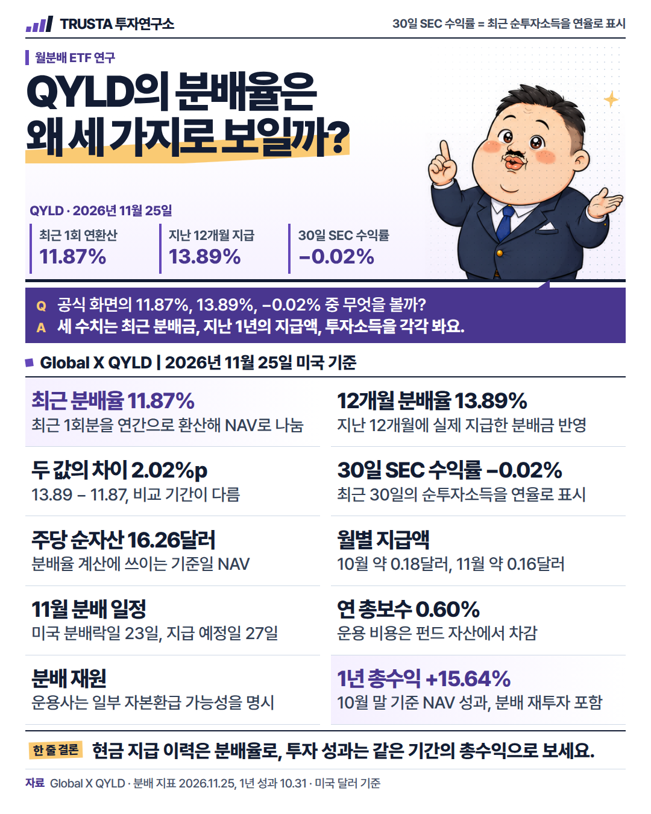
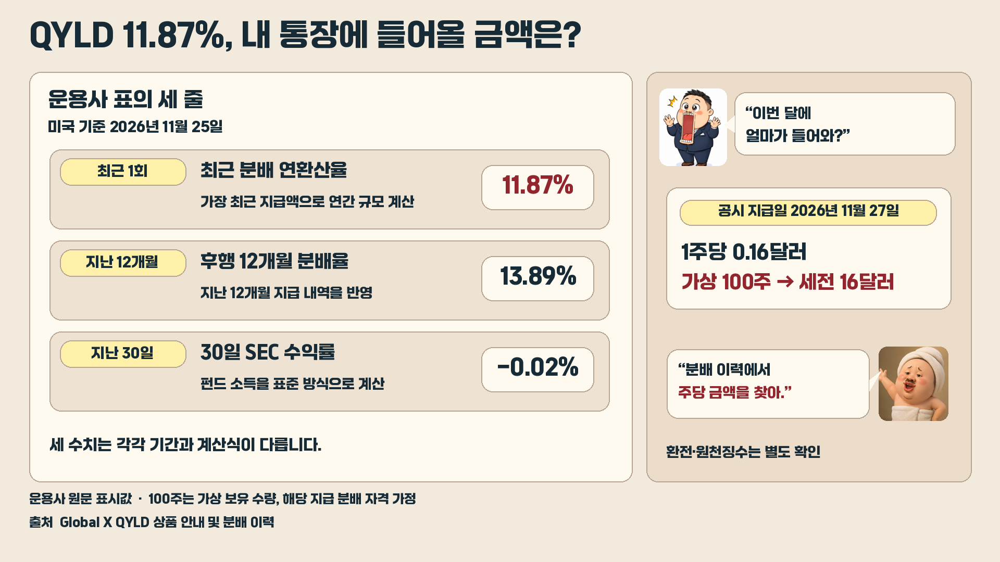

# 은퇴 생활비로 QYLD를 본다면, 분배율 11.87%를 월급처럼 써도 될까?

## 1. 월요일에 적어 둔 메모

가상 인물 천억이는 관리비가 나갈 때마다 달러 분배금으로 생활비를 보태는 그림을 그립니다. 휴대전화에는 QYLD 옆에 퍼센트 숫자가 하나 적혀 있습니다. 수건 친구가 메모에는 없는 두 가지를 묻습니다. 어느 날 화면을 봤는지, 그 숫자 위에 무슨 제목이 있었는지입니다.

## 2. 돈이 필요한 날부터

생활비 달력에는 입금일과 원화로 쓸 금액을 적습니다. 운용사가 표시하는 분배율은 일정 규칙으로 만든 비율입니다. 최근 한 번 지급한 금액을 연간 규모로 늘린 숫자를 월별 확정 입금액으로 옮겨 적으면 지급액과 지급일이 바뀔 때 장부가 틀어집니다.

## 3. 공식 표 세 줄 읽기

공식 운용사 페이지의 미국 기준 **2026년 11월 25일** 표에서 최근 분배 연환산율은 **11.87%**, 후행 12개월 분배율은 **13.89%**, 30일 SEC 수익률은 **−0.02%**입니다. 운용사 표의 총보수는 연 0.60%입니다. 기획 메모의 13.95%는 같은 방식으로 과거 표 전체를 다시 확인하지 못해 실제 역사값으로 채택하지 않습니다.

최근 분배 연환산율은 최근 지급을 연간 규모로 바꿔 보는 지표입니다. 후행 비율은 지난 12개월 분배를 반영하고 운용사가 정한 분모를 씁니다. 30일 SEC 수익률은 표준 방식에 따른 소득 지표입니다. 세 수치의 관측 기간과 산식이 다르므로 평균을 내도 내년 지급액은 되지 않습니다.

*11월 25일 QYLD의 11.87%, 13.89%, −0.02%는 관측 기간과 산식이 다른 세 지표다.*

## 4. 1만 달러에 곱해 본 숫자

가상 원금 1만 달러를 같은 달러 기준으로 두고 11.87%를 1회 곱하면 **1,187달러**입니다. 세전으로 단순 연간 규모만 환산했으며 거래·환전 비용과 재투자는 없습니다. 주가 변화와 실제 보유기간 수익률도 가정하지 않습니다. 두 분배 지표의 단순 차이 2.02%포인트는 수수료나 투자 손익을 뜻하지 않습니다.

## 5. 계좌에서 찾은 다른 숫자

운용사 표에서 2026년 11월 27일 지급분으로 표시된 금액은 **1주당 0.16달러**입니다. 해당 지급의 수령 자격을 갖춘 가상 100주라면 그 한 번의 세전 현금은 16달러입니다. 여기에는 개인 원천징수·환전 비용이 반영되지 않았습니다. 보유 수량과 주당 지급액으로 구한 숫자와 1만 달러에 연환산율을 곱한 숫자는 서로 다른 장부에 씁니다.

*운용사 수치의 기준일은 2026년 11월 25일. 2026년 11월 27일 지급분을 가상 100주에 적용하면 세전 16달러다.*

## 6. 판단이 바뀌는 두 조건

주당 지급액이 같고 분모로 쓰는 순자산가치만 낮아지면 표시 비율이 높아질 수 있습니다. 반대로 다음 지급액이 가상 0.12달러라면 100주에서 받는 세전 현금은 12달러로, 앞의 16달러보다 4달러 적습니다. 실제 QYLD의 다음 분배를 가정한 값으로 사용하지 않습니다. 운용사는 분배금에 원금 성격의 환급이 포함될 수 있다고도 설명합니다.

## 7. 지출일로 돌아가기

천억이는 연환산 숫자 옆에 연간 규모라고 쓰고 생활비 표에는 주당 분배금과 지급일을 씁니다. 달러 지급액이 같아도 환전 뒤 원화 금액은 달라질 수 있습니다. 계좌 평가액이나 총수익도 별도로 확인하면 받은 현금만으로 내 자산의 성과를 판단하는 일을 줄일 수 있습니다.

## 8. 앱에서 확인할 한 가지

운용사 페이지의 **분배 이력에서 주당 금액·지급일 한 줄**을 적고 계좌에서 실제 세후로 입금된 날짜와 금액을 대조합니다. 수건 친구는 마지막으로 다음 고지서 날짜를 표시합니다.

**편집부 Q&A · 30일 SEC 수익률이 음수면 이번 달 분배가 없나요?**  
표준화된 소득 지표와 해당 지급의 금액은 따로 확인합니다. 운용사의 분배 이력과 지급 안내가 이 질문에 직접 답합니다.

**원문**　[Global X QYLD 지표·산식](https://www.globalxetfs.com/funds/qyld) · [미 SEC 펀드 분배금 안내](https://www.investor.gov/introduction-investing/general-resources/news-alerts/alerts-bulletins/investor-bulletins/fund-distributions-investor-bulletin)

**이어 읽기**　[JEPI·JEPQ·SPYI·QQQI, 월분배 ETF 네 개를 같은 표에 놓는 순서](EP045.md) · [분배락 뒤 당일 손실과 실제 입금, 지급 전에는 어디에 적을까?](FAQ03.md) · [전자책 목차](목차.md)
