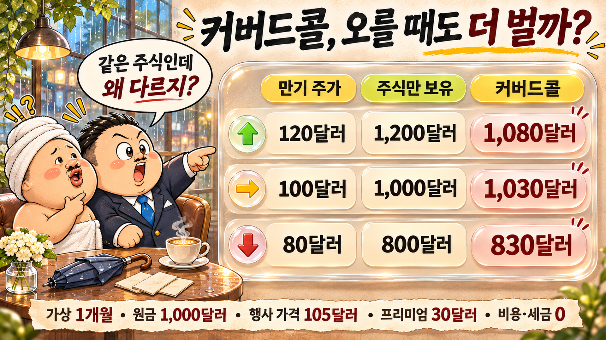

# 커버드콜, 하락장에서 덜 잃었는데 반등 뒤에는 얼마가 남았을까?

*등장인물의 대화와 Q&A는 편집부가 만든 질문입니다.*

수진이 우산을 접고 카페에 들어옵니다. 휴대전화에는 주가가 많이 오른 날이라는 알림과, 매달 분배를 목표로 한다는 ETF 소개가 나란히 떠 있어요. 수진은 두 화면을 천억이에게 보여 줍니다. 같은 주식을 담고 있다면, 주식이 오른 만큼 벌고 옵션으로 받은 돈도 그대로 더 받는 것 아닐까요? 천억이는 젖은 우산을 문 옆에 세워 놓고 종이 냅킨을 세 장 가져옵니다. 오늘은 상승한 날만 보지 말고, 오르거나 그대로거나 떨어졌을 때 최종 통장에 남는 돈을 각각 계산해 보자고 합니다.

## 같은 1,000달러로 한 달 비교

먼저 만기 한 달인 가상의 계약입니다. 시작일에 두 계좌 모두 미국 달러 천 달러로 한 주에 백 달러인 주식 열 주를 삽니다. 추가 납입이나 인출은 없고, 달러 환전과 거래 비용, 세금은 생략합니다. 배당이나 펀드 분배는 없고, 옵션 거래로 받은 현금은 만기까지 그대로 둡니다. 연율로 바꾸지 않고 한 달 뒤의 금액만 봅니다. 첫 계좌에는 주식만 있어요. 두 번째 계좌는 가진 열 주 전부에 대해 한 주당 백오 달러에 살 수 있는 콜옵션을 팔고, 한 주당 삼 달러를 받습니다. 실제 상품의 계약 단위와 다른 교육용 가정이고, 계산을 쉽게 하려고 만기에 주식을 넘기는 계약으로 놓을게요.

콜옵션을 산 사람은 약속한 가격으로 주식을 살 권리를 가집니다. 권리를 얻는 대가가 프리미엄이고, 우리 사례에서는 콜옵션을 판 계좌가 삼십 달러를 받습니다. 그쪽은 반대편이 권리를 행사할 때 약속한 가격으로 주식을 넘길 의무를 집니다. 주식을 가진 상태에서 그 주식의 상승에 대한 권리를 팔기 때문에 여기서는 커버드콜이라고 부릅니다. 이미 주식을 갖고 있다는 말은 넘겨줄 주식이 준비됐다는 뜻입니다. 그 주식의 가격이 내려가지 않는다는 약속은 없어요.

첫 냅킨에는 주가가 백이십 달러가 된 날을 씁니다. 주식만 가진 쪽은 열 주가 천이백 달러입니다. 콜을 판 쪽은 만기에 한 주당 백오 달러로 열 주를 넘겨 천오십 달러를 받았고, 처음 받은 삼십 달러와 더해 천팔십 달러가 남아요. 처음의 천 달러와 비교하면 두 계좌 모두 이익이 났습니다. 주식 쪽은 이백 달러를 벌었고 커버드콜 쪽은 팔십 달러를 벌었어요. 수진이 화면을 보고 마음속으로 더했던 삼십 달러는 실제 받은 돈입니다. 동시에 백오 달러 위의 상승분을 넘겨준 결과도 실제 계산에 들어갑니다.

두 번째 냅킨에는 주가가 백 달러인 만기를 써 봅니다. 반대편이 시장에서 백 달러에 살 수 있는 주식을 백오 달러에 사는 일은 이 가정에서 일어나지 않습니다. 첫 계좌에는 천 달러의 주식이 있고, 두 번째 계좌에는 똑같은 주식과 삼십 달러 현금이 있습니다. 이때는 커버드콜 쪽이 삼십 달러 앞서요. 시장이 한달 동안 고요했다고 가정할 필요도 없습니다. 이 한 번의 계약을 그대로 만기까지 갖고 가고 중간에 거래가 없었다면, 여기서는 마지막 가격이 백 달러라는 조건으로 만기 손익을 구할 수 있습니다.

마지막 냅킨에는 팔십 달러를 적습니다. 콜옵션을 판 쪽도 한 주 가격이 내려가는 동안 열 주의 주식을 그대로 갖고 있었어요. 주식 계좌는 팔백 달러가 남습니다. 커버드콜 계좌는 팔백 달러의 주식에 삼십 달러를 더해 팔백삼십 달러입니다. 주식만 샀을 때보다 삼십 달러 손실을 줄였지만, 처음의 천 달러보다 백칠십 달러 부족합니다. 밖에서 비가 내리기 시작하자 수진은 자기 우산을 가리킵니다. 삼십 달러는 작은 비를 조금 막아 주지만, 바닥에 물이 들어차면 신발까지 지켜 주는 장치는 아니네요.

*동일 원금 1,000달러, 가상 1개월. 만기 주가 120·100·80달러에서의 최종 금액.*

**그림 Q&A · 편집부가 만든 질문**  주가가 80달러로 떨어지면 프리미엄을 받아도 왜 원금을 잃나요? 주식 평가액이 800달러로 내려가고 프리미엄 30달러를 합쳐도 830달러이기 때문입니다.

| 가상 만기 주가 | 주식만 보유 | 주식 + 콜 매도 |
|---|---:|---:|
| 120달러 | 1,200달러 | 1,080달러 |
| 100달러 | 1,000달러 | 1,030달러 |
| 80달러 | 800달러 | 830달러 |

*동일 원금 1,000달러, 동일 1개월. 콜 행사 가격 105달러, 옵션 프리미엄 30달러, 배당·세금·비용 없음.*

## 손익분기점 97달러와 두 계좌가 같아지는 108달러

수진은 비가 그치는 동안 냅킨 세 장 사이에 들어갈 가격을 찾습니다. 주가가 구십칠 달러라면 어떻게 될까요? 열 주가 구백칠십 달러이고, 받은 삼십 달러를 더하면 정확히 천 달러입니다. 주식만 산 경우에는 삼십 달러 손실을 봤을 자리에 커버드콜은 원금이 남았습니다. 여기서는 만기에 한 주당 구십칠 달러가 손익분기점이에요. 장중에 주가가 여기 닿았다고 손익이 곧바로 영이 되는 것은 아닙니다. 그때는 만기가 남아 있고, 이미 판 옵션을 다시 사서 정리하려면 돈이 들 수 있습니다.

두 계좌가 나란히 같은 금액을 남기는 주가도 찾아봅시다. 주가가 백오 달러를 넘으면 커버드콜의 만기 금액은 천팔십 달러에서 멈춥니다. 주식만 있는 계좌는 주가가 백팔 달러가 될 때 열 주 가치가 천팔십 달러에 닿아요. 백육 달러에서 끝나면 주식 계좌는 천육십 달러, 커버드콜은 천팔십 달러입니다. 주가가 행사 가격을 넘기자마자 주식 계좌가 앞서지는 않아요. 처음에 받은 프리미엄 삼십 달러가 있기 때문입니다. 수진이 서로 섞었던 숫자 셋을 이제 각각 적습니다. 구십칠 달러는 커버드콜이 원금과 만나는 가격, 백오 달러는 계약의 행사 가격, 백팔 달러는 두 계좌의 금액이 같아지는 가격입니다.

만기가 되기 전에 팔아야 한다면 어떻게 될까요? 수진은 갑자기 노트북 수리비를 내야 한다고 가정합니다. 같은 열 주가 중간에 천백 달러에 평가되는 날, 먼저 받은 삼십 달러는 그대로 있지만 옵션을 닫으려면 육십 달러를 내야 한다고 놓습니다. 주식과 옵션을 같은 날 모두 닫으면 천칠십 달러가 남아요. 주식 평가액에 받은 돈만 더하면 천백삼십 달러라고 잘못 계산하게 됩니다. 이 새로운 육십 달러는 시장에서 관측한 옵션 가격이 아니라, 중도 청산에 들어가는 돈을 보여 주려고 넣은 가정입니다. 감당 가능한 손익을 볼 때 만기 그림과 내 실제 매도 가능 시점을 구별합니다.

## 옵션을 절반만 팔면 달라지는 것

두 계좌에 비슷한 이름이 붙어 있어도 옵션을 파는 범위가 다르면 반응도 달라질 수 있습니다. 아까와 같은 주식 열 주를 산 뒤 이번에는 다섯 주에 대해서만 콜을 팔아 한 주당 삼 달러씩 십오 달러를 받는다고 칩시다. 만기 주가가 백이십 달러면 계약을 건 다섯 주는 백오 달러씩 오백이십오 달러, 나머지 다섯 주는 백이십 달러씩 육백 달러입니다. 십오 달러 현금을 더하면 천백사십 달러예요. 같은 조건에서 주식만 산 천이백 달러와 열 주에 대해 전부 판 천팔십 달러의 중간입니다. 반대로 팔십 달러에 끝났다면 주식 팔백 달러와 현금 십오 달러가 남아요. 옵션을 덜 판 만큼 상승에 참여하는 주식이 많았고, 하락을 줄여 줄 프리미엄은 작았습니다.

운용사 문서에서 볼 숫자가 이제 하나 생겼습니다. 주식의 몇 퍼센트에 대해 옵션을 쓰는가입니다. 글로벌 엑스는 큐와이엘지 설명에서 포트폴리오 가치의 약 절반을 대상으로 콜옵션을 매도한다고 안내합니다. 같은 운용사의 큐와이엘디 설명에는 나스닥 백 지수 구성 주식을 보유하며 그 지수의 콜옵션을 매도한다는 내용이 있어요. 두 설명을 여기에 가져온 이유는 실제 상품의 옵션 대상과 범위를 어디서 읽는지 보여 주기 위해서입니다. 방금 다섯 주나 열 주를 판 계산은 두 상품의 실측 수익률이 아닙니다. 지수 옵션을 쓰는 ETF에서는 우리 냅킨처럼 주식을 다섯 주씩 건네는 계약을 가정할 필요가 없고, 구체적인 정산과 교체 규칙은 그 상품의 설명서와 지수 방법론에서 확인합니다.

## 실측 지수 비교 · 2022~2023년

이제 수진은 가상 냅킨 대신 거래소가 공개한 지난 성적표를 꺼냅니다. 씨보의 에스앤피 오백 바이 라이트 지수와 에스앤피 오백 총수익 지수입니다. 둘 다 동일한 미국 대형주 시장을 바탕으로 삼고, 하나에는 지수 콜을 파는 규칙이 들어 있습니다. 여기서는 두 지수의 차이를 보려고 이 대상을 골랐습니다. 실측 구간으로는 에스앤피 오백 총수익이 마이너스였던 이천이십이 년과 반등한 바로 다음 해를 택했습니다. 앞뒤가 이어지는 두 해를 같이 두면 손실을 줄이는 모습과 반등을 따라가는 모습이 한 장부 안에 담깁니다. 둘 중 한 해만 보여 주면 비교 결과도 달라집니다.

이 수치는 세전 달러 총수익 지수입니다. 배당 등을 포함하는 지수 성과에 다시 배당을 더하지 않습니다. 실제로 지수를 매수한 내역은 없으므로 증권사 수수료, 펀드 보수, 개인 세금은 반영하지 않아요. 처음 원금은 각각 백만 원, 중간 납입과 인출은 없다고 놓습니다. 지수 수익 관측 구간은 이천이십일 년 말부터 이천이십삼 년 말까지이고, 중간 지점은 이천이십이 년 말입니다. 원화 표시를 위해 미국 연준이 발표하는 달러당 원화 시계열을 사용합니다. 시작일인 이천이십일 년의 마지막 날에는 환율 관측값이 비어 있어서 십이월 서른 날 관측값인 달러당 천백팔십팔 원 오십구 전을 썼습니다. 중간값은 이천이십이 년 십이월 삼십 일의 천이백육십 원 십팔 전, 종료값은 이천이십삼 년 십이월 이십구 일의 천이백구십 원 구십칠 전입니다. 관측 환율로 환산한 값이며 거래 계좌의 실제 환전 단가와는 차이가 있을 수 있습니다.

이천이십이 년 달러 기준으로 바이 라이트는 십일 점 사 퍼센트 내렸고, 에스앤피 오백 총수익은 십팔 점 일 퍼센트 내렸습니다. 원화로 환산하면 백만 원은 각각 약 구십삼만 구천삼백육십오 원과 팔십육만 팔천삼백이십구 원이 됩니다. 둘 다 원금 아래였고, 이 해만 보면 옵션을 판 쪽의 손실 폭이 작았습니다. 여기까지 보고 다음 해도 무조건 앞서겠다고 생각하기 쉽습니다. 수진은 계산기를 덮지 않고 두 번째 칸을 엽니다.

그 다음 해 달러 지수 성과는 바이 라이트가 십일 점 팔 퍼센트, 에스앤피 오백 총수익이 이십육 점 삼 퍼센트였습니다. 이 비율은 먼저 줄어든 달러 금액에 곱합니다. 두 해 연속의 달러 수익률을 단순히 더하면 원래 금액에 다시 손실과 이익을 모두 매긴 셈이 돼요. 마지막에 종료 환율을 적용하면 바이 라이트 쪽은 약 백칠만 오천팔백칠십 원, 에스앤피 오백 총수익 쪽은 약 백십이만 삼천사백구십오 원입니다. 종료 시점 차이는 약 사만 칠천육백이십오 원입니다. 발표된 연 수익률이 소수점 첫째 자리까지 반올림되어 있으니, 원 단위 계산도 그 입력값으로 낸 근삿값입니다.

| 세전 총수익 지수 | 2022년 달러 수익률 | 2022년 말 원화 환산 | 2023년 달러 수익률 | 2023년 말 원화 환산 |
|---|---:|---:|---:|---:|
| Cboe S&P 500 BuyWrite | −11.4% | 939,365원 | +11.8% | 1,075,870원 |
| S&P 500 Total Return | −18.1% | 868,329원 | +26.3% | 1,123,495원 |

*시작 원금 각각 100만 원. 중간 입출금 없음. 공개 연 수익률과 관측 환율로 계산한 근삿값이며 ETF 실거래 비용과 개인 세금은 제외했습니다.*

원화 잔액을 어떻게 만들었는지도 짚고 갈게요. 원화 백만 원을 시작 환율로 나눠 달러 원금을 구합니다. 여기에 매해의 총수익 배율을 차례로 곱하고, 마지막에 그날의 원 달러 환율을 곱합니다. 달러만 비교하고 싶다면 처음과 끝의 환율이 같다고 놓으면 됩니다. 같은 백만 원의 기말 환산값은 그 조건에서 바이 라이트가 구십구만 오백사십팔 원, 에스앤피 오백 총수익이 백삼만 사천삼백구십칠 원입니다. 환율을 실측대로 넣었을 때는 양쪽 원화 금액이 이보다 높아요. 그래도 두 전략 사이의 순서는 같았습니다. 양쪽 달러 성과에 똑같은 양의 환율 배율이 곱해졌기 때문입니다.

마지막 숫자가 더 컸던 에스앤피 오백 쪽이 그 두 해 동안 하루도 더 크게 떨어지지 않았다는 뜻은 아닙니다. 연말 수치만으로는 그 사이 가장 높았던 날에서 얼마나 깊게 하락했는지 계산할 수 없어요. 씨보 자료에는 별도로 훨씬 긴 기간 동안의 월말 값으로 구한 최대낙폭 통계가 있습니다. 그것을 이 두 해의 일별 최대낙폭으로 가져와 적지 않습니다. 생활비를 중간에 꺼낼 계획이라면 실제 인출일의 조건으로 다시 장부를 만들어야 합니다. 연말 실적표만으로 어느 날 얼마를 쓸 수 있었는지까지는 답할 수 없습니다.

## 같은 가격에서 끝나도 달라지는 두 달의 수익

수진이 냅킨을 다시 꺼냅니다. 한 번의 계약과 달리, 매달 새 옵션을 판다면 시장이 같은 곳에서 끝나도 결과가 달라질까요? 두 달짜리 가상 실험으로 답을 볼게요. 두 계좌 모두 첫날 백 달러의 주식 한 단위를 사고 중간에 새 돈을 넣거나 빼지 않습니다. 첫 계좌는 두 달 동안 주식만 보유합니다. 두 번째는 각 달 첫날의 주식 가격을 그달 옵션의 행사 가격으로 정하고, 한번 팔 때마다 삼 달러를 받는다고 가정합니다. 배당, 펀드 분배, 보수, 수수료, 세금, 환전은 없고 프리미엄은 재투자하지 않습니다. 주식은 계속 들고 있되 옵션으로 갚아야 할 차액만 만기에 현금으로 정산합니다. 기말에는 보유 주식에서 옵션 정산 의무를 뺀 순가치를 계산합니다.

첫 경로에서는 첫 달이 끝났을 때 주식이 팔십 달러, 두 번째 달 끝에는 백 달러로 돌아옵니다. 최초에 판 콜의 행사 가격은 백 달러였으니, 첫달 말에 지불할 차액은 영입니다. 둘째 달에는 팔십 달러를 행사 가격으로 다시 콜을 팔아요. 주식 가격이 백 달러가 됐을 때 행사 가격을 넘어선 이십 달러를 갚습니다. 두 달 받은 프리미엄은 총 육 달러이므로 이 계약들에서 생긴 손익은 마이너스 십사 달러입니다. 주식이 원래 가격인 백 달러로 돌아와도 둘을 합친 순가치는 팔십육 달러입니다. 비교를 위해 실제 계좌처럼 정산을 처리하려면 부족한 현금을 마련해야 하므로, 이 경로의 팔십육 달러는 정산할 금액까지 반영한 순가치입니다. 차액을 감당할 별도 현금이 없다면 만기에 주식 일부를 처분해야 할 수 있어요.

두 번째 경로에서는 두 달 다 월말 가격이 백 달러입니다. 각각 행사 가격도 백 달러였고 갚을 차액이 없어요. 주식 한 단위와 두 번 받은 육 달러를 합쳐 백육 달러가 됩니다. 주식만 들고 있던 계좌는 두 경로 모두 끝에서 백 달러입니다. 커버드콜 계좌는 같은 곳에서 시작해 같은 곳에서 끝났어도 둘째 달에 어느 가격에서 옵션을 팔았는지에 따라 이십 달러가 달라졌습니다. 수진은 마지막 가격만 적어 둔 냅킨의 빈칸에 중간 날짜를 추가합니다. 앞서 한 계약을 만기까지 둔 사례에서 끝값을 비교한 것과, 매달 계약을 새로 잡는 전략을 비교하는 것은 이렇게 다릅니다.

## 행사 가격과 비용을 바꿔 본 계산

행사 가격을 한 번 바꿔 보겠습니다. 최초의 열 주 예시에서 한 주당 백오 달러 대신 백십 달러를 받기로 하면 위쪽 상승을 더 많이 남길 수 있어요. 그 대신 같은 만기와 같은 주식인데 행사 가격만 올리면 원래 받았던 삼 달러를 그대로 받는다는 전제는 다시 확인해야 합니다. 예를 들어 백십 달러 계약의 프리미엄이 한 주당 일 달러라고 가정하면, 주가가 백이십 달러인 만기에는 천백 달러에 십 달러를 더한 천백십 달러가 남습니다. 백오 달러 계약보다는 삼십 달러 더 많습니다. 하지만 주식이 팔십 달러에서 끝나면 팔백십 달러로, 낮은 행사 가격에서 삼십 달러를 받았던 계좌보다 이십 달러 적습니다. 어떤 조건을 골라도 매번 유리하다면 이렇게 한쪽에서 비교 결과가 바뀔 일이 없겠죠.

여기에 실제로 지불하는 비용이 붙는 경우도 볼게요. 주식 열 주와 콜 옵션을 비교하는 첫 달력으로 돌아가서 옵션 매도와 정산에 합계 십이 달러의 추가 비용이 든다고 가정합니다. 두 계좌가 같이 부담하는 주식 거래비용은 여기서는 영입니다. 세금과 환율, 배당 조건도 처음과 같습니다. 주식이 백 달러에서 끝나면 그 달의 옵션을 판 효과는 삼십 달러에서 십이 달러를 뺀 십팔 달러가 됩니다. 주가가 구십칠 달러일 때 전에 원금이 남았던 커버드콜 계좌는 이제 구백팔십팔 달러예요. 새 손익분기점은 한 주당 구십팔 달러 이십 센트입니다. 손에 들어온 삼십 달러를 그대로 이익으로 적으면 새 분기점도 잘못 읽습니다. 펀드 투자자라면 기초 전략의 거래비용과 본인이 주문할 때 내는 비용이 무엇인지 자료에서 따로 확인합니다.

수진은 두 번째 달에 정산 비용을 지불할 생각으로 따로 현금을 마련해 둘 경우와, 매번 프리미엄을 꺼내 쓰는 경우를 비교합니다. 방금 두 경로의 둘째 달에서 삼 달러를 받았다고 계좌 밖으로 빼 버리면 이후에 정산할 때 그 삼 달러는 남아 있지 않아요. 이미 쓴 현금까지 합쳐서 투자 성과를 계산하는 것과, 오늘 당장 정산 가능한 현금을 세는 것은 별개의 질문입니다. 실제 펀드에서 분배가 이뤄졌다면, 운용 손익은 투자설명서와 결산 자료에서 보고 투자자 계좌의 현금은 지급 내역에서 봅니다. 월마다 받은 현금을 전부 재투자할 생각이라면, 성과를 비교할 때도 재투자 조건이 같은 자료를 찾아야 합니다.

하락장에서는 왜 풋옵션을 샀을 때처럼 보호되지 않는지도 확인해 봅니다. 앞의 열 주 가정에서 주가가 이십 달러로 끝났다고 합시다. 커버드콜의 최종 지분 가치는 이백 달러이고 현금은 삼십 달러입니다. 결과는 이백삼십 달러예요. 만기 때 콜을 산 사람이 가진 권리는 백오 달러에 살 권리이니, 주가가 이십 달러가 됐다고 그 사람에게 백오 달러로 사 달라고 요구할 수는 없습니다. 팔 권리를 사는 풋옵션에는 다른 계약 조건과 지불할 값이 따릅니다. 커버드콜이라는 이름에 무언가 덮어 주는 상품이라는 인상을 받았다면, 실제로 가진 권리와 상대에게 넘긴 권리를 문장으로 써 보면 구별됩니다. 콜을 팔아서 받은 대가가 얼마든 하락할 때 주식을 정해 둔 가격에 팔 권리는 이 계약에 들어 있지 않습니다.

수진은 두 상품이 화면에 나란히 나오면 연말의 기준가격 변동부터 그대로 옮기던 습관도 바꿉니다. 가상으로 한 상품의 기준가격은 백 달러에서 구십오 달러가 되었고 일 년 사이 한 주당 십 달러를 현금으로 지급했다고 합시다. 다른 상품은 백 달러에서 백이 달러로 바뀌고 지급이 없어요. 처음에 같은 달러로 한 주씩 사서 마지막까지 보유하고, 받은 돈은 그대로 보관하며 세금과 비용과 환전을 생략합니다. 첫 상품의 가격만 보면 오 퍼센트 손실인데, 현금을 합산하면 백오 달러입니다. 둘째는 백이 달러예요. 이 조건에서는 현금의 재투자가 없으므로 공식 총수익률에서 재투자를 가정했다면 그 값과 같다고 쓰지 않습니다. 먼저 비교 조건을 맞추면 어떤 숫자를 장부에 옮겨야 할지 알 수 있습니다.

## 투자설명서에서 직접 찾을 세 가지

거래소 표를 보고 자기 돈으로 계산할 때 수진이 실제로 할 일을 정합니다. 관심 있는 상품 한 개의 공식 설명서를 열고, 옵션을 파는 대상, 비중, 만기나 교체 주기를 찾습니다. 그다음 같은 기초자산을 담는 옵션 없는 상품의 공식 자료도 같이 열어 봅니다. 같은 날짜 두 개를 표시하고, 둘 다 분배금을 포함한 성과를 냈는지 확인해요. 하나가 기준가격, 다른 하나가 장내 거래가격이면 같은 항목으로 다시 고릅니다. 환전이나 중도 인출을 한 경우는 자기 날짜와 체결 내역을 옆에 적습니다. 이 짧은 기록만 있어도 비교표의 숫자에서 어떤 차이가 전략 때문에 생겼는지, 어떤 차이가 비교 조건 때문에 생겼는지 따져 볼 수 있습니다.

비가 그쳤습니다. 수진은 카페 문 옆에 두었던 우산을 다시 집어 듭니다. 휴대전화에 뜬 분배 안내는 저장하되, 옆에 질문 하나를 덧붙여요. 같은 주식이 크게 올랐다가 내렸을 때, 또는 떨어졌다 돌아왔을 때, 나는 어떻게 움직이는 상품을 가진 걸까? 다음에 분배 숫자로 상품을 고르고 싶어질 때는 수진처럼 각 상품 설명서에서 옵션을 얼마나 쓰는지 먼저 표시해 보세요. 오늘 적어 두었던 세 장의 냅킨을 펼치면, 어떤 조건에서 받은 현금의 가치가 달라지는지 다시 계산할 수 있습니다.

## 편집부 Q&A

**2022년에 손실이 작았던 전략이 왜 2년 뒤에는 뒤졌나요?** 2023년 달러 지수 수익률 차이가 14.5%포인트였습니다. 감소한 원금에 다음 해의 수익률을 각각 곱하자 2022년 말 앞서던 BuyWrite가 2023년 말에는 뒤졌습니다. 두 전략에 같은 환율을 적용했습니다.

## 근거 원문

자료 확인일 2026년 11월 27일. Cboe 비교표는 2026년 3월 31일자이며 본문 비교 구간은 2022~2023년입니다. 시작 환율은 2021년 12월 31일 관측치가 없어 12월 30일 자료를 사용했습니다.

- [Cboe BXM 공식 자료와 연간 총수익 비교표](https://cdn.cboe.com/resources/indices/factsheet/CboeGlobalIndices_BXM-Index.pdf)
- [연준 H.10 원/달러 환율 시계열](https://fred.stlouisfed.org/series/DEXKOUS)
- [Global X QYLD 상품 자료](https://www.globalxetfs.com/funds/qyld)
- [Global X QYLG 상품 자료](https://www.globalxetfs.com/funds/qylg)

## 관련 장

- [ETF가 똑같이 100달러를 줬는데, 얼마를 벌었을까?](EP042.md)
