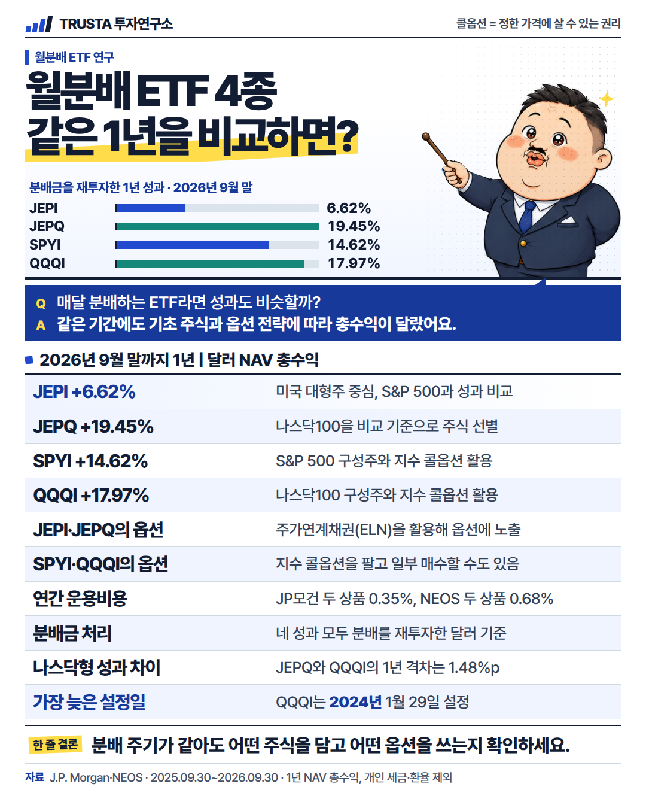
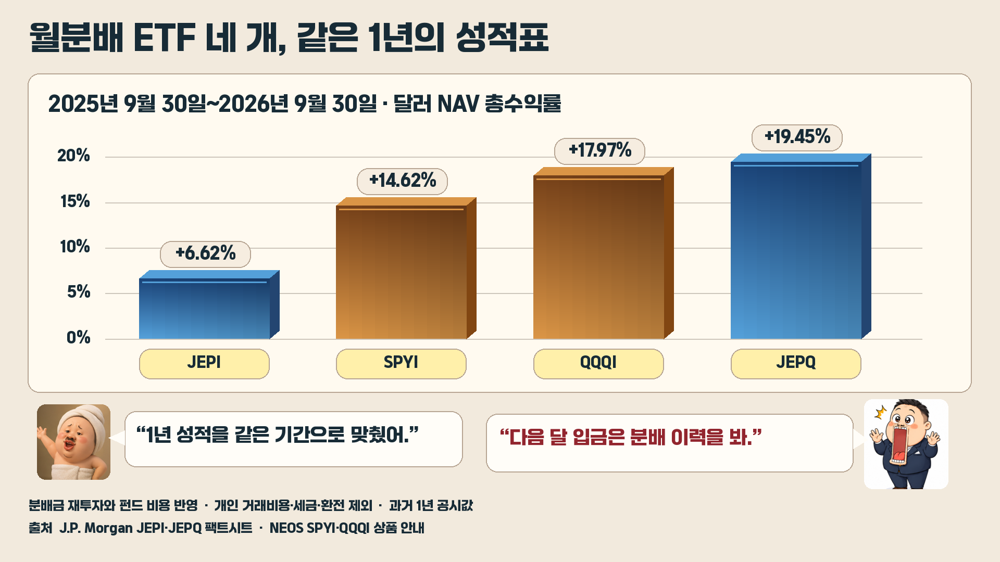

# 은퇴 통장에 월분배 ETF 하나를 넣는다면? JEPI·JEPQ·SPYI·QQQI 비교법

## 1. 한 달 입금 알림 네 장

은퇴한 가상 인물 천억이는 네 ETF의 최근 분배 알림을 모아 봅니다. 같은 달에 돈이 들어왔다면 가장 많이 준 것을 고르면 될까요? 수건 친구는 생활비 장부 아래에 ‘그 돈을 쓰고 남은 평가액’이라는 줄을 넣습니다. 입금과 남은 돈을 함께 보자 같은 순위표를 쓸 수 있는지부터 달라집니다.

## 2. 필요한 현금은 날짜가 정해져 있다

분배금은 월 생활비의 일부가 될 수 있습니다. 실제 달러 입금액, 지급일, 그날 원화로 환전한 금액을 구분합니다. 월분배 일정은 주당 지급액을 고정하는 약속과 다릅니다. 이달 받은 현금만 비교하려면 같은 양의 투자금이나 같은 보유 수량 가운데 어떤 기준을 쓸지도 먼저 정해야 합니다.

## 3. 네 티커 뒤에 있는 노출

JEPI와 JEPQ는 편입 주식군이 다르고 주가연계증권(ELN)을 통해 옵션 노출을 만들 수 있습니다. 공식 자료에서 ELN의 유동성과 거래상대 위험을 확인합니다. NEOS의 SPYI와 QQQI는 각각 S&P 500, Nasdaq-100과 관련된 주식과 지수 옵션을 활용합니다. 같은 쪽 시장을 보더라도 옵션을 쓰는 수단과 비중이 달라 상승에 얼마나 참여하는지, 하락을 어떻게 겪는지는 같지 않을 수 있습니다.

## 4. 분배금이 많았던 통장부터 열기

각각 가상 원금 1,000달러를 같은 날 투자해 1년 뒤 비교합니다. 현금은 쓰지 않고 따로 두며 재투자하지 않습니다. 개인 세금·거래비용·환전은 제외하고 원화 환산을 하지 않습니다.

A는 현금 100달러와 평가액 920달러를 남겨 합계 1,020달러입니다. B는 현금 60달러와 평가액 990달러를 남겨 합계 1,050달러입니다. 이 조건에서 A의 기간 손익률은 **+2%**, B는 **+5%**입니다. 이 비교의 현금 보유 방식과 아래 공시 총수익의 분배 재투자 방식은 다릅니다.

## 5. 실측을 같은 1년으로 맞추기

2025년 9월 30일부터 2026년 9월 30일까지의 달러 NAV 총수익률은 **JEPI 6.62%, JEPQ 19.45%, SPYI 14.62%, QQQI 17.97%**였습니다. 분배 재투자와 펀드 비용이 반영되어 있고 개인의 거래비용·세금·환전은 제외합니다. J.P. Morgan 팩트시트의 10월 말 성과와 9월 말 성과가 나란히 있는 부분에서 NEOS와 같은 9월 말 종료 1년 열을 골랐습니다. 이 네 수치는 인출을 가정하지 않은 공시 성과입니다.

같은 1,000달러를 1년 맡겼다고 단순 환산하면 각각 1,066.20달러, 1,194.50달러, 1,146.20달러, 1,179.70달러입니다. 같은 기준에서 가장 높았던 값과 가장 낮았던 값은 128.30달러 차이입니다. 이 수치는 공시 수익률을 가상 원금에 적용한 결과입니다.

*2026년 9월 말 종료 1년. 모두 분배 재투자 NAV 총수익 기준이다.*

*2025년 9월 30일~2026년 9월 30일 공시 성과. 분배금 재투자·펀드 비용 반영, 개인 거래비용·세금·환전 제외.*

## 6. 결론이 달라질 때

가상 A의 평가액이 960달러로 끝나고 현금 100달러가 같다면 합계 1,060달러로 B의 1,050달러보다 많아집니다. 현금이 더 많았던 상품도 가격 결과가 달라지면 순서가 달라질 수 있습니다. 또 실제로 받은 분배금을 매달 소비했다면 공시의 재투자 결과를 그대로 내 계좌에 대입하기 어렵습니다. 달러 성과가 좋아도 원화 평가에서는 환율 효과가 더해집니다.

## 7. 생활비 시점으로 다시 보기

가상 인물 두 사람은 최근 분배 이력의 지급일과 주당 금액을 먼저 모읍니다. 이어 같은 종료일과 통화의 NAV 총수익, 보수, 기간 중 얼마나 내렸는지를 봅니다. 중간 최대낙폭을 비교하려면 기간 중 시계열이 더 필요하므로 이 글의 1년 성과 네 값으로 추정하지 않습니다. 미국 세무 문서의 자본환급 추정과 내 투자 손익, 국내 과세 처리는 각각 다른 항목으로 확인합니다.

## 8. 오늘 확인할 한 줄

천억이는 네 상품의 입금 알림 대신 둘의 공식 설명서를 엽니다. **어떤 주식을 들고 있고 어떤 수단으로 옵션 노출을 만드는지** 먼저 적습니다. 다음으로 같은 기간의 공시 수익률과 내 생활비 날짜를 이 기록에 붙입니다.

**편집부 Q&A · 이 한 해에 가장 높았던 종목이 다음 달도 가장 많이 지급하나요?**  
1년 NAV 총수익에는 주가 변화와 분배 재투자가 담깁니다. 다음 지급액은 공식 분배 발표와 보유 수량으로 확인하는 별도의 질문입니다.

**원문**　[J.P. Morgan JEPI 팩트시트](https://am.jpmorgan.com/content/dam/jpm-am-aem/americas/us/en/literature/fact-sheet/etfs/fs-jepi.pdf) · [J.P. Morgan JEPQ 팩트시트](https://am.jpmorgan.com/content/dam/jpm-am-aem/americas/us/en/literature/fact-sheet/etfs/fs-jepq.pdf) · [NEOS SPYI 운용정책](https://neosfunds.com/spyi/) · [NEOS QQQI 운용정책](https://neosfunds.com/qqqi/) · [J.P. Morgan JEPI·분기 말 성과](https://am.jpmorgan.com/content/dam/jpm-am-aem/americas/us/en/literature/fact-sheet/etfs/FS-JEPI.pdf) · [J.P. Morgan JEPQ·분기 말 성과](https://am.jpmorgan.com/content/dam/jpm-am-aem/americas/us/en/literature/fact-sheet/etfs/FS-JEPQ.pdf)

**이어 읽기**　[월 100만 원 분배금을 받으려면 원금이 1억이면 될까?](EP046.md) · [분배락 뒤 당일 손실과 실제 입금, 지급 전에는 어디에 적을까?](FAQ03.md) · [전자책 목차](목차.md)
