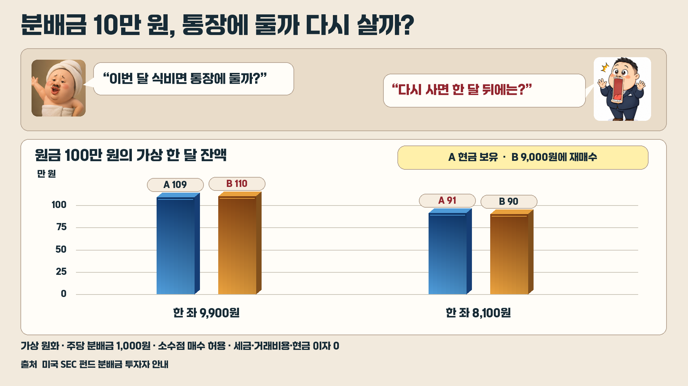
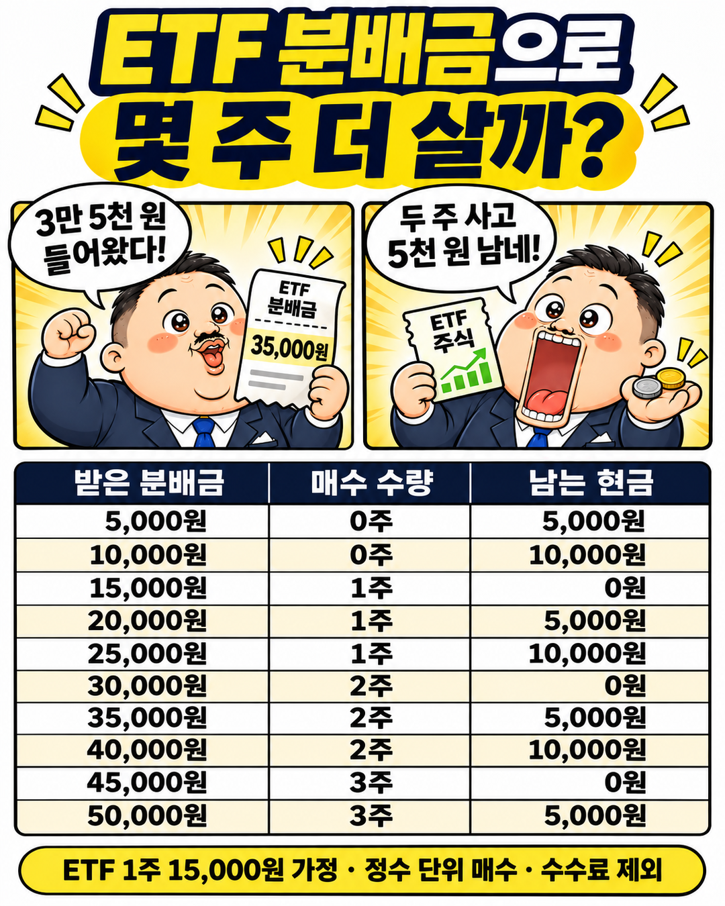

# 은퇴 통장에 들어온 분배금 10만 원, 다시 사면 한 달 뒤 얼마나 다를까?

## 1. 통장에 남길까, 한 주 더 살까

가상 인물 천억이는 월요일 아침에 분배금 10만 원이 들어온 것을 봅니다. 이번 달 식비로 남겨 둘 수 있고, 같은 ETF를 더 살 수도 있습니다. 앱에는 재투자 수익률이 보이지만 천억이의 장부에는 식비가 나가는 날짜도 있습니다. 수건 친구와 두 선택을 나눠 계산합니다.

## 2. 현금과 추가 좌수

분배금을 현금으로 두면 보유 좌수는 그대로입니다. 같은 ETF를 재매수하면 더 많은 좌수가 다음 가격 변동을 함께 겪습니다. 자동 재투자 기능이 있는 경우에도 어느 계좌에서 가능한지, 수수료·거래 시점과 소수점 매수 적용 방식을 직접 확인합니다.

## 3. 시작 돈과 분배 날짜를 맞추기

가상 원화 원금 100만 원, 한 좌 1만 원으로 100좌를 보유합니다. 주당 1,000원을 한 번 받아 총 10만 원이 들어옵니다. 현금 이율과 세금 및 거래비용은 0으로 두고, 그날 바로 9,000원에 소수점 좌수까지 살 수 있다고 가정합니다. 한 달 뒤 같은 시각에 두 경우를 평가하며 중간 지출은 없습니다.

## 4. 올랐을 때의 두 잔액

한 달 뒤 가격이 9,900원이면 현금 보유 쪽은 99만 원어치 ETF와 현금 10만 원을 합쳐 **109만 원**입니다. 재투자 쪽은 10만 원을 9,000원으로 나눈 만큼, 정확히 100/9좌를 더 삽니다. 총 100 + 100/9좌에 9,900원을 곱하면 **110만 원**입니다. 차이는 1만 원입니다. 계산 도중에는 추가 좌수를 반올림하지 않습니다.

## 5. 내렸을 때 1만 원의 방향이 바뀐다

한 달 뒤 가격이 8,100원이라면 현금 보유는 81만 원에 10만 원을 더해 **91만 원**, 재투자는 **90만 원**입니다. 추가 좌수가 많을수록 가격 상승에도 하락에도 더 노출됩니다. 반대로 평가가가 정확히 9,000원이면, 이 모형에서는 두 잔액이 모두 100만 원입니다.

*가상 원화 100만 원, 한 달 평가. 기준 재매수가 9,000원을 위아래로 벗어나면 1만 원 차이의 방향이 바뀐다.*

## 6. 온전한 한 좌만 살 수 있다면

주당 9,000원에 10만 원으로 정수 좌수만 매수하면 11좌를 사고 **1,000원**이 남습니다. 같은 9,900원에서 보유분 111좌의 109만 8,900원과 잔돈을 더한 총액은 **109만 9,900원**입니다. 실제 체결가가 더 높거나 세후 입금액이 줄어들면 사는 좌수도 바뀝니다.

*본문의 소수점 매수와 달리 한 주 단위로만 사면 35,000원에서 2주를 사고 5,000원이 남는다.*

## 7. 식비 봉투에 필요한 현금인가

천억이는 분배금이 들어오는 날과 식비를 낼 날을 나란히 적습니다. 재투자한 돈을 그 전에 다시 팔아야 한다면 별도의 거래와 출금 시점이 생깁니다. 현금으로 받았다가 며칠 뒤에 다시 샀다면, 실제 매수일과 체결가를 씁니다. 운용사 공시의 재투자 성과와 자신의 장부가 같다고 전제하기보다 실제로 늘어난 좌수를 확인합니다.

## 8. 월요일 앱에서 볼 한 줄

오늘 할 일은 **실제 세후 입금액을 실제 재매수 단가로 나누고 증권사에 표시된 추가 수량과 대조하는 것**입니다. 정수 매수라면 잔돈을 따로 기록합니다. 천억이는 그 아래에 이번 달에 이미 쓰기로 정한 현금이 있는지도 표시합니다.

**편집부 Q&A · 자동으로 다시 샀으면 세금도 없어지나요?**  
과세 계좌에서는 재투자해도 분배금 과세가 발생할 수 있습니다. 본인 상품과 계좌에 적용된 실제 명세를 확인합니다.

**원문**　[미 SEC 펀드 분배금 안내](https://www.investor.gov/introduction-investing/general-resources/news-alerts/alerts-bulletins/investor-bulletins/fund-distributions-investor-bulletin) · [Global X QYLD 지표·산식](https://www.globalxetfs.com/funds/qyld) · [미 SEC의 ETF 구조 안내](https://www.investor.gov/introduction-investing/investing-basics/investment-products/mutual-funds-and-exchange-traded-2)

**이어 읽기**　[ETF NAV가 줄었을 때, 분배락인지 손실인지 가르는 다섯 질문](EP049.md) · [분배락 뒤 당일 손실과 실제 입금, 지급 전에는 어디에 적을까?](FAQ03.md) · [전자책 목차](목차.md)
