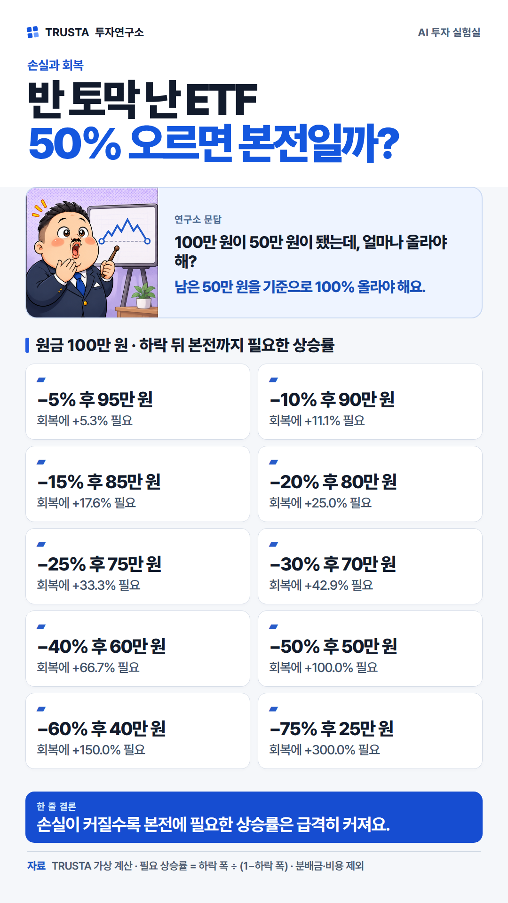
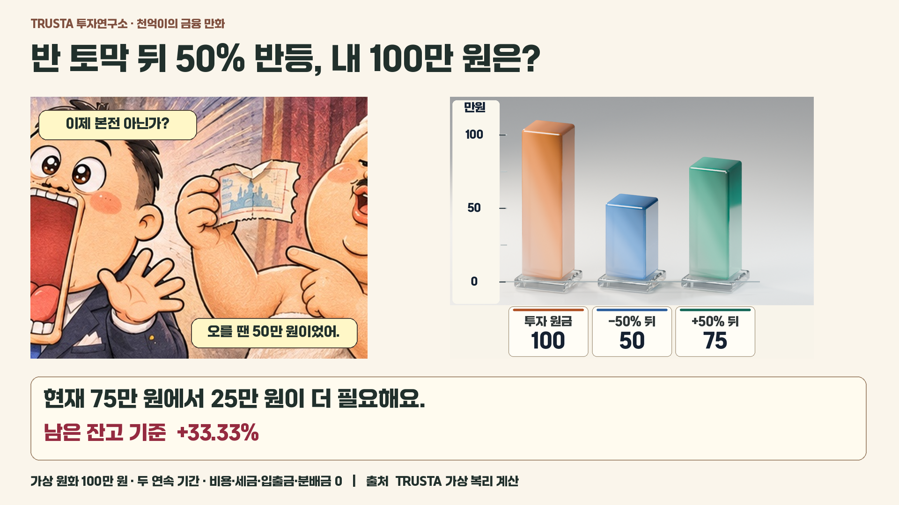

# 반 토막 난 ETF가 50% 올랐다면, 내 100만 원은 어디까지 돌아왔을까?

## 돌아온 줄 알고 취소한 알림

천억이는 증권 앱에서 플러스 오십 퍼센트를 확인하고 가격 알림을 지웁니다. “지난번에 오십 퍼센트 빠졌고 이번에 오십 퍼센트 올랐으니 이제 본전이겠네.” 수건 친구는 알림을 지운 손을 붙잡는 대신 처음 매수한 날의 영수증을 펼칩니다. 한쪽에는 백만 원, 다른 쪽에는 칠십오만 원. 오늘의 두 인물과 계좌는 설명을 위해 꾸몄습니다. 실측 사례는 마지막에 날짜를 달아 따로 살펴봅니다.

먼저 조건을 맞춥니다. 백만 원을 한 번 투자한 원화 모형이고, 수익률은 두 연속 기간의 수익률입니다. 그 사이에는 추가 입출금, 세금, 비용, 분배금 및 재투자가 없습니다. 첫 기간에 오십 퍼센트 잃고 둘째 기간에 오십 퍼센트 오르면, 첫날의 백만 원에 영 점 오를 곱한 다음 일 점 오를 곱합니다. 백만 원이 오십만 원을 거쳐 칠십오만 원이 되는 과정입니다. 손익을 계산하는 두 수치의 크기는 같고, 그 수치가 붙는 원금은 달랐습니다.

장부를 읽는 질문도 바뀝니다. 처음에는 “오늘 얼마나 올랐지?”였고 이제는 “지금 가진 돈에서 얼마나 더 올라야 본전이지?”입니다. 천억이는 처음에 부족한 이십오만 원이라고만 쓰고 펜을 내려놓습니다. 이십오만 원이 지금 잔고에서 몇 퍼센트인지까지 알아야 다음 알림의 기준을 바꿀 수 있어요.

## 같은 돈인데 왜 두 비율이 나올까

수건 친구는 영수증에 빈 줄을 하나 더 긋습니다. 지금 남아 있는 칠십오만 원에 더 필요한 이십오만 원을 나누면 삼분의 일입니다. 현재 잔고에서 약 삼십삼 점 삼삼 퍼센트 올라야 원래 백만 원에 닿습니다. 오십만 원으로 떨어진 직후였다면 오십만 원이 더 필요하므로 상승률은 백 퍼센트였습니다. 두 답은 모두 본전이라는 같은 목표를 향하지만 적용하는 시점이 다릅니다.

처음 금액을 백으로 놓고 쓰면 손실 후 남은 금액은 백에서 빠진 만큼을 뺀 값입니다. 회복에 필요한 변화율은 빠진 금액을 남은 금액으로 나눠 구합니다. 십 퍼센트가 빠지면 십을 구십으로 나눈 약 십일 점 일일 퍼센트. 이십 퍼센트가 빠지면 이십을 팔십으로 나눈 이십오 퍼센트. 칠십오 퍼센트까지 빠지면 남은 이십오에서 칠십오를 채워야 하니 삼백 퍼센트가 필요합니다. 손실률이 오십에서 칠십오로 이십오 퍼센트포인트 늘 때 회복 문턱은 백에서 삼백으로 뛰어요.

친구는 영수증 가장 아래에 영 원도 적어 봅니다. 기존 잔고가 영이면 유한한 상승률을 곱해서 원금이 생기지는 않습니다. 빈칸에 영 퍼센트라고 적는 순간 뜻이 달라져요. 나눌 잔고가 없으므로 그 계산에 적용할 숫자가 없습니다. 이 구간은 이해를 돕는 산술이고 실제 ETF가 어떤 조건에서 청산되거나 거래를 멈추는지는 상품별 공식 문서로 확인합니다.

## 회복과 입금이 같은 날에 일어났다면

천억이의 앱에 마침 백만 원이라는 숫자가 다시 뜹니다. 처음 수리표에 찍힌 가격과 같은 숫자예요. 하지만 계좌에 없던 이십오만 원을 현금으로 넣고, 투자 평가액은 칠십오만 원 그대로라는 조건을 붙이면 뜻이 달라집니다. 계좌 전체는 백만 원인데, 내 돈이 어디서 늘었는지 펼쳐 보면 기존 투자 칠십오만 원과 새 현금 이십오만 원입니다. 같은 잔고를 보고도 가격 회복 알림을 취소할 이유는 사라집니다.

반대로 처음 깊은 손실이 났던 오십만 원 시점에 이십오만 원을 추가해 전부 투자하고, 이후 같은 자산이 오십 퍼센트 올랐다고 합시다. 기말 계좌는 백십이만 오천 원이 됩니다. 첫 투자금 백만 원은 넘었지만 총 납입액은 백이십오만 원입니다. 여전히 납입액에 십이만 오천 원 모자라요. 둘째 기간에는 새로 들어온 돈도 함께 올랐습니다. 이 차이를 적어 두면 성과가 나던 시점과 내가 그 성과에 참여한 시점이 따로 보입니다.

## 전고점까지 832일 걸린 실제 장부

수건 친구가 증권 앱 대신 거래소 지수를 열었습니다. 미국 나스닥 종합의 일별 종가입니다. 이천이십일년 십일월 십구일에는 만 육천오십칠 점 사사. 이천이십이년 십이월 이십팔일에는 만 이백십삼 점 이구가 됐습니다. 앞선 종가에서 약 삼십육 점 사 퍼센트 내려왔습니다. 낮아진 값에서 처음 종가까지 올라가는 데 필요한 수익률은 약 오십칠 점 이이 퍼센트였습니다. 이 구간에서는 뉴스에서 말하는 하락률을 그대로 복구 목표로 쓰면 목표가 작아집니다.

그럼 처음 값에 실제로 다시 닿은 날은 언제였을까요? 일별 종가만 놓고 보면 이천이십사년 이월 이십구일입니다. 이때 종가는 만 육천구십일 점 구이였습니다. 고점으로 잡은 날에서 팔백삼십이 달력일이 지난 뒤입니다. 가령 그날의 앞선 고점에 세금·비용·배당·환율 변동을 제외하고 가상 원화 백만 원을 맞춰 놓았다면, 해당 저점에서 약 육십삼만 육천 원 상당이고 회복일에는 약 백만 이천 원 상당입니다. 이는 지수 종가 비례 환산이며 실제로 ETF를 그 가격에 매수하거나 매도한 사례는 아닙니다.

천억이는 옆에 날짜 두 개를 쓴 뒤, 저점에서 회복일까지의 기간은 고점에서 센 기간보다 짧다고 말합니다. 두 사람이 똑같이 회복 기간을 알아보는 듯해도 출발선이 다릅니다. 고점에 산 사람의 기다림이 궁금하다면 고점에서 출발합니다. 저점에 들어간 새 돈의 결과가 궁금하다면 그날부터 재죠. 저점은 지난 데이터를 살펴본 뒤에 고른 관측점입니다. 그 가격에서 실시간으로 바닥임을 알았다는 뜻을 붙이지 않습니다. [FRED 나스닥 종합 일별 종가](https://fred.stlouisfed.org/series/NASDAQCOM)

### 같은 날 샀을 때와 각 지수의 고점에 샀을 때

수건 친구는 나스닥 종합 옆에 에스앤피 오백의 이야기도 놓습니다. 이천이십이년 일월 삼일 종가 사천칠백구십육 점 오육에서, 같은 해 시월 십이일 종가 삼천오백칠십칠 점 영삼까지 약 이십오 점 사삼 퍼센트 내렸습니다. 이 고점에 도달한 뒤 처음으로 그 종가를 다시 넘은 날은 이천이십사년 일월 십구일입니다. 칠백사십육 달력일이 걸렸어요. 저점에서 고점 수준까지 필요한 상승률은 약 삼십사 점 영구 퍼센트였습니다.

두 지수의 결과를 한 화면에 놓되, 날짜 칸은 하나씩 따로 적습니다. 아까 나스닥의 팔백삼십이 일은 그 지수의 이천이십일년 십일월 고점부터이고, 에스앤피 오백의 칠백사십육 일은 다음 해 일월 고점부터입니다. 이 표는 각 지수의 고점 회복에 걸린 시간을 보는 용도입니다. 같은 날 같은 돈을 넣었다면 어느 쪽에 더 남았느냐고 물으면 두 기간의 출발 날짜를 통일하는 계산으로 돌아갑니다.

두 결과에는 배당과 원화 환산에 따른 환율 변화, ETF 보수, 매매 비용, 세금이 들어 있지 않습니다. 공개 지수의 종가를 같은 단위로 읽고, 처음 그 수준을 다시 찍은 날까지의 달력일을 셌습니다. 장중에 잠깐 고점을 넘은 시각은 이 관측에 들어가지 않습니다. 앱에서 회복 시점이 다르게 보인다면 시작점이 종가인지 장중 고가인지, 차트가 분배금을 반영하는지부터 확인해 보세요. [FRED S&P 500 일별 종가](https://fred.stlouisfed.org/series/SP500)

| 비교 기준 | 나스닥 종합 | S&P 500 |
|---|---:|---:|
| 기준 고점 종가와 관측일 | 16,057.44 · 2021-11-19 | 4,796.56 · 2022-01-03 |
| 기준 저점 종가와 관측일 | 10,213.29 · 2022-12-28 | 3,577.03 · 2022-10-12 |
| 이 구간 하락률 | −36.40% | −25.43% |
| 저점에서 고점까지 필요 상승률 | +57.22% | +34.09% |
| 첫 회복일과 고점부터 달력일 | 2024-02-29 · 832일 | 2024-01-19 · 746일 |

### 두 영수증의 날짜를 통일하면

천억이는 두 지수의 고점이 찍힌 날짜가 다르다는 말을 듣고, 둘이 실제 비교할 구간을 달력 한 장에 표시합니다. 첫날은 2022년 1월 3일 종가, 마지막 날은 2024년 2월 29일 종가입니다. 이건 앞서 살펴본 각 지수의 고점과 회복일을 옮겨 적는 표와 다른 실험입니다. 같은 날에 가상의 백만 원을 넣어 그대로 두었다고 놓고, 종가의 비율만 원화 백만 원에 곱합니다. 환율 변동, 배당과 재투자, 세금, 보수, 거래비용 및 추가 입출금은 빼고 계산합니다.

이 구간 마지막 날의 금액은 나스닥 종합 1,016,366원, 에스앤피 오백 1,062,484원입니다. 에스앤피 오백 쪽이 46,118원 더 남는 결과입니다. 여기서 중요한 건 그 차이를 어느 날짜에서 만들었느냐입니다. 두 지수의 앞선 고점이 다르므로 각자의 고점에서 같은 백만 원을 출발시켰다면 이 비교의 금액과도 달라집니다. 내가 매수한 날짜의 영수증에 맞춰 계산하는 사람과, 시장 전체가 어느 날 전고점을 되찾았는지 궁금한 사람은 같은 종가 자료를 쓰고도 필요한 첫 행이 달라요.

친구는 맨 뒤에 두 줄의 확인 칸을 더 붙입니다. 내가 실제 매수한 것이 어느 지수를 추종했는지, 내 앱의 수익률에 배당과 환율이 어떻게 들어갔는지입니다. 이 계산에서 백만 원이 한 방향으로 매일 불었다는 뜻도 아닙니다. 두 지수 모두 관측 구간 중간에 2022년 종가 저점을 지나갔습니다. 마지막 금액으로 순위를 매길 때에는 기다리는 동안 감당해야 했던 손실의 깊이도 함께 봅니다.

## 같은 가격으로 돌아왔는데 장바구니는 가벼워졌다

손님이 가게에서 음료 두 개를 사다가 하나를 내려놓습니다. 계좌가 다시 백만 원이 됐는데도 전에 사던 물건 값이 올랐다고 해요. 가상의 같은 기간에 생활비로 쓰는 장바구니 가격이 전체로 오 퍼센트 올랐다고 놓겠습니다. 출발 시점 백만 원과 같은 구매력을 가지려면 기말에는 백오만 원이 필요합니다. 원금의 명목 회복선은 백만 원이고 이 장바구니의 구매력 회복선은 백오만 원입니다.

현재 평가액이 칠십오만 원이라면 구매력을 회복하는 데 삼십만 원이 더 필요합니다. 그 차이를 현재 평가액으로 나누면 사십 퍼센트입니다. 앞서 백만 원으로 돌아가는 데 필요한 약 삼십삼 점 삼삼 퍼센트보다 높죠. 물가가 그만큼 올랐다고 가정한 예시일 뿐이고, 실제로 지출했던 품목의 가격이나 물가지표는 따로 가져와야 합니다.

비용 때문에 회복선이 달라지는 경우도 있습니다. 팔기 직전에 가상의 평가액에서 판매 대금의 일 퍼센트를 낸다고 합시다. 실제 백만 원이 손에 남으려면 매도 전 평가액은 백만 원을 영 점 구구로 나눈 약 백일만 백일 원이어야 합니다. 칠십오만 원에서 그 목표까지 오르는 비율은 약 삼십사 점 육팔 퍼센트입니다. 저 비용률은 산술을 보여 주기 위한 숫자입니다. 실제 매도 비용은 계좌와 체결 내역으로 확인합니다.

## 회복률과 다음 투자 판단을 떼어 읽다

친구는 수리 견적서에 ‘필요 상승률 사십 퍼센트’라고 쓰고, 그 바로 아래 ‘기대 수익률’ 칸을 비웁니다. 필요한 상승률은 지금과 목표의 거리입니다. 다음 해에 실제로 오를 전망은 이 계산으로 나오지 않습니다. 목표까지 부족하다는 사실이 상품의 미래 수익률을 끌어올려 주지는 않아요. 입력 숫자에 내가 산 가격을 넣어서 나온 답을 상품의 매력 점수로 쓰면 서로 다른 질문을 합친 셈입니다.

예컨대 두 사람이 같은 자산 한 주를 갖고 있고 오늘 평가 가격이 칠만 오천 원이라면, 내일부터 그 한 주에 생기는 가격 변화는 같습니다. 한 사람은 십만 원에 샀고 다른 사람은 육만 원에 샀을 수 있습니다. 첫 사람은 자신의 매수가 회복까지 삼십삼 점 삼삼 퍼센트가 필요하고, 둘째는 벌써 이십오 퍼센트 이익 상태입니다. 각자의 본전선은 달라도 앞으로 같은 한 주를 들고 있을 때의 가격 변화는 같죠.

누군가 배당을 받아 모아 두었다면 비교할 돈이 하나 늘어납니다. 가상의 첫 매입가가 주당 십만 원, 기말 주가가 칠만 오천 원, 받은 현금이 이만 원이라면 합계는 구만 오천 원입니다. 비용과 세금 없이 현금을 보관했다면 명목으로 오천 원이 부족합니다. 주가 기준으로만 본 차액 이만 오천 원과 투자 평가액에 수령 현금을 더한 차액 오천 원을 각각 기록할 수 있습니다. 현금이 그대로라는 조건에서 주당 총액이 처음 십만 원으로 돌아가려면, 한 주 가격이 팔만 원으로 오르면 됩니다.

### 매수가를 회복할 때까지 기다리면 비교 결과는 어떻게 달라질까

천억이는 증권 앱에서 처음 산 가격에 선을 긋고, 그 아래에서는 절대 보지 않기로 합니다. 친구는 앞으로 남은 잔고가 같다면 두 선택을 같은 출발점에서 계산해 보자고 합니다. 지금 투자 평가액은 칠십오만 원입니다. 이후 한 해 동안 기존 자산이 오 퍼센트, 다른 자산이 팔 퍼센트 오른다는 가상의 비교를 해 봅니다. 세금, 이동 비용, 추가 입출금, 분배금은 모두 없다고 두면 기존 쪽은 칠십팔만 칠천오백 원, 다른 쪽은 팔십일만 원입니다. 과거에 백만 원을 냈다는 숫자는 두 선택의 현재 출발점을 바꾸지 않습니다.

이 계산은 앞으로 오 퍼센트나 팔 퍼센트가 실제로 나온다는 뜻이 아닙니다. 오히려 하나의 기대만 보고 결정을 내리면 무엇을 놓치는지 알아보는 용도입니다. 다음 경로에서 기존 자산이 십 퍼센트 오르는 동안 비교 자산이 십오 퍼센트 내린다고 바꾸면, 기존 쪽은 팔십이만 오천 원이고 비교 쪽은 육십삼만 칠천오백 원입니다. 어느 쪽이 먼저 본전에 접근하는지는 그다음 수익률에 달렸습니다. 필요한 수익률이 낮다고 해서 안전한 자산이 되고, 필요 수익률이 높다고 해서 빨리 오르는 자산이 되는 관계는 없습니다.

그럼 추정 수익에서 비용을 얼마나 빼야 결과가 바뀔까요? 이번에는 기존 쪽 오 퍼센트, 비교 쪽 팔 퍼센트라는 첫 경로로 돌아갑니다. 갈아탈 때 시작 금액에서 일회성으로 일 퍼센트를 잃는 가상의 조건입니다. 칠십오만 원의 영 점 구구를 투자해 팔 퍼센트 오른 경우 최종은 팔십만 천구백 원입니다. 비용이 없을 때보다 팔천백 원 줄지만, 이 경로에서는 기존 장부보다 만 사천사백 원 많습니다. 같은 가정에서 비용률을 삼 퍼센트로 놓으면 칠십팔만 오천칠백 원이 되며, 기존 장부가 천팔백 원 앞서게 됩니다.

천억이는 비교표를 접어 주머니에 넣습니다. 앞으로 한 번 더 확인할 생각이 생겼어요. 앱이 보여 주는 ‘본전까지 얼마’와 내가 쓰게 될 수수료, 곧 필요한 현금, 다음 기간의 손실 가능성을 같은 칸에 넣지 않는 겁니다. 목표선을 보는 것 자체는 도움이 됩니다. 거기에서 한 걸음 더 나아가 앞으로 비교할 두 자산의 기준일과 비용을 맞추면, 어떤 가정에서 판단이 뒤집히는지도 찾을 수 있습니다.

### 비용이 어디까지 올라가면 두 선택이 같아질까

친구는 아까 갈아타는 비용을 일 퍼센트와 삼 퍼센트로 달리 놓은 표에서 두 줄 사이를 짚습니다. 같은 미래 수익률을 가정했는데 낮은 비용에서는 비교 쪽이 앞서고 높은 비용에서는 기존 자산이 앞섰죠. 그렇다면 두 선택이 정확히 같은 잔액에 닿는 비용률을 구해 볼 수 있습니다. 기존 자산은 한 해 뒤 칠십팔만 칠천오백 원이 됩니다. 비교 자산은 갈아타는 비용이 없으면 팔십일만 원입니다. 둘의 차이 이만 이천오백 원을 팔십일만 원으로 나누면 약 이 점 칠팔 퍼센트입니다.

이 비율은 비용을 지금 내서 애초에 투자하지 못한 금액도 나중 수익만큼 따라서 줄어드는 모형입니다. 예를 들어 비용이 딱 이 퍼센트라면 시작하는 칠십오만 원에서 만 오천 원을 빼고 칠십삼만 오천 원에 팔 퍼센트를 곱해 붙입니다. 마지막 금액은 칠십구만 삼천팔백 원. 비용을 나중에 내는 계약이라면 언제, 어느 잔고를 기준으로 청구하는지 확인한 뒤 식을 바꿔야 합니다.

천억이는 “비용이 이 점 칠팔 퍼센트 아래면 언제나 갈아타도 돼?”라고 묻습니다. 그 기준은 기존 쪽 오 퍼센트, 비교 쪽 팔 퍼센트라는 특정 가정으로 나온 값입니다. 기대했던 틈이 좁아지면 비용 문턱도 좁아져요. 두 상품이 각각 오 퍼센트로 같게 끝나는 경로라면 갈아타는 비용만큼 차이가 생깁니다. 두 장부의 남은 돈이 같아지는 조건을 적는 이유는 결론을 외우기 위해서가 아니라, 어떤 전제가 움직이면 계산을 다시 해야 하는지 알기 위해서입니다.

### 몇 년 안에 돌아오고 싶은지도 수치에 넣어 보자

천억이가 영수증의 오른쪽 끝에 빈 달력을 붙입니다. 손실이 난 뒤 필요한 상승률이 백 퍼센트라는 계산은 회복까지 몇 년이 걸리는지 알려 주지 않습니다. 오십만 원이 백만 원이 되려면 한 해로 잡았을 때 백 퍼센트가 필요합니다. 같은 목표에 삼 년을 허용하고 매년 수익률이 똑같다고 가정하면 연 약 이십육 퍼센트, 오 년이면 연 약 십사 점 팔칠 퍼센트입니다. 기간을 다르게 잡으면 목표를 이루는 데 필요한 연 복리 수익률이 달라집니다.

이번에는 반등 직후 칠십오만 원에서 출발합니다. 삼 년 뒤 백만 원이라는 목표를 넣고, 수익을 빼지 않고 다시 불어난 잔고에 같은 비율이 붙는다고 가정하면 연 약 십 점 영육 퍼센트가 필요합니다. 삼십삼 점 삼삼을 단순히 삼으로 나눈 연 십일 점 일일 퍼센트와는 다릅니다. 둘째 해부터 계산 기준에 앞선 해의 이익도 들어갑니다. 다만 매년 그만큼 수익이 발생한다는 전망이나 약속은 이 식에 없습니다.

친구가 달력 두 장을 나란히 펼칩니다. 둘 다 삼 년이지만 한쪽에는 매년 같은 수익률을 적고, 다른 쪽에는 첫해 보합, 둘째 해 보합, 마지막 해 삼십삼 점 삼삼 퍼센트에 해당하는 정확한 삼분의 일 상승을 적습니다. 비용도 중간 입출금도 없는 가정에서는 둘 다 칠십오만 원에서 백만 원으로 끝납니다. 첫해 끝에 생활비를 뺄 사람에게는 앞부분이 평평한 경로에서 인출한 금액이 그 뒤의 반등에 참여하지 못합니다. 따라서 같은 끝 금액을 보여 주는 삼 년 그래프라도 생활비를 써야 할 날을 먼저 표시해 봐야 합니다.

예를 들어 칠십오만 원에서 시작해 첫해에 십 퍼센트, 둘째 해에 이십일 퍼센트 오르면 최종 평가액은 구십구만 팔천이백오십 원입니다. 두 수익률의 순서를 바꾸어도 중간 현금 인출 없이 투자했다면 같은 금액이 됩니다. 두 경우 모두 첫해 말에 십만 원씩 현금으로 뺀다면 달라집니다. 십 퍼센트가 먼저인 쪽은 남은 칠십이만 오천 원에 이십일 퍼센트가 붙어 팔십칠만 칠천이백오십 원, 이십일 퍼센트가 먼저인 쪽은 남은 팔십만 칠천오백 원에 십 퍼센트가 붙어 팔십팔만 팔천이백오십 원입니다. 양쪽에 보관한 십만 원씩을 더해도 투자 계좌에 남은 만천 원의 차이는 그대로입니다.

천억이는 그제야 표에 자기가 원하는 두 칸을 넣습니다. 언제까지 써야 하는 돈인지, 그날까지 꺼낼 돈이 있는지입니다. 시장이 그 날짜에 맞추어 반등한다는 가정 대신, 날짜를 바꾸거나 중간 지출을 바꿨을 때 내가 마주할 숫자가 무엇인지 먼저 확인합니다.

## 같은 100만 원에서 시작한 두 계좌의 선택

수건 친구는 엘리베이터 안에서 두 개의 가격표를 꺼냅니다. 오늘 오전에 본 것처럼 둘 다 백만 원에서 시작했습니다. 첫 번째 장부는 오십 퍼센트 내린 다음 오십 퍼센트 올랐어요. 두 번째는 이십 퍼센트 내린 다음 이십 퍼센트 올랐습니다. 비용과 세금, 이자와 배당, 중간 입출금은 모두 없는 가상 원화 모형입니다. 첫 계좌에는 칠십오만 원이, 둘째에는 구십육만 원이 남았습니다. 두 줄 모두 앞뒤 퍼센트를 더하면 영이지만 기말 잔고는 이십일만 원 차이 납니다.

두 번째 계좌가 본전까지 채울 돈은 사만 원이고 지금 손에 든 돈으로 나누면 약 사 점 일칠 퍼센트입니다. 첫 번째 계좌의 삼십삼 점 삼삼 퍼센트와는 간격이 큽니다. 앞으로 두 계좌가 모두 십 퍼센트 오른다고 한 번 더 가정하면 두 번째는 백오만 육천 원입니다. 첫 번째는 팔십이만 오천 원이에요. 같은 십 퍼센트의 반등을 보고도 한 친구는 본전선을 넘고, 다른 친구는 여전히 아래에 남습니다. 움직인 비율을 알았다면 다음에는 그 비율이 붙은 금액을 확인해야 하는 이유입니다.

이번에는 두 번째 장부의 첫날 과정만 바꿔 봅니다. 백만 원을 전부 같은 자산에 넣는 대신 오십만 원을 투자하고 오십만 원을 현금으로 보관합니다. 투자한 돈은 오십 퍼센트 빠졌다 다시 오십 퍼센트 올라 삼십칠만 오천 원이 되고, 현금을 합친 잔고는 팔십칠만 오천 원입니다. 모든 돈을 투자한 경우보다 십이만 오천 원 많습니다. 반대로 투자한 자산이 첫날부터 두 번 연속 오십 퍼센트 오르면 전액 투자한 장부는 이백이십오만 원, 절반만 투자한 장부는 백육십이만 오천 원입니다. 현금 비중을 조절하면 증폭되는 쪽뿐 아니라 포기하는 쪽도 함께 생깁니다.

### 수익이 난 쪽을 팔아서 생활비를 댔다면

친구가 다른 집의 가상 생활비 장부를 꺼냅니다. 첫날 모아 둔 원화 백만 원을 주식과 채권에 오십만 원씩 나눠 놓았습니다. 한 기간 동안 주식은 사십 퍼센트 내리고 채권은 오 퍼센트 올랐다고 가정합니다. 이자와 배당은 각 평가액 밖에서 별도로 생기지 않았고, 거래비용과 세금, 외부 입출금도 없습니다. 주식 평가액은 삼십만 원, 채권 평가액은 오십이만 오천 원입니다. 처음 백만 원에서 줄어든 돈은 십칠만 오천 원입니다.

다음에 주식만 반등하고 채권 가격이 그대로라면, 주식이 칠십오 퍼센트 올라야 그쪽 평가액이 오십이만 오천 원이 됩니다. 둘의 합은 백오만 원까지 올라가죠. 하지만 여기서 목표로 정한 계좌 전체 백만 원만 맞추려면 주식 평가액은 사십칠만 오천 원이면 충분합니다. 남은 주식 잔고 삼십만 원에서 보면 약 오십팔 점 삼삼 퍼센트 상승입니다. 계좌 전체 회복에 필요한 값은 본인이 주식에 처음 넣은 오십만 원까지의 회복률과도 다릅니다. 다른 자산에 얼마가 남아 있는지에 따라 계산 결과가 움직입니다.

이제 채권에서 먼저 십만 원을 팔아 생활비로 쓴 경우를 열어 봅시다. 현금을 빼고 나면 채권 쪽에 사십이만 오천 원이 남습니다. 인출 후에도 투자계좌 잔고를 다시 백만 원으로 만들고 싶다면 주식 쪽에 오십칠만 오천 원이 필요합니다. 삼십만 원 기준 약 구십일 점 육칠 퍼센트입니다. 생활비로 쓴 돈까지 투자 과정에서 받았던 돈으로 세어, 과거 원금과 기말 잔고 및 인출액을 함께 비교하는 질문이라면 앞선 오십팔 점 삼삼 퍼센트가 그대로 쓰입니다. 같은 인출이라도 ‘계좌에 다시 들어 있는 돈’을 묻는지, ‘이미 받아 쓴 돈을 더해 얼마나 회수했는지’를 묻는지가 다릅니다.

천억이는 오늘 두 개의 목표 금액을 같은 색으로 칠했던 걸 지웁니다. 한 칸에는 사용한 현금까지 적고 다른 칸에는 통장에 지금 남아 있는 돈을 적습니다. 시장에서 함께 움직이는 자산을 묶었을 때 어느 한 상품의 가격 회복 날짜가 내 생활비 문제까지 해결해 주는 것은 아닙니다. 돈을 어떻게 썼는지도 장부에 남겨야 내 목표에 맞는 회복선을 찾을 수 있습니다.

수건 친구가 마지막 장부를 덮으려다 접힌 영수증을 한 장 더 꺼냅니다. 가격이 회복됐을 때의 결과는 이제 이해했는데, 내가 중간에 투자한 돈을 빼서 쓴 뒤에도 같은 회복을 기대할 수 있는지가 궁금했다고 합니다. 이번 장부는 같은 자산에서 같은 폭으로 하락하고 반등하는데, 생활비를 꺼내는 시점만 다릅니다. 모두 가상의 원화 계산입니다. 처음에는 백만 원을 한 번 넣고, 첫 기간에 오십 퍼센트가 내려 오십만 원이 됩니다. 둘째 기간에는 가격이 백 퍼센트 오릅니다. 세금과 비용, 분배금 재투자와 추가 납입은 없습니다. 수익률 숫자가 붙는 기간과 돈이 실제 움직이는 순간을 구분해서 보겠습니다.

먼저 생활비 이십만 원이 첫 기간 말에 필요했다고 합시다. 오십만 원 가운데 이십만 원을 꺼내면 삼십만 원이 남습니다. 다음 기간에는 그 삼십만 원이 두 배가 되어 육십만 원입니다. 생활비는 이미 썼지만, 지금 계좌에 남은 돈은 육십만 원입니다. 만약 첫날부터 투자된 수량을 그대로 유지할 때와 같은 금액을 기대했다면 이 장부에서는 사십만 원 모자랍니다. 일단 꺼낸 돈이 가격 회복에 참여하지 않았으니까요.

이번에는 같은 이십만 원을 둘째 기간이 끝난 직후에만 빼는 장부를 써 봅시다. 첫 기간 끝의 오십만 원이 전부 다음 반등에 참여합니다. 백만 원이 된 뒤 이십만 원을 빼면 팔십만 원입니다. 두 장부에서 꺼내 쓴 돈은 똑같고, 자산 가격도 똑같은 순서로 움직였습니다. 그런데 마지막 계좌는 육십만 원과 팔십만 원입니다. 첫 장부는 낮아진 잔고에서 이십만 원을 꺼내고, 두 번째는 같은 금액을 회복을 본 뒤 꺼냈습니다. 반등 백 퍼센트를 누구의 잔고에 곱하느냐가 차이를 만들었습니다.

천억이가 말합니다. “그럼 그냥 회복한 다음에 생활비를 꺼내면 되겠네.” 수건 친구는 고개를 저으며 납부일이 적힌 종이를 보여 줍니다. 생활비는 언제 반등이 오는지 보고 날짜를 고를 수 있는 돈만 있는 게 아닙니다. 예시의 한 사람은 첫 기간 말에 꼭 내야 할 돈이 있고, 다른 사람은 둘째 기간 말까지 지출을 미룰 수 있습니다. 둘 사이에서 시장 반등을 잘 예측한 사람을 가리키려는 비교가 아닙니다. 언제까지 돈을 꺼내지 않고 버틸 수 있는지에 따라 실제로 적용받는 수익 경로가 어떻게 달라지는지 확인하는 비교입니다.

그때 이십만 원을 다른 통장에 따로 들고 있었다면 어땠을까요? 같은 총원금 백만 원 조건을 또 지킵니다. 투자에 팔십만 원을, 이자가 없다고 가정한 현금에 이십만 원을 둡니다. 첫 기간 말에는 투자액이 사십만 원으로 줄지만 생활비는 밖에 둔 현금으로 냅니다. 둘째 기간의 반등 뒤에는 투자계좌에 팔십만 원이 남습니다. 같은 시기에 돈을 쓴 첫 장부의 육십만 원보다 이십만 원 많습니다. 다만 이는 첫 기간에 내렸다가 둘째 기간에 정확히 회복한 경로입니다. 오르는 동안 투자 원금을 줄여 둔 조건은 다른 경로에서 결과를 바꿉니다.

이제 반례를 종이에 올려 봅니다. 첫 기간에 이십오 퍼센트 오르고 둘째 기간에는 가격이 그대로라고 합시다. 생활비 이십만 원은 두 장부에서 모두 첫 기간 말에 지급합니다. 처음 원금 백만 원을 모두 투자한 장부는 백이십오만 원에서 생활비를 내고 백오만 원이 남습니다. 현금을 먼저 떼어 둔 장부에서는 팔십만 원만 올라 백만 원이 되고, 생활비는 따로 둔 현금에서 나갑니다. 마지막 투자계좌는 백만 원입니다. 상승 경로에서는 전액 투자 장부가 오만 원 더 큽니다. 같은 현금 보관 규칙이 두 경로에서 어떤 효과를 냈는지 확인했으니, 이제 한쪽 결과만 보고 규칙 전체를 평가할 이유가 줄었습니다.

주가가 본전에 돌아온 이야기에 또 하나 남는 질문이 있습니다. 내가 받아 쓴 돈을 어디까지 합칠까요? 계좌의 현재 평가액만 보고 싶다면 이미 쓴 생활비는 다시 넣지 않습니다. 투자와 인출을 통틀어 명목상 얼마나 회수했는지 증명하고 싶다면, 각 날짜에 받은 돈을 별도의 칸에 적고 마지막 잔액과 나란히 둡니다. 돈을 받은 날짜가 다르면 같은 단순 합계라도 운용한 기간이 다릅니다. 그래서 투자 성과를 회사의 공시 수익률과 비교하려는 경우, 내가 중간에 넣고 뺀 금액이 있었는지부터 확인합니다. 비교하는 숫자가 서로 어떤 현금의 흐름을 담고 있는지 구분하려는 겁니다.

수건 친구가 장부의 목표 금액을 두 줄로 다시 정합니다. 첫 줄은 다음에 반드시 내야 할 생활비. 둘째 줄은 시장 반등 후에도 투자 계좌에 남았으면 하는 금액입니다. 원금 백만 원이라는 첫 알림만 봤을 때는 두 줄이 하나처럼 보였습니다. 실제로 두 줄을 따로 쓰면, 어느 날 얼마가 부족할 때 얼마를 투자할 수 있을지 판단하기 쉬워집니다. 낮아진 가격이 내 투자 목표를 바꾼 것인지, 따로 준비하지 않은 납부일이 나를 움직인 것인지도 보입니다. 이 구분을 해 두면 반등 알림 하나만 보고 매수나 매도 계획을 앞당기기 전에 다시 계산할 수 있습니다.

같은 장부를 내가 직접 만드는 순서도 어렵지 않습니다. 최초 입금액, 중간에 돈을 빼기 직전의 잔액, 출금액, 출금 직후의 잔액을 적습니다. 그 뒤 수익률은 출금 직후 남은 돈에만 적용합니다. 현금으로 미리 남겨 둔 금액이 있으면 그 돈이 전체 원금에 포함됐는지 확인합니다. 그렇지 않으면 비교하는 한쪽이 처음부터 더 많은 돈을 갖고 시작하게 됩니다. 마지막에는 평가액을 확인하려는지, 지금 실제로 이체할 수 있는 현금까지 확인하려는지를 고릅니다. 이 두 칸을 채우고 나면 처음 휴대폰에서 보던 플러스 오십 퍼센트가 어떤 답에 필요한 숫자인지 드러납니다.

## 알림을 어느 가격에 다시 걸까

엘리베이터 문이 열리고 천억이는 아까 취소한 가격 알림을 다시 엽니다. 처음 산 금액을 넘기려면 앞으로 무엇을 비교해야 하는지 이제 한 줄을 적을 수 있어요. 처음 투자한 금액, 지금 평가액, 그동안 실제 밖으로 들어오고 나간 현금을 적습니다. 분배금이 계좌 밖 통장에 남아 있다면 같은 돈을 두 번 더하지 않는지도 확인합니다. 그다음 앞으로 필요한 금액을 계산하고, 현재 그 변동을 적용받는 잔고로 나눕니다.

편집부 질문입니다. 처음에 십 퍼센트 떨어지고 다음 날 십 퍼센트 오르면 평균 수익률은 영인데 왜 평가액이 줄까요? 백만 원에서 십만 원이 빠져 구십만 원이 되면, 그다음 날 들어오는 십 퍼센트는 구만 원입니다. 남은 돈은 구십구만 원이에요. 두 날짜의 수익률만 더해 평균을 내는 계산과, 각 날짜에 남아 있던 돈을 계산하는 일은 서로 다른 답을 줍니다.

오늘 비교에서 가져갈 행동은 하나입니다. 매수 금액을 목표로 삼고 있다면 투자 평가액과 새로 넣은 돈을 먼저 구분하세요. 다음으로 부족한 돈을 현재 잔고에 대어 봅니다. 천억이는 백만 원에서 오십만 원을 거쳐 칠십오만 원까지 와 본 종이를 휴대폰 뒷면에 끼워 넣습니다. 알림에 플러스가 뜨면 이제 그는 그 숫자와 함께, 얼마에서 움직인 숫자인지도 확인합니다.

**원문**　[FRED 나스닥 종합 일별 종가](https://fred.stlouisfed.org/series/NASDAQCOM) · [미 SEC 복리계산기](https://www.investor.gov/financial-tools-calculators/calculators/compound-interest-calculator)
