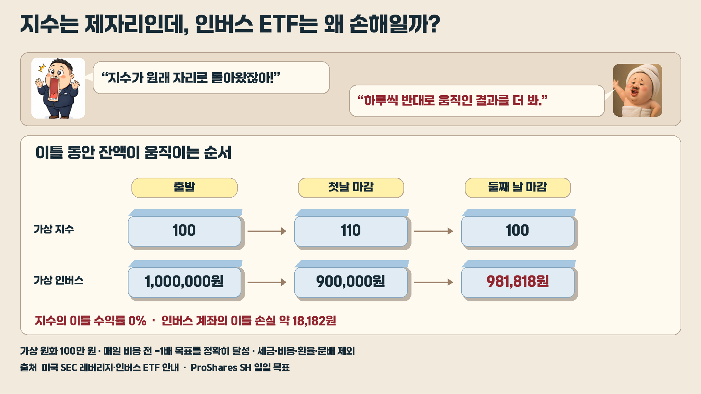

# 은퇴 계좌를 지키려 산 인버스 ETF, 지수가 제자리인데 왜 손해일까?

## 1. 연금 전날, 불안해서 누른 검색창

가상 인물 천억이는 이달 생활비를 꺼내기 전에 주식 계좌의 하락이 걱정됩니다. 지수가 내리면 반대로 움직인다는 ETF를 발견하고 계산기에 지수의 처음과 끝을 넣습니다. 수건 친구는 상품 설명에서 짧은 말 하나를 찾아 밑줄을 긋습니다. “반대로 움직인다는 목표, **하루**라고 되어 있어.”

## 2. 지켜야 할 돈과 실제 기준 지수

천억이가 걱정하는 건 자기 계좌의 평가액입니다. 미국의 ProShares SH가 목표로 설명하는 대상은 S&P 500의 일일 수익률을 역방향으로 따라가는 것입니다. 자기 계좌에 다른 시장이나 업종을 더 많이 담고 있다면 같은 금액을 두 계좌에 두더라도 움직임이 맞지 않을 수 있습니다. 외화 가격을 원화로 평가하면 환율 효과도 생깁니다.

## 3. 같은 출발점을 두 번 계산하는 이유

원화 가상 원금 100만 원으로 시작합니다. 두 거래일의 종가를 가정하며, 상품은 일일 지수 수익률의 −1배를 정확히 달성합니다. 분배금·세금·거래비용·운용 및 금융비용·환율 효과는 없고, 분배금 재투자와 중간 입출금도 없습니다. 둘째 날 적용할 비율의 분모는 첫날의 시작 값이 아니라 첫날 마감 값입니다.

## 4. 지수는 100으로 돌아왔지만

지수가 첫날 100에서 110이 되면 상승률은 10%입니다. 역방향 계좌는 100만 원에서 90만 원으로 내려갑니다. 둘째 날 지수가 110에서 100으로 돌아오면 둘째 날 지수 수익률은 약 −9.09%입니다. 역방향으로는 정확히 1/11만큼 오릅니다. 이 비율을 90만 원에 적용한 결과는 반올림하면 **981,818원**입니다. 지수의 이틀 기간 수익률은 0%이고, 역방향 계좌의 기간 손실은 약 18,182원입니다.

*가상 이틀의 종가 비교. 비용 전 일일 −1배를 정확히 달성하면 지수가 제자리여도 약 18,182원 손실이 남는다.*

## 5. 계속 내릴 때는 또 다른 값이 나온다

지수가 100에서 90, 이어서 81이 되면 매일 10%씩 하락하지만 이틀 누적 하락률은 19%입니다. 가상 역방향 계좌는 매일 10%씩 올라 **121만 원**이 됩니다. 이틀 지수 하락률에 부호만 바꾼 19%와 다릅니다. 매일 그날의 수익률을 현재 잔액에 적용했기 때문입니다.

## 6. 날짜도 같고 첫날 방향만 반대라면

지수가 100에서 90으로 내려갔다가 둘째 날 100으로 오르는 가상 경로를 적습니다. 역방향 계좌는 첫날 110만 원이지만, 둘째 날 지수가 올라간 비율은 10%가 아니라 1/9입니다. 이 비율만큼 내려가면 약 **977,778원**입니다. 같은 시작과 끝이라도 두 경로의 중간 값에 따라 잔액이 달라집니다.

## 7. 내 주문 내역의 시각

천억이는 ETF의 기준 시각과 자기 주문 체결 시각이 같은지 확인합니다. 장중에 들어간 사람의 손익은 펀드의 하루 기준과 어긋날 수 있습니다. 실제 펀드에선 비용과 추적 차이가 있고, 거래 가격에는 호가 차이도 있습니다. 둘째 날 현금이 필요해 상품을 판다면 그 시각의 가격으로 생활비를 마련합니다.

## 8. 오늘 해 볼 한 가지

공식 설명서에서 **기준 지수와 하루 목표**를 찾아 실제 계좌의 보유 자산 옆에 적습니다. 그리고 이틀치 지수 종가로 일별 수익률을 각각 구한 뒤, 각 부호를 바꾸어 다음 잔액에 곱해 봅니다. 천억이는 생활비 장부의 마감일과 상품 목표를 같은 칸에 쓰지 않습니다.

**편집부 Q&A · 당일 아무 때나 사도 목표의 반대 수익률과 똑같나요?**  
상품이 정하는 하루의 시작·끝과 투자자의 체결 시점이 다를 수 있습니다. 개인 체결가와 펀드의 계산 조건을 따로 볼 필요가 있습니다.

**원문**　[미 SEC 레버리지·인버스 ETF 안내](https://www.investor.gov/introduction-investing/general-resources/news-alerts/alerts-bulletins/investor-alerts/sec) · [ProShares SH 일일 목표](https://www.proshares.com/our-etfs/leveraged-and-inverse/sh)

**이어 읽기**　[ETF 청산 공지를 받았다면 마지막 거래일과 지급일 중 무엇을 봐야 할까?](EP057.md) · [전자책 목차](목차.md)
