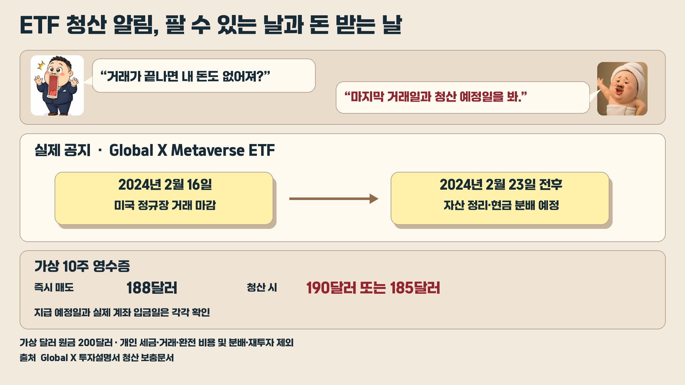

# 은퇴 생활비로 쓰려던 ETF가 청산된다면? 팔 수 있는 날과 돈 받는 날

## 1. 관리비 앞에 뜬 거래 종료 알림

가상 인물 천억이는 다음 달 쓸 돈을 확인하다 ‘거래 종료 예정’이라는 공지를 봅니다. 앱의 알림만 보면 ETF가 사라지고 돈까지 없어지는 것처럼 느껴집니다. 수건 친구는 생활비 달력에 빈칸 두 개를 만듭니다. 거래소에서 마지막으로 팔 수 있는 날과 펀드가 남은 자산을 나눠 주는 날입니다.

## 2. 거래소와 펀드의 시계를 따로 보기

거래가 끝나면 그 시장에서 평소처럼 주문해 매도하기 어렵습니다. 청산은 펀드 자산을 정리하고 남은 가치를 보유자에게 나누는 과정입니다. 단순 거래정지와 청산은 구분합니다. 공지에서 대상 ETF의 티커와 정식 이름, 거래소, 마지막 거래 시각과 정리 방식을 각각 확인합니다.

## 3. 실제 공지의 두 날짜

Global X는 2024년 1월 19일 결정한 19개 ETF 청산 계획을 공지했습니다. 예를 들어 운용사의 투자설명서 보충 문서에는 Global X Metaverse ETF의 거래 종료 시점이 **2024년 2월 16일 미국 정규 거래 마감**으로 표시됐습니다. 자산을 정리하고 남은 보유자에게 현금으로 나눠 줄 예정일은 **2024년 2월 23일 전후**였습니다. 문서에 적힌 것은 예정 일정과 그날 지분의 순자산가치에 따른 분배 방식입니다. 이 글은 특정 계좌의 실제 입금일을 확인한 사례가 아닙니다.

## 4. 마지막 거래일의 가상 영수증

달러로 10주를 주당 20달러에 샀다고 가정합니다. 원금은 200달러입니다. 마지막 거래일에 10주 전부를 주당 18.80달러에 팔 수 있다면 **188달러**를 회수합니다. 개인 세금·수수료·환전 비용은 제외하며, 기간 중 분배금과 재투자는 없습니다. 마지막 거래일에서 청산일까지의 짧은 기간을 비교하고 연율로 표시하지 않습니다.

## 5. 기다렸다가 받는 쪽의 숫자

청산에 쓰이는 최종 잔여가치가 가상 주당 19달러라면 10주에서 **190달러**를 받습니다. 매도 예시보다 2달러 많지만 매수 원금보다는 10달러 적습니다. 19달러는 마지막 거래일에 확정된 금액이 아닙니다. 자산 가치와 청산 과정에 드는 비용 등이 회수액에 영향을 줄 수 있습니다.

## 6. 두 가지 조건이 바뀌면

가상 청산 잔여가치가 주당 18.50달러라면 회수액은 **185달러**입니다. 이 경우에는 앞의 가상 즉시 매도 188달러보다 3달러 적습니다. 반대로 청산 잔여가치가 19달러로 끝나더라도 생활비 납부일보다 실제 입금이 늦으면 그날 쓸 현금은 따로 필요합니다. 2달러의 가상 차이와 제때 지급할 수 있는지는 다른 질문입니다.

*Global X Metaverse ETF의 과거 공지 일정과 별도의 가상 달러 계산을 나눠 표시했다.*

## 7. 다시 은퇴 생활비 달력으로

천억이는 매도할 수 있는 날, 결제 후 출금 가능일, 청산 예정일, 실제 중개사 입금 확인일을 서로 다른 줄에 적습니다. 원화로 지출하는 경우에는 환전하고 쓸 수 있는 시점도 확인합니다. 사고팔 때의 호가와 청산 회수액 비교는 양쪽을 같은 통화와 비용 기준으로 맞춰야 합니다.

## 8. 공지에서 직접 찾을 한 가지

오늘 할 일은 운용사 원문에서 **마지막 거래일과 예정 청산일 두 줄에 표시**하는 것입니다. 지급 방식도 옆에 짧게 적고, 실제 입금에 관한 부분은 계좌 안내와 비교합니다.

**편집부 Q&A · ETF 청산이면 내가 산 가격으로 돌려받나요?**  
실제 공지의 지급 기준을 확인합니다. 위 사례는 청산일의 지분 순자산가치에 따른 현금 분배를 예정한 경우입니다.

**원문**　[Global X 투자설명서 청산 보충문서](https://www.globalxetfs.com/content/files/BFIT-497K.pdf) · [Global X의 19개 펀드 청산 발표](https://www.prnewswire.com/news-releases/global-x-etfs-to-liquidate-19-etfs-302039841.html)

**이어 읽기**　[ETF 투자 실패를 만드는 다섯 행동, 매도 버튼을 누르기 전 복기하기](EP059.md) · [전자책 목차](목차.md)
