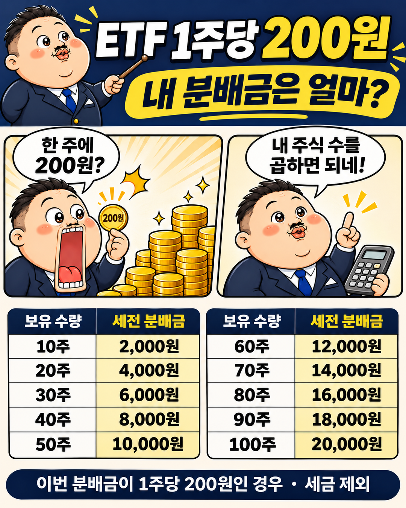
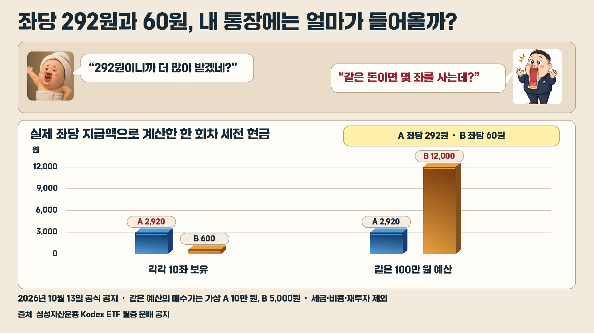

# 은퇴 생활비, 같은 100만 원이라면 월분배금 292원이 60원보다 많이 들어올까?

## 1. 관리비 고지서 옆에 놓인 두 숫자

가상 인물 천억이는 생활비를 보태려고 월분배 ETF 공시를 읽습니다. 한 상품은 좌당 292원, 다른 상품은 60원입니다. “292원이 거의 다섯 배네. 통장에도 그만큼 더 들어오겠지?” 수건 친구가 공시 옆에 천억이의 매수 예산을 적습니다. 두 상품을 몇 좌씩 살 수 있는지가 먼저입니다.

## 2. 같은 수량과 같은 예산

좌당 분배금은 한 좌를 보유한 사람의 기준입니다. 입금 액수는 보유 수량을 곱해야 나옵니다. 예산이 같다면 가격이 높은 ETF는 상대적으로 적은 수량을 살 수 있습니다. 이때 매수 가능 수량은 실제 호가와 거래 단위를 사용합니다. 분배 공시가 사용한 기준 종가는 내 체결가와도 다를 수 있습니다.

## 3. 실제 공시를 같은 날짜로 보기

삼성자산운용이 2026년 10월 13일 알린 월중 분배 대상 18종 가운데 공지 앞 10종을 정리했습니다. 원화 좌당 분배금은 한 회차이고 당월 공시 분배율의 분모는 2026년 10월 12일 종가입니다. 순서는 공지 순서입니다.

|코드|ETF|좌당 분배금(원)|당월 공시 분배율|
|---|---|---:|---:|
|498400|KODEX 200타겟위클리커버드콜 ETF|281|1.47%|
|476800|KODEX 한국부동산리츠인프라 ETF|60|1.43%|
|481060|KODEX 미국30년국채타겟커버드콜(합성 H) ETF|71|1.00%|
|441640|KODEX 미국배당커버드콜액티브 ETF|94|0.77%|
|0089D0|KODEX 금융고배당TOP10 ETF|58|0.46%|
|0153K0|KODEX 주주환원고배당주 ETF|45|0.38%|
|0091C0|KODEX 미국10년국채액티브(H) ETF|34|0.37%|
|489250|KODEX 미국배당다우존스 ETF|37|0.31%|
|237370|KODEX 코리아배당성장채권혼합 ETF|44|0.29%|
|273140|KODEX 단기변동금리부채권액티브 ETF|292|0.25%|

## 4. 열 좌씩 들고 있다면 292원이 더 크다

두 상품에서 같은 지급의 수령 자격을 갖춘 10좌를 각각 보유했다고 가정합니다. 공지의 292원과 60원을 곱하면 세전 **2,920원과 600원**입니다. 가격 변동 수익률을 계산하지 않았고 세금·거래비용·분배 재투자는 제외했습니다. 같은 개수만 비교할 때 입금 차이는 2,320원입니다.

## 5. 같은 100만 원으로 사면 뒤집힐 수 있다

이제 원화 첫 예산을 양쪽 모두 100만 원으로 맞춥니다. 가격은 실제 공시 종가와 별도의 가상 가격입니다. 좌당 292원을 지급한 종목을 10만 원에, 60원을 지급한 종목을 5,000원에 샀다고 가정합니다. 각 10좌와 200좌를 살 수 있으므로 같은 한 차례 세전 현금은 **2,920원과 12,000원**입니다. 기간 가격수익, 수수료, 세금, 이자와 재투자는 제외합니다. 좌당 금액만으로 정한 순서가 예산을 기준으로 바뀝니다.

*만화에서는 주당 200원으로 고정한다. 위의 실제 10월 공시는 종목마다 주당 지급액이 다르다.*

*한 회차 실제 좌당 금액, 가상 보유 수량과 매수가. 각각 10좌를 보유할 때와 같은 100만 원일 때 지급액 순서가 달라진다.*

## 6. 가격과 분배가 각각 바뀌는 반례

가상의 첫 상품 가격만 2만 원으로 내려가고 좌당 분배금은 같다고 가정하면, 50좌에서 14,600원이 들어와 두 번째 상품의 12,000원보다 많아집니다. 반대로 두 번째 상품이 같은 보유 수량이라도 다음 회차 좌당 지급액을 줄이면 이번 계산을 다음 달에 복사할 수 없습니다. 실제 생활비에는 그 회차의 세후 현금과 지급일을 적어야 합니다.

## 7. 관리자 화면으로 돌아가기

두 인물은 같은 공지에서 코드를 확인한 뒤 지급 회차, 좌당 금액, 현재 보유 수량을 맞춥니다. 당월 비율을 열두 배 한 수치는 지난 12개월 실측도, 내년 예상 총수익도 아닙니다. 리츠·채권·커버드콜의 분배 재원과 평가액 변동은 각각 확인합니다.

## 8. 오늘 비교할 두 줄

천억이는 공지의 **좌당 금액에 실제 보유 수량을 곱해 입금내역과 대조**합니다. 새로 비교하는 상품이라면 같은 예산으로 몇 좌가 되는지 먼저 씁니다. 그 아래에 실제 지급일과 생활비 납부일을 나란히 적습니다.

**편집부 Q&A · 이번 달 공시 분배율이 가장 높은 행이 투자 성과도 가장 좋았나요?**  
같은 시작·종료일의 평가액과 분배·재투자 조건을 맞춰야 총수익을 비교할 수 있습니다. 위 금액은 한 회차의 분배 공시입니다.

**원문**　[삼성자산운용 월중 분배 공지](https://www.samsungfund.com/etf/lounge/notice-view.do?no=80195) · [삼성자산운용 ETF 분배금 현황](https://www.samsungfund.com/etf/product/distribution.do) · [미 SEC 펀드 분배금 안내](https://www.investor.gov/introduction-investing/general-resources/news-alerts/alerts-bulletins/investor-bulletins/fund-distributions-investor-bulletin)

**이어 읽기**　[일본 ETF가 인기라는 말, 거래대금·순유입·NISA 적격 중 어느 뜻일까?](EP065.md) · [분배락 뒤 당일 손실과 실제 입금, 지급 전에는 어디에 적을까?](FAQ03.md) · [전자책 목차](목차.md)
