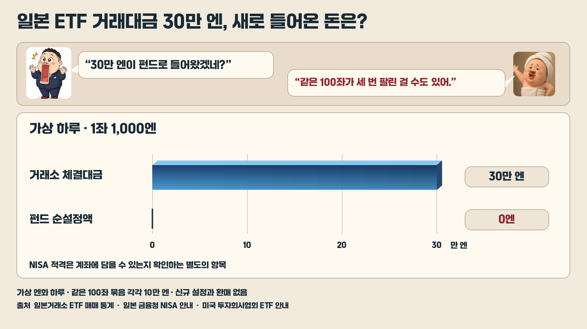

# 은퇴 자금으로 일본 ETF를 볼 때, ‘거래대금 1위’는 무슨 뜻일까?

## 1. 친구가 보낸 도쿄 시장 순위표

가상 인물 천억이는 은퇴한 친구에게 일본 ETF 거래 순위표를 받습니다. “제일 많이 샀다는데, 일본 사람들의 새 돈이 가장 많이 들어온 거야?” 수건 친구가 순위표 제목의 거래대금에 밑줄을 긋습니다. 주식이 손을 바꾼 돈과 펀드로 새로 들어간 돈은 다른 장부에 있습니다.

## 2. 언제 팔 수 있는지가 궁금할 때

일본거래소그룹의 ETF 호가·거래 통계에서 매매 활동을 볼 수 있습니다. 거래량은 수량, 거래대금은 체결된 금액입니다. 자주 거래되는 상품이어도 내가 주문할 시각에 원하는 수량이 모두 같은 가격에 체결된다는 뜻은 아닙니다. 거래 여부에 관한 질문이라면 지금 보이는 호가 차이와 수량도 확인합니다.

## 3. ETF 좌수가 늘어난 날

거래소에서는 이미 발행된 지분을 투자자끼리 사고팔 수 있습니다. 펀드 단계에서는 별도의 참가자가 설정하거나 환매하면서 발행 좌수가 늘거나 줄 수 있습니다. 운용자산 규모는 가격이나 환율만 움직여도 달라질 수 있으므로, 어제와 오늘 규모의 차이를 그대로 순유입이라고 읽기 어렵습니다. 순유입을 비교할 때에는 자료 제공자가 어떤 방식으로 산출했는지 읽습니다.

## 4. 하루에 세 번 돌아간 100좌

가상 엔화 ETF 100좌가 있습니다. 주당 1,000엔에 같은 100좌 묶음이 하루 동안 세 번 다른 손으로 넘어갑니다. 체결을 한 번씩만 기록하면 거래대금은 **30만 엔**입니다. 새로 설정하거나 환매한 좌수는 0이라고 가정하므로 펀드에는 순설정이 없습니다. 기간 가격수익은 0%, 분배·세금·비용과 재투자도 없습니다. 보유자의 투자수익을 추정하는 계산은 아닙니다.

*가상 하루의 엔화 체결액과 순설정액. 이미 발행된 같은 100좌가 세 번 손을 바꾼다.*

## 5. 거래 없이 좌수가 늘어나는 반례

가상으로 기존 좌수의 거래소 매매가 전혀 없는 날에, 지정 참가자가 1,000엔 가치의 좌수 200좌를 새로 설정했다고 가정합니다. 시장 거래대금은 0엔인 반면 펀드 쪽에는 20만 엔 상당의 순설정이 생깁니다. 실제 설정 때 현금 대신 자산을 납입하는 방식도 있으므로, 이 값은 무조건 현금이 오갔다는 뜻으로 쓰지 않습니다.

## 6. NISA는 다른 질문에 답한다

일본 금융청의 NISA는 제도 구간에 따라 대상 상품의 조건에 차이가 있습니다. 일본에 상장된 ETF라고 해서 두 구간에 모두 들어갈 수 있다고 가정하기 어렵습니다. NISA 적격은 계좌의 편입 조건입니다. 이 조건으로 거래대금 순위나 순유입 순위를 정할 수 없습니다. 한국 투자자의 과세와 계좌 편입 조건은 별도로 알아봐야 합니다.

## 7. 통화와 기초자산 구분하기

엔화로 거래되는 ETF가 일본 기업에 투자한다는 보장은 없습니다. 해당 지수나 보유 자산의 지역을 팩트시트에서 따로 봅니다. 일본 시장의 거래금액과 한국 시장의 거래금액을 비교할 때에는 같은 기간, 통화 환산 기준, 장내 거래 집계 범위인지 확인합니다. 자료가 투자자 국적을 알려주지 않는다면 누구의 돈이 들어왔는지 추정하지 않습니다.

## 8. 배운 날의 기록 한 줄

천억이는 ‘인기’라고만 쓰인 표 옆에 **기관·열 이름·집계 기간·단위**를 적습니다. 매도 가능성이 궁금한 날에는 거래와 호가를 읽습니다. 돈이 얼마나 새로 들어왔는지 궁금한 날에는 설정·환매 계열을 찾습니다.

**편집부 Q&A · 일본 ETF 거래대금이 높으면 투자 성과도 높나요?**  
거래대금은 거래 활동을 보여줍니다. 투자 성과는 같은 관측 기간의 가격 또는 재투자 총수익 자료를 확인합니다.

**원문**　[일본거래소 ETF 매매 통계](https://www.jpx.co.jp/english/equities/products/etfs/quoting-data/) · [일본 금융청 NISA 구조](https://www.fsa.go.jp/policy/nisa2/know/index.html) · [미 투자회사협회 ETF 설정·환매 FAQ](https://www.ici.org/faqs/faqs_etfs_retail_investors)

**이어 읽기**　[2027 ISA·연금·NISA 변경표, 발표일과 시행일을 왜 따로 써야 할까?](EP067.md) · [전자책 목차](목차.md)
