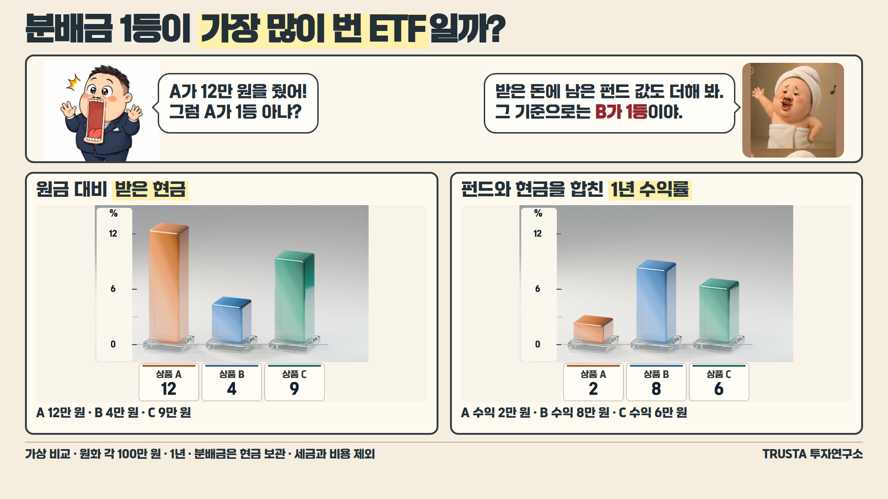

# 분배율 1위와 총수익률 1위가 다른 이유, ETF를 두 축에 놓아 보기

## 냉장고에 붙인 1등 스티커가 두 장이었다

수건 친구가 월분배 ETF 두 개를 비교하다가 한쪽에 금색 스티커를 붙입니다. 그쪽에서 들어온 돈이 한 해 동안 더 많았거든요. 천억이가 그 스티커를 옮기려 합니다. 펀드의 남은 값과 받아 둔 현금을 더해 보니 다른 쪽이 더 컸습니다. 마침 두 사람은 냉장고를 바꾸려고 생활비 통장을 열어 놓은 참이었습니다. 지금 꺼내 쓸 현금이 필요한지와, 일 년 뒤 자산을 더 남기고 싶은지가 같은 질문인지부터 따져 보기로 합니다. 두 사람과 계좌는 설명을 위해 만든 가상 사례입니다.

*원화 100만 원씩 1년 동안 보유한 가상 비교. 분배금은 현금으로 남기고 세금과 비용은 제외했다.*

수건 친구는 비교표에 두 칸을 그립니다. 한 칸에는 같은 기간에 분배받아 현금으로 쓸 수 있었던 금액을 씁니다. 다른 칸에는 마지막에 남은 펀드 가치와 중간에 받아 그대로 보관한 현금을 더합니다. 첫 칸은 수익의 전부를 모아 놓은 것이 아니고, 둘째 칸의 합계에는 첫 칸에서 센 돈이 이미 들어 있습니다. 한 상품에 스티커를 두 번 붙인 뒤 그것을 다시 더하면 같은 현금을 두 번 보상할 수 있습니다.

## 12만 원 받은 쪽과 8만 원 늘어난 쪽

두 통장에 각각 같은 날 원화 백만 원을 넣습니다. 일 년 동안 납입이나 인출은 없고 세금과 비용 및 환율 효과는 빼겠습니다. 받은 돈은 재투자하지 않고, 이자가 붙지 않는 현금으로 보관합니다. 가상 상품 에이는 십이만 원을 분배하고 기말 펀드 가치가 구십만 원입니다. 비는 사만 원을 분배하고 기말 펀드 가치가 백사만 원입니다.

원금 백만 원에 비해 실제로 받은 현금은 에이가 십이 퍼센트, 비가 사 퍼센트입니다. 마지막에 펀드와 보관 현금을 합치면 에이는 백이만 원, 비는 백팔만 원입니다. 기간 전체의 원화 수익은 각각 이만 원과 팔만 원입니다. 그해 현금을 더 많이 나누어 준 쪽은 에이이고, 그 돈을 현금으로 보관했을 때 최종 합계가 더 큰 쪽은 비입니다.

천억이는 지금 고장 난 냉장고 값을 한 번에 내야 한다면 당장 통장에 있는 돈이 얼마나 되는지 묻습니다. 수건 친구는 이번 겨울에 꼭 써야 할 돈이 있으면 분배 지급일도 봐야 한다고 답합니다. 일 년치 분배금이 먼저 다 들어와 있다고 가정하지 않는 이상, 기말 합계만으로 중간의 납부일을 맞출 수 있는지는 알 수 없습니다. 그래서 세 번째 칸에 실제 현금이 필요한 날짜를 씁니다.

## 같은 펀드 화면에도 분배 숫자가 둘 있었다

천억이는 실제 사례로 글로벌 엑스의 큐와이엘디 화면을 엽니다. 2026년 11월 25일 화면에서 최근 12개월 분배 지표는 13.89%, 최근 지급을 연율로 바꾼 분배율은 11.87%였습니다. 두 값은 같은 상품의 같은 날 표시입니다. 앞 숫자는 이전 12개월의 소득·자본이득·자본환급 분배를 합하고, 분모에 최신 순자산가치와 해당 기간 자본이득 분배를 반영합니다. 뒤 숫자는 가장 최근 지급분을 연율로 바꾼 뒤 최신 순자산가치로 나눕니다. 어느 숫자도 그날 통장에 받은 돈의 총수익률을 말하지 않습니다. [Global X QYLD 상품 설명](https://www.globalxetfs.com/funds/qyld)

수건 친구는 이 차이를 가상 계산으로 바꿉니다. 최근 1년간 주당 분배금 합계가 1.20달러이고 자본이득 분배가 없어 분모가 10달러라고 하겠습니다. 그러면 12개월 지표는 12%입니다. 마지막 달 지급액만 0.08달러였고 월 지급이 12번 계속되는 가정으로 연율을 계산하면 0.96달러를 10달러로 나눠 9.6%가 됩니다. 세금과 비용은 제외합니다. 9.6%를 기록한 근거는 마지막 달 하나이고, 12%에 들어간 것은 이미 지나간 열두 달입니다.

같은 가상 사례에서 주당 분배 합계가 여전히 1.20달러인데 분모의 평가액만 8달러로 바뀌면 12개월 지표는 15%로 올라갑니다. 통장에 찍힌 분배금이 늘어난 것은 아니므로 수건 친구는 그래프에서 분자와 분모를 따로 놓습니다. 지표만 뛰었을 때 수입이 정말 늘었는지 보려면 주당 분배액의 원자료부터 확인합니다.

## 빨간 선을 그은 것은 상품 순위가 아니라 달력이다

천억이는 큐와이엘디와 네오스의 에스피와이아이를 한 화면에서 비교하다가 날짜 차이를 발견합니다. 큐와이엘디의 위 분배 숫자는 11월 25일 화면이고, 당시 페이지 내 월말 수익률 표의 종료일은 10월 31일이었습니다. 에스피와이아이의 같은 조회 화면에서는 분배율 11.43%에 2026년 10월 31일이, 1년 달러 NAV 총수익률 14.62%에 2026년 9월 30일이 붙었습니다. 앞의 것은 표시 분배율이고 뒤의 것은 1년 성과입니다. 날짜를 확인하지 않고 병렬로 붙인 두 숫자는 같은 기간의 결과가 아닐 수 있습니다. [Global X QYLD 상품 설명](https://www.globalxetfs.com/funds/qyld) · [NEOS SPYI 상품 설명](https://neosfunds.com/spyi/)

공시 화면을 켰을 때 두 사람이 가장 먼저 고른 것은 같은 종료일입니다. 그 뒤에 같은 기준의 1년 달러 NAV 총수익률을 찾고, 분배는 주당 지급액을 공통 시작가로 나누어 따로 비교할 수 있는지 봅니다. 공통 기간에 한 상품이 아직 존재하지 않았다면 기간을 줄이거나 길게 이어지는 비교에서 그 상품을 빼야 합니다. 한 상품의 출시 이후 연율과 다른 상품의 최근 1년 수익률로 1등을 정하면, 두 숫자에는 상품 차이와 시작일 차이가 섞입니다.

## 기말 순위가 같아도 결제는 중간에 막힌다

냉장고 설치비가 당초 생각한 날보다 앞서 청구됩니다. 가상의 두 펀드가 일 년 동안 일정한 월말 금액을 지급한다고 단순화해 봅시다. 에이의 12만 원은 12번에 걸쳐 월 1만 원씩, 비의 4만 원은 월평균 3,333원과 3분의 1원씩 들어오는 계산입니다. 실제 원 단위 정산을 재현하기 위한 예시는 아닙니다. 비교기간은 같은 일 년이며, 세금·비용 없이 현금으로 받은 돈을 쌓아 둡니다.

세 번째 지급 직후 설치비 2만 5천 원을 내야 한다면 에이의 지급금은 3만 원, 비의 지급금은 1만 원입니다. 이때부터 기말에 더 큰 잔액을 남긴다는 계산은 여전히 가능해도, 비의 지급금만으로는 현재 지출이 1만 5천 원 모자랍니다. 기존 현금이 있다면 섞어 낼 수 있고, 펀드 일부를 팔아 충당하면 기말에 남을 지분이 달라집니다. 그 경우 전체 지분을 일 년 내내 들고 있었던 원래 가정을 그대로 가져올 수 없습니다.

같은 설치비를 첫 지급보다 먼저 냈어야 한다면 에이도 분배금만으로는 결제하지 못합니다. 반면 네 번째 지급까지 기다릴 수 있으면 비의 지급액도 약 1만 3천 원으로 늘어납니다. 두 사람이 보고 있는 것은 월 수익률 경주에 붙이는 새 점수가 아닙니다. 해당 지출일에 다른 자금 없이 쓸 수 있는 돈의 차이입니다. 수건 친구는 월별 지급액과 설치비 지급일 사이에 선을 그어 봅니다.

### 분배금이 모자라면 일부를 팔아서 메울 수 있을까

친구는 설치비를 이미 낸 이야기와 섞이지 않도록, 별도의 연말 가상 장부를 펼칩니다. 각 펀드를 처음에 원화 백만 원씩 사서 일 년을 보유하고, 받은 분배금을 전부 현금으로 남긴 상태입니다. 이번 지출은 평가 직후 팔만 원입니다. 에이는 이미 들어온 십이만 원에서 팔만 원을 내면 현금 사만 원과 펀드 구십만 원이 남습니다. 비는 들어온 사만 원을 쓰고 펀드에서 사만 원어치를 팔면 현금은 영, 펀드는 백만 원이 남습니다. 세금·비용·환전 효과는 없고 필요한 금액만큼 팔 수 있으며, 팔고 곧바로 결제할 수 있다고 가정합니다.

지출액이 같으므로 지출 뒤 합계 차이는 여전히 육만 원입니다. 두 사람은 이 줄에 ‘팔 수 있는 가격’과 ‘결제 때 쓸 수 있는 현금’을 적습니다. 이 계산에서 일부 매도가 가능했던 건 그날 시장에서 원하는 금액만큼 팔 수 있다고 먼저 놓았기 때문입니다. 실제로는 매도 시점의 가격이나 비용이 달라지고 매도대금이 들어오는 날을 확인해야 합니다. 지분을 줄인 다음 해에는, 다른 조건이 같아도 남은 지분에 지급되는 분배금의 총액이 달라집니다.

수건 친구는 지급금만으로 생활비를 내는 장부와 일부 매도로 충당하는 장부를 각각 적습니다. 어느 쪽이 실제 결제일에 맞을지 확인하려면, 지출 날짜 바로 앞에 들어온 현금과 그날 실제 팔 수 있는 금액을 분리해 보아야 합니다. 그 다음에야 결제하고 남을 지분과 현금을 한꺼번에 비교할 수 있습니다.

## 연간 카드가 같아도 중간 손실은 다르다

천억이는 기말에 분배금을 포함해 8% 오른 가상 펀드 두 개를 더 그립니다. 출발 가치는 모두 원화 100만 원입니다. 배당 재투자 성과의 경로만 비교하므로 외부 입출금, 세금, 비용을 빼고, 관측은 시작일과 중간일, 종료일 세 번으로 제한합니다. 첫 경로는 100만 원에서 80만 원으로 내렸다가 108만 원에 끝납니다. 두 번째는 100만 원에서 98만 원으로 내렸다가 같은 108만 원에 끝납니다.

세 관측점에서만 보면 중간에 앞선 고점에서 가장 많이 떨어진 폭은 20%와 2%입니다. 실제로는 이 세 날 사이에 더 깊게 떨어졌을 수 있으므로 전체 기간의 최대낙폭으로 부를 수 없습니다. 공식 순위에 낙폭을 추가하려면 같은 빈도의 총수익 계열, 관측기간, 고점 기준을 상품마다 맞춥니다. 가격 계열에서 분배락을 아무 설명 없이 투자 손실로 셌다면 총수익 기준으로 그린 낙폭과 다르게 보일 수 있습니다.

중간에 급하게 팔아야 했다면 두 경로를 같은 8%라고만 보기 어렵습니다. 반대로 중간 매도가 없고 두 경로 모두 기간이 끝날 때까지 유지했다는 이 가상 전제에서는 마지막 금액이 같습니다. 수건 친구는 분배금과 총수익 옆에 이 경로의 하락폭을 적되, 세 관측점으로 계산한 값이라는 표시를 남깁니다.

## 냉장고 앞에 붙인 두 축

천억이는 가로축에 초기 원금 대비 지급금, 세로축에 현금 보관 기준 기간 수익률을 그립니다. 에이는 가로 십이, 세로 이로 갑니다. 비는 가로 사, 세로 팔입니다. 단위는 퍼센트고, 두 점은 같은 시작일에 원화 백만 원을 넣고 일 년을 지켜본 가상 통장입니다. 세금과 비용, 추가 입출금은 없고 지급액은 현금 보관입니다. 옆에 백이만 원과 백팔만 원이라고 써 두면 각 점이 어느 돈을 나타내는지 바로 읽을 수 있습니다.

수건 친구는 표를 바꿔 가로축을 ‘최근 지급분 연율’로 표시해 봅니다. 그러면 새 가로축과 기존 점의 숫자는 맞지 않습니다. 에이의 12%는 초기 원금으로 일 년치 현금을 나눈 값이기 때문입니다. 상품 화면의 연율은 운용사가 표시한 분모와 최신 지급 내역을 써야 다시 계산할 수 있습니다. 실제 데이터를 모을 때 같은 기간에 주당 지급액과 출발일 가격을 구할 수 있다면 비교자가 산식을 통일해서 비교할 수 있습니다. 시점 중간에 주식분할 같은 변화가 있다면 가격과 주당 지급액의 단위도 일치시켜야 합니다.

가상의 세 번째 상품을 더해 봅시다. 원금 백만 원 가운데 일 년에 구만 원을 분배하고 기말 펀드 가치가 구십칠만 원 남았습니다. 현금을 보관한 합계는 백육만 원입니다. 같은 표에서 가로 구, 세로 육에 찍힙니다. 그해 받을 현금이 최소 팔만 원이어야 하는 사람은 먼저 그 선 오른쪽의 두 점을 볼 수 있습니다. 그 조건을 통과한 에이와 세 번째 상품의 기말 합계는 각각 백이만 원과 백육만 원입니다. 현금 기준을 먼저 통과시킨 다음 다른 목표를 비교하면, 두 축을 더해 줄 세웠을 때와 다른 결론이 나올 수 있습니다.

## 1등 표시 옆에 무슨 기준인지 적는다

편집부 질문입니다. 현금 지급률과 총수익률을 더해 종합점수를 만들면 어떤가요? 현금 포함 기말 수익률에 지급금을 이미 더했다면, 두 점수를 더하는 순간 같은 지급금이 두 번 들어갑니다. 지급액을 두 번 반영하는 편집 기준을 쓰려면 그 사실을 독자에게 설명해야 합니다. 최소 현금과 남길 자산을 따로 보는 가정에서는 지급일에 필요한 최소 금액을 먼저 적고, 그 조건을 만족한 경로의 기말 잔액을 비교할 수 있습니다.

천억이가 구입 예정일을 냉장고에 붙입니다. 수건 친구는 금색 스티커 두 장의 이름을 다시 씁니다. 하나는 그날까지 받은 돈, 다른 하나는 같은 비교가 끝날 때 남은 돈입니다. 실제 통장에서는 분배금이 과세 후 입금될 수 있고 외화가 들어오면 쓸 돈을 원화로 바꾸는 시점도 필요합니다. 표의 숫자로 실제 지출을 계획하려면 지급일, 실제 입금액, 쓴 금액을 같은 통화로 맞춰야 합니다.

오늘 한 번만 확인한다면 두 운용사의 공식 화면에서 분배율의 분모와 NAV 총수익의 종료일에 밑줄을 긋습니다. 같은 뜻처럼 보이는 퍼센트가 어떤 현금과 날짜를 담고 있는지 알면, 처음의 금색 스티커가 어떤 질문에 답하는지 설명할 수 있습니다.

**원문**　[미 SEC 펀드 분배금 안내](https://www.investor.gov/introduction-investing/general-resources/news-alerts/alerts-bulletins/investor-bulletins/fund-distributions-investor-bulletin) · [Global X QYLD 지표·산식](https://www.globalxetfs.com/funds/qyld) · [NEOS SPYI 운용정책](https://neosfunds.com/spyi/)

**이어 읽기**　[2027 ISA·연금·NISA 변경표, 발표일과 시행일을 왜 따로 써야 할까?](EP067.md) · [분배락 뒤 당일 손실과 실제 입금, 지급 전에는 어디에 적을까?](FAQ03.md) · [전자책 목차](목차.md)
