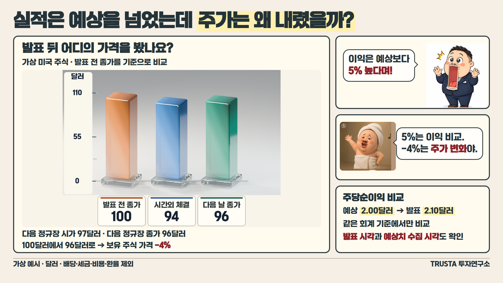
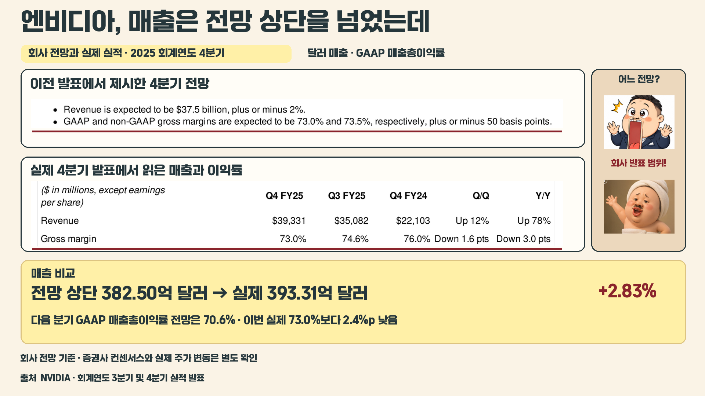

# 실적이 예상을 넘었는데 주가는 왜 떨어질까? 발표 전후 두 장부

## 알림은 초록색인데 계좌는 빨간색이었다

천억이는 저녁에 실적 속보를 보고 다음 날 열릴 계좌를 상상합니다. 속보에는 ‘예상보다 많이 벌었다’고 쓰여 있습니다. 그런데 다음 정규장이 끝날 무렵, 같은 회사 주가는 전날보다 낮습니다. 천억이가 휴대폰 두 화면을 나란히 놓자 수건 친구가 묻습니다. “위 화면은 누구의 예상을 넘었다는 거야? 아래 화면은 언제의 가격보다 내렸고?” 두 사람과 회사, 가격은 상황을 설명하기 위해 꾸몄습니다.

*가상 미국 기업의 실적 발표와 가격 반응. 달러 기준이며 배당, 세금, 거래비용, 환율은 제외했다.*

천억이는 처음엔 알림과 계좌 중 하나가 틀렸다고 봅니다. 친구가 종이를 찢어 시각을 두 개 적습니다. 첫 장에는 발표 직전에 동결한 이익 예상치, 둘째 장에는 발표 후 거래가 이뤄진 가격입니다. 주당순이익 예상이 달러 2.00이고 회사가 같은 기준으로 2.10을 발표했다면 예상치보다 0.10달러 더 벌어 5% 상회합니다. 가격이 100달러에서 96달러로 내렸다면 한 주당 가격손익은 4달러 손실입니다. 두 가격 사이에는 분배금과 추가 거래가 없고 세금·비용·환율은 제외합니다. 5%와 마이너스 4%는 각각 처음의 예상치와 주가를 분모로 한 숫자입니다.

그날 업종 지수가 같은 비교 구간에 6% 하락했다면 이 주식은 절대 손실이면서 업종보다 2%포인트 덜 내렸습니다. 이 차이로 발표가 주가를 몇 퍼센트 움직였다고 확정할 수는 없습니다. 다만 친구가 처음 던진 질문 덕분에, 천억이는 기사 머리말과 거래내역에서 새로 찾아야 할 시각이 두 개라는 것을 알게 됩니다.

## 주당순이익을 읽기 전에 기준부터 맞췄다

수건 친구는 제목에 나온 이익 숫자를 읽기 전에 표의 주석을 봅니다. 같은 회사가 같은 분기에 주당순이익 두 개를 발표할 수 있기 때문입니다. 애플이 2024년 10월 31일 발표한 2024 회계연도 4분기는 2024년 9월 28일 종료됐습니다. 해당 분기의 희석 주당순이익은 0.97달러였고, 회사가 밝혔던 특정 일회성 비용을 제외한 희석 주당순이익은 1.64달러였습니다. 0.67달러 차이는 애플의 발표와 조정 내역에서 확인할 수 있습니다. 둘 다 같은 분기의 달러 수치입니다. [Apple 4분기 실적 발표](https://www.apple.com/newsroom/2024/10/apple-reports-fourth-quarter-results/)

가상의 비교 화면에서 조정 기준 예상치가 1.60달러였다고 놓아 봅시다. 이 값은 애플의 실제 시장 전망치가 아니라 분모를 설명하기 위해 만든 숫자입니다. 조정 실제치 1.64달러를 넣으면 예상치보다 2.5% 높습니다. 그 예상치에 공시의 회계기준 숫자 0.97달러를 섞으면 약 39.4% 낮다는 계산이 나오지만, 서로 다른 기준끼리 뺀 결과입니다. 주당 달러 수치가 같아 보이더라도 어떤 항목을 뺐는지부터 맞추지 않으면 뜻을 잃습니다.

천억이는 발표문을 열고 이익 숫자 옆에 붙은 각주에 줄을 긋습니다. 다음으로 예상치 표가 어느 시각에 갱신된 것인지 확인합니다. 만약 그 시각이 발표 이후라면, 실적을 본 뒤의 수정치가 섞일 수 있으니 발표 순간에 시장이 보던 예상으로 쓰기 어렵습니다. 회사가 발표한 실적은 확인할 수 있어도, 발표 전 어떤 기준으로 얼마를 예상했는지 확인되지 않으면 실제 서프라이즈 계산은 보류합니다.

## 장후 호가를 보고 정규장 결과라고 적었다

천억이는 실적이 정규장 마감 직후 발표됐다는 가상의 시간표를 펼칩니다. 발표 당일 마감 가격은 주당 백 달러입니다. 발표 두 시간 뒤 장외 거래에서 구십사 달러에 체결된 기록이 하나 있습니다. 다음 날 정규장 시가는 구십칠 달러, 정규장 종가는 구십육 달러입니다. 이 예시에서는 배당과 주식분할, 수수료, 세금, 환율 효과를 빼고 같은 주식의 달러 가격만 봅니다.

전일 정규장 종가를 기준으로 하면 장외 체결 기록은 마이너스 육 퍼센트, 다음 날 정규장 첫 가격은 마이너스 삼 퍼센트, 정규장 종가는 마이너스 사 퍼센트입니다. 다음 날 시가에 한 주를 산 사람에게 그날 종가까지의 가격 변화는 일 달러 손실로, 구십칠 달러를 분모로 계산한 약 마이너스 일 점 영삼 퍼센트입니다. 같은 기사 안에서도 어느 시점부터 잰 숫자인지에 따라 셋 이상의 수익률이 동시에 나올 수 있습니다.

수건 친구는 장외에 찍힌 구십사 달러가 자기 주문에도 적용되는지를 따로 묻습니다. 체결 기록은 특정 주문의 결과입니다. 그때 주문할 수 있었는지, 내 주문의 크기와 가격 조건으로 거래가 성사됐을지는 별도 정보가 필요합니다. 다음 날 정규장 시가로 들어간 투자자의 손실을 계산하면서, 마감 전부터 들고 있던 사람의 마이너스 사 퍼센트를 옮겨 적을 수는 없습니다.

천억이는 거래 화면 아래에 정규장 종료, 장외 체결, 다음 정규장 개장, 다음 정규장 종료를 그대로 씁니다. 발표가 개장 전에 나온 사례라면 발표를 끼우는 자리가 달라집니다. 우선 발표의 현지 시각과 가격이 속한 세션을 확인하면, 큰 숫자만 골라 기사 제목에 붙일 때 놓치는 변화를 다시 볼 수 있습니다.

## 발표문 아래쪽에는 아직 장부에 없는 숫자가 있었다

수건 친구가 엔비디아의 2025년 2월 26일 발표를 펼칩니다. 2025년 1월 26일에 끝난 2025 회계연도 4분기 매출은 393억 3,100만 달러였습니다. 같은 표의 미국 회계기준 매출총이익률은 73.0%였습니다. 바로 아래 전망은 다음 분기 매출 430억 달러를 중심으로 위아래 2%, 미국 회계기준 매출총이익률은 70.6%를 중심으로 위아래 0.5%포인트였습니다. 매출은 달러이고 이익률은 퍼센트입니다. 한 숫자는 끝난 분기의 집계이고 다른 숫자는 당시 회사가 제시한 다음 분기 전망입니다. [NVIDIA 실적 발표와 전망](https://nvidianews.nvidia.com/news/nvidia-announces-financial-results-for-fourth-quarter-and-fiscal-2025)

천억이는 위아래 2%가 매출 2억 달러의 차이라는 뜻인지 묻습니다. 430억 달러에 2%를 곱하면 8억 6천만 달러입니다. 따라서 제시된 매출 범위는 421억 4천만 달러에서 438억 6천만 달러까지입니다. 매출총이익률은 70.6%에서 0.5%포인트씩 움직여 70.1%에서 71.1%입니다. 앞 계산은 금액에 상대 비율을 곱했고 뒤 계산은 비율끼리 직접 더하고 뺐습니다. 전망 범위의 양끝을 같은 방식으로 그려 놓으면 어느 쪽이 어떤 단위로 움직였는지 보입니다.

이번 실제 발표를 근거로 당시 주가 움직임의 원인을 단정할 수는 없습니다. 회사 발표만 보면 투자자가 미리 어떤 매출과 마진을 예상했는지는 알 수 없기 때문입니다. 대신 천억이는 매출이 커지는 전망과 마진이 낮아지는 전망이 한 문서에 같이 있을 수 있다는 사실을 확인합니다. 주가 반응을 설명하려면, 이번 분기 실적과 다음 분기 전망을 각각 발표 전 예상치와 짝지을 자료가 더 필요합니다.

**실측 · 회사가 먼저 제시한 전망 범위와 실제 매출을 비교한다.** 엔비디아는 2024년 11월 20일에 2025 회계연도 4분기 매출을 375억 달러, 상하 2% 범위로 제시했습니다. 하단은 367억 5,000만 달러, 상단은 382억 5,000만 달러입니다. 같은 분기의 실제 매출 393억 3,100만 달러는 전망 중간값을 18억 3,100만 달러(약 4.88%), 상단을 10억 8,100만 달러(약 2.83%) 웃돌았습니다. 달러 단위의 분기 매출을 비교한 결과이며 주가 수익률이나 연율이 아닙니다. [NVIDIA · 3분기 실적 발표와 4분기 전망](https://nvidianews.nvidia.com/news/nvidia-announces-financial-results-for-third-quarter-fiscal-2025/)

같은 비교에서 4분기 미국 회계기준 매출총이익률은 실제 73.0%로, 사전에 제시한 중간값 73.0%와 같았습니다. 그 실적을 발표하면서 회사는 다음 분기 매출총이익률의 전망 중간값을 70.6%로 제시했습니다. 실제 4분기보다 2.4%포인트 낮은 전망입니다. 한 발표에서 앞선 매출 전망을 넘은 실제치, 앞선 전망과 같았던 실제 이익률, 앞으로 낮아질 것으로 제시한 이익률을 모두 볼 수 있습니다. 회사가 직접 발표한 범위를 비교한 사례이며 발표 직전의 애널리스트 컨센서스나 실제 주가 하락의 원인을 입증하지는 않습니다.

*엔비디아의 두 실적 발표 원문 일부. 일치하는 회계기간의 매출을 비교했다.*

## 한 주가 번 돈이 늘어도 회사가 번 돈은 줄 수 있다

천억이는 첫 장부의 이익 숫자를 회사 전체 이익으로 읽었습니다. 수건 친구는 그 옆에 ‘주당’이라는 글자를 붙입니다. 두 사람이 비교하는 가상의 미국 회사는 첫 분기에 보통주에 귀속되는 이익이 2억 달러이고 희석 가중평균 주식 수가 1억 주입니다. 주당 2달러입니다. 둘째 분기에 이익은 1억 9,800만 달러로 1% 줄었지만, 희석 가중평균 주식 수가 9,000만 주로 줄었다고 놓습니다. 같은 방식으로 나누면 주당 2.20달러, 앞 분기보다 10% 늘어납니다. 두 분기는 같은 길이고 이익과 주식 수는 계산을 위한 가정입니다.

이익의 크기와 그 이익을 나누는 주식 수가 함께 움직였으니 두 변화가 동시에 가능합니다. 천억이는 보통주에 돌아가는 이익, 희석 가중평균 주식 수, 각주 순서로 표를 다시 읽습니다. 잠재 주식이 포함되는지, 분할 전후 비교 숫자가 같은 기준으로 조정됐는지도 확인합니다. 손익계산서의 마지막 순이익을 어떤 상황에서든 주식 수로 바로 나눠도 된다고 가정하면, 회사가 공시한 주당순이익과 어긋날 수 있습니다. [미 SEC 사업보고서 읽는 법](https://www.investor.gov/introduction-investing/general-resources/news-alerts/alerts-bulletins/investor-bulletins/how-read)

다른 가상 회사는 이익이 2억 달러에서 2억 2천만 달러로 10% 늘고, 희석 가중평균 주식 수가 1억 주에서 1억 2천만 주로 20% 늘었습니다. 주당 이익은 2달러에서 약 1.83달러로 내려갑니다. 회사 전체 이익의 성장과 내가 들고 있는 한 주에 표시된 수치가 엇갈리는 또 하나의 조건입니다. 두 사람은 ‘잘 벌었다’라는 말 옆에 회사 전체의 이익인지 주당 이익인지부터 적습니다.

## 앞으로 더 벌 것으로 봤는데 가격표가 내려간 경우

천억이는 가상 기업의 다음 열두 달 주당순이익 예상치를 달러 5에서 5.50으로 올려 적습니다. 예상 이익이 10% 늘었습니다. 처음 주가 100달러를 예상 이익 5달러로 나눈 배수는 20배입니다. 다음 관측에서 주가가 93.50달러, 예상 이익이 5.50달러라면 배수는 17배입니다. 가격은 6.5% 내렸지만 예상 이익은 올랐습니다. 주가와 예상 이익만 담은 교육용 모형이고 배당, 환율, 세금과 거래비용은 제외합니다.

배수 20이 계속 유지된다는 가정이면 같은 예상 이익 5.50달러에 대응하는 가격은 110달러입니다. 반대로 이익 예상이 5달러에서 4.80달러로 낮아져도 배수가 20에서 22로 높아져 가격이 105.60달러가 되는 가상 사례를 만들 수 있습니다. 수건 친구는 ‘이익이 바뀐 줄’과 ‘이익 한 달러에 붙인 가격이 바뀐 줄’을 따로 표시합니다.

천억이는 여기서 왜 배수가 바뀌었는지 묻습니다. 표는 배수가 얼마로 바뀌었는지 구해 주지만, 그 이유까지 알려 주지는 않습니다. 다른 발표가 있었는지, 업종 전체도 함께 움직였는지, 전망치가 언제 갱신됐는지를 다시 확인해야 합니다. 한 사람이 전날 100달러에 샀다면 93.50달러의 평가손익은 한 주에 6.50달러 손실입니다. 그 사람에게는 배수가 움직인 이유를 설명하는 일과 실제 장부에 손익을 기록하는 일이 모두 필요합니다.

## 업종과 비교하면 두 번째 답이 나온다

천억이는 주가가 4% 내린 실험에 업종 수익률 6% 하락을 붙입니다. 주식의 기간 수익률과 업종의 기간 수익률을 단순히 빼면 플러스 2%포인트입니다. 같은 100달러로 두 경로를 시작한 가상 비교로 보면 각각 96달러와 94달러입니다. 주식 경로의 96달러가 업종 쪽 94달러보다 2달러 큽니다. 이 기간 가격에 배당, 비용, 세금, 환율 변화는 포함하지 않습니다. 업종 숫자 역시 가상으로 설정한 가격 경로입니다.

같은 날 업종도 내려갔다는 이유만으로 실제 하락을 둘로 정확히 나눌 수는 없습니다. 주식에 영향을 줄 다른 공시가 있었는지, 비교한 업종에 바로 그 기업이 얼마나 들어 있는지, 업종 수치 역시 동일한 시각에서 나왔는지부터 확인해야 합니다. 업종이 오히려 2% 오른 가상 조건이면 같은 주식의 절대 손실은 그대로고, 단순 업종 대비 차이는 마이너스 6%포인트로 바뀝니다.

천억이는 표에 두 개의 결과를 나란히 적습니다. 보유한 돈의 변화는 100달러에서 96달러입니다. 업종 대비 차이는 비교할 경로를 특정한 다음에만 읽을 수 있습니다. 두 값이 서로 다른 방향을 보이더라도 자기 영수증의 손익은 바뀌지 않습니다. 수건 친구는 이 셈의 출발점으로 발표 시각과 맞닿은 정규장 종가를 정하고, 비교하는 기간을 두 줄에 같이 적습니다.

## 같은 기사 아래에 날짜와 기준을 다시 쓴다

편집부 질문입니다. 발표가 끝난 뒤 내려받은 예상치로 당시 서프라이즈를 계산해도 될까요? 추정치 화면의 숫자에 발표 뒤 수정값이 섞였다면 그 계산은 당시 참가자가 알았던 예상과 달라집니다. 발표 전에 기록한 시각과 기준을 함께 확인할 수 있는 자료를 찾습니다. 자료가 없으면 회사가 실제로 발표한 값과 시장이 예상했다는 값을 따로 적고, 실제 예상 대비 비율은 비워 둡니다.

천억이는 처음 본 ‘예상 상회’라는 알림 아래에 발표 시간과 이익 구분을 적습니다. 발행사가 어느 기준으로 이익을 냈고 조정치를 함께 공개했는지 먼저 확인합니다. 다음 줄에는 주가 비교가 전일 종가에서 시작했는지, 장후 체결에서 시작했는지 씁니다. 마지막으로 다음 분기 전망의 기준일과 범위도 붙입니다. 그 세 줄을 읽어 보니 처음 알림의 초록색과 계좌의 손실 숫자가 함께 남아도 이상하지 않습니다.

오늘 한 가지를 확인한다면 최근 읽은 실적 기사에서 회사의 발표 시각과 기사에 쓰인 예상치의 수집 시각을 나란히 적으세요. 두 시각을 확인한 뒤에 회계 기준이나 비교하려는 주가의 시점을 맞추면, 회사가 무엇을 발표했고 내 계좌에서 얼마가 달라졌는지 같은 표에서 읽을 수 있습니다.

**원문**　[미 SEC 사업보고서 읽는 법](https://www.investor.gov/introduction-investing/general-resources/news-alerts/alerts-bulletins/investor-bulletins/how-read) · [애플 실적 발표 원문](https://www.apple.com/newsroom/2024/10/apple-reports-fourth-quarter-results/) · [NVIDIA 실적 발표와 전망](https://nvidianews.nvidia.com/news/nvidia-announces-financial-results-for-fourth-quarter-and-fiscal-2025)

**이어 읽기**　[회사의 가이던스가 좋아졌다는 말, 범위와 중간값부터 읽기](EP077.md) · [전자책 목차](목차.md)
