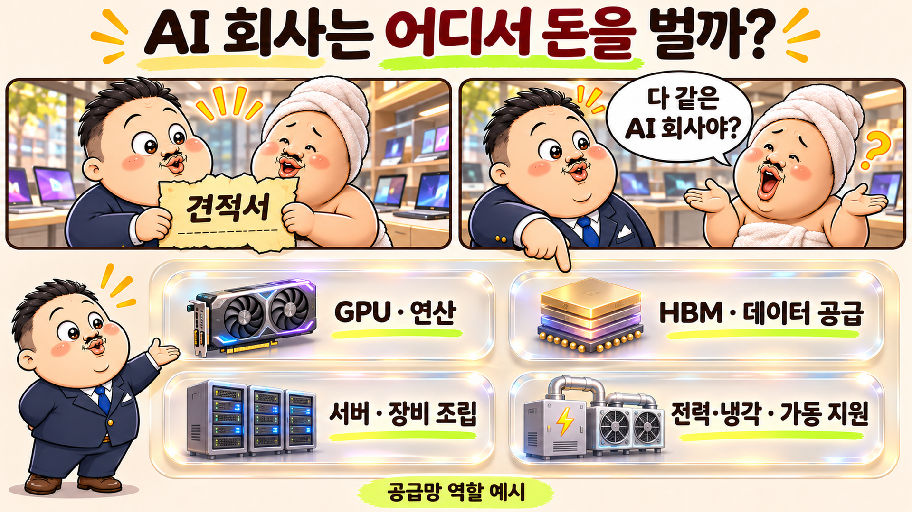

# AI 회사는 어디서 돈을 벌까?

서진이 동생에게 맞춰 줄 컴퓨터 견적서를 펼칩니다. 그래픽 카드, 메모리, 전원 장치가 각각 적혀 있습니다. 그런데 투자 앱은 부품 회사부터 냉각기 회사까지 모두 AI 관련주라고 묶습니다. “주문이 늘면 네 회사가 다 비슷하게 버는 거야?” 천억이가 견적서의 각 줄을 가리킵니다. 누구에게 무엇을 팔고, 그 대금에서 비용을 빼면 얼마나 남는지부터 읽어 봅시다.

*AI 공급망의 네 역할을 컴퓨터 견적서에 빗댄 그림입니다.*

**편집부가 만든 질문.** 그림에서 데이터를 빠르게 공급하는 부품과 장비의 가동을 지원하는 역할은 어디에 있나요?  
**답.** HBM은 연산 장치에 데이터를 빠르게 공급하는 고대역폭 메모리입니다. 전력·냉각은 전력 공급과 열 관리를 통해 장비 가동을 지원합니다. 서버 업체는 여러 부품을 조립해 납품할 수 있습니다.

## 네 기업의 숫자는 무엇을 세고 있을까?

아래 숫자는 각 회사가 보고한 연간 실적입니다. 결산일과 통화, 집계 범위가 다릅니다. 어느 기업의 주가가 가장 많이 올랐는지 비교하려면 같은 거래일과 시작 금액으로 별도 계산이 필요합니다. 자료 확인일은 2026년 11월 27일입니다.

| 역할과 기업 | 자료의 관측 기간 | 보고 수치 | 숫자의 범위 |
|---|---|---|---|
| 연산·네트워크 — 엔비디아 | 2026-01-25 종료 회계연도 | 데이터센터 193,737 / 전체 215,938백만 달러 | 데이터센터 최종시장 매출, 전체의 약 89.7% |
| 메모리 — SK하이닉스 | 2025-12-31 종료 회계연도 | 전체 매출 97.1467조 원, 전체 영업이익 47.2063조 원 | 회사 전체. HBM 매출은 전년 대비 약 두 배였다는 회사 설명 |
| 서버 — 델 | 2026-01-30 종료 회계연도 | AI 최적화 서버 순매출 24,683백만 달러 | 인프라 솔루션 그룹(ISG)의 한 제품군 |
| 전력·냉각 — 버티브 | 2025-12-31 종료 회계연도 | 전체 순매출 10,229.9백만 달러 | 여러 시장의 제품과 서비스가 들어 있는 회사 전체 |

- **엔비디아.** 데이터센터 매출에는 컴퓨트 162,361과 네트워킹 31,376백만 달러가 모두 포함됩니다. 두 직접 고객의 비중은 연간 전체 매출의 22%와 14%였습니다. 직접 구매자는 최종 사용자와 다를 수 있습니다. [엔비디아 FY2026 연차보고서](https://www.sec.gov/Archives/edgar/data/1045810/000104581026000038/a2026-annualxreportxwebxfi.pdf)
- **SK하이닉스.** HBM 매출 증가 배수와 회사 전체 매출을 함께 공개했지만, 위 두 수치만으로 HBM의 전체 매출 비중이나 별도 영업이익률을 계산할 수 없습니다. [SK하이닉스 연간 실적](https://news.skhynix.com/en/sk-hynix-announces-fy25-financial-results/) · [주주총회 설명](https://news.skhynix.com/en/78th-annual-general-meeting/)
- **델.** AI 최적화 서버 매출은 ISG 매출 60,826백만 달러의 **40.6%**, 델 전체 순매출 113,538백만 달러의 **21.7%**입니다. 같은 분자에 분모만 달리 썼습니다. ISG 영업이익은 5,579에서 7,111백만 달러로 늘었고, 영업이익률은 12.8%에서 11.7%로 내려갔습니다. 회사는 AI 최적화 서버 쪽으로 판매 구성이 바뀐 점을 매출총이익률 하락의 주된 이유로 설명합니다. [델 FY2026 Form 10-K](https://www.sec.gov/Archives/edgar/data/1571996/000157199626000008/dell-20260130.htm)
- **버티브.** 회사의 연간 순매출은 전년 대비 27.7% 늘었습니다. 회사 전체의 증가율에는 전력·열관리 제품과 서비스의 여러 시장이 포함됩니다. 위 총액에서 AI 전용 냉각 매출을 구할 수 없습니다. [버티브 2025 Form 10-K](https://www.sec.gov/Archives/edgar/data/1674101/000167410126000008/vrt-20251231.htm)

## 같은 고객이 주문을 줄이면

**가상 사례.** 원화 기준으로 두 공급사의 한 해 매출이 각각 100억 원이라고 가정합니다. 당초 단일 고객 매출은 A 40억 원, B 10억 원입니다. 다음 한 해 그 고객이 주문량을 25% 줄이고 단가와 다른 주문은 그대로라고 둡니다. 기업 세금과 차입 이자, 외부 입출금과 주식 거래, 환전, 분배와 재투자는 계산에 적용하지 않습니다.

| 가정 | A 매출 | B 매출 |
|---|---:|---:|
| 해당 고객 주문만 감소 | 90억 원 | 97억 5천만 원 |
| A가 다른 고객 주문 8억 원 확보 | 98억 원 | 97억 5천만 원 |

**반례.** A의 고객 집중도가 더 높아도 새 주문을 얼마나 빨리 다른 곳에서 받는지에 따라 매출의 순서가 바뀝니다. 새 주문의 단가나 원가가 달라지면 이익도 다시 계산해야 합니다.

## 투자 전에 확인할 공시 항목

1. **주문과 매출.** 주문이 쌓인 금액과 실제로 매출로 인식된 금액은 계약 조건과 납품·검수 시점에 따라 달라집니다.
2. **매출과 미수금.** 연간 매출의 고객 비중과 결산일 매출채권의 고객 비중은 분모와 시점이 다릅니다.
3. **설비와 현금.** 서버를 파는 쪽의 매출이 늘 때 사는 쪽에는 장비비가 먼저 나갈 수 있습니다. 설비투자·리스와 서비스 수입은 서로 다른 시점에 나타납니다.
4. **공급망 매출의 중복.** 서버 가격에는 부품 비용이 들어갈 수 있습니다. 부품 매출과 서버 매출을 합쳐 최종 고객의 지출로 해석하면 같은 비용이 거듭 들어갈 수 있습니다.
5. **ETF의 실제 노출.** 두 펀드에 50만 원씩 담고 같은 칩 기업의 비중이 각각 20%와 40%라면, 그 기업에 연결된 투자는 합계 30만 원입니다. 같은 시점의 가상 구성으로 수익·환율·비용·세금·분배를 반영하지 않은 값입니다.

**오늘 해볼 일.** 관심 기업 하나의 공시에서 제품이나 사업부 매출 한 줄을 찾고, 견적서에 품목을 적듯 “누구에게, 무엇을, 얼마에 팔았나”를 적어 보세요. 금액의 단위, 결산일, 회사 전체인지 제품군인지까지 함께 남기면 다음 실적에서 같은 숫자를 비교할 수 있습니다.

관련 장 [ROE가 두 배면 장사도 두 배 잘했을까?](EP072.md) · [PER 5배, 정말 싼 걸까?](EP074.md)
