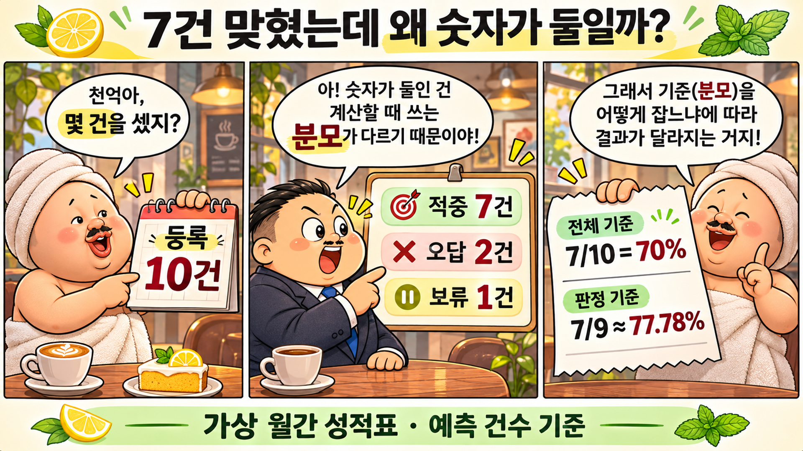

# AI 투자연구소 월간 성적표, 지난달 틀린 판단까지 남기는 법

*민호의 구독 달력과 문답은 편집부가 만든 질문과 가상 사례입니다.*

월말 아침, 수건을 머리에 두른 민호가 휴대폰 달력에 적어 둔 별표를 봅니다. 투자 소식지 구독을 연장할지 결정하는 날이에요. 지난달 판단을 일곱 번이나 맞혔다는 알림이 떠 있습니다. 그런데 앱에서는 적중률이 칠십 퍼센트, 전자우편에서는 칠십칠 점 칠팔 퍼센트라고 해요. 같은 편집부가 보낸 성적표인데 어느 쪽을 믿어야 할까요? 민호는 높은 숫자가 인쇄된 쪽을 천억이에게 보여 줍니다. 낮은 숫자는 계산 실수겠지?

천억이가 달력에 표시한 지난달 날짜를 손가락으로 짚습니다. 일곱 개 맞혔다는 말은 두 곳이 같네. 그런데 지난달에 뭘 몇 개나 알아보겠다고 했어? 민호는 그제야 휴대폰에서 그달 첫 소식지를 찾습니다. 종목 사진을 보고서는 기억이 났지만 몇 건을 약속했는지는 기억이 안 나요. 두 사람은 메일을 보낸 날짜순으로 다시 정렬합니다. 처음 편지에는 검증할 질문이 열 개 적혀 있습니다. 오늘 볼 것은 그 열 줄입니다. 이 이야기는 실제 연구소의 투자 실적이 아니라 편집부가 만든 한 달의 사례입니다.

## 빈칸 하나가 바꾸는 분모

접이식 달력 뒤에 빈칸을 열 개 그립니다. 맞힌 일곱 줄에 초록 점을 찍고 틀린 두 줄에 빨간 점을 찍었어요. 마지막 한 줄은 자료가 나오지 않아 하얗게 남았습니다. 여기서 전체 등록 건 중 오늘까지 맞았다고 확인한 몫은 일곱 나누기 열, 칠십 퍼센트입니다. 결론을 낼 수 있었던 건만 모아 그 안에서 맞힌 비율은 일곱 나누기 아홉, 약 칠십칠 점 칠팔 퍼센트예요. 두 숫자는 다른 질문에 대한 답이었습니다. 하나만 골라 정답이라고 하면 다른 쪽에서 물었던 것을 놓칩니다.

**그림 Q&A · 편집부가 만든 질문**　판정 기준의 분모에서 빠진 한 건은 어디에 있나요? 보류 칸에 남아 있습니다. 전체 기준은 7/10, 판정 기준은 7/9입니다.

민호가 흰 칸에 작은 물음표를 그립니다. 그럼 마지막 한 건은 반은 맞았다고 쳐 줄까? 자료가 늦었다는 사실은 절반을 맞혔다는 증거가 아니죠. 열 건 중 아홉 건에서 확인 가능한 결론이 나왔으니 판정이 끝난 비율은 구십 퍼센트입니다. 확인된 적중 일곱, 확인된 오답 둘, 미판정 하나를 합치면 처음 열 건이 됩니다. 이 세 수를 함께 보여 주면 독자는 적중률뿐 아니라 어느 정도까지 일을 끝냈는지도 볼 수 있어요. 반대로 칠십칠 점 칠팔이라는 소수점 둘째 자리만 보면 열 건을 약속했는지 천 건을 약속했는지조차 알기 어렵습니다.

천억이는 빈칸의 결말을 두 가지로 그려 봅니다. 늦게 온 자료를 확인했더니 맞았다면 최종 적중은 열 건 가운데 여덟 건, 팔십 퍼센트입니다. 틀렸다면 열 건 가운데 일곱 건, 칠십 퍼센트예요. 다른 아홉 건에 정정이 없고 마지막 건을 끝내 판정할 수 있다는 조건에서 가능한 범위가 나왔습니다. 이건 통계적으로 계산한 신뢰구간이 아니에요. 빈칸 하나를 맞거나 틀린 것으로 채울 때의 산술적인 양 끝입니다. 아예 자료가 영구히 사라지면 최종 단일값을 내지 못할 수도 있죠.

## 결과보다 먼저 고정할 한 문장

첫 소식지를 읽다 보니 민호가 유독 잘 기억하는 문장이 하나 있습니다. 이번 달 좋은 흐름이 기대된다는 말이에요. 이걸 적중이라고 어떻게 판단할까요? 중간에 하루 오르기만 해도 되는지, 마지막 날에 전달보다 비싸야 하는지, 비교 대상보다 덜 내려도 좋은 흐름인지 정해져 있지 않습니다. 뒤에서 답을 고를 수 있으면 결과가 어찌 나오든 그럴듯한 설명을 붙일 수 있어요. 편집부가 지난달 미리 정했어야 하는 건 멋진 제목보다 판정 가능한 한 문장입니다. 대상과 단위, 기간과 비교 기준이 그 안에 같이 있어야 합니다.

그래서 둘은 같은 질문을 두 버전으로 읽어 봅니다. 이번 달 펀드 갑이 강할 것이다. 이건 해석이 열려 있습니다. 다른 문장에는 이달 마지막 거래일의 원화 기준 종가가 전달 마지막 거래일 종가를 웃도는지 확인한다고 쓰여 있어요. 무엇을 볼지, 어떤 돈으로 셀지, 언제 자를지가 정해져 있죠. 만일 두 종가가 같으면 어떻게 할까요? 웃돈다는 조건을 택했다면 같음은 조건을 만족하지 못합니다. 같다를 별도 무승부로 둘 계획이라면 그것도 관측 전에 밝혀야 해요. 월말에 결과를 본 뒤 유리한 때만 무승부로 돌리는 건 비교하기 어려운 성적표를 만듭니다.

이번에는 시작값이 백이고 마지막 값이 백이라고 해 봅시다. 달 중간에는 백십까지 올랐어요. 마지막 값이 시작값보다 높은지를 물었다면 맞지 않았습니다. 중간에 한 번이라도 백오 이상에 닿는지를 물었다면 맞았어요. 같은 가격 경로가 질문의 동사 하나 때문에 반대 판정을 내놓습니다. 한 달 뒤에 그래프를 확대해서 꼭대기에 화살표를 붙이는 건 쉽습니다. 당시 약속이 중간 고점을 맞히는 것이었는지를 되찾는 일은 처음 문장을 보존했을 때만 가능해요. 민호는 달력 뒤 첫 번째 칸에 숫자 대신 당시 문장을 먼저 적습니다.

## 일곱 번 맞히고도 손실이 나는 계좌

한 달짜리 사례에는 돈을 넣거나 빼는 거래가 없어요. 기본 성적표의 단위는 맞힌 질문의 건수입니다. 원금도 통화별 투자금도 없고 비용, 세금, 분배금 재투자, 연율 환산도 적용하지 않아요. 그런데 민호는 칠십 퍼센트라는 숫자를 보면 자꾸 통장 잔액이 늘어난 모습을 떠올립니다. 일곱 번 맞힌 사람을 따라 샀다면 수익도 좋았을 거라는 생각이 들어서예요. 맞힌 횟수와 벌어들인 돈 사이에는 어떤 일이 얼마나 컸느냐는 한 단계가 더 있습니다. 그 차이는 별도 돈통을 놓고 계산해야 보입니다.

간단히 원화 십만 원짜리 독립된 가상 투자 아홉 건을 동시에 시작해 보죠. 원금은 구십만 원이고 추가 납입과 인출은 없습니다. 모두 한 달 뒤 끝내며 비용과 세금은 영 원, 분배와 재투자도 없습니다. 연간 수익으로 바꾸지 않겠습니다. 상승을 맞힌 일곱 건은 각각 일 퍼센트씩 올랐고, 틀린 두 건은 각각 십 퍼센트씩 내렸다고 정합니다. 맞힌 쪽에서 천 원씩 일곱 번, 칠천 원을 법니다. 틀린 쪽에서는 만 원씩 두 번, 이만 원을 잃어요. 합계로는 만 삼천 원 손실입니다. 구십만 원에서 약 일 점 사사 퍼센트가 줄었습니다.

반대로 맞힌 일곱 건이 각각 삼 퍼센트 오르고 틀린 두 건이 각각 일 퍼센트 내렸다면 적중 건수는 똑같습니다. 돈은 이만 천 원 벌고 이천 원 잃어서 만 구천 원 늘어요. 이 두 사례의 적중률을 보면 나란히 아홉 건 중 일곱입니다. 그 숫자만으로 두 계좌를 구별할 수 없어요. 실제 소식지에서는 질문 하나가 주문 하나와 정확히 일치한다는 보장도 없습니다. 수익률을 보여 주려면 투자 금액, 체결할 수 있던 시점, 비용을 포함한 별도의 일관된 가정이 필요합니다. 단순 적중 건수를 읽다가 투자 성적에 대한 결론까지 뛰어가면 안 되는 이유예요.

천억이는 민호의 달력에서 초록 점 세 개를 손으로 가립니다. 나머지만 보면 지난달 판단을 평가할 수 있겠어? 맞힌 사례만 골라 보여 주는 요약을 생각해 보자는 겁니다. 지난달에는 열 건이 있었지만 이번 달 메일에는 성공 사례 세 개만 실렸다면, 그 메일이 보여 주는 것은 골라낸 세 사례의 설명이에요. 세 건 중 세 건 성공했다는 말은 맞을 수 있어도 열 건의 월간 적중률을 말해 주지는 않습니다. 독자가 실제로 찾아야 할 것은 요약에 들지 않은 일곱 개의 자리입니다. 그 자리들이 첫 소식지의 목록에서 여전히 제 이름으로 남아 있는지 보면 됩니다.

목록을 일부러 골라내지 않아도 비슷한 누락이 생깁니다. 가상 펀드 하나가 중간에 청산돼 월말 가격표에서 사라졌다고 해 보죠. 내려받은 쪽에 남아 있는 펀드만 모으면 자연스럽게 그 상품이 빠지게 됩니다. 남은 상품 아홉 개의 성적은 구할 수 있어요. 다만 연구소가 열 개를 약속한 뒤 어떤 하나가 왜 사라졌는지는 독자에게 남겨야 합니다. 청산대금으로 성과를 계산하기로 했는지, 마지막 관측과 사유를 남기고 미판정 처리할지 처음의 규칙을 확인합니다. 빈칸을 영 원이라고 적으면 전액 손실로 오해할 수 있고 삭제하면 존재했던 위험 자체가 지워집니다.

## 월말과 공시일 사이

민호는 왜 각 질문에 번호를 붙이는지 이제 알 것 같다고 합니다. 친구에게 보이는 큼직한 회차 표시가 아니라 장부 안에서 같은 질문을 몇 달 뒤에도 찾기 위한 이름이에요. 제목이 바뀌거나 띄어쓰기가 조금 달라져도 같은 질문의 처음과 끝을 이어야 하죠. 지난달 마지막 한 건이 오늘 해결됐다면 새로 생긴 예측으로 하나 더 세지 않습니다. 지난달 약속의 결과가 오늘 도착했다는 표시를 하는 겁니다. 질문 열 개를 등록했는데 게시물 형식이 글과 만화와 영상 세 가지라고 해서 서른 번 예측한 것은 아니니까요.

달력에서 이제 시계를 들여다봅니다. 월요일 오전 아홉 시에 발행한 보고서와 월요일 오후 여섯 시에 바뀐 기업 공시가 있다고 해 볼게요. 겉에 적힌 날짜는 둘 다 월요일입니다. 오전에 내놓은 판단의 근거로 그날 저녁의 값을 써도 될까요? 시간 순서를 적어 보면 답이 나옵니다. 월요일 저녁 자료는 오전에는 아직 알려지지 않았습니다. 처음 보고서에서 정말 어떤 근거를 볼 수 있었는지 따지려면 단순히 자료의 대상 월만 볼 게 아니라 독자가 접근할 수 있게 된 시점까지 구분해야 합니다. 지역이 다르면 어느 시간대를 썼는지도 함께 남겨요.

예를 들어 분기 말이 구월 말이라는 표시와 그 자료가 십일월에 제출됐다는 표시는 서로 다른 역할을 합니다. 구월 말의 상태를 다룬 재무자료가 십일월에 처음 공개될 수 있어요. 십월에 했던 예측에 그 숫자를 이미 알았던 정보로 넣으면 실제로는 불가능했던 판단을 복원하게 됩니다. 미국 증권거래위원회의 전자공시 자료를 사용할 때 회사별 제출 기록과 재무 항목 데이터를 찾아볼 수 있습니다. 같은 회사 이름을 찾은 다음에는 어떤 제출 문서의 어느 기간 값인지, 언제 제출됐는지까지 맞춰 봐야 합니다. 오늘 내려받은 표라는 사실 하나만으로 십월의 지식 상태가 재현되지는 않습니다.

같은 숫자를 어디에서 읽었는지도 생각보다 중요합니다. 편집부가 만든 가상 공시에서 매출 칸에 백이 적혀 있고 단위가 백만 달러라고 해 보죠. 다음 파일에서도 옆에 똑같이 백이 보이는데 이번에는 금액 단위가 천 달러입니다. 둘을 같은 크기로 보면 천 배를 잘못 읽습니다. 또 누적 구 개월 수치와 직전 석 달 수치는 단위 통화가 같아도 기간이 달라요. 민호는 지난달 자료를 불러올 때 회사 이름과 금액만 저장해 둔 걸 아쉬워합니다. 값 옆에 단위와 대상 기간, 원문 내 항목을 옮겨 놓으면 다음 달의 자기가 그 숫자를 다시 해석할 수 있습니다.

## 정정 전후 성적을 연결하는 법

설명을 듣던 민호가 기발한 지름길을 냅니다. 잘못된 숫자가 보이면 최신 숫자로 옛 표를 싹 고치면 되겠네. 보고서 화면은 깔끔해지지만 답을 못 하는 질문이 하나 생깁니다. 그때 독자들은 무엇을 읽었을까요? 원자료가 발표 뒤 정정되는 일도 있고, 편집부가 원래 수치를 잘못 옮긴 일도 있을 수 있습니다. 둘 다 고쳐야 하지만 책임과 설명은 달라요. 전자는 원자료의 두 판을 연결하고, 후자는 당시 원문과 편집 오류를 명시해야 하죠. 과거 숫자와 바뀐 숫자를 모두 남기면 수정 사실 자체를 독자가 확인할 수 있습니다.

판정선 바로 옆의 숫자가 바뀌는 상황을 한번 만들어 봅시다. 편집부가 특정 수치가 오십 이상이면 맞음이라고 미리 정했습니다. 첫 발표는 사십구 점 팔이었고, 일주일 뒤 정정값은 오십 점 이입니다. 처음 발표에 근거한 판정은 틀림이고 수정값으로 다시 보면 맞음입니다. 가상 성적표에서 처음의 오답 둘 가운데 이 한 건이 포함돼 있었다면, 다른 행이 그대로일 때 확인 성공은 일곱에서 여덟이 되고 오답은 둘에서 하나가 돼요. 원자료가 늦은 마지막 한 건은 아직 빈칸입니다. 전체 기준 팔십 퍼센트, 판정한 아홉 건 기준 약 팔십팔 점 팔구 퍼센트입니다.

그렇다고 처음 전달한 칠십 퍼센트가 거짓 기록이 되는 걸까요? 당시 이용 가능했던 원자료 기준으로는 맞게 계산했을 수 있어요. 처음부터 판정할 때 최초 공표값을 쓰겠다고 약속했다면 그 기준의 공식 성적은 여전히 처음 숫자입니다. 최신 정정값으로 재계산한 참고 성적을 곁에 놓을 수는 있지만, 처음의 규칙까지 거슬러 바꿀 필요는 없죠. 민호는 이때 두 질문을 따로 씁니다. 그날 무엇을 알 수 있었나. 지금 가장 정확한 자료로 보면 무엇이 달라지나. 한 줄에 두 답을 다 담으려 하면 둘 중 하나가 사라집니다.

이번엔 값은 바뀌었지만 판정이 그대로인 경우를 떠올려 보죠. 최초 발표 오십일이 정정 뒤 오십이로 바뀌었다면 둘 다 오십 이상입니다. 적중 건수는 바뀌지 않아요. 하지만 예측한 수치가 관측값에 얼마나 가까웠는지 따지는 별도 항목이 있다면 그 오차는 달라질 수 있습니다. 예측값이 오십이었다면 처음엔 한 단위 차이, 정정 뒤에는 두 단위 차이죠. 방향을 맞혔는지와 숫자를 얼마나 가깝게 제시했는지는 다른 기준입니다. 구독자는 정정이 몇 건인가뿐 아니라 어느 결론을 바꿨는지 알고 싶을 수 있어요. 바뀐 숫자 옆에 영향을 받은 항목을 적어 주는 이유입니다.

천억이는 인공지능에게 지난달 결론을 다시 요약하게 했다는 설정을 더합니다. 새 요약은 훨씬 알아듣기 쉬워요. 하지만 원래는 조건부로 썼던 말을 확정처럼 고친다면 어떻게 될까요? 예를 들어 원문은 금리가 그대로라면 이 지표가 기준을 넘을 것으로 본다고 했습니다. 그런데 금리가 움직였고 지표도 넘지 못했어요. 나중에 조건 부분을 떼고 단정적인 문장으로 바꾸면 원래 검증해야 했던 것과 다른 예측이 됩니다. 반대로 결과가 맞은 뒤에만 조건을 슬쩍 붙여도 같은 문제가 생깁니다. 글을 쉽게 풀더라도 대상과 시점과 조건은 붙여서 보존해야 합니다.

## 두 달을 합칠 때의 계산

조건 자체가 발생하지 않은 질문은 어떻게 셀까요? 이번에는 기준 금리가 특정 값일 때만 평가하겠다고 발행 전에 정한 질문을 따로 봅시다. 그 조건이 끝내 성립하지 않았다면 자료가 늦은 것과는 이유가 달라요. 확인할 데이터는 있는데 예측이 적용될 상황이 오지 않았습니다. 조건 미발생과 자료 미도착을 구분해서 표시하면 다음 달에 무엇을 기다려야 하는지가 달라집니다. 자료 미도착은 후속 발표를 기다릴 수 있지만 특정 기간 동안의 조건 미발생은 그 기간이 지나면 확정될 수 있어요. 처음 약속에 그런 규칙이 없다면 사후에 멋대로 맞음으로 돌리지 않습니다.

민호가 찻잔 두 개를 옮겨 놓습니다. 지난달과 이번 달을 나란히 보려는 겁니다. 지난달에는 판단 가능한 아홉 건 중 일곱을 맞혔고 이번 달에는 단 한 건을 냈는데 그 한 건을 맞혔다고 하죠. 이번 달은 백 퍼센트니까 둘을 단순 평균 내서 약 팔십팔 점 팔구 퍼센트라고 써도 될까요? 한 달을 한 표로 취급하는 평균을 묻는다면 그 계산의 이름을 붙일 수 있습니다. 하지만 두 달 동안 판정한 전체 질문 중 맞힌 비율을 묻는다면 맞은 여덟 건을 판정된 열 건으로 나눠 팔십 퍼센트입니다. 작은 달 한 건의 영향이 어느 쪽에서 훨씬 크게 들어가는지 보이죠.

처음에 미판정이던 한 건도 그대로 추적해 보죠. 두 달간 등록한 전체 질문은 첫 달 열 건과 둘째 달 한 건을 합쳐 열한 건입니다. 전체에서 지금까지 확인한 성공은 여덟 건이니 약 칠십이 점 칠삼 퍼센트예요. 판정 완료율은 열한 건 중 열 건으로 약 구십 점 구일 퍼센트입니다. 민호는 처음에 숫자가 너무 많다고 느꼈지만 달력을 두 장 펼쳐 놓으니 각각 어느 칸을 세었는지 보입니다. 누구에게 무엇을 알려 줄지 먼저 정하면 필요한 숫자는 금방 줄어요. 나란히 놓고도 정의가 다른 숫자 중 큰 것만 골라서는 한 달의 개선을 판정할 수 없습니다.

그렇다면 지난달보다 예측을 잘했는지는 무엇과 견줘야 할까요. 상승과 하락만 있는 가상 시장에서 한 달간 열 종목 중 여덟 종목이 올랐다고 합시다. 처음부터 아무 분석 없이 열 개가 전부 오를 거라고 한 단순 규칙도 여덟 개를 맞힙니다. 편집부가 같은 열 개에서 일곱 개를 맞혔다면 적중이 절반을 넘겼다는 사실만으로 그 단순 규칙보다 나았다고 할 수 없어요. 반대로 하락 종목이 대부분인 달에 방향을 맞힌 일곱 건의 의미는 또 달라질 수 있습니다. 비교할 대상도 결과를 보기 전에 정하고 같은 질문, 같은 종료일에서 계산해야 합니다.

여기에는 평가 기회 수라는 문제도 있습니다. 한 팀은 확신이 아주 클 때만 두 건을 내고, 다른 팀은 스무 건 모두에 답한다고 해 봅시다. 두 건을 전부 맞힌 팀은 백 퍼센트, 스무 건 중 열여섯 건을 맞힌 팀은 팔십 퍼센트입니다. 적중률만 보면 첫 팀이 앞서지만 참여한 범위도 크게 다릅니다. 연구소가 구독자에게 매달 스무 항목을 점검하겠다고 했는지, 조건에 맞을 때만 두 항목을 내겠다고 했는지에 따라 약속 이행의 의미가 달라요. 안 낸 열여덟 건을 틀렸다고 단정할 수도 없고 애초에 점검하려던 범위를 모른 척할 수도 없습니다.

## 규칙을 고른 달과 시험한 달

천억이는 다음 면에 도장을 세 번 찍습니다. 세 도장이 모두 같은 날짜, 같은 기업, 같은 실적 발표를 가리키면 독립된 세 번의 판단일까요? 한 문장을 제목, 본문 요약, 질문 답변에 세 번 썼을 수도 있습니다. 한 사건에 연결된 세 판단이 진짜로 다른 질문이라 해도 같은 원자료의 충격을 함께 받을 수 있어요. 적중 건수 열 개가 서로 무관한 열 번의 실험이었다고 가정하면 확신을 부풀릴 수 있습니다. 그래서 월간 성적표에는 질문의 고유한 단위와 서로 같은 사건을 공유하는 항목을 표시하는 것이 좋습니다. 문장을 잘게 나눈 만큼 실력이 늘었다고 셀 수는 없습니다.

민호는 인공지능에게 조건을 여러 번 바꿔 물어본 일을 떠올립니다. 첫 답이 마음에 안 들어 기간을 이 주에서 한 달로 늘리고, 비교 지수를 바꾸고, 성과가 나빴던 종목을 하나 뺐더니 멋진 결과가 나왔어요. 과거 자료에서 여러 규칙을 시험한 다음 가장 좋아 보인 조합만 뽑으면 무엇이 문제일까요? 그 조합이 우연히 그 자료에 잘 맞았을 가능성이 커집니다. 베일리와 공동 연구자들이 다룬 백테스트 과적합의 문제가 이런 선택 과정과 관련 있어요. 여기서는 그 논문의 확률 수치를 우리 소식지의 적중률로 옮기지 않습니다. 두 문제의 표본과 질문이 다르니까요.

실습으로 규칙 세 가지를 고른 상황을 놓아 볼게요. 한 달 뒤에 가장 성적이 좋은 규칙을 골랐다면 그 달은 규칙을 고르는 데 사용한 기간입니다. 그 성적으로 다음 달에도 잘할 거라고 증명했다는 설명을 붙이기는 어렵습니다. 선정에 쓴 기간을 표시하고 그 뒤의 새 기간에서는 선택한 규칙을 미리 고정해야 해요. 새 기간 중간에 또 바꾸면 그때부터는 새 규칙으로 이어진 별개의 기록입니다. 그전 판단을 조용히 새 기준으로 갈아 끼우면 고른 시간과 시험한 시간이 계속 뒤섞입니다. 어느 시점부터 바뀐 규칙이 적용됐는지 선 하나가 독자에게는 큰 차이를 만듭니다.

이제 민호가 소식지에서 실제로 보고 싶던 것이 나옵니다. 자기가 좋아하는 펀드가 이번 달 비교 지수를 이겼다는 주장입니다. 펀드의 한 주 가격이 백에서 구십구로 내려가고 같은 기간에 현금 이 단위를 지급했다고 해 보죠. 이번 계산은 원금 백 단위로 한 주만 보유한 한 기간 사례입니다. 추가 입출금은 없고 세금과 비용은 영, 받은 돈은 끝까지 현금으로 둡니다. 가격 변화는 마이너스 일 퍼센트지만 마지막 한 주와 현금을 더하면 백일, 단순 총수익은 플러스 일 퍼센트입니다. 어느 쪽 숫자를 비교할지는 비교 지수에서 분배를 어떻게 처리하는가에 달려 있어요.

## 틀린 두 줄을 다시 찾는 날

분배를 반영한 펀드 숫자와 가격만 반영한 지수 숫자를 섞으면 차이가 운용 실력처럼 보일 수 있습니다. 반대로 재투자를 전제로 계산한 장기 성과와 생활비로 현금을 다 쓴 독자의 계좌를 그대로 맞대도 어긋나죠. 미국 증권거래위원회의 투자자 안내는 펀드가 분배할 수 있는 돈과 재투자 선택을 설명합니다. 지급을 받았다는 사실만으로 그달 투자 손익 전체를 대신할 수 없다는 점을 확인할 수 있어요. 자료의 출처가 정확해도 가져온 두 숫자의 산식이 서로 다르면 비교 결론이 흔들립니다. 민호는 원문 주소 옆에 가격 기준인지 총수익 기준인지 적습니다.

월별로 원화와 달러가 바뀐 경우도 생각해 봅시다. 첫 달에는 달러 투자자 기준, 둘째 달에는 한국 독자의 원화 환산 성적을 사용했다면 두 결과를 같은 선으로 이을 수 있을까요? 한 달에 달러로 백에서 백으로 제자리였어도 환율이 달러당 천 원에서 천백 원으로 움직이면 원화 가치는 십만 원에서 십일만 원이 됩니다. 한 기간, 추가 납입과 인출 없음, 환전비용과 세금과 분배금 없음이라는 가정입니다. 원화 기준 십 퍼센트가 어떤 독자의 실제 수익인지까지 말하려면 실제 환율과 거래 조건을 봐야 합니다. 같은 성과라는 단어라도 어떤 통화로 장부를 쓰는지 표 머리에 밝혀야 하죠.

민호는 여기서 한 가지 더 까다로운 질문을 합니다. 규칙을 다 지켜도 틀린 예측이 나오면 그 소식지는 아무 소용이 없는 걸까? 틀린 판단을 쉽게 찾을 수 있는 것은 다른 종류의 가치가 있습니다. 예를 들어 오답 두 건 중 하나는 숫자 단위를 잘못 옮긴 편집 오류, 다른 하나는 자료를 올바르게 읽었지만 미래 방향을 잘못 예상한 경우일 수 있어요. 첫째는 단위 확인 절차를 고칠 수 있고 둘째는 예측 가정과 관련 근거를 재검토할 수 있습니다. 적중률 하나로 두 문제를 같은 실패로 묶으면 다음 호에서 무엇을 바꿔야 할지 보이지 않습니다.

반대로 적중한 한 건에도 잘못된 계산이 숨어 있을 수 있어요. 두 번의 실수가 서로 지워져 결론의 방향만 우연히 맞았을 수 있으니까요. 달러 단위를 잘못 읽고 비교 시점까지 잘못 골랐는데도 최종 결론이 상승으로 같다면 결과 칸은 맞음, 근거 검토 칸은 수정 필요입니다. 민호는 결과 판정과 자료 품질을 한 색깔로 칠하던 습관을 고칩니다. 독자에게 중요한 것은 맞혔다고 쓰였느냐뿐 아니라 다음에 같은 방법으로 다시 셈할 수 있느냐이기도 해요. 검산 가능한 원문과 단위가 빠지면 성적이 좋아도 재현하기 어렵습니다.

지난달을 복원하는 마지막 연습입니다. 민호는 열 개의 질문 중 일부만 선택해 흥미로운 사례를 이야기로 만들 수 있습니다. 단, 열 건 전체의 상태표로 돌아갈 길은 남겨야 해요. 원문을 통째로 다시 배포하기 어려운 자료라면 공개가 허용된 출처 이름과 문서 식별 정보, 관측 범위와 산식을 남깁니다. 독자가 필요한 권한을 갖고 있다면 같은 경로에서 다시 계산할 수 있고, 그렇지 않으면 어디까지 직접 확인할 수 없었는지 알 수 있죠. 보이지 않는 유료 표를 직접 확인했다고 대신 보증하는 것과 출처와 한계를 알려 주는 건 다른 일입니다.

민호는 이제 편집부가 만든 질문 하나에 자기 말로 답할 수 있습니다. 원자료가 늦은 흰 칸만 다음 달로 옮기면 이번 달 성적이 좋아질까요? 오늘 화면에서 숫자를 크게 보이게 할 수는 있어요. 그런데 옮긴 한 건은 지난달에 등록했던 판단이었고 독자가 그 약속을 들은 날도 그대로입니다. 다음 달 발표일을 붙여 결과를 갱신하고 지난달 표의 그 칸으로 연결하는 편이 두 달의 관계를 정확히 보여 줍니다. 지난달 열 건이었던 모집단을 아홉으로 줄이면 숫자가 예뻐져도 달력 한 장을 잃는 셈이에요.

천억이가 물잔을 비우고 휴대폰을 돌려줍니다. 민호는 구독 연장 버튼 앞에서 처음과 다른 질문을 적습니다. 몇 퍼센트 맞혔나요 대신 지난달 틀린 두 줄 중 하나를 원문부터 정정까지 보여 줄 수 있나요 하고요. 실제로 뭘 살지, 소식지를 계속 구독할지는 독자가 결정합니다. 오늘 할 일은 지난달 판단 하나를 골라 발표 때의 문장과 확인 날짜를 같은 줄에 써 보는 것만으로 충분해요. 그 줄에 근거와 단위와 판정이 들어가면 다음 달에는 기억 대신 기록으로 확인할 수 있습니다. 민호는 달력의 별표를 지우지 않습니다. 별표 옆에 작은 빈 네모를 하나 더 그립니다. 늦게 도착할 마지막 답이 돌아올 자리입니다.

**자료 시점**　원문 확인일 2026년 11월 27일. 열 건의 판단은 가상 한 달 사례입니다. 실제 연구소 성적과 투자 실적은 측정하지 않았습니다.

**원문**　[미 SEC EDGAR 데이터 정의](https://www.sec.gov/search-filings/edgar-application-programming-interfaces) · [미 SEC 펀드 분배금 안내](https://www.investor.gov/introduction-investing/general-resources/news-alerts/alerts-bulletins/investor-bulletins/fund-distributions-investor-bulletin) · [Bailey 외 백테스트 과적합 논문](https://www.davidhbailey.com/dhbpapers/backtest-prob.pdf)

**이어 읽기**　[증권·코인 계좌 보안, 휴대폰을 바꾸기 전 확인할 일곱 가지](EP099.md) · [전자책 목차](목차.md) · [분배락 뒤 당일 손실과 실제 입금](FAQ03.md)
