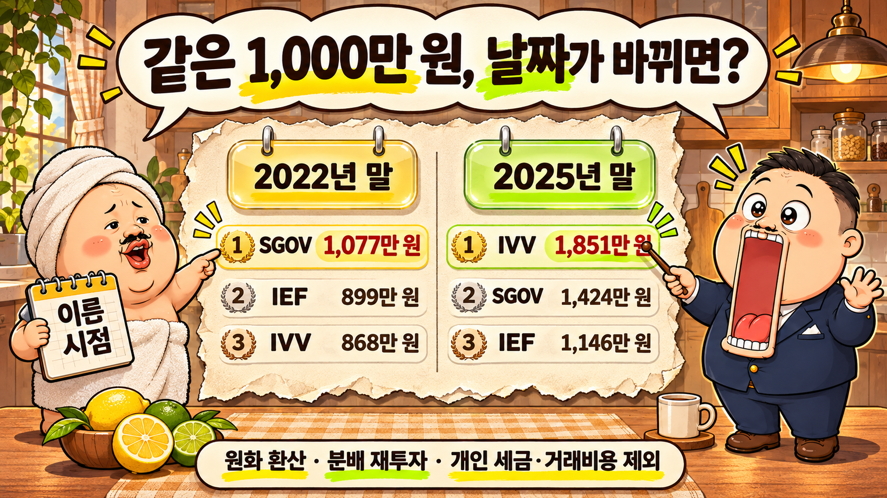

# 같은 1,000만 원, 날짜가 바뀌면?

**편집부가 만든 질문.** 엄마가 전세 계약 날짜에 동그라미를 칩니다. 1,000만 원을 미국 대형주나 미국 국채에 넣었다면, 계약금을 내는 날 얼마가 있었을까요?

**답.** 2021년 말 출발한 세 상품의 공시 수익률을 적용했을 때 2022년 말에는 초단기 국채 ETF가, 2025년 말에는 미국 대형주 ETF가 가장 높은 원화 평가액을 기록했습니다.

*2021년 말 공통 출발. 운용사 공시 총수익률과 연준 환율을 가상 원금에 적용했습니다. 만 원 단위 반올림.*

**편집부가 만든 질문.** 2025년 말 가장 높은 IVV는 2022년 말에도 가장 높았나요?  
**답.** 첫해 말에는 **SGOV 약 1,077만 원**, **IVV 약 868만 원**이었습니다. IVV의 4년 말 평가액은 약 1,851만 원입니다.

## 1,000만 원이 매년 말 얼마였을까?

**가정과 관측값.** 2021년 말에 상품마다 1,000만 원을 한 번 투자하고 2025년 말까지 납입·인출이 없다고 가정했습니다. 운용사 공시의 달러 기준 순자산가치 총수익률은 분배 재투자와 펀드 비용을 반영합니다. 개인 세금·거래비용·호가 차이·환전비용은 제외했습니다. 공시 연간 수익률 네 개를 복리로 연결해 누적했습니다. 2022~2025년은 자료 확인일 현재 최근 완료된 4개 달력 연도입니다. 주식과 국채 두 만기를 비교하기 위해 세 상품을 골랐습니다.

| 연말 | IVV 미국 대형주 | SGOV 0~3개월 미국 국채 | IEF 7~10년 미국 국채 |
|---|---:|---:|---:|
| 2021 출발 | 10,000,000원 | 10,000,000원 | 10,000,000원 |
| 2022 | 8,680,111원 | 10,769,827원 | 8,987,578원 |
| 2023 | 11,228,172원 | 11,598,957원 | 9,536,789원 |
| 2024 | 16,064,482원 | 13,979,189원 | 10,850,806원 |
| 2025 | 18,505,277원 | 14,243,465원 | 11,461,099원 |

2025년 말 IVV와 SGOV의 차이는 약 **426만 원**입니다. 2022년 말에 1,000만 원이 필요했다면 IVV와 같은 평가액으로는 약 **132만 원**이 부족했습니다. 표는 공시 수익률을 가상 원금에 적용한 근삿값입니다.

| 관측 연도 | IVV 달러 총수익률 | SGOV 달러 총수익률 | IEF 달러 총수익률 | 환율 관측일 | 원/달러 |
|---|---:|---:|---:|---|---:|
| 2021 출발 | — | — | — | 2021-12-30 | 1,188.59 |
| 2022 | −18.13% | +1.58% | −15.23% | 2022-12-30 | 1,260.18 |
| 2023 | +26.27% | +5.13% | +3.58% | 2023-12-29 | 1,290.97 |
| 2024 | +24.98% | +5.28% | −0.61% | 2024-12-31 | 1,477.86 |
| 2025 | +17.85% | +4.24% | +8.06% | 2025-12-31 | 1,444.55 |

계산식은 **1,000만 원 × 해당 연도까지의 달러 총수익 배율 × 해당 연말 환율 ÷ 출발 환율**입니다. 환율은 연도별 마지막 관측값을 사용했습니다. 연준 H.10은 2021년 12월 31일에 관측값을 제공하지 않아 30일 값을 적용했습니다. 기준일과 환율 관측일은 표에 각각 적었으며 원문 확인일은 2026년 11월 27일입니다. [IVV 공식 공시](https://www.ishares.com/us/products/239726/ishares-core-s-p-500-etf-ivv) · [SGOV 공식 공시](https://www.ishares.com/us/products/314116/ishares-0-3-month-Treasury-bond-etf) · [IEF 공식 공시](https://www.ishares.com/us/products/239456/ishares-7-10-year-treasury-bond-etf-ief) · [연준 H.10 원/달러](https://www.federalreserve.gov/releases/h10/Hist/dat00_ko.htm)

## 표를 내 돈에 대입할 때

1. **필요한 날짜.** 4년 말의 1위와 첫해 말의 1위가 달랐습니다.
2. **통화.** IEF의 4년 달러 총수익은 약 −5.70%였지만 같은 기간 달러당 원화 환율이 높아져 원화 평가액은 약 +14.61%였습니다.
3. **환율 반례.** 위 달러 수익을 유지하고 최종 환율만 시작보다 20% 낮다고 가정하면, SGOV의 원화 기말 평가액은 약 938만 원입니다.
4. **분배.** 생활비로 인출한 분배금에는 이후 재투자 수익이 붙지 않습니다.
5. **호가.** 표는 순자산가치 기준입니다. 매수·매도 내역에는 실제 체결가격을 사용합니다.
6. **비용.** 양쪽 환전에 각각 0.5%의 비용이 발생한다는 가정이면 IVV의 기말은 약 1,832만 원입니다.
7. **세금.** 세후 현금화액에는 개인별 계좌·분배·거래 내역을 적용합니다.
8. **국채 만기.** 같은 미국 국채를 담아도 만기 구성이 다르면 금리에 대한 가격 민감도가 다릅니다.
9. **낙폭.** IVV는 첫해 말 원화 평가액이 출발점보다 13.20% 낮았습니다. 일중·일별 최대 낙폭은 연말 표로 산출할 수 없습니다.
10. **정기 리밸런싱.** 처음에 똑같이 나누고 그대로 두는 경우와 매년 비중을 다시 맞추는 경우는 다른 거래입니다.
11. **비교 대상.** 표의 순위는 세 상품과 선택한 기간에 한정됩니다.

**오늘 해볼 일.** 수익률 표 옆에 내 돈을 쓸 날짜와 통화를 적고, 그 날짜에 가장 가까운 평가액을 함께 읽어 보세요.

관련 장 [달러 수익과 원화 손익](EP056.md) · [내년에도 쓰는 ETF 비교표](EP070.md)
