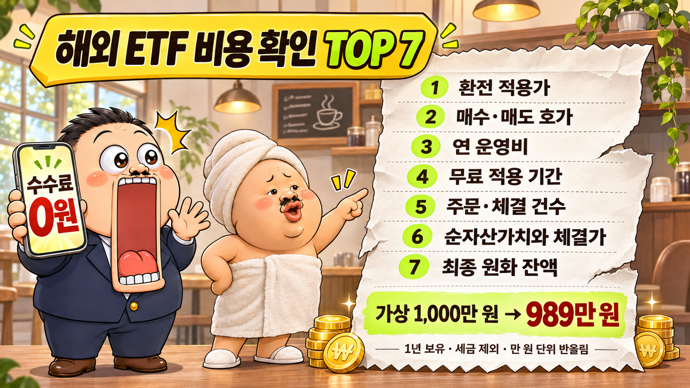

# 해외 ETF 비용 확인 TOP 7

**편집부가 만든 질문.** 지호가 식탁에서 ‘수수료 0원’ 화면을 부모님께 보여 줍니다. 원화를 달러로 바꿔 ETF를 사고, 1년 뒤 팔아 원화로 돌려도 비용은 0원일까요?

**답.** 직접 거래 수수료가 0원이어도 환전에 적용된 가격, 매수·매도 호가 차이, 펀드 운영비가 최종 잔액에 영향을 줍니다.

*가상 1년. 확인 순서이며 사람마다 비용 크기는 달라질 수 있습니다. 만 원 단위 반올림.*

**편집부가 만든 질문.** ‘수수료 0원’인 가상 거래에서 1,000만 원은 얼마가 됐나요?  
**답.** 환전·호가·펀드 운영비를 반영한 최종 잔액은 **약 989만 원**입니다.

## 영수증을 읽는 일곱 순서

1. **환전 적용가.** 같은 시점 참조값이 1,000원이어도 달러를 살 때 1,003원, 팔 때 997원이 적용됐다면 환전만 왕복한 잔액은 약 994만 원입니다.
2. **매수·매도 호가.** 100.10달러에 사서 99.90달러에 바로 파는 가상 50주 거래라면 차이는 10달러입니다. 실제 호가와 체결 수량을 함께 봅니다.
3. **연 운영비.** 1,000만 원이 일정한 단순 모형에서 연 0.30%는 1년 3만 원입니다. 공시 총수익에 이미 반영된 운영비를 다시 차감하면 중복됩니다.
4. **무료 적용 기간.** 주문 날짜·시장·채널과 종료 후 적용 요율을 확인합니다. 가상 사례에서 첫 달 매수만 무료이고 매도 요율이 0.10%라면, 이후 매도대금 1,000만 원에서 1만 원을 냅니다.
5. **주문·체결 건수.** 체결당 3,000원이라는 별도 가정에서 한 번 사고 한 번 팔면 6,000원, 다섯 번 사고 한 번 팔면 18,000원입니다. 주문당인지 체결당인지 약관을 봅니다.
6. **순자산가치와 체결가.** 같은 시각 순자산가치 100달러, 양쪽 호가의 가운데 100.50달러, 실제 매수가 100.60달러라면 순자산가치와 체결가 차이 0.60달러에 호가 쪽 0.10달러가 이미 포함됩니다.
7. **최종 원화 잔액.** 실제 발생 순서대로 받은 달러와 체결 금액, 매도 후 적용 환율을 넣습니다.

### 1,000만 원에서 109,442원이 줄어든 계산

**가상 조건.** 첫날 원화 1,000만 원을 한 번 납입해 같은 해외 ETF를 한 번 삽니다. 1년 뒤 한 번 팔아 원화로 바꾸고, 중간 납입·인출은 없습니다. 참조 환율과 ETF의 비용 차감 전 기준 가격은 일정하며 비용 차감 전 연 수익률은 0%입니다. 분배·재투자, 이자, 개인 세금과 직접 주문 수수료는 0입니다. 소수점 매매로 전액을 투자하며, 순자산가치와 호가 가운데가 같은 것으로 둡니다. 가상 연 운영비율 0.30%는 편의상 매도 가격에 한 번 적용합니다.

**계산.** 10,000,000원 ÷ 1,003원/달러 × (99.90 ÷ 100.10) × 0.997 × 997원/달러 ≈ **9,890,558원**. 중간에는 반올림하지 않았습니다. 위의 행사·건별 수수료·별도 괴리 사례는 이 합계에 포함되지 않습니다.

**반례.** 비교 시점 이전에 달러를 보유했고 거래 후에도 달러로 둔다면, 그 비교 구간의 새 환전 비용은 없습니다. 반대로 같은 모형에서 3개월만 보유하면 0.30% 연 운영비의 단순 근사는 7,500원으로, 1,000만 원에서 왕복 호가 차이를 적용한 약 2만 원보다 적습니다.

호가 중앙값은 관측 기간의 요약입니다. 주문 시점의 호가와 수량은 따로 확인합니다. 연 운영비 면제가 끝나는 날짜나 환전 우대가 적용되는 계좌도 상품 설명서와 요금표를 확인합니다. 자료 확인일은 2026년 11월 27일입니다. [SEC 투자자 안내 ETF 거래와 호가](https://www.investor.gov/introduction-investing/general-resources/news-alerts/alerts-bulletins/investor-bulletins-24) · [SEC 투자자 안내 펀드 비용](https://www.investor.gov/introduction-investing/general-resources/news-alerts/alerts-bulletins/investor-bulletins/mutual-fund-and-etf-fees-and-expenses-investor-bulletin)

**오늘 해볼 일.** 최근 주문 한 건의 환전 적용가·체결가·직접 수수료를 날짜와 통화까지 한 장에 적고, 화면에 보이는 0원이 어느 항목인지 표시하세요.

관련 장 [보수가 낮은 ETF가 정말 더 쌀까?](EP068.md) · [ETF 괴리율, 날짜부터 맞춰요](EP092.md)
