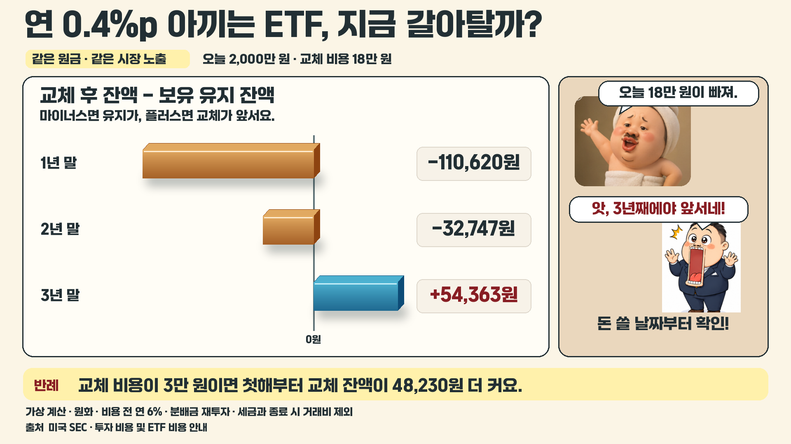

# ETF 갈아타기 손익분기점, 연 0.4%p를 아끼려면 몇 년이 필요할까?

## 주문 직전에 18만 원이 나타났다

가상의 천억이가 수건 친구에게 휴대폰을 내밉니다. “같은 지수를 따라가는데 저쪽이 일 년에 0.4%포인트나 싸. 바로 옮겨?” 수건 친구가 화면을 내립니다. 이미 보유한 ETF를 팔고 다른 ETF를 사는 선택입니다. 둘이 가정한 총 교체 비용은 18만 원. 낮은 비용률은 앞으로 매년 적용되지만, 18만 원은 오늘 장부에서 빠집니다. 천억이는 주문창을 닫고 달력을 엽니다. 이 돈을 언제 쓸지 먼저 알아야 답이 나옵니다.

## 두 상품의 출발선에 같은 돈을 올린다

가상 ETF A를 지금 2,000만 원어치 보유했다고 놓습니다. 오늘부터 두 상품 모두 비용 전 연간 총수익률이 6%로 일정하고, 동일한 자산 노출을 갖는다고 가정합니다. 총수익에는 분배금 전액 재투자를 반영합니다. 연간 비용의 효과를 단순화해 A는 0.50%포인트, B는 0.10%포인트를 수익률에서 빼고 각 연말에 장부를 닫습니다. 각각 연 5.50%, 5.90%입니다. 실제 펀드의 비용 공제 시점이나 수익 경로를 재현한 수치는 아닙니다. 전부 원화 기준이고 환율, 추가 납입, 물가, 종료 시의 매도비와 세금은 제외합니다. 교체 비용은 오늘 투자 잔액에서 차감하는 가상의 거래 마찰입니다. 특정 계좌나 국가의 세법을 적용한 사례는 아닙니다.

## 싼 상품이 첫해에 졌다

A를 유지하면 2,000만 원 전부가 첫해를 보냅니다. B로 교체하면 1,982만 원에 첫해 수익률을 적용합니다. 첫해 말 잔액은 각각 2,110만 원과 2,098만 9,380원입니다. 낮은 비용률의 B가 11만 620원 뒤집니다. 천억이는 처음에 2,000만 원에 0.4%를 곱해 8만 원을 떠올렸습니다. 그런데 두 상품의 첫해 시작 잔액부터 다릅니다. 일찍 빠져나간 원금에는 그해의 재투자 수익도 붙지 않습니다.

## 달력의 세 번째 칸에서 순서가 바뀐다

오늘 평가액을 V, 일회성 교체 비용을 C, 보유할 햇수를 n이라고 두면 유지 장부는 V × 1.055ⁿ, 교체 장부는 (V − C) × 1.059ⁿ입니다. 아래 금액은 복리 계산을 마친 뒤 원 단위로 반올림했습니다.

| 오늘부터 | 보유 유지 | 18만 원 내고 교체 | 3만 원 내고 교체 |
|---|---:|---:|---:|
| 1년 | 21,100,000원 | 20,989,380원 | 21,148,230원 |
| 2년 | 22,260,500원 | 22,227,753원 | 22,395,976원 |
| 3년 | 23,484,828원 | 23,539,191원 | 23,717,338원 |
| 5년 | 26,139,200원 | 26,398,755원 | 26,598,544원 |

18만 원 조건에서는 2년 말에도 유지가 앞섭니다. 3년 말에는 교체한 쪽이 앞섭니다. 반면 교체 비용이 3만 원인 반례에서는 첫해 말부터 교체 장부가 큽니다. 같은 비용률 차이를 보고도 1년 뒤 전세 보증금에 쓸 사람과 5년 동안 건드릴 계획이 없는 사람은 서로 다른 달력 칸부터 봅니다.

*원화 가상 비교. 그래프의 0원은 두 잔액이 같다는 뜻이다.*

## 몇 년인지 알아냈다면 이번에는 비용을 거꾸로 계산한다

수건 친구는 올해 안에 돈을 쓸 수도 있다고 합니다. 그럼 몇 년 뒤가 아니라 **주문할 때 얼마까지 내도 되느냐**가 질문입니다. 두 장부를 같게 놓고 C를 풀면 V × [1 − (1.055 ÷ 1.059)ⁿ]입니다. 이 예시에서 1년의 교체비 손익분기 금액은 약 7만 5,543원입니다. 2년은 약 15만 801원, 3년은 약 22만 5,774원입니다. 이 금액은 각각 해당 시점의 두 장부가 같아지는 오늘의 비용입니다. 가격 차이가 18만 원에서 7만 원으로 줄어든다면 1년짜리 장부의 판단부터 달라집니다. 반대로 새 ETF의 순수익률이 기존 상품과 같아지면, 양의 일회성 교체 비용을 회수할 수 있는 시점은 이 모델에 없습니다.

## 18만 원의 구성부터 확인한다

미국 SEC 투자자 안내문은 펀드 자산에서 지급되는 운용비용과 투자자가 주문할 때 부담할 수 있는 중개 수수료를 구분하고, 호가 차이나 순자산가치 대비 거래가격 차이도 설명합니다. 거래할 예정인 수량에서 호가가 어떻게 잡히는지 살펴보면, 보이는 첫 호가와 주문 전체의 체결 예상 단가가 다를 때도 있습니다. 스프레드를 별도로 잡을 때는 체결 예상 단가에 이미 넣은 항목을 두 번 차감하지 않습니다. 매도와 매수 수수료도 각 주문에서 계산합니다. 매도 때문에 지금 내야 할 세금이 있다면 실제 계좌의 적용 조건을 따로 확인합니다. 양쪽을 미래에 모두 매도할 계획이라면 그때의 세후 장부도 함께 계산해야 합니다. 오늘 앞당겨 낸 세금과 미래에 남아 있을 세금 부담을 같은 것으로 놓으면 비교가 어긋납니다.

## 새 돈만 다른 상품에 넣는 선택지도 있다

천억이는 기존 ETF를 모두 내놓는 장면만 생각했습니다. 수건 친구는 다음 달에 들어올 새 돈에 동그라미를 칩니다. 새 돈만 B로 보내면 이미 들고 있는 A의 매도는 발생하지 않습니다. 대신 A 잔액에는 A의 비용이 계속 반영되고, 종목 두 개를 관리해야 합니다. 새로 납입할 돈이 적으면 전체 계좌의 비용률도 천천히 바뀝니다. 예를 들어 같은 시점에 A 2,000만 원을 그대로 두고 신규 500만 원만 B에 넣는다면, 시작 잔액 기준 단순 가중 연 비용률은 0.42%입니다. 이후 두 잔액의 비율이 변하면 가중 비용률도 달라집니다. ETF 둘을 비교할 때는 상품 이름에 같은 지수가 들어가는지만 볼 게 아니라 추종 지수, 환헤지 여부, 분배금 처리, 공시된 비용 감면의 종료 조건까지 맞춰 봅니다. 과거 공시 기준가 총수익을 별도로 비교한다면 그 수익에 반영된 펀드 운용비를 다시 빼지 않습니다.

## 달력 첫 장에 금액 하나를 쓴다

천억이가 다시 주문창을 열었습니다. 이번에는 ‘수수료 몇 퍼센트’ 대신 ‘오늘 옮기면 얼마가 빠지나’를 적습니다. **직접 확인하기.** 내 계좌의 교체 후보 두 종목에 대해 같은 거래 금액으로 기존 상품의 매도와 후보 상품의 매수에 드는 예상 현금 유출을 현재 시점의 원화 금액으로 기록해 보세요. 비교표에서 내가 돈을 쓸 날짜에 해당하는 행과 나란히 놓으면, 낮은 비용률에 서두를 이유가 있는지 계산할 수 있습니다.

**편집부 Q&A · 연 0.4%포인트는 0.4%와 같은 말인가요?** 연 0.50%에서 0.10%로 바뀐 차이는 0.40%포인트입니다. 기존 비용률 대비 감소율로 표현하면 80%입니다. 실제 연말 금액 표에는 두 상품의 시작 잔액과 각 연도의 수익률이 함께 반영됩니다.

**편집부 Q&A · 교체 비용 18만 원이면 언제나 3년인가요?** 이 원금과 고정 수익률을 둔 장부에서는 첫 역전이 3년 말에 보입니다. 잔액, 순수익 차이, 주문비, 세금이 달라지면 새 장부를 계산합니다. 3년은 이 사례의 연말 관측 결과입니다.

## 원문

- [미국 SEC · How Fees and Expenses Affect Your Investment Portfolio](https://www.investor.gov/introduction-investing/general-resources/news-alerts/alerts-bulletins/investor-bulletins/updated)
- [미국 SEC · Mutual Fund and ETF Fees and Expenses](https://www.investor.gov/introduction-investing/general-resources/news-alerts/alerts-bulletins/investor-bulletins/mutual-fund-and-etf-fees-and-expenses-investor-bulletin)
