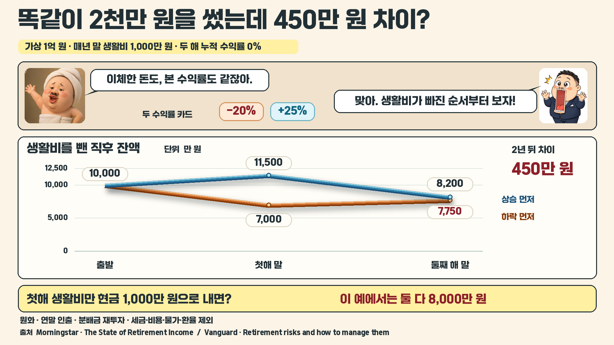

# 은퇴 첫해 ETF가 20% 하락하면? 수익률이 같아도 생활비를 빼면 450만 원 차이

## 통장에 넣을 천만 원은 같은 날 필요하다

가상의 수건 친구가 달력에 생활비 이체일을 표시합니다. 천억이는 두 장의 수익률 카드를 식탁에 올렸습니다. 한 장에는 마이너스 20퍼센트, 다른 한 장에는 플러스 25퍼센트가 적혀 있습니다. 두 카드를 어느 순서로 넘겨도 두 해를 합친 시장 수익률은 0퍼센트입니다. 수건 친구가 묻습니다. “그럼 둘 다 생활비를 똑같이 빼고 나면 남는 돈도 같겠네?” 두 사람은 같은 원금으로 직접 장부를 써 봅니다.

## 돈을 빼지 않으면 두 카드가 서로 상쇄된다

비교 기간은 은퇴 시점부터 둘째 해 말까지입니다. 원금은 원화 1억 원, 가상의 원화 기준 투자계좌 하나에서 시작합니다. 각 연간 수익률은 분배금이 생기면 전액 재투자한 총수익으로 놓습니다. 개인 세금, 거래비, 상품 비용, 물가, 환율은 제외하고 추가 납입도 없습니다. 실제 시장의 관측값이나 특정 ETF의 실적을 사용한 사례는 아닙니다.

하락이 먼저면 1억 원에 0.8을 곱해 8천만 원, 그다음 1.25를 곱해 1억 원입니다. 상승이 먼저면 1억 2,500만 원 뒤에 0.8을 곱해서 똑같이 1억 원이 됩니다. 두 해의 단순 산술평균은 2.5퍼센트지만, 출발점에서 끝점까지 복리로 계산한 누적 수익률은 0퍼센트입니다. 두 해 동안 계좌에 아무 돈도 드나들지 않는다면 둘의 최종 잔액도 같습니다.

## 생활비 이체가 첫 번째 장부를 바꾼다

장부를 다시 써서 각각 매년 말 시장 수익을 먼저 반영한 뒤 1,000만 원을 계좌에서 꺼냅니다. 하락이 먼저인 장부는 첫해 말 8천만 원에서 1,000만 원을 빼면 7천만 원입니다. 둘째 해에는 바로 그 7천만 원이 25퍼센트 오릅니다. 8,750만 원에서 생활비를 한 번 더 빼면 7,750만 원입니다.

상승이 먼저인 장부는 첫해에 1억 2,500만 원에서 1,000만 원을 빼고 1억 1,500만 원이 남습니다. 이 돈이 둘째 해에 20퍼센트 내려 9,200만 원입니다. 마지막 생활비를 빼면 8,200만 원입니다.

| 같은 시점에 기록한 잔액 | 하락 → 상승 | 상승 → 하락 |
|---|---:|---:|
| 출발 | 100,000,000원 | 100,000,000원 |
| 첫해 말 생활비를 뺀 직후 | 70,000,000원 | 115,000,000원 |
| 둘째 해 말 생활비를 뺀 직후 | 77,500,000원 | 82,000,000원 |
| 두 해 인출 합계 | 20,000,000원 | 20,000,000원 |

*원금 1억 원에서 매년 말 1,000만 원씩 인출한 원화 가상 장부. 선은 연말 잔액을 잇는다.*

## 먼저 꺼낸 천만 원이 어떻게 450만 원 차이를 만들었나

두 사람은 모두 2,000만 원을 꺼냈습니다. 그런데 첫해에 꺼낸 1,000만 원이 둘째 해에 미치는 영향이 달랐습니다. 하락이 먼저였던 장부에서 이 돈이 계좌에 남았다면 둘째 해에 1,250만 원 가치가 됐을 겁니다. 상승이 먼저였던 장부에서는 둘째 해에 800만 원 가치가 됩니다. 그 차이가 450만 원입니다. 둘째 해 말 인출은 두 장부에서 똑같이 빠지므로 둘 사이의 차이를 확대하지 않습니다.

Morningstar의 은퇴 연구는 초기 손실이 장기 지출을 버티기 어렵게 만드는 현상을 수익률 순서 위험으로 다룹니다. Vanguard의 은퇴 위험 안내도 하락과 생활비 인출이 겹칠 때 손실 상태에서 자산을 처분할 수 있다고 설명합니다. 이 글의 450만 원은 그 원리를 보이기 위해 만든 두 해짜리 계산입니다.

## 첫해에 꺼낼 돈은 어디에 있을까

천억이는 같은 1억 원 가운데 처음부터 1,000만 원을 현금에, 9,000만 원을 투자계좌에 둡니다. 현금 이자는 0원이고, 첫해 생활비는 전액 현금에서 냅니다. 둘째 해 말에 투자계좌에서 1,000만 원을 꺼냅니다. 9,000만 원이 두 해 동안 손대지 않은 상태로 마이너스 20퍼센트와 플러스 25퍼센트를 모두 겪으므로 둘째 해 인출 직전 투자 잔액은 어느 순서에서나 9,000만 원입니다. 두 번째 생활비를 빼면 모두 8,000만 원입니다.

같은 하락 우선 경로에서 전액 투자보다 250만 원 더 남았습니다. 상승 우선 경로에서는 전액 투자보다 200만 원 덜 남았습니다. 현금에서 생활비를 꺼내는 선택은 손실 상태에서 파는 일을 피할 시간을 살 수 있습니다. 그만큼 투자에 들어가는 시작 원금도 작아집니다. 비교할 때 현금을 원금에 더 얹으면 어느 쪽이든 시작부터 유리해지므로 이 계산에서는 똑같이 1억 원만 사용했습니다.

## 첫해에 덜 꺼낼 수 있으면 어느 정도가 달라질까

가상 반례로 두 사람 모두 첫해에 1,000만 원 대신 500만 원만 꺼내고, 둘째 해에는 그대로 1,000만 원을 꺼낸다고 합시다. 둘째 해 말에 각각 8,375만 원과 8,600만 원이 남습니다. 서로의 격차는 225만 원입니다. 두 장부 모두 인출을 500만 원씩 줄였으므로 생활 속에서 실제로 포기하거나 다른 수입으로 충당할 수 있는 지출이 있는지가 조건입니다. 전기료나 약값 같은 필수비와 다음 해로 옮길 수 있는 여행비를 같은 항목으로 놓으면 적용하기 어렵습니다.

## 늦게 받는 분배금도 달력에는 빈칸이다

연금이나 임대료처럼 생활비를 충당할 다른 현금이 있으면 투자계좌에서 꺼낼 금액은 총지출에서 그 현금을 뺀 부족분입니다. 들어올 날짜도 함께 봐야 합니다. 재투자 총수익률에 이미 포함한 분배금을 현금 수입으로 또 더하면 같은 돈을 두 번 셉니다. 실제 분배금을 생활비로 쓸 때는 분배금이 빠진 뒤의 투자 잔액과 손에 들어온 금액을 한 장부에 기록합니다. 이 사례는 연말 인출이므로 월별 인출을 생각하는 독자는 급락과 인출의 선후가 드러나도록 월별로 다시 계산해야 합니다.

## 이체일 옆에 부족액을 한 줄 적는다

수건 친구는 달력에 적었던 생활비 옆에 입금 확정일을 써 붙입니다. 천억이는 두 카드 중 어느 것이 먼저 올지 맞히려던 손을 멈춥니다. **직접 확인하기.** 다음 12개월의 달력에 필수지출일과 입금이 확정된 소득일을 표시하고, 투자계좌를 건드리기 전에 어느 달에 얼마가 부족한지 한 번 계산해 보세요. 시기를 바꿀 수 없는 돈과 기한이 유연한 돈이 보이면, 첫해 하락이 실제로 어떤 주문을 강제하는지 점검할 수 있습니다.

**편집부 Q&A · 두 해의 수익률 숫자가 같은데 왜 투자 성과가 달라 보이나요?** 시장 자체의 두 해 누적 수익률은 양쪽 모두 0퍼센트입니다. 두 장부는 수익을 얻는 도중에 생활비를 인출합니다. 서로 다른 크기의 잔액에 두 번째 해 수익률이 적용됩니다.

**편집부 Q&A · 첫해 생활비를 현금에서 내면 늘 이득인가요?** 이 예시에서도 상승이 먼저인 경로의 최종 잔액은 전액 투자 장부가 200만 원 큽니다. 현금의 이자, 보유 기간, 투자 수익률과 실제 인출 규칙을 바꾸면 비교 결과도 바뀝니다.

## 원문

- [Morningstar · The State of Retirement Income](https://www.morningstar.com/content/cs-assets/v3/assets/blt9415ea4cc4157833/bltb73b87c5d0c70ead/The_State_of_Retirement_Income_2025.pdf)
- [Vanguard · Retirement risks and how to manage them](https://investor.vanguard.com/investor-resources-education/retirement/risks-you-face-in-retirement)
