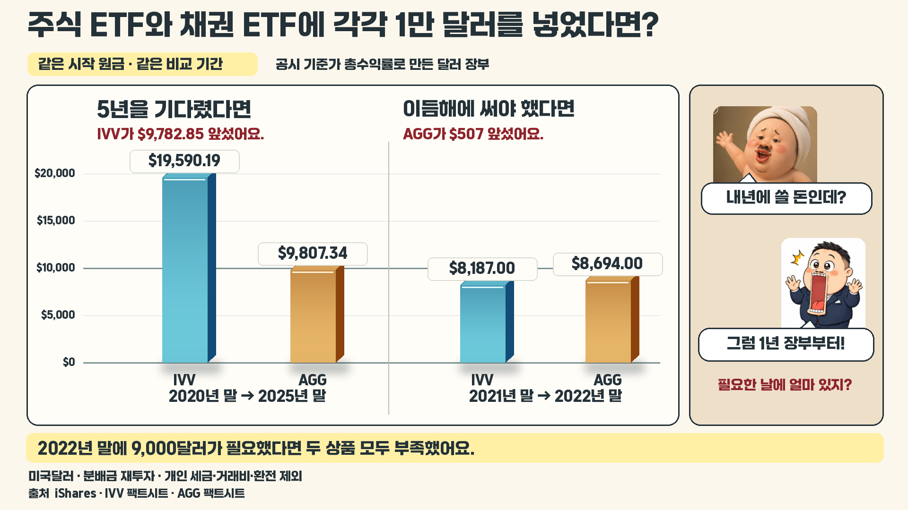

# 미국 주식 IVV vs 채권 AGG, 같은 1만 달러를 넣으면 5년 뒤 얼마였을까?

## 같은 가격표 옆에 서로 다른 만기일을 적었다

가상의 천억이와 수건 친구가 저녁 식탁에서 증권 계좌를 엽니다. 둘 다 1만 달러를 준비했습니다. 천억이는 미국 대형주 ETF를, 수건 친구는 미국 투자등급 채권 ETF를 장부에 적습니다. 그러다 수건 친구가 묻습니다. “나 이 돈, 내년에 써야 할 수도 있는데. 5년 누가 더 벌었는지 보면 답이 나와?” 두 사람은 먼저 같은 날짜에 산 것으로 놓고, 달력에서 돈이 필요했던 날을 따로 열어 봅니다.

## 1만 달러씩 두 장부에 넣는다

비교 대상은 S&P 500을 추종하는 iShares Core S&P 500 ETF IVV와 미국 투자등급 채권 시장을 폭넓게 담는 iShares Core U.S. Aggregate Bond ETF AGG입니다. 두 상품에 각각 2020년 말 기준 10,000미국달러를 넣고 2025년 말까지 보유한다고 놓습니다. 운용사가 발표한 달러 기준 연도별 순자산가치(NAV) 총수익률을 복리로 연결합니다. 공시 수익률에는 분배금 재투자와 펀드의 운용비용이 반영돼 있습니다. 개인 세금, 중개 수수료와 호가 차이, 환전, 추가 납입과 인출은 제외합니다. 실제 펀드의 공시 성과를 작은 가상 장부에 적용한 계산입니다.

## 5년 뒤 잔액은 약 9,783달러 벌어졌다

해마다 직전 잔액에 1과 해당 연도 수익률을 합한 값을 곱하고, 마지막에 센트 단위로 반올림합니다. 예를 들어 IVV의 첫해 공시 수익률 28.66%를 넣으면 12,866달러입니다. 이 잔액에 이듬해 수익률 −18.13%를 넣으면 10,533.39달러입니다. 중간 잔액은 반올림하지 않은 값으로 다음 해에 전달합니다.

| 관측 시점 | IVV 수익률 / 잔액 | AGG 수익률 / 잔액 |
|---|---:|---:|
| 2021년 말 | +28.66% / $12,866.00 | −1.67% / $9,833.00 |
| 2022년 말 | −18.13% / $10,533.39 | −13.06% / $8,548.81 |
| 2023년 말 | +26.27% / $13,300.52 | +5.58% / $9,025.83 |
| 2024년 말 | +24.98% / $16,622.99 | +1.37% / $9,149.49 |
| 2025년 말 | +17.85% / $19,590.19 | +7.19% / $9,807.34 |

2025년 말 기준 IVV 잔액은 19,590.19달러, AGG는 9,807.34달러였습니다. 최종 잔액 차이는 약 9,782.85달러입니다. 두 상품 모두 같은 달러 원금에서 출발했으므로 잔액 차이와 이익 차이가 같습니다. 수익률에는 이미 반영한 비용을 다시 빼지 않습니다. 공시에 표시된 연 수익률 자체가 소수 둘째 자리까지 반올림돼 있어 더 정밀한 데이터로 연결한 실제 누적 수익률과는 조금 다를 수 있습니다.

## 내년에 쓸 돈이라면 5년 표의 마지막 줄을 앞당겨 읽어야 한다

수건 친구는 출발 날짜를 2021년 말로 옮깁니다. 두 상품 모두 다시 10,000달러에서 출발합니다. 2022년 말 돈이 필요했다면 IVV는 8,187달러, AGG는 8,694달러입니다. 이 한 해에는 채권 쪽에 507달러가 더 남았지만 원금에는 1,306달러 못 미쳤습니다. 5년 표에서 2022년 말 IVV가 여전히 원금 위에 있었던 것은 이 장부에 2021년 상승을 넣었기 때문입니다. 뒤늦게 산 사람에게 그 상승은 들어오지 않습니다.

같은 2021년 말 출발점에서 돈을 2025년 말까지 안 썼다면 IVV는 15,226.32달러, AGG는 9,973.90달러입니다. 출발 날짜를 고정해도 종료일을 바꾸면 2022년 말에는 AGG가, 2025년 말에는 IVV가 더 많았습니다.

*운용사 기준가 달러 총수익률을 원금 1만 달러에 적용한 가상 잔액. 두 구간의 원금은 각각 1만 달러다.*

## 주식보다 덜 빠진 날에도 생활비가 부족할 수 있다

천억이는 “그럼 일 년 뒤 쓸 돈에는 채권 쪽이 덜 줄었네”라고 말합니다. 수건 친구는 필요한 금액을 장부 위에 얹습니다. 2022년 말에 정확히 9,000달러가 필요했다면 두 ETF 모두 이 한 해의 장부로는 부족합니다. IVV는 813달러, AGG는 306달러 모자랍니다. 상대 순위에서 이겼는지와 내가 지불할 돈이 충분한지는 서로 다른 질문입니다. 금리 변화가 채권 가격에 미치는 영향과 손실을 견딜 수 있는 기간도 함께 봐야 합니다.

## 하락 이후에 시작한 장부에는 무엇이 달라졌나

이번에는 2022년 말부터 2025년 말까지 3년으로 놓습니다. 출발점의 1만 달러는 IVV에서 18,598.17달러, AGG에서 11,472.16달러가 됐습니다. 이 창에는 2022년의 두 손실이 모두 빠져 있습니다. 반대로 첫 표에서는 AGG가 2023년, 2024년, 2025년에 모두 플러스였어도 2020년 말 원금으로 돌아오지 못했습니다. 손실 후 필요한 회복률의 분모가 작아지기 때문입니다. 예를 들어 1만 달러가 8천 달러가 되면, 2천 달러를 되찾으려면 그 8천 달러의 25%가 필요합니다. 이 글은 연말 자료만 쓰므로 기간 중 최대낙폭과 장중 매도 손익은 따로 측정하지 않았습니다.

## 원화로 쓸 돈은 원화 장부까지 열어본다

달러 잔액과 한국에서 쓸 원화 잔액은 환율을 거쳐 연결됩니다. 같은 시각에 원화로 전환한다면 두 달러 잔액에 동일한 양의 환율을 곱해 원화로 비교할 수 있습니다. 같은 환율을 적용하는 가정 아래에서 순서는 유지돼도, 처음 원화를 달러로 바꾼 시점의 환율에 따라 원화 수익률은 달러 수익률과 달라집니다. 세금과 비용이 상품별로 달라지면 각자 실제 실수령액을 다시 적어야 합니다. 돈을 중간에 여러 번 꺼낼 계획이라면 각 날짜의 환율과 체결가도 별도로 필요합니다.

## 내 계좌의 첫 지출일부터 쓴다

천억이는 5년 마지막 줄을 읽기 전에 달력에서 돈 쓸 날부터 찾아 표시합니다. **직접 확인하기.** 비교 중인 상품 두 개를 골라 실제로 돈이 필요할 날을 먼저 적고, 비슷한 길이의 과거 구간에서 같은 통화·같은 원금·같은 종료일로 잔액을 계산해 보세요. 최종 잔액 옆에 그날 꼭 지불해야 하는 금액을 적습니다. 이 한 줄이면 과거 순위와 내 계획이 같은 질문에 답하는지 확인할 수 있습니다.

**편집부 Q&A · 채권 ETF가 만기까지 들고 있는 개별 채권과 같은가요?** AGG는 여러 채권을 보유하면서 지수를 추종하는 펀드입니다. 내 명의의 개별 채권처럼 특정 날짜에 정해진 액면액을 돌려받는 구조를 가정할 수 없습니다.

**편집부 Q&A · 분배금을 생활비에 썼다면 표의 금액을 그대로 써도 될까요?** 이 표는 받은 분배금을 재투자하는 장부입니다. 생활비로 사용했다면 재투자 매수가 없으므로 소비로 옮긴 현금과 남은 투자 잔액을 나눠 검산합니다.

## 원문

- [iShares · IVV 팩트시트](https://www.ishares.com/us/literature/fact-sheet/ivv-ishares-core-s-p-500-etf-fund-fact-sheet-en-us.pdf)
- [iShares · AGG 팩트시트](https://www.ishares.com/us/literature/fact-sheet/agg-ishares-core-u-s-aggregate-bond-etf-fund-fact-sheet-en-us.pdf)
