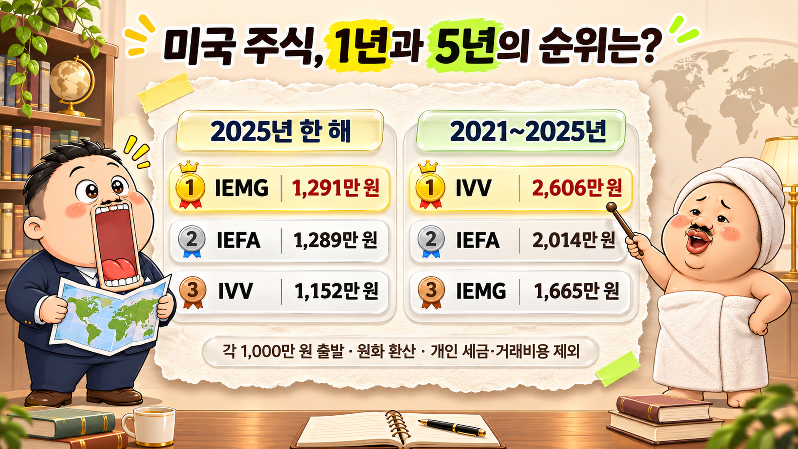

# 미국 주식, 1년과 5년의 순위는?

**편집부가 만든 질문.** 아버지가 세계지도에서 미국과 한국에 자석을 붙입니다. 2025년에 미국보다 신흥국 주식이 더 올랐다면, 같은 돈을 5년 전에 넣었을 때도 신흥국의 평가액이 더 높았을까요?

**답.** 같은 2025년 말에 끝내더라도 시작일이 다르면 순위가 달랐습니다. 세 상품 가운데 2025년 한 해는 신흥국 ETF, 2021~2025년 전체는 미국 대형주 ETF가 앞섰습니다.

*각 비교는 1,000만 원 출발입니다. 공시 총수익과 연준 환율을 적용한 가상 평가이며 개인 세금·거래비용은 제외했습니다. 만 원 단위 반올림.*

**편집부가 만든 질문.** 같은 2025년 말에 끝난 두 표의 1위는 각각 무엇인가요?  
**답.** 2025년 한 해는 **IEMG**, 2021~2025년은 **IVV**입니다.

## 출발일만 바뀌면

**가정과 관측.** 1년 비교는 2024년 말, 5년 비교는 2020년 말에 원화 1,000만 원을 한 번 투자하고 2025년 말에 평가합니다. 추가 납입·인출은 없습니다. iShares가 공시한 연도별 달러 순자산가치 총수익을 사용했습니다. 공시 수익은 분배 재투자와 상품 비용을 반영하며 개인 세금·매매 수수료·호가 차이·환전비용은 별도로 넣지 않았습니다. 미국 대형주와 그 밖의 선진국·신흥국 주식 시장의 차이를 보려고 세 상품을 선택했습니다.

| 상품 | 2025년 한 해 원화 평가액 | 2021~2025년 원화 평가액 |
|---|---:|---:|
| IVV 미국 대형주 | 11,519,374원 | 26,055,379원 |
| IEFA 미국·캐나다 제외 선진국 | 12,885,864원 | 20,144,848원 |
| IEMG 신흥국 | 12,914,210원 | 16,650,497원 |

5년 원화 평가액에서 **IVV와 IEMG의 차이는 약 940만 원**이었습니다. 2025년 한 해 평가액에서 IEMG와 IEFA는 **28,346원** 차이였습니다. **반례.** 다른 모든 조건이 같고 IEMG의 추가 비용을 기말 기준 3만 원으로 가정하면 1년 표에서 IEMG와 IEFA의 순서가 바뀝니다.

| 연도 | IVV 달러 NAV 총수익 | IEFA 달러 NAV 총수익 | IEMG 달러 NAV 총수익 | H.10 연말 관측일 | 원/달러 |
|---|---:|---:|---:|---|---:|
| 2020 출발 | — | — | — | 2020-12-31 | 1,086.11 |
| 2021 | +28.66% | +11.29% | −0.64% | 2021-12-30 | 1,188.59 |
| 2022 | −18.13% | −15.13% | −19.87% | 2022-12-30 | 1,260.18 |
| 2023 | +26.27% | +17.63% | +11.31% | 2023-12-29 | 1,290.97 |
| 2024 | +24.98% | +3.41% | +6.92% | 2024-12-31 | 1,477.86 |
| 2025 | +17.85% | +31.83% | +32.12% | 2025-12-31 | 1,444.55 |

**계산식.** 출발 원화 1,000만 원에 연도별 달러 총수익 배율을 이어 곱한 뒤 **기말 환율 ÷ 출발 환율**을 곱합니다. 기준일과 환율 관측일은 연말의 마지막 관측값을 사용하되 자료상 날짜를 구별합니다. 원문 확인일은 2026년 11월 27일입니다. [IVV 공식 자료](https://www.ishares.com/us/products/239726/ishares-core-s-p-500-etf-ivv) · [IEFA 공식 팩트시트](https://www.ishares.com/us/literature/fact-sheet/iefa-ishares-core-msci-eafe-etf-fund-fact-sheet-en-us.pdf) · [IEMG 공식 팩트시트](https://www.ishares.com/us/literature/fact-sheet/iemg-ishares-core-msci-emerging-markets-etf-fund-fact-sheet-en-us.pdf) · [연준 H.10](https://www.federalreserve.gov/releases/h10/Hist/dat00_ko.htm)

## 지도에서 우리 집 돈을 찾기

- **편입 범위.** IEFA가 추종하는 MSCI EAFE IMI는 미국과 캐나다를 제외한 선진시장 대형·중형·소형주를 담는 지수입니다. [MSCI EAFE 지수 계열 자료](https://www.msci.com/documents/10199/b622e138-666c-4994-a10f-cefc659ba1b3)
- **분류 차이.** MSCI 신흥시장 IMI는 한국을 포함합니다. FTSE Russell의 2026년 9월 글로벌 주식지수 규칙은 한국을 선진시장으로 분류합니다. [MSCI 신흥시장 IMI](https://www.msci.com/indexes/index/664220/msci-em-emerging-markets-imi-index) · [FTSE Russell 지수 규칙](https://www.lseg.com/content/dam/ftse-russell/en_us/documents/ground-rules/ftse-global-equity-index-series-ground-rules.pdf)
- **중복 노출.** 가상으로 한국 주식 400만 원과 한국 비중 20%인 신흥국 ETF 600만 원을 보유하면 한국 노출은 **520만 원, 전체의 52%**입니다.
- **보유 기준일.** 실제 계산에는 같은 날짜의 펀드 국가 비중과 계좌 잔액을 씁니다.
- **시가총액.** 나라 수가 같아도 실제 국가별 비중은 다릅니다.
- **환율.** 세 상품 모두 달러로 공시해도 기초시장의 통화 구성은 다릅니다.
- **기간.** 마지막 한 해의 수익률 순위와 5년 계좌에서 마지막 해에 늘어난 금액 순위는 출발 잔액 때문에 다를 수 있습니다.
- **분산.** 2022년에는 세 상품 모두 달러 NAV 수익률이 마이너스였습니다.
- **평가와 매도.** 내 실수령액에는 실제 주문·환전·개인 세금을 적용합니다.
- **최대 낙폭.** 위의 달력 연도 표로 일별 최대 낙폭을 알 수 없습니다.

**오늘 해볼 일.** 보유하거나 관심 있는 두 상품의 추종 지수와 국가 목록을 같은 날 확인하고, 공통으로 들어 있는 나라나 둘 다 빠진 나라 한 곳을 표시하세요.

관련 장 [ETF 속에서 같은 기업 비중 찾기](EP006.md) · [같은 1,000만 원, 날짜가 바뀌면?](EP104.md)
