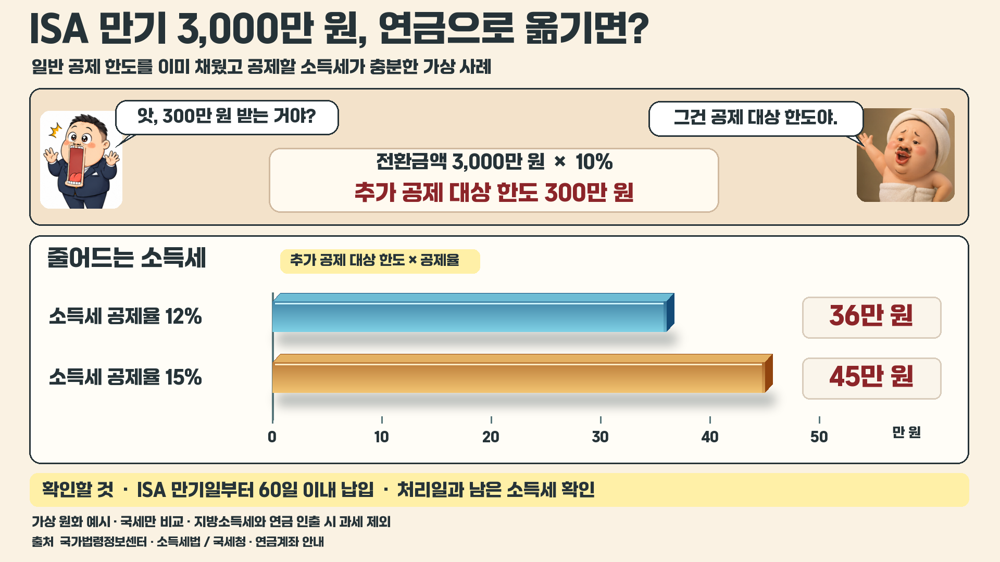
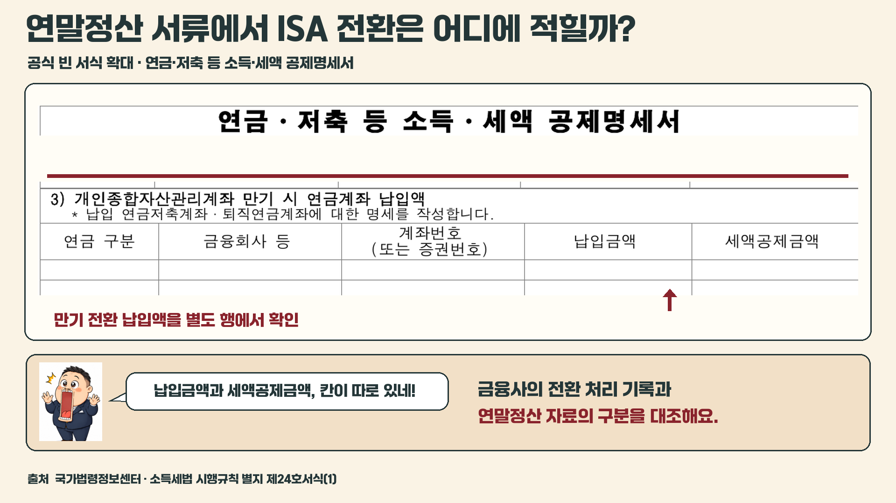

# ISA 만기자금 3,000만 원을 연금으로 옮기면 소득세는 얼마나 줄어들까?

## 만기 알림 아래 300만 원이 적혀 있었다

가상의 수건 친구가 ISA 만기 알림을 받았습니다. 잔액은 3,000만 원입니다. 연금계좌로 옮기면 세액공제 한도가 최대 300만 원 늘어난다는 안내를 본 천억이가 말합니다. “그럼 연말정산 때 300만 원이 돌아오는 건가?” 수건 친구는 다음 봄에 쓸 돈이 있어 전부 넘길지 아직 정하지 못했습니다. 두 사람은 먼저 300만 원이 어느 칸의 숫자인지 확인합니다.

종이를 한 장 꺼낸 수건 친구는 위쪽에 올해 받을 수 있는 혜택을, 아래쪽에는 내년 봄까지 손에 남겨야 할 돈을 적습니다. 위에 쓰는 숫자가 커지면 아래에 적을 현금은 줄어요. 둘 중 하나만 화면에 띄워 놓으면 간단한 문제처럼 보이는데, 같은 종이에 올리는 순간 다른 질문이 됩니다. 문구 그대로 최대 혜택을 받을 수 있는가, 그리고 그 조건을 갖추는 데 내 돈이 얼마나 움직여야 하는가. 두 질문에 각각 답해야 이체할 숫자를 쓸 수 있습니다.

만기라는 말도 한번 천천히 읽어 볼까요. 수건 친구는 상품 페이지에 뜬 만기 안내가 계좌 계약의 만료를 뜻하는지부터 확인합니다. 계좌 안에서 들고 있던 예금이나 채권을 정리하는 날과 개인종합자산관리계좌 계약이 끝나는 날은 같은 말이 아닙니다. 이 이야기에서 전환에 필요한 출발점은 아이에스에이 계약의 만료입니다. 아직 계약이 이어지는 동안 일부 현금을 뺄 수 있다는 설명과, 만기 뒤에 연금으로 옮겨 추가 공제 한도를 받는 설명을 한 화면에서 읽으면 헷갈릴 수 있습니다. 질문 뒤에 ‘내가 지금 하는 거래 이름이 무엇인가’를 붙여 읽어 보세요. 같은 버튼 색이라도 받을 수 있는 혜택을 정하는 것은 금융사가 어떤 거래로 처리하는지입니다.

천억이는 알림을 즐겨찾기에 넣지만 이체 버튼은 보류합니다. 세율까지 한 번에 외워서 결정할 생각이었다가 메모 칸을 세 개로 늘립니다. 얼마나 보내는지, 세금을 계산할 때 얼마를 인정하는지, 그래서 세금이 실제로 얼마나 줄어드는지입니다. 오늘 처음 받아 든 삼백만 원은 그중 어느 칸일까요?

## 이체 금액과 공제 대상 금액을 나눠 적는다

소득세법 제59조의3은 ISA 계약기간이 만료된 뒤 요건에 따라 만기 잔액 전부 또는 일부를 연금계좌에 납입한 경우를 다룹니다. 추가 공제 대상 한도는 전환금액의 10%와 300만 원 중 작은 쪽을 기준으로 계산합니다. 3,000만 원을 옮기면 한도 계산에 300만 원이 더해지고, 1,000만 원을 옮기면 100만 원이 더해집니다. 계산되는 세액공제액은 이 대상 금액에 해당 소득세 공제율을 곱한 값입니다. 만기자금의 10%를 현금으로 받는 제도로 이해하면 두 칸을 혼동하게 됩니다. [국세청 · 연금계좌 세액공제](https://www.nts.go.kr/nts/cm/cntnts/cntntsView.do?cntntsId=7875&mi=6449)

이체 금액은 은행 앱에서 실제로 움직이는 돈입니다. 추가 공제 대상 한도는 연말정산 장부에서 계산에 더 사용할 수 있는 범위입니다. 두 숫자는 같은 원화로 쓰여 있어도 관찰하는 곳이 다릅니다. 택배로 치면 상자에 붙은 무게 한도와 상자 안의 물건 가격을 비교하는 셈이에요. 한도가 삼백만 원이라는 문구만 보고 삼백만 원짜리 돈이 새로 생긴 것처럼 장부에 넣으면, 실제 계좌를 열었을 때 찾을 수 없는 돈을 먼저 쓰게 됩니다.

하나씩 올려 보죠. 만기 잔액이 천만 원이고 그중 절반인 오백만 원만 요건에 맞춰 옮기면, 추가 공제 대상 한도의 계산에는 오십만 원이 들어갑니다. 만기 잔액 천만 원 전부에 십 퍼센트를 붙이는 게 아닙니다. 옮긴 오백만 원에 십 퍼센트를 붙이는 거죠. 소득세 공제율 십오 퍼센트이고 공제할 세액이 충분하며 일반 한도를 이미 채웠다면, 계산한 소득세 차이는 칠만 오천 원입니다. 출발 잔액은 천만 원, 이체액은 오백만 원, 공제 대상 증가분은 오십만 원, 국세 감소액은 칠만 오천 원. 숫자를 한 줄에 몰아쓰지 않고 각자의 칸에 넣으면, 어디서 열 배 차이가 벌어졌는지 눈에 들어옵니다.

수건 친구가 처음에 본 삼천만 원 전액을 다시 적어 봅니다. 한도에 걸리기 전까지는 이체액 천만 원당 공제 대상 한도가 백만 원씩 늘어납니다. 한도에 닿고 나면 같은 천만 원을 더 넣어도 특별히 더 열린 한도는 없습니다. 이 변화는 이체 금액을 구간별로 나눠 볼 이유입니다. 자, 이제 첫 번째 칸과 두 번째 칸이 채워졌습니다. 세 번째 칸을 채우려면 두 사람의 소득 조건을 먼저 맞춰야 합니다.

천억이는 집에서 서류를 세 묶음으로 나눕니다. 첫 묶음은 아이에스에이 계약에 관한 문서입니다. 계약 만료일, 만기 기준 잔액, 금융사에서 보여 준 전환 안내를 함께 둡니다. 두 번째 묶음은 연금계좌에 관한 거래 내역입니다. 같은 해에 내가 납입한 금액을 날짜 순서로 담습니다. 마지막은 소득세 장부입니다. 올해 얼마를 벌었는지, 다른 공제를 넣고 나면 이번 전환으로 줄일 수 있는 세금이 얼마나 있는지 적습니다. 궁금한 숫자가 어디에 들어 있는지 알고 나면 세 서류를 한꺼번에 뒤적일 필요가 없어요.

그가 올해 납입액 내역을 보니 삼백만 원짜리 줄이 또 나옵니다. 이미 갖고 있던 연금계좌 하나를 다른 금융사의 연금계좌로 이전한 기록입니다. 통장에 삼백만 원이 새로 찍혀 있어 보여도 기존 연금계좌를 계약 이전하면서 들어온 돈이라면 법에서 일반적인 연금계좌 세액공제 납입액 계산의 제외 항목으로 둡니다. 이 사례에는 원천징수하지 않은 이연퇴직소득도 따로 있지 않지만, 만약 같은 화면에 섞여 있다면 성격을 따로 확인해야 합니다. 세액공제 장부의 항목은 앱에 표시된 입금이라는 단어 하나로 결정되지 않습니다.

수건 친구가 거래 목록을 보고 빠진 곳이 있는지 점검합니다. 한 금융사의 연금계좌 화면에는 다른 금융사에 넣은 금액이 그대로 나오지 않을 수 있습니다. 계좌별로 올해 자료가 다 모였는지 살펴보지 않고 납입을 추가하면, 내가 원한 세액 효과를 이미 다른 계좌에서 사용하고 있었을 수 있습니다. 돈을 온전히 보냈더라도 이번 연말 장부에서 기대한 칸을 다 채우지 못하는 상황입니다. 이런 차이를 찾으려면 계좌 평가액 그래프 대신 올해 납입 확인서를 나란히 놓고, 회사에서 낸 금액과 내가 낸 금액을 구분해 봅니다.

## 이미 일반 한도를 채운 사람의 계산부터 한다

세법은 연금저축 자체 공제 대상에 연 600만 원 한도를 두고, 퇴직연금계좌의 적격 개인 납입금을 더한 일반 합산 한도를 연 900만 원으로 둡니다. 가상의 천억이는 해당 과세기간에 일반 한도를 모두 사용했습니다. 아래는 계약기간이 끝난 ISA 잔액을 정해진 방법으로 같은 과세연도에 옮기고, 추가분을 모두 공제할 소득세가 충분하다고 가정한 원화 계산입니다. 국세인 소득세만 비교하며 지방소득세, 장래 인출 과세, 수수료와 투자 손익은 포함하지 않습니다. 투자기간, 연율과 분배금 재투자는 계산 대상이 아닙니다.

| 연금계좌에 옮긴 금액 | 추가 공제 대상 한도 | 소득세 공제율 12% | 소득세 공제율 15% |
|---|---:|---:|---:|
| 1,000만 원 | 100만 원 | 12만 원 | 15만 원 |
| 2,000만 원 | 200만 원 | 24만 원 | 30만 원 |
| 3,000만 원 | 300만 원 | 36만 원 | 45만 원 |
| 4,000만 원 | 300만 원 | 36만 원 | 45만 원 |

4,000만 원 행은 만기 잔액이 4,000만 원 이상인 별도 가상 사례입니다. 일반 한도를 이미 다 썼다면 3,000만 원에서 4,000만 원으로 전환을 늘려도 이 표의 당해 추가 소득세 공제는 늘지 않습니다. 근로소득만 있는 거주자는 총급여 5,500만 원 이하일 때 소득세 공제율이 15%이고, 그 구간을 넘으면 12%입니다. 근로소득만 있는 경우에 해당하지 않으면 종합소득금액 기준을 확인합니다. 법의 해당 경계는 4,500만 원입니다. [국가법령정보센터 · 소득세법 제59조의3](https://www.law.go.kr/LSW/lsLinkCommonInfo.do?chrClsCd=010202&lsJoLnkSeq=1030564855)

*일반 공제 한도를 채우고 공제할 소득세가 충분한 가상 사례. 지방소득세와 연금 인출 시 과세는 제외한다.*

두 사람이 똑같이 삼천만 원을 보낸다고 합시다. 두 사람 모두 일반 공제 한도를 다 썼고 다른 감면과 공제를 반영한 뒤에도 이번 혜택을 사용할 세액이 충분합니다. 한 사람은 근로소득만 있고 그해 총급여가 법의 낮은 경계 이하입니다. 다른 사람은 그 경계를 넘습니다. 둘 다 추가 계산에 들어갈 납입액은 삼백만 원입니다. 한쪽은 여기에 십오 퍼센트를 곱해 사십오만 원이고, 다른 쪽은 십이 퍼센트를 곱해 삼십육만 원입니다. 이체액은 같고 세금 차이는 구만 원 벌어집니다. 친구가 자기 계산값만 보내와도 그것을 내 계좌에 곧장 붙일 수 없는 이유입니다.

같은 사람 안에서는 이렇게 계산해 볼 수 있습니다. 천만 원을 옮겼을 때와 이천만 원을 옮겼을 때를 한 번 비교합니다. 가정한 소득세 공제율이 십오 퍼센트라면, 첫 번째의 십오만 원과 두 번째의 삼십만 원 사이 차이는 십오만 원입니다. 이체액을 천만 원이나 더 늘렸지만 지금 세금 차이는 그중 십오만 원이라는 뜻입니다. 이번에는 삼천만 원과 사천만 원을 나란히 둡니다. 일반 한도를 모두 썼다는 조건 아래에서 두 경우 모두 추가 공제 대상은 삼백만 원에 멈춥니다. 이후의 세금이나 투자 결과를 보기 전에, 오늘 옮기는 금액을 늘려도 당해 국세 공제가 더 붙는 구간인지부터 알 수 있습니다.

또 하나의 작은 구분이 있습니다. 총급여는 근로소득만 있는 경우에 해당하는 법의 기준입니다. 월급통장에 들어온 실수령액을 열두 번 더해서 표에 대입하면 비교에 쓴 금액 자체가 달라집니다. 사업소득 등 다른 소득이 있는 경우에는 본인이 확인해야 할 항목이 종합소득금액 기준으로 바뀝니다. 두 사람이 서로 급여가 비슷해 보여도 분류가 섞여 있다면 간이 계산 결과가 다를 수 있습니다. 따라서 공제율을 먼저 확인하지 않고 ‘누구나 십오 퍼센트’라고 덧셈하면, 세 번째 칸부터 틀어질 수 있습니다.

천억이는 세액공제율 십오 퍼센트를 투자 상품 수익처럼 표시하려다 고칩니다. 앞에서 계산한 사십오만 원은 일정한 세금 조건에서 당해 소득세가 줄어든 금액입니다. 연금으로 옮긴 돈의 가격이 사십오만 원 올랐다는 말도, 매년 같은 돈이 붙는다는 말도 성립하지 않습니다. 분모로 이체액 삼천만 원만 두고 비율을 구하면 일 점 오 퍼센트입니다. 이 역시 한 번의 국세 감소를 이번 이체액과 비교한 숫자입니다. 기간을 정해 운용한 연수익률 표에 그대로 끼워 넣을 이유가 없습니다.

## 45만 원을 계산했는데 실제 감소액이 작을 수 있다

천억이는 계산기에 45만 원이 나오자 그대로 받을 돈이라고 장부에 적습니다. 수건 친구는 한 줄을 더 둡니다. ‘추가 공제로 줄일 수 있는 소득세’. 단순화한 반례로 다른 요건을 모두 충족했지만 반영할 수 있는 소득세가 20만 원만 남았다면, 추가 소득세 감소액은 최대 20만 원입니다. 급여에서 이미 원천징수된 세금까지 고려하는 연말정산 환급액은 또 다른 숫자입니다. 세액이 줄어든 만큼 최종 납부가 줄 수도 있고 이미 낸 세금의 환급에 영향을 줄 수도 있습니다. 비교하려면 같은 근로·공제 조건을 두고 전환을 입력하기 전과 후의 소득세 차이를 봅니다.

천억이가 이체액 천만 원짜리 줄과 삼천만 원짜리 줄을 비교합니다. 추가로 옮길 이천만 원에 대해, 종이 위 예시에서는 소득세가 삼십만 원 더 줄어요. 그런데 수건 친구는 계산기를 껐다가 공제하기 전의 소득세를 가리킵니다. 공제할 수 있는 세액이 이십만 원뿐인 예시라면, 천만 원을 옮길 때는 십오만 원까지 쓸 수 있고 삼천만 원을 옮겨도 최대 이십만 원입니다. 둘의 차이는 삼십만 원에서 오만 원으로 줄어듭니다. 어느 금액이 더 유리한가라는 질문은 이 두 숫자 중 어느 조건에 해당하느냐에 달려 있죠.

세금이 줄어도 급여통장에 새 돈이 언제 들어오는지는 별도의 이야기입니다. 아주 단순한 예를 들어, 전환이 없을 때 최종 소득세가 사십만 원이고 이미 낸 소득세가 삼십만 원이면, 남은 십만 원을 내야 합니다. 전환 때문에 최종 세금이 십오만 원 줄어 이십오만 원이 되면 이미 낸 삼십만 원보다 오만 원 적습니다. 전환 전에는 십만 원을 내고 전환 후에는 오만 원을 돌려받으므로 두 상황의 차이는 십오만 원입니다. 그런데 통장에 실제 들어오는 값은 오만 원입니다. 결정세액과 원천징수액을 같은 칸에 쓰지 않으면 이 차이를 설명할 수 있습니다.

반대로 이미 낸 금액이 아주 적다면 공제를 받아도 통장으로 돌아오는 돈보다 앞으로 낼 돈이 줄어드는 모습이 먼저 보일 수 있습니다. ‘환급’이라는 말로 실익을 설명하려면 비교 장부에서 소득세가 얼마나 줄었는지와 기납부 세액 뒤에 실제로 입금될 값이 얼마인지 구분해 말해야 합니다. 같은 원화 금액을 계산했다고 해서 모든 사람에게 같은 세금 영수증이 생기지는 않죠. 수건 친구는 올해 다른 공제가 이미 반영된 장부에서 시작하도록 순서를 바꿉니다.

## 60일과 과세연도를 각각 달력에 놓는다

국세청 안내에서 ISA 만기일로부터 60일 이내에 연금계좌로 납입하는 절차를 확인할 수 있습니다. 공제 계산에는 그 전환금액을 납입한 날이 속하는 과세기간이 중요합니다. 연말에 만기가 오는 계좌라면 납입이 기한 안이어도 어느 귀속연도에 들어가는지 확인해야 합니다. 한 만기자금을 두 과세기간에 걸쳐 전환하는 경우 법에서 직전 과세기간에 적용한 추가 한도 금액을 300만 원에서 차감하도록 정합니다. 예를 들어 만기 잔액이 충분하고, 기한 내 각각 2,000만 원씩 옮겼으며 첫해 추가 한도 200만 원을 적용했다면 다음 해 남은 추가 한도는 최대 100만 원입니다. [국세청 · 연금계좌의 요건](https://ems.nts.go.kr/nts/cm/cntnts/cntntsView.do?cntntsId=7885&mi=6449)

달력에는 두 개의 표시가 생깁니다. 하나는 아이에스에이 만기일, 다른 하나는 연금계좌에 실제 전환 납입이 찍히는 날입니다. 금융사 안내에서 신청 접수와 납입 완료가 서로 다른 날로 표시된다면 두 표시를 보고 각각 무엇을 뜻하는지 확인하세요. 원하는 날에 앱에서 신청이 끝났다는 사실만으로 연말정산 자료에 그날 납입됐다고 가정할 수 없습니다. 계좌에 아직 팔아야 할 자산이 있거나 영업일이 끼면 실제 일정은 더 달라질 수 있습니다. 상품 종류나 금융사에 따라 처리 단계가 다를 수 있으므로, 만기 뒤에 어디로 이체하는지와 실제 납입을 확인할 위치부터 물어봅니다.

달력이 연말에서 신년으로 넘어가면 두 장의 장부를 엽니다. 예를 들어 만기 잔액이 두 번의 전환을 감당할 만큼 있고 두 납입이 모두 기한 조건을 충족한다고 합시다. 첫해에 이천만 원을 전환해 추가 한도 이백만 원을 사용했다면, 다음 해에 다시 같은 크기를 옮겨도 이번 만기에 연결된 추가 한도는 최대 백만 원만 남습니다. 두 번째 전환액이 이천만 원이라고 해서 서류가 넘어간 해에 삼백만 원부터 다시 시작하는 것이 아니기 때문입니다. 첫해에 무슨 전환을 했는지 확인할 자료가 없으면 둘째 해 추가로 사용할 수 있는 한도를 계산하기 어렵습니다.

이번에는 첫해와 둘째 해의 세율도 다르다고 가정합니다. 앞의 이백만 원에는 십이 퍼센트, 뒤의 백만 원에는 십오 퍼센트를 적용하면 각각 이십사만 원과 십오만 원, 합계 삼십구만 원입니다. 두 해 모두 일반 한도를 다 썼고 공제할 소득세도 충분하다고 둔 단순 예시입니다. 중요한 질문은 여러 해에 쪼개면 무조건 이득인가가 아닙니다. 같은 만기 자금의 추가 한도가 어떤 해에 얼마씩 적용됐고, 그해 공제할 수 있는 세금이 얼마였느냐입니다. 기한을 놓쳐 버린 뒤 유리한 연도를 고를 수 있다고 가정하는 순서는 사용하지 않습니다.

## 아직 일반 공제 한도가 남았다면 비교의 출발점이 달라진다

전환금액은 요건을 충족하면 해당 과세기간의 연금계좌 납입액에 포함됩니다. 따라서 일반 한도를 이미 다 사용한 앞 표와 일반 한도가 남은 사람의 공제액은 달라질 수 있습니다. 예를 들어 일반 합산 한도 중 200만 원이 비어 있고, 받는 계좌의 종류별 한도에도 여유가 있으며, 1,000만 원을 전환하고 공제할 소득세가 충분하다고 놓습니다. 이 사례에서는 기존의 일반 한도에서 200만 원, 전환에 따른 추가 한도에서 100만 원이 공제 대상 증가액이 됩니다. 소득세 공제율이 15%이면 45만 원입니다. 일반 한도를 다른 적격 납입으로 이미 채울 계획이었다면, 전환 때문에 새로 열린 한도 100만 원에 해당하는 15만 원만 따로 비교합니다.

연금저축과 개인형 퇴직연금 두 계좌를 함께 가진 천억이는 각각의 앱을 열고 잔고를 합하려 합니다. 수건 친구는 거래일 열을 먼저 눌러 올해 납입만 따로 거릅니다. 작년부터 있던 잔고, 올해 시장에서 늘어난 평가액, 본인이 직접 보낸 적격 납입액은 전부 다른 항목입니다. 공제 한도 소진 여부는 잔고가 얼마인지로 맞추지 않습니다. 이미 올해 공제 대상이 될 수 있는 납입액이 어디에 얼마나 있는지를 확인합니다. 앞서 일반 한도를 다 채웠다는 표와 이 장면의 조건이 다르면 두 원고의 결론이 다르게 나오는 게 자연스럽습니다.

숫자를 조금 바꿉니다. 가상의 한 사람이 올해 연금저축에 육백만 원, 아이알피에 개인 돈 이백만 원을 적격 납입했다고 합시다. 합산 일반 한도에는 백만 원 여유가 있지만, 연금저축 자체의 일반 한도는 이미 찼습니다. 이때는 ‘일반 한도 백만 원 남음’이라는 한 줄로 끝내지 않고 실제로 받을 계좌에서 그 일반 한도를 쓸 수 있는지 확인해야 합니다. 수건 친구가 처음에 가정한 이백만 원 여유 예시에는 그래서 받는 계좌의 종류별 조건에도 여유가 있다고 붙였습니다. 합산 칸에 공간이 나도 계좌별 칸이 이미 차 있다면 단순 합계만으로 답을 낼 수 없습니다.

같은 연도에 별도의 일반 납입이 예정돼 있는지도 기록합니다. 올해 빈 한도가 백만 원이라고 해서 아이에스에이 이체로 계산된 국세 효과를 전부 특별한 혜택으로 세면, 며칠 뒤 별도로 할 예정이었던 적격 납입을 장부에서 지워 버리는 셈입니다. 전환하지 않는 경우에 원래 하려던 납입을 한 장에 적고, 전환하는 경우에 실제 할 납입을 다른 장에 적습니다. 두 장의 소득세를 비교하면 평소에도 받을 수 있었던 공제와 만기 전환 덕분에 바뀐 공제를 다시 볼 수 있습니다.

세금을 절약하는 두 가지 방법이 충돌하는 상황을 가정해 볼까요. 천억이는 평소 연금계좌 일반 한도에 백만 원을 더 채우려고 별도의 월급 통장에서 돈을 남겨 뒀습니다. 그런데 회의에서 듣고 온 전환 이야기를 장부에 넣어 보니, 아이에스에이에서 천만 원을 옮기는 방법으로도 받는 계좌에 비어 있는 일반 한도 백만 원을 채울 수 있다는 계산이 나옵니다. 계좌별 한도가 남아 있고 다른 요건도 충족합니다. 소득세 공제율이 십오 퍼센트이고 줄일 세금이 충분하다고 놓으면, 전환 장부에는 일반 한도 백만 원과 전환으로 새로 열린 한도 백만 원이 함께 들어갑니다.

여기서 아무것도 하지 않는 장부를 상대편에 놓으면 세금 차이가 삼십만 원으로 보입니다. 그런데 상대편에 처음부터 하려고 했던 일반 납입 백만 원을 넣으면 이미 십오만 원을 공제받는 장부가 됩니다. 그러면 전환을 더한 경우의 추가 소득세 차이는 십오만 원입니다. 그중 한쪽에만 대안을 몰아넣으면 같은 질문을 비교하는 셈이 아니겠죠. 돈을 옮길지 결정하기 전에는 ‘오늘 만기 전환을 그만두면, 그 돈과 일반 납입 계획은 실제로 어떻게 될까?’를 먼저 답해야 합니다.

이 비교에서 세금 밖에 남는 차이도 있습니다. 일반 납입에 쓰려던 월급 통장 현금 백만 원을 계속 보유할 수 있는지, 만기 잔액 가운데 얼마를 장기 계좌에 남겨 두는지를 두 장부에 같이 적습니다. 소득세 차이만 따로 보여 주고 싶다면 그 결과에 장기 자금 계획의 위험이나 이익을 미리 덧붙이지 않습니다. 장기적 실익이 궁금하면 비교 기간을 먼저 정하고, 그 기간 안에서 언제 돈을 사용할 수 있는지와 수령할 때 부담할 비용을 각각 같은 기준으로 넣습니다. 여기서는 투자 수익률을 가정하지 않았습니다. 장부의 빈칸을 평균 수익률로 채우면 이체 결정에 필요한 실제 현금 시점이 다시 가려지기 때문입니다.

## 내년에 쓸 돈의 자리는 남겨 둔다

수건 친구는 봄에 필요한 2,000만 원을 표시합니다. 만기 잔액이 3,000만 원이라면, 예시처럼 일부 전환을 선택해 연금으로 1,000만 원을 넘기고 2,000만 원을 따로 둘 수 있습니다. 일반 한도를 채웠고 공제율이 15%인 앞 사례에서 전액과 일부 전환의 당해 소득세 차이는 30만 원입니다. 이후의 연금계좌 출금 조건과 과세는 별도로 따져야 하므로 이 30만 원은 전액을 옮겼을 때의 최종 순이익을 뜻하지 않습니다. 금융사에 접수 기한과 실제 납입 처리일을 함께 확인하면 기한 내에 선택할 수 있는 금액이 더 분명해집니다.

수건 친구는 봄의 이천만 원을 옮길 수 있는 돈으로 다시 표시해 달라는 말을 듣습니다. 이사 보증금이라면 송금 날짜와 금액에 여유가 거의 없습니다. 그해 여행이나 가전 교체라면 시기를 늦출 수 있을지도 모릅니다. 같은 이천만 원이라도 어느 쪽인지에 따라 전환한 다음에 남겨야 할 현금이 달라집니다. 연금계좌에서 투자 자산을 처분할 수 있다는 것, 처분 금액을 연금계좌 밖으로 보내는 것, 그때 세금이 어떻게 계산되는 것은 따로 확인할 질문입니다. 당장 화면에 보이는 잔고로 세 가지를 동시에 답하지 않습니다.

가상 장부에서 한 사람이 일부 전환하고, 다른 사람은 전액을 옮겼다는 상황을 생각해 봅시다. 다른 거래비나 세금은 모두 빼고 올해 소득세만 비교한 숫자는 삼십만 원 차이였습니다. 전액 전환한 쪽이 봄에 새로 돈을 빌려야 한다면 비교 가정에 금융비용도 넣어야 합니다. 순전히 계산 예로 이천만 원을 육 개월 동안 연 오 퍼센트 단리로 빌리고 기간 말에 원금을 갚는다면 이자만 오십만 원입니다. 기존 대출이나 다른 현금이 없고 그 차입이 전환 때문에 생겼다는 조건으로 비교하면 오십만 원이 삼십만 원보다 큽니다. 실제 대출 금리나 수수료를 말하는 것이 아니라, 세액이 줄어드는 만큼 자금 조달비가 따라붙으면 장부가 어떻게 바뀌는지 보여주는 예입니다.

만기 때의 전액만 기억하지 말고 연금으로 보낸 뒤의 시간표를 한 번 그려 보세요. 오늘 옮길 수 있는 돈, 다음 봄에 손에서 나갈 돈, 장기적으로 인출할 돈을 서로 다른 날에 표시합니다. 이미 납입한 돈의 공제 여부와 인출 방식에 따라 장래 세금도 달라질 수 있으므로, 그 돈까지 필요하다고 알았다면 금융사에서 인출 조건과 적용 세금부터 확인합니다. 세금이 줄어드는 한 줄을 장기 세후 이익 전체로 쓰지 않는 습관이 여기서 돈을 아낍니다.

수건 친구는 대출 금리를 먼저 비교하는 대신, 전환을 많이 했을 때와 적게 했을 때의 당해 소득세 차이를 기준선으로 씁니다. 가상 장부에서 추가 전환 덕분에 삼십만 원이 더 줄고, 그 때문에 새로 필요한 돈이 이천만 원이며, 필요한 기간이 반년이라고 합시다. 단리 계산에서는 이천만 원에 연 이자율을 곱한 뒤 반년을 곱합니다. 거래비가 없다는 조건에서 이자와 추가 소득세 절감액이 같아지는 연 이자율은 삼 퍼센트입니다. 두 배 오래 쓴다면 같은 이자율에서 비용도 두 배가 됩니다. 조달 기간이 짧아지면 그 계산이 또 달라져요.

실제 달력은 반년으로 딱 떨어지지 않을 수 있고, 대출에는 이자 외 비용도 붙을 수 있습니다. 이 예시에서 비교하는 비용은 전환을 안 해도 원래 부담하던 돈이 아니라 전환 금액을 늘려서 새로 발생하는 비용입니다. 전액 전환 전후로 빌릴 돈의 크기가 같다면, 그 차입비를 전액 전환 한쪽에만 얹으면 안 됩니다. 반대로 일부 전환에서는 아예 안 빌려도 되고 전액 전환 때문에 추가 자금이 필요한 상황이라면, 새로 생긴 비용에 해당 기간을 적용합니다. 세금과 이자를 더 정확하게 보는 순서는 금융상품의 홍보문을 읽는 순서와 다릅니다. 우선 두 선택에서 달라지는 현금 이동부터 표시합니다.

세액이 많은 사람에게도 같은 검산을 해 볼 수 있습니다. 만기 잔액을 얼마 옮겼는지가 아니라, 한 번 더 옮기는 그 금액이 지금 내 세금을 얼마나 더 줄여 주는지를 보는 겁니다. 이미 추가 한도 상한에 도달했다면 당해 절세 증가분은 영 원입니다. 그렇더라도 연금 자산으로 따로 두고 싶다는 이유가 있을 수 있습니다. 그 이유까지 존중하려면, 세금이 더 준다는 계산과 돈을 오래 모으고 싶다는 계획을 같은 문장으로 섞지 않아야 합니다. 수건 친구는 자신의 만기 잔액에서 내년에 쓸 돈을 제외하고, 남은 돈으로 실제 전환할 후보 금액만 적습니다.

## 신청 전에 받을 계좌와 처리일을 확인한다

천억이는 ‘300만 원’이라고 적었던 자리에 ‘추가 공제 대상 한도’라고 다시 씁니다. **직접 확인하기.** 금융사에서 ISA 계약 만료일과 연금계좌로의 전환 처리 예정일을 확인하고, 같은 메모에 전환할 금액과 그해 이미 쓴 연금계좌 공제 대상 금액을 적어 보세요. 생활비와 분리한 뒤 그 액수로 전환을 입력했을 때 소득세가 실제로 얼마나 달라지는지 비교합니다.

처음에 봤던 화면으로 돌아옵니다. 수건 친구는 이체 숫자를 바로 쓰기 전에 세 줄만 남깁니다. 계약 만료일과 전환 납입 예정일, 실제로 전환할 액수, 그리고 지난번 공제하고 남은 범위입니다. 따로 확인해 둔 내년 봄 필수 현금은 전환 후보에서도 빼 놓습니다. 천억이는 처음 메모에 적은 삼백만 원 옆에 작은 글씨를 붙입니다. ‘세금을 줄일 때 더 계산할 수 있는 금액.’ 처음 본 숫자는 그대로인데 돈을 어디로 움직일지 판단하는 순서는 달라졌습니다.

확인할 수 있는 예라면 직접 계산해 봅시다. 만기 자금 삼천만 원 가운데 이번에 천만 원만 옮기는 지점부터 봅니다. 천만 원의 십 퍼센트는 백만 원입니다. 국세 공제율이 십이 퍼센트인 조건에서 일반 한도를 이미 사용했고 공제할 세액이 충분하다면 십이만 원입니다. 같은 세액 조건에서 전액을 옮기는 경우와 장부를 나란히 놓으면 자기 돈 이천만 원을 더 보내는 대신 올해 소득세가 이십사만 원 더 줄어듭니다. 이 숫자는 지방세나 연금 수령 뒤까지 합친 금액과는 구성이 다릅니다. 비교하려는 사람이 둘이라면 같은 항목끼리 나란히 적고 빼야 합니다.

달력의 마지막 칸에 답이 있습니다. 내일 받아야 할 혜택과 나중에 꺼낼 돈의 날짜가 같지 않습니다. 삼백만 원이라는 숫자 때문에 신청을 서두르던 천억이는, 이제 납입이 언제 완료될지와 그해 세금을 실제로 얼마 줄일 수 있을지를 먼저 확인합니다. 이체창은 여전히 열려 있습니다. 돈이 언제 필요한지 다시 봐도 답이 같다면 그때 액수를 쓰면 됩니다. 선택의 출발점은 화면에서 가장 큰 숫자가 아니라, 금융사에서 확인한 처리일과 장부에 적은 실제 필요 금액입니다.

폰에만 저장한 이체 안내가 며칠 뒤 사라져도 계산을 다시 할 수 있게, 천억이는 입금 날짜와 거래명, 금융사에서 확인한 전환 서류의 이름을 장부 바로 옆에 적습니다. 연말 자료에서 납입액을 확인할 때는 입력한 금액과 실제 서류에 표시된 수치가 일치하는지도 봅니다. 모양이 비슷한 표시라도 나중에 본인이 다시 설명할 수 있어야 하죠. 남에게 자기의 계좌번호나 민감한 서류를 보여 줄 필요는 없습니다. 비교한 금액의 종류와 납입이 처리된 날짜만 있어도 계산을 재현할 수 있습니다.

작은 예시로 마무리합니다. 두 사람 모두 삼천만 원이 있습니다. 첫 번째 사람은 얼마를 옮길 수 있는지부터 묻고, 두 번째 사람은 얼마를 내년에도 바로 써야 하는지부터 묻습니다. 같은 공제율에 같은 작년 소득을 들고 와도 두 질문은 같은 답을 요구하지 않습니다. 한 사람에게는 기한과 공제 가능 세액을 맞추는 일이 중요하고, 다른 사람에게는 고정 지출 뒤에 남는 현금을 먼저 세는 일이 중요합니다. 앞의 장부에서 얻은 답을 뒤의 장부에 대신 넣기 시작하면 세금이 줄어들어도 자금 계획이 힘들어질 수 있습니다. 전환 금액을 하나 더 입력하기 전에, 그 돈이 빠져나가도 내가 지켜야 할 날짜를 지킬 수 있는지 확인하세요.

*소득세법 시행규칙의 공식 빈 서식 일부. 화살표는 납입금액 확인 위치를 표시한다.*

**편집부 Q&A · ISA 돈을 전부 옮겨야 추가한도가 생기나요?** 법령의 만기 전환 요건을 갖춘 일부 납입도 전환 대상입니다. 일부를 옮기면 그 금액에 10%를 적용하고 추가 한도 상한을 확인합니다.

**편집부 Q&A · 먼저 은행으로 빼고 나중에 연금에 직접 넣어도 되나요?** 전환 처리와 일반 납입은 기록이 다를 수 있습니다. 신청 전에 금융사에 연금계좌에서 ISA 만기 전환으로 인정되는 처리 방식과 구비서류를 확인합니다.

## 원문

- [국가법령정보센터 · 소득세법 제59조의3](https://www.law.go.kr/LSW/lsLinkCommonInfo.do?chrClsCd=010202&lsJoLnkSeq=1030564855)
- [국세청 · 연금계좌 세액공제](https://www.nts.go.kr/nts/cm/cntnts/cntntsView.do?cntntsId=7875&mi=6449)
- [국세청 · 연금계좌의 요건](https://ems.nts.go.kr/nts/cm/cntnts/cntntsView.do?cntntsId=7885&mi=6449)
- [국가법령정보센터 · 소득세법 시행규칙 별지 제24호서식(1)](https://www.law.go.kr/LSW/flDownload.do?bylClsCd=110202&flSeq=154143281&gubun=)
