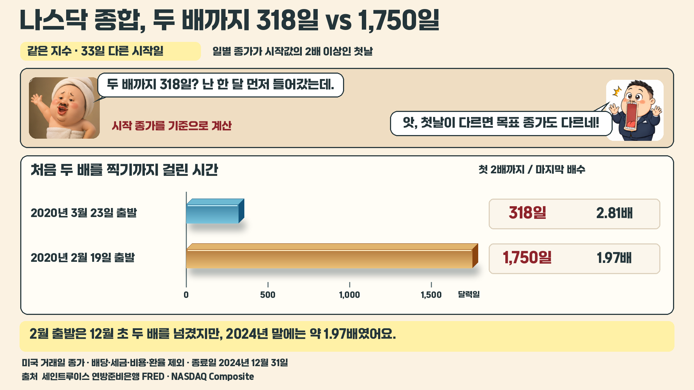

# 나스닥은 318일 만에 두 배가 됐는데, 한 달 먼저 샀다면 얼마나 걸렸을까?

## 같은 영상에 두 배라는 자막이 두 번 나왔다

가상의 천억이가 두 배 수익 자막을 보고 화면을 멈춥니다. 수건 친구는 스크롤을 되돌려 첫 날짜를 찾습니다. “이 돈, 떨어지기 전에 넣었다면?” 둘이 2020년에 약 한 달 간격으로 시작해 같은 종료일까지 기다렸다고 놓습니다. 비교 대상은 나스닥 종합과 S&P 500입니다. 누구의 잔액이 두 배가 되는지, 화면에 처음 찍힌 날과 마지막 날이 같은 이야기를 하는지 살펴봅니다.

## 두 배의 뜻부터 정해 둔다

미국 거래일의 일별 종가로 두 지수를 비교합니다. 공통 시작일은 2020년 2월 19일 또는 3월 23일이고, 종료일은 2024년 12월 31일입니다. 첫날 지수 종가를 1로 놓고, 이후 종가를 그 종가로 나눴을 때 처음 2 이상이 되는 날을 셉니다. 달력일을 사용하므로 318일은 장이 열린 횟수가 아닙니다. 두 배는 잔액 2배, 수익률 +100%라는 뜻입니다. 세 배는 +200%입니다.

아래 장부는 가상 미국달러 10,000달러에 지수 가격 비율만 적용합니다. 지수를 샀다는 뜻이 아니며 실제 ETF 실적도 아닙니다. 분배금과 재투자, 환율, 매매 비용, 펀드 보수, 개인 세금, 추가 입출금을 반영하지 않습니다. 배수와 손익은 기간 수익입니다. 기본 데이터는 FRED에 수록된 실제 지수 종가입니다.

## 3월 출발 장부에는 318일이 적혔다

2020년 3월 23일 종가로 시작한 장부에서 나스닥 종합은 2021년 2월 4일에 시작 종가의 두 배를 처음 넘었습니다. 318일입니다. 같은 출발일의 S&P 500은 2021년 8월 16일, 511일 만에 처음 넘었습니다. 출발과 종료를 같은 날로 고정하면 비교 대상마다 두 배를 찍은 날짜가 달랐습니다. 2024년 말 기준으로 미화 10,000달러를 가격 비율대로 환산하면 약 28,147.09달러와 26,287.79달러입니다. 두 장부 모두 이 관측 구간에 3배에는 닿지 않았습니다.

## 한 달 앞쪽에서 시작하면 같은 두 배가 다르게 보인다

시작일을 2020년 2월 19일로 옮기면 나스닥 종합은 2024년 12월 4일이 첫 두 배입니다. 1,750일입니다. 시작일 차이는 33일인데, 기준을 처음 통과하기까지 걸린 시간은 1,432일이나 늘었습니다. S&P 500은 이 출발 기준으로 관측 종료일까지 2배를 찍지 않았습니다. 출발 종가가 달라졌기 때문에 실제 두 배에 필요한 목표 종가도 달라졌습니다. 같은 지수와 같은 시장이 흘렀어도 구간의 첫 줄에 어떤 값을 두는지가 결과를 바꿉니다.

| 시작일 · 지수 | 처음 2배 이상인 종가 | 2024년 말 가상 잔액 | 구간 내 종가 최대낙폭 |
|---|---|---:|---:|
| 2020-02-19 · 나스닥 종합 | 2024-12-04 · 1,750일 | $19,670.40 | −36.40% |
| 2020-02-19 · S&P 500 | 관측 종료일까지 미도달 | $17,369.67 | −33.92% |
| 2020-03-23 · 나스닥 종합 | 2021-02-04 · 318일 | $28,147.09 | −36.40% |
| 2020-03-23 · S&P 500 | 2021-08-16 · 511일 | $26,287.79 | −25.43% |

*실제 나스닥 종합 일별 종가에서 계산한 첫 2배까지의 달력일. 끝값은 각각 약 2.81배와 1.97배다.*

## 최초 두 배와 마지막 두 배는 다른 질문이다

천억이는 2월 출발 나스닥 종합의 두 배 날짜를 동그라미 칩니다. 수건 친구가 마지막 줄을 짚습니다. 연말 가상 잔액은 19,670.40달러입니다. 12월 초 종가에서는 두 배를 넘겼어도 월말에 같은 배수가 유지되지는 않았습니다. ‘처음 넘겼다’는 관측은 그날 시장이 열려 실제 상품을 주문할 수 있었는지, 어느 가격으로 팔았는지, 거래비 뒤 남긴 돈이 얼마인지까지 말해 주지 않습니다. 특정 금액을 확정해야 하는 계획이라면 기준 통과일과 실제로 돈을 쓸 날의 잔액을 둘 다 기록해야 합니다.

## 두 배를 지나서도 종가가 36.40% 내려갔다

낙폭은 매 거래일 종가를 그 시점까지의 최고 종가와 비교해 계산합니다. 그중 가장 큰 하락을 구간의 최대낙폭으로 적습니다. 나스닥 종합의 약 −36.40%는 두 시작일 모두 2022년 12월 28일 종가에서 관측됩니다. 처음 출발금보다 손실이 36.40%였다는 뜻으로 읽으면 안 됩니다. 당시까지 올라갔던 고점에서 내려온 폭입니다. S&P 500의 경우 2월 출발은 약 −33.92%, 3월 출발은 약 −25.43%였습니다. 3월 출발 장부에는 2월 고점에서 3월 저점까지의 경로가 포함되지 않기 때문입니다. 일별 종가 기록이라 장중에 잠깐 나타난 손실은 이 계산에 들어가지 않습니다.

## 뒤에서 고른 날짜는 실제 매수 조건이 아니다

수건 친구가 “그러면 3월 23일 같은 날을 고르면 되겠네” 하고 묻습니다. 그날이 앞선 하락 구간에서 얼마나 낮은 위치였는지는 나중에 종가를 늘어놓고 확인한 결과입니다. 낮은 시작점과 회복을 마친 지수만 골라 비교하면 비슷한 상황에서 반등하지 못한 상품이나 기업을 빼기 쉬워집니다. 두 결과를 따로 보기 위해 이 글에는 조정 전 날짜와 같은 종료일도 남겼습니다. 좋아 보이는 과거 두 배 사례라도 상품이나 기업의 상장 유지, 비교 후보가 빠졌는지, 하락 구간 전체를 포함했는지 확인해야 자신의 계획과 비교할 수 있습니다.

## 날짜를 하나만 바꿔 같은 계산을 다시 한다

천억이는 자막 아래에 시작일과 종료일, 그리고 처음 두 배를 넘은 날을 따로 붙입니다. **직접 확인하기.** 과거 두 배 사례를 하나 봤다면 같은 시계열에서 시작일을 한 달 전으로 옮겨 보세요. 동일한 종료일로 다시 계산해 최초 통과 여부와 마지막 잔액을 함께 적습니다. 거기에 중간 고점 대비 낙폭을 더하면, 제목 한 줄에는 없는 기다리는 동안의 경로가 드러납니다.

**편집부 Q&A · 2배를 찍은 뒤 더 떨어졌다면 두 배라고 써도 되나요?** 처음 2배를 넘긴 관측일을 말할 때는 맞습니다. 최종 수익을 말할 때는 종료 종가 기준의 배수를 적습니다.

**편집부 Q&A · 여기서 나스닥 종합은 나스닥 100 ETF인가요?** 이 글의 비교 대상은 나스닥 종합 가격 지수입니다. 나스닥 100과 구성 범위가 다르고, 종가 기반 비교에는 실제 ETF 비용이나 분배금이 들어가지 않습니다.

## 원문

- [세인트루이스 연방준비은행 FRED · NASDAQ Composite](https://fred.stlouisfed.org/series/NASDAQCOM)
- [세인트루이스 연방준비은행 FRED · S&P 500](https://fred.stlouisfed.org/series/SP500)
