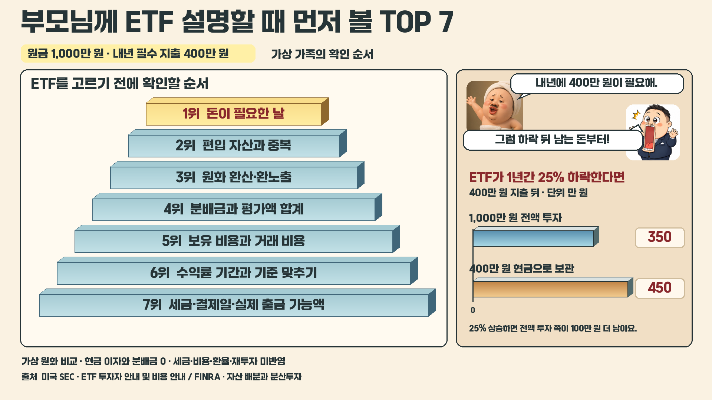

# 부모님께 ETF 설명할 때 먼저 볼 TOP 7, 수익률보다 손에 남는 돈부터

## “은행에서 뺀 천만 원, 이 ETF에 넣어도 되니?”

가상의 천억이는 부모님에게서 ETF 화면을 받았습니다. ‘최근 수익률’ 칸이 크고 분배금 안내도 눈에 띄었습니다. 수건 친구는 화면에 없는 질문을 하나 적습니다. “이 천만 원 중 내년에 꼭 쓸 돈부터 얼마예요?” 답은 400만 원. 투자상품 순위보다 먼저 돈 쓸 날짜와 액수가 필요했습니다. 아래 일곱 항목은 실제 투자수익률 순위가 아니라 이 가정의 결정을 바꾸는 **편집부의 확인 순서**입니다.

## 1위 · 하락했을 때도 지킬 수 있는 약속인가

설명용 가정입니다. 오늘 원화 1,000만 원에서 1년 뒤 꼭 쓸 돈이 400만 원입니다. 주식 ETF는 1년 동안 25% 하락한다고 놓고, 따로 보관한 현금의 이자는 0원으로 둡니다. 세금, 비용, 환율을 빼고 추가 입출금은 1년 뒤 지출 한 번뿐입니다. 분배금과 재투자도 없다고 가정합니다. 실제 수익이나 특정 ETF 전망을 의미하지 않습니다.

전액을 주식 ETF에 넣으면 1년 뒤 평가액은 750만 원. 400만 원을 쓰려면 내려간 가격에 그만큼을 팔고 350만 원이 남습니다. 처음에 400만 원을 현금으로 남기고 나머지 600만 원만 투자했다면 같은 하락 뒤에 투자액이 450만 원 남습니다. 400만 원은 현금에서 지출합니다. 반대로 ETF가 25% 오르는 경로에서는 지출 후 전액 투자에 850만 원, 일부 투자에 750만 원이 남습니다. 지출일에 현금을 따로 두는 선택에는 상승에 덜 참여하는 조건도 함께 붙습니다.

*피라미드는 가상 가족의 확인 순서다. 막대는 1년 동안 25% 하락한 뒤 400만 원을 지출하고 남은 금액이다.*

## 2위 · 이름을 가리고 무엇을 담았는지 본다

천억이는 후보 둘에 붙은 ‘미국’, ‘성장’ 같은 단어를 포스트잇으로 가립니다. 지수 이름과 주요 편입 기업을 보고 나니 같은 국가를 담아도 구성 기업은 다를 수 있었습니다. 주식형인지 채권형인지도 확인합니다. 가령 기업의 이익이 흔들리는 것과 채권 가격이 금리 변화로 흔들리는 것은 서로 다른 경로입니다. 채권 ETF라 해도 지출일에 필요한 원금이 자동으로 맞춰지지는 않습니다.

후보가 둘일 때는 직접 가진 주식까지 합쳐 봅니다. ETF 두 개에 각각 300만 원을 담고 그 안에 X사 비중이 각각 20%와 10%라면 ETF를 통한 노출은 90만 원입니다. X사를 30만 원어치 직접 가졌다면 총 120만 원이 같은 기업의 가격에 반응합니다. 가상 평가액 1,000만 원 전체를 분모로 삼으면 12%입니다. 이 예시는 투자 비중을 찍은 한 시점의 장부입니다. [FINRA · 자산 배분과 분산투자](https://www.finra.org/investors/investing/investing-basics/asset-allocation-diversification)

## 3위 · 원화로 쓸 돈은 원화로 계산한다

미국 달러 가격이 10% 오르고, 같은 기간 1달러를 바꿀 때 받는 원화 금액이 10% 떨어지는 가상 사례를 놓습니다. 환헤지 없는 달러 노출을 원화로 환산하면 1.10과 0.90을 곱해 0.99입니다. 원화 1,000만 원은 비용·세금 없이 990만 원에 해당합니다. 달러에서 플러스였던 수익이 원화에서는 마이너스일 수 있습니다. 한국 거래소에서 원화로 주문하는 상품도 편입 자산이 해외에 있다면 환헤지 정책과 환율 반영 방식을 상품설명서에서 확인합니다. 거래 통화와 경제적으로 노출되는 통화를 별도로 적어 둡니다.

## 4위 · 분배금과 평가액을 한 봉투에 넣어 비교한다

수건 친구가 “매달 받으면 생활비 되겠네”라고 묻습니다. 가령 가상의 펀드 X는 1년 동안 분배금 40만 원을 지급했고 연말 평가액은 940만 원입니다. 같은 1,000만 원으로 시작한 펀드 Y는 지급액이 0원이고 연말 평가액은 1,020만 원이라고 둡니다. 원화이고 분배금은 소비하거나 재투자하지 않고 현금으로 따로 뒀으며 세금과 거래비는 제외합니다. X의 평가액과 현금 합계는 980만 원, Y는 1,020만 원입니다. X의 분배금을 지출 계획에 쓸 경우에는 총액과 별도로 언제 실제로 들어오는지 봅니다. 월지급 일정도 다음 분배액이 같은 금액으로 확정됐다는 뜻으로 읽지 않습니다.

## 5위 · 매년 드는 비용과 주문할 때의 비용을 같이 본다

연 운용비용이 0.30%포인트 차이 나는 두 상품을 예로 듭니다. 원화 1,000만 원을 기준으로 단순 환산하면 차이는 연 3만 원입니다. 한 후보를 매수했다가 같은 시장 상태에서 반대 호가로 즉시 판다는 단순 가정에서 매수 호가가 10,020원, 매도 호가가 9,980원이라면 1주당 차이는 40원입니다. 900주면 3만 6,000원입니다. 첫해 단순 보수 차이보다 주문 가격 차이가 더 큰 예입니다. 실제로는 보유 기간, 체결 가격, 거래량, 중개 수수료가 달라집니다. 비교할 때 NAV와 거래 가격을 혼용하지 않고 공시 총수익률에 이미 반영된 운용비를 다시 빼지 않습니다. [미국 SEC · ETF 비용 안내](https://www.investor.gov/introduction-investing/general-resources/news-alerts/alerts-bulletins/mutual-fund-and-etf-fees-and-expenses-investor-bulletin)

## 6위 · 기간과 수익률의 단위를 맞춘다

‘올해 10%’와 ‘작년 1년간 12%’가 붙어 있는 두 카드가 있습니다. 시작일이 다르면 이 숫자를 그대로 순위표로 만들 수 없습니다. 같은 기간인지 확인한 뒤 가격 상승률과 분배금 재투자를 포함한 총수익률 중 어느 쪽인지 맞춥니다. 2년 누적 플러스 21%는 매년 10%가 같은 속도로 반복됐을 때와 끝이 같은 결과입니다. 21%를 1년의 수익으로 읽거나 단순히 2로 나눠 연율이라고 쓰면 다른 숫자가 됩니다. 거래를 결정하는 데 원문이 필요할 때는 상품설명서에서 추종 지수, NAV 수익과 거래가격 수익의 기준을 찾아 같은 줄에 기록합니다. [미국 SEC · ETF 투자자 안내](https://www.investor.gov/introduction-investing/general-resources/news-alerts/alerts-bulletins/investor-bulletins-24)

## 7위 · 계좌에서 실제로 꺼낼 수 있는 돈을 확인한다

천억이는 비교를 마친 뒤 한 가지를 다시 묻습니다. “출금해야 할 때 이 계좌에서는 어떤 순서로 얼마가 들어와요?” 같은 상품을 갖고 있어도 계약이나 계좌에 따라 매도와 돈을 꺼내는 단계는 다를 수 있습니다. 주문을 넣고 나서 즉시 돈을 보낼 수 있는지, 매매 대금 결제일과 출금 가능일이 언제인지, 수수료와 세금을 뺀 금액은 얼마인지 금융사 화면에서 따로 확인합니다. 계좌의 개인별 세법 조건은 이 가상 순위에 숫자로 적용하지 않았습니다.

**직접 확인하기.** 부모님과 투자 앱을 같이 열었다면 상품을 고르기 전에 종이에 ‘지출일, 꼭 필요한 금액, 그날 출금 가능한 금액’을 한 줄씩 적어 보세요. 설명을 마친 뒤 세 숫자를 부모님이 각자 자신의 말로 한 번 되짚을 수 있으면, 첫 질문을 제대로 확인한 겁니다.

**편집부 Q&A · 모든 사람에게 같은 순서인가요?** 가까운 날짜에 큰 지출이 있는 가상의 가족을 기준으로 정했습니다. 정해진 지출이 없는 장기 비교라면 보유 구조나 운용비의 중요도가 커질 수 있습니다.

**편집부 Q&A · 같은 숫자를 확인했는데 상품 선택이 달라도 되나요?** 두 사람이 같은 상품을 비교해도 쓸 날짜, 견딜 수 있는 손실과 이미 보유한 자산이 다르면 결론이 달라질 수 있습니다.

## 원문

- [미국 SEC · ETF 투자자 안내](https://www.investor.gov/introduction-investing/general-resources/news-alerts/alerts-bulletins/investor-bulletins-24)
- [미국 SEC · ETF 비용 안내](https://www.investor.gov/introduction-investing/general-resources/news-alerts/alerts-bulletins/mutual-fund-and-etf-fees-and-expenses-investor-bulletin)
- [FINRA · 자산 배분과 분산투자](https://www.finra.org/investors/investing/investing-basics/asset-allocation-diversification)
