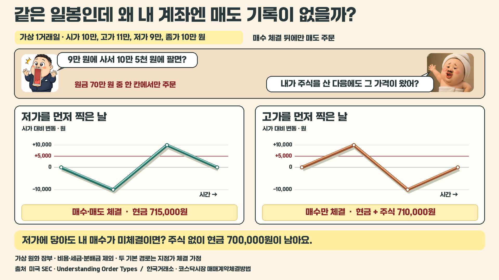

# 일곱 칸 분할매매 백테스트, 같은 일봉인데 왜 내 계좌엔 매도 기록이 없을까?

## 숫자 네 개는 똑같았다

가상의 천억이가 하루짜리 차트를 띄웠습니다. 10만 원에 시작해서 가장 높게는 11만 원, 가장 낮게는 9만 원을 찍고 10만 원에 끝났습니다. “그럼 9만 원에 사서 10만 5천 원에 팔 수 있었겠네?” 수건 친구가 같은 일봉을 한 장 더 인쇄합니다. 두 장의 모양은 같습니다. 그 위에 움직임의 순서를 손으로 그리자 매도 기록이 한 장에서만 나왔습니다.

## 일곱 칸 중 한 칸의 주문을 재생한다

설명용 가상 장부입니다. 원화 70만 원을 일곱 칸에 10만 원씩 적어 둡니다. 처음 보유 수량은 0주입니다. 오늘 관찰하는 한 칸에서는 9만 원짜리 매수 지정가를 먼저 내고 1주가 체결된 후에만 10만 5천 원 매도 지정가를 냅니다. 나머지 여섯 칸의 규칙은 작동하지 않는다고 둡니다. 두 주문이 제출된 뒤 각각 해당 호가에서 상대 물량이 충분해 지정한 가격 그대로 체결된다는 기본 모형입니다. 하루의 원화 평가액을 비교하며 세금, 비용, 현금 이자, 환율, 분배금과 재투자는 제외합니다. 특정 책이나 상품의 실제 전략을 구현한 결과가 아닙니다.

## 첫 번째 장부에서는 저가를 먼저 지나갔다

움직임을 순서대로 읽습니다. 시가 10만 원으로 시작하고 9만 원을 먼저 지나 11만 원까지 올랐다가 10만 원에 마감했습니다. 9만 원에서 매수 1주를 체결합니다. 다음 상승 중 10만 5천 원 매도 주문이 체결됐다고 둡니다. 장이 끝날 때 현금은 71만 5천 원이고 주식은 없습니다. 시가와 종가가 같았어도 장중에 진입과 청산을 마친 가상 장부에는 1만 5천 원이 남았습니다.

## 두 번째 장부에서는 매도 기회가 주문보다 먼저 지나갔다

이번에는 10만 원에서 11만 원을 먼저 찍고 그 뒤 9만 원으로 내렸다가 10만 원에 마감합니다. 11만 원을 찍었을 때는 내 계좌에 주식이 없습니다. 하락 중 9만 원에 매수한 뒤에는 10만 5천 원까지 오르지 않았습니다. 이 장부의 현금은 61만 원이고 10만 원으로 평가되는 1주가 남아 있습니다. 청산하지 않았어도 기말 평가액 합계는 71만 원입니다. 두 장부에서 달라진 것은 고가와 저가가 나타난 순서입니다.

| 가상 경로 | 매수 뒤 10만 5천 원 도달 | 기말 현금 | 기말 보유 평가액 | 합계 |
|---|---|---:|---:|---:|
| 10만 → 9만 → 11만 → 10만 원 | 도달, 체결 가정 | 715,000원 | 0원 | 715,000원 |
| 10만 → 11만 → 9만 → 10만 원 | 미도달 | 610,000원 | 100,000원 | 710,000원 |

*원화 70만 원에서 시작한 두 가상 경로. 같은 시가를 0원 변화로 놓고 장중 순서를 비교했다.*

## 저가에 닿았어도 내 차례가 오지 않을 수 있다

수건 친구는 첫 번째 장부에 세 번째 조건을 붙입니다. 9만 원에서 주식이 거래됐지만 그 가격에 걸린 내 매수 주문은 끝내 체결되지 않았다고 해 봅니다. 지정가는 매수할 때 지불할 가격의 상한, 매도할 때 받을 가격의 하한을 제시하는 방식입니다. 미국 SEC는 지정가 주문에서 체결 자체가 보장되지는 않는다고 설명합니다. 한국거래소의 코스닥시장 매매체결 안내도 접속매매에 가격우선과 시간우선 원칙을 적용합니다. 시장과 세션에 따라 세부 규칙을 확인해야 합니다. 이 미체결 반례에서는 뒤에 11만 원이 보여도 매도 주문을 내는 조건 자체가 성립하지 않아 70만 원 현금만 남습니다. 일봉에 찍힌 저가와 내 주문의 체결 보고서는 다른 자료입니다.

## 계산은 거래비와 평가 방식까지 맞춘다

두 기본 장부에 체결당 2,000원의 가상 비용을 붙입니다. 첫 경로에서는 매수와 매도 두 건을 완료해 4,000원을 냅니다. 기말 71만 1천 원입니다. 두 번째는 매수 한 건만 있어 2,000원을 내므로 현금 60만 8천 원과 주식값 10만 원을 합한 70만 8천 원입니다. 매도하지 않은 주식의 평가액에는 당일 청산 비용을 빼지 않았습니다. 두 번째 장부도 당일 10만 원에 매도할 수 있고 비용을 한 번 더 낸다고 가정하면 청산 직후 현금은 70만 6천 원입니다. 실현 이익과 결제 전 기말 평가액, 거래 이후 실제 남는 현금 중 어떤 값을 비교하는지부터 씁니다.

## 백테스트에서 모르는 순서를 기록한다

천억이는 백테스트 프로그램으로 돌아갑니다. 일봉만 가지고 같은 날 매수와 매도 조건이 모두 충족됐다고 보면, 프로그램이 경로를 어떤 순서로 가정했는지 확인해야 합니다. 같은 날 중간에 가격이 여러 번 오르내리는 경로도 있을 수 있어 두 그림은 가능한 경우를 모두 나열한 것이 아닙니다. 판단이 순서에 따라 뒤집히는 날에는 매수 먼저, 매도 조건 먼저의 가상 결과를 각각 남기고 어느 경우에도 주문이 체결되지 않을 조건을 별도로 적습니다. 더 짧은 분봉을 쓰면 순서를 좁힐 수 있지만 같은 분 안의 순서나 내 주문이 대기열에서 얼마나 앞섰는지는 여전히 확인이 필요합니다. 이미 거래한 경우에는 주문 접수와 체결 시각이 찍힌 기록에서 뭘 알 수 있는지 확인합니다.

## 두 번째 영수증을 그릴 수 있는지 확인한다

처음 차트로 돌아온 천억이는 ‘9만 원인데 왜 못 샀지?’라고 묻던 메모를 바꿉니다. “그 가격에 닿았을 때 내 주문이 유효했나, 그리고 산 다음에 매도 가격이 왔나?” **직접 확인하기.** 분할 전략을 검토 중이라면 하루의 일봉을 고르고 같은 네 가격을 가진 두 순서를 적어 보세요. 각 순서에서 주문이 활성화되는 시간, 매수·매도 체결을 가정한 가격, 기말 현금과 보유 평가액을 한 줄씩 계산합니다. 결과 차이가 크다면 일봉만으로 정산한 손익을 확정하기 전에 주문 자료를 더 확인합니다.

**편집부 Q&A · 하루 동안 목표 가격이 지나갔으면 매도한 걸로 넣어도 되나요?** 매도 주문이 그때 실제로 존재했고 상대 주문과 만날 수 있었는지를 따로 봅니다. 매수 체결 뒤에만 매도를 내는 장부라면 앞서 지나간 고가를 이용할 수 없습니다.

**편집부 Q&A · 1만 5천 원과 1만 원을 둘 다 실현 이익으로 봐도 되나요?** 첫 경로는 가상 매도를 끝냈고 둘째는 종가로 보유 주식을 평가했습니다. 값은 같은 시점에서 비교했지만 보유 상태가 다릅니다.

## 원문

- [미국 SEC · Understanding Order Types](https://www.investor.gov/introduction-investing/general-resources/news-alerts/alerts-bulletins/investor-bulletins-14)
- [한국거래소 · 코스닥시장 매매계약체결방법](https://regulation.krx.co.kr/contents/RGL/03/03020205/RGL03020205.jsp)
